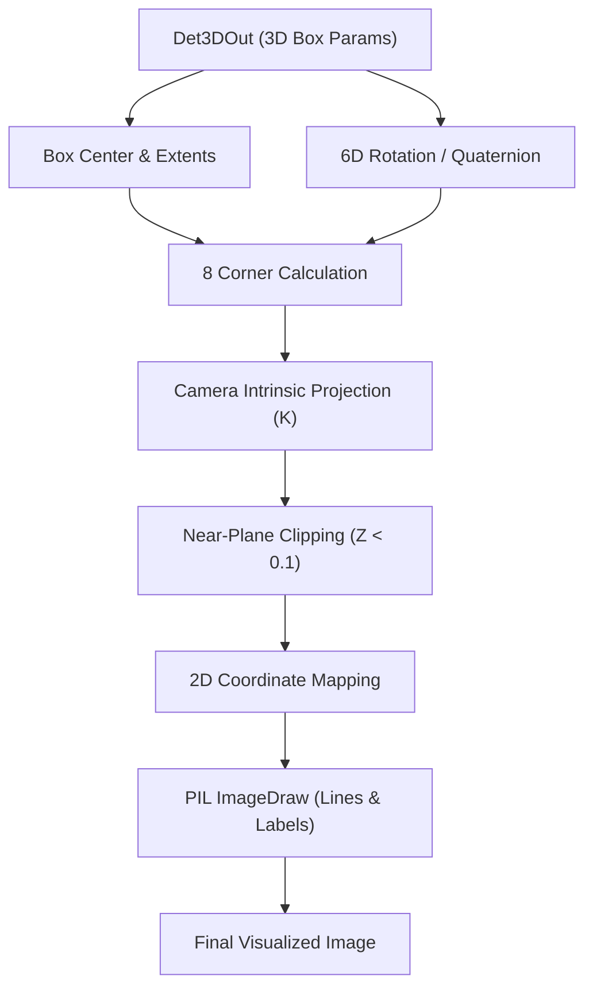
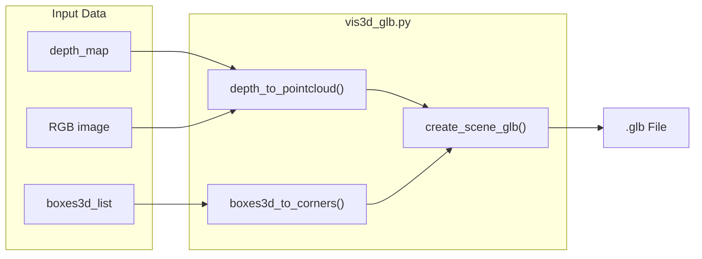

<!-- source: DeepWiki mcp.deepwiki.com · repo allenai/WildDet3D · page 5.2 Visualization Utilities · fetched 2026-10-26 -->

# Visualization Utilities

Relevant source files

The following files were used as context for generating this wiki page:

- [assets/demo_text_indoor.png](assets/demo_text_indoor.png)
- [assets/demo_text_outdoor_cafe.png](assets/demo_text_outdoor_cafe.png)
- [assets/demo_text_street.png](assets/demo_text_street.png)
- [assets/demo_text_urban.png](assets/demo_text_urban.png)
- [demo/huggingface/vis3d_glb.py](demo/huggingface/vis3d_glb.py)

The WildDet3D visualization suite provides high-fidelity 2D and 3D rendering capabilities designed for "in-the-wild" detection scenarios. It includes anti-aliased 3D box projection, custom font rendering for labels, near-plane clipping for robust visualization, and 3D scene export to GLB format for interactive web viewing.

## 2D Visualization Pipeline

The core 2D visualization logic resides in `wilddet3d/vis/visualize.py`. The primary entry point is `draw_3d_boxes()`, which handles the projection of 3D bounding boxes onto 2D image planes while maintaining visual clarity and handling edge cases like near-plane intersections.

### Implementation Details
*   **Anti-Aliasing:** The utility uses `PIL.ImageDraw` for rendering. When drawing box edges, it utilizes line thickness and coordinate rounding to ensure smooth visualization on high-resolution images [wilddet3d/vis/visualize.py:204-220]().
*   **Near-Plane Clipping:** To prevent projection artifacts (where boxes behind the camera or very close to the lens create infinite lines), the system implements a near-plane clipping heuristic. Points with a Z-depth below a threshold (typically 0.1m) are clipped or handled to prevent invalid 2D coordinates [wilddet3d/vis/visualize.py:165-180]().
*   **Manrope Font Rendering:** Labels are rendered using the Manrope font family. The system dynamically scales font size based on the box dimensions to ensure readability across different object scales [wilddet3d/vis/visualize.py:225-240]().
*   **Color Palette:** A distinct color palette is generated based on object categories or instance IDs to ensure high contrast between adjacent detections [wilddet3d/vis/visualize.py:25-50]().

### Data Flow: 3D to 2D Projection
The following diagram illustrates the transformation from predicted 3D box parameters to the final rendered image.

**3D Box Rendering Logic**

Sources: [wilddet3d/vis/visualize.py:150-250](), [wilddet3d/data_types.py:50-70]()

## 3D GLB Export

For interactive 3D visualization (used in the HuggingFace demo), the system converts detections and depth maps into GLB files. This is handled by `demo/huggingface/vis3d_glb.py`.

### Point Cloud Generation
The `depth_to_pointcloud` function unprojects the depth map into a colored 3D point cloud [demo/huggingface/vis3d_glb.py:22-54]().
1.  **Coordinate Conversion:** Converts OpenCV coordinates (x-right, y-down, z-away) to glTF coordinates (x-right, y-up, z-backward) [demo/huggingface/vis3d_glb.py:125-127]().
2.  **Edge Removal:** Implements a "MoGe2-style" edge removal using `utils3d.np.depth_map_edge` to discard points at depth discontinuities, which reduces visual noise [demo/huggingface/vis3d_glb.py:99-102]().
3.  **Subsampling:** To maintain performance in web viewers, the point cloud is subsampled by a factor (default 4) [demo/huggingface/vis3d_glb.py:109-115]().

### 3D Wireframe Boxes
Boxes are converted from their canonical 3D representation to 8 corners in the GLB coordinate system [demo/huggingface/vis3d_glb.py:145-154](). These are rendered as `GL_LINES` within the GLB scene using the `pygltflib` library [demo/huggingface/vis3d_glb.py:19-20]().

**GLB Scene Composition**

Sources: [demo/huggingface/vis3d_glb.py:22-133](), [demo/huggingface/vis3d_glb.py:145-190]()

## Visualization Utility API

| Function | Location | Description |
| :--- | :--- | :--- |
| `draw_3d_boxes` | `wilddet3d/vis/visualize.py` | Projects 3D boxes onto 2D image with labels and anti-aliasing. |
| `depth_to_pointcloud` | `demo/huggingface/vis3d_glb.py` | Unprojects RGB-D data to a colored (N, 3) point cloud. |
| `create_scene_glb` | `demo/huggingface/vis3d_glb.py` | Bundles points, colors, and 3D wireframe boxes into a GLB file. |
| `boxes3d_to_corners` | `demo/huggingface/vis3d_glb.py` | Converts [cx, cy, cz, w, h, l, q] format to 8 corner points. |

### Box Parameter Convention
The visualization utilities expect 3D boxes in the following format:
*   **Translation:** `[cx, cy, cz]` in meters.
*   **Dimensions:** `[w, h, l]` (width, height, length) corresponding to x, y, z axes in the object's local frame.
*   **Rotation:** Quaternions `[qw, qx, qy, qz]` or 6D rotation vectors depending on the pipeline stage [demo/huggingface/vis3d_glb.py:150-165]().

Sources: [wilddet3d/vis/visualize.py:10-50](), [demo/huggingface/vis3d_glb.py:1-16]()

---

