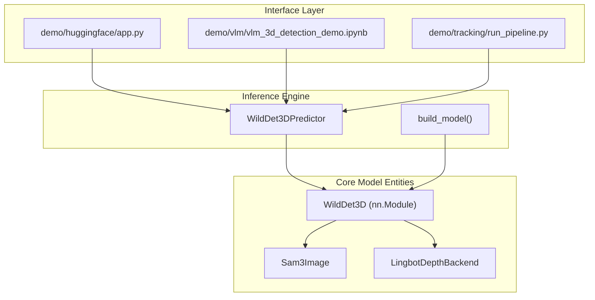
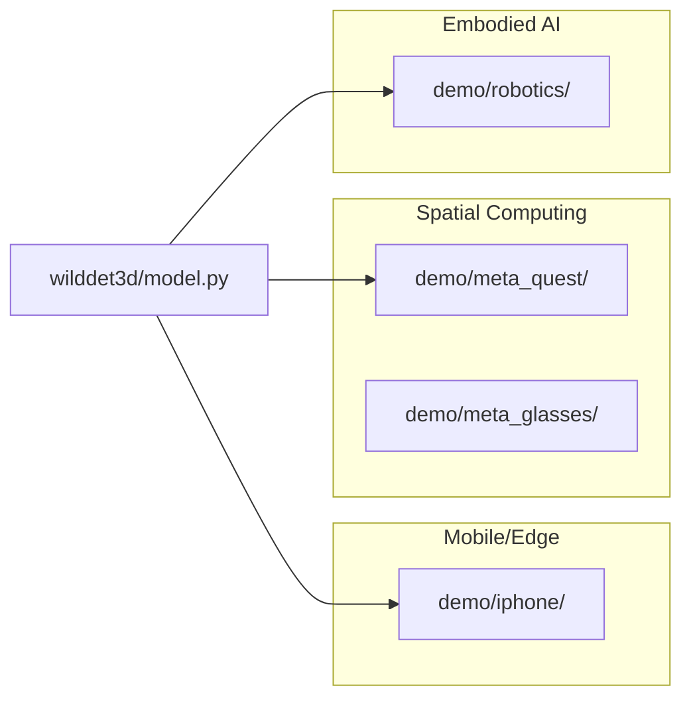

<!-- source: DeepWiki mcp.deepwiki.com · repo allenai/WildDet3D · page 6 Demos & Integrations · fetched 2026-10-26 -->

# Demos & Integrations

Relevant source files

The following files were used as context for generating this wiki page:

- [assets/demo_huggingface.png](assets/demo_huggingface.png)
- [assets/demo_iphone.png](assets/demo_iphone.png)
- [assets/demo_meta_quest.png](assets/demo_meta_quest.png)
- [assets/demo_robotics.png](assets/demo_robotics.png)
- [assets/demo_vlm.png](assets/demo_vlm.png)
- [docs/DEMO.md](docs/DEMO.md)

WildDet3D provides a comprehensive suite of interactive applications and platform integrations designed to showcase its zero-shot 3D detection capabilities. These demos range from high-level web interfaces for rapid testing to specialized deployments for mobile, AR/VR, and robotic systems.

### Demo Architecture Overview

The following diagram illustrates how the various demo interfaces interact with the core `WildDet3D` model and its underlying components.

**System to Code Entity Mapping**

Sources: [wilddet3d/inference.py:12-85](), [wilddet3d/model.py:22-45](), [docs/DEMO.md:3-46]()

---

## HuggingFace Spaces Web Demo
The HuggingFace Spaces demo is the primary interactive entry point for the project. It utilizes a **Gradio** application to support all five prompting modes (Text, Visual, Visual+Label, Geometric, and Geometric+Label). Key features include:
*   **Cross-category NMS**: Post-processing to handle overlapping detections across different semantic prompts.
*   **3D GLB Visualization**: Exporting detected 3D boxes as GLB meshes for interactive inspection in the browser.
*   **Metric Depth**: Visualization of the predicted depth maps from the LingBot-Depth backend.

For details, see [HuggingFace Spaces Web Demo](#6.1).

Sources: [demo/huggingface/app.py:1-150](), [docs/DEMO.md:3-36]()

## 3D Object Tracking Demo
This demo extends WildDet3D into the temporal domain, providing a zero-shot 3D tracking pipeline. It processes video sequences by combining per-frame WildDet3D inference with a **Kalman Filter** for state estimation and smoothing. The pipeline accepts video frames, RLE masks, and camera intrinsics to produce stable 3D trajectories.

For details, see [3D Object Tracking Demo](#6.2).

Sources: [demo/tracking/run_pipeline.py:1-100](), [demo/tracking/kalman_filter.py:1-50]()

## VLM Integration Demo
The VLM (Vision-Language Model) integration demonstrates how to use frontier models like **Qwen2-VL** or **Molmo** as a high-level reasoning front-end. In this workflow, the VLM identifies objects of interest in 2D and generates bounding box or point prompts, which are then passed to WildDet3D to "lift" the detections into metric 3D space.

For details, see [VLM Integration Demo](#6.3).

Sources: [demo/vlm/vlm_3d_detection_demo.ipynb:1-50](), [docs/DEMO.md:46-46]()

## Platform Demos: iPhone, Meta Quest & Robotics
WildDet3D is optimized for deployment across various hardware platforms. This section covers specialized integrations:
*   **iPhone**: Real-time on-device 3D detection utilizing mobile-optimized backends.
*   **Meta Quest**: AR/VR implementation for spatial computing and 3D perception in mixed reality.
*   **Robotics**: Integration for manipulation tasks, providing the 3D spatial awareness necessary for robotic grasping and obstacle avoidance.

For details, see [Platform Demos: iPhone, Meta Quest & Robotics](#6.4).

**Platform Integration Flow**

Sources: [docs/DEMO.md:38-60]()

---

