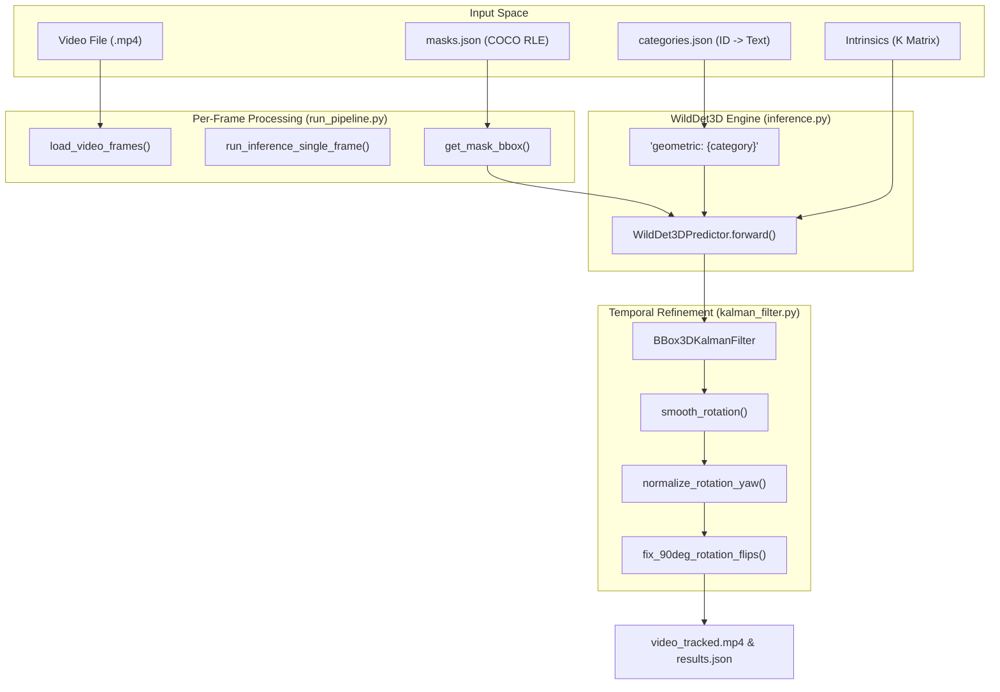
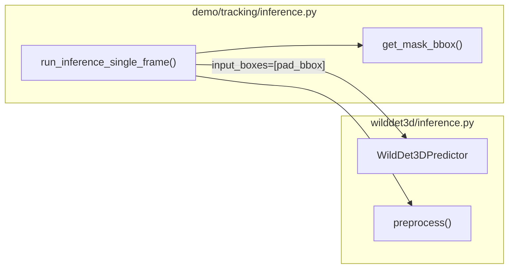
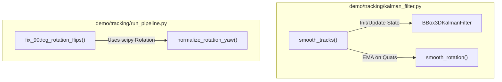

<!-- source: DeepWiki mcp.deepwiki.com · repo allenai/WildDet3D · page 6.2 3D Object Tracking Demo · fetched 2026-10-26 -->

# 3D Object Tracking Demo

Relevant source files

The following files were used as context for generating this wiki page:

- [assets/demo_tracking.gif](assets/demo_tracking.gif)
- [demo/tracking/README.md](demo/tracking/README.md)
- [demo/tracking/__init__.py](demo/tracking/__init__.py)
- [demo/tracking/config.py](demo/tracking/config.py)
- [demo/tracking/inference.py](demo/tracking/inference.py)
- [demo/tracking/kalman_filter.py](demo/tracking/kalman_filter.py)
- [demo/tracking/run_pipeline.py](demo/tracking/run_pipeline.py)
- [demo/tracking/visualization.py](demo/tracking/visualization.py)

The **3D Object Tracking Demo** provides a zero-shot pipeline for tracking any object in a video sequence with temporally smooth 3D bounding boxes. It leverages WildDet3D's open-vocabulary capabilities to perform 3D detection on per-frame object masks, followed by a Kalman filter-based smoothing stage to ensure trajectory stability.

## Pipeline Overview

The tracking pipeline is designed to work without any tracking-specific training. It consumes externally generated object masks (e.g., from SAM2) and uses them as geometric prompts for the WildDet3D model.

### 3D Tracking Data Flow
The following diagram illustrates the data flow from input video and masks to the final smoothed 3D trajectories.

**Tracking Pipeline Logic**

Sources: `[demo/tracking/run_pipeline.py:11-43]()`, `[demo/tracking/README.md:19-43]()`, `[demo/tracking/inference.py:81-105]()`

---

## Per-Frame Inference

The inference stage translates 2D object masks into 3D bounding boxes using the WildDet3D API.

### Key Functions
- **`load_model()`**: Initializes the `WildDet3DPredictor` using `build_model()`. It defaults to using `NMS=True` and a score threshold defined in the config [demo/tracking/inference.py:37-58]().
- **`get_mask_bbox()`**: Converts a COCO RLE mask into a 2D bounding box `[x1, y1, x2, y2]`. It filters out masks smaller than `MIN_MASK_AREA` (default 100 pixels) [demo/tracking/inference.py:61-78]().
- **`run_inference_single_frame()`**: The core loop for per-frame detection. For every visible object in a frame, it:
    1. Scales the 2D mask bbox to the model's internal 1008x1008 resolution [demo/tracking/inference.py:128-146]().
    2. Formats a text prompt as `"geometric: {category}"` [demo/tracking/inference.py:148]().
    3. Calls the model with the transformed box as an `input_boxes` prompt [demo/tracking/inference.py:150-158]().

**Code Entity Association: Inference**

Sources: `[demo/tracking/inference.py:119-158]()`, `[demo/tracking/config.py:25-38]()`

---

## Temporal Smoothing & Refinement

Raw per-frame 3D detections often exhibit jitter. The pipeline applies several filters to produce smooth trajectories.

### Kalman Filter (`BBox3DKalmanFilter`)
The system implements a Constant Velocity (CV) model to smooth the 3D center and dimensions.
- **State Vector**: `[cx, cy, cz, dx, dy, dz, vx, vy, vz]` (9D) representing center position, dimensions, and velocity [demo/tracking/kalman_filter.py:9-12]().
- **Observation**: `[cx, cy, cz, dx, dy, dz]` (6D) provided by WildDet3D [demo/tracking/kalman_filter.py:14]().
- **Noise Parameters**: Controlled via `config.py` (e.g., `KF_PROCESS_NOISE_POS`, `KF_MEASUREMENT_NOISE_DIM`) [demo/tracking/config.py:30-34]().

### Rotation Smoothing
Rotations are handled outside the Kalman filter to avoid complexities with non-linear quaternion dynamics:
- **EMA Smoothing**: `smooth_rotation()` applies Exponential Moving Average (EMA) to the 4-element rotation vector [demo/tracking/kalman_filter.py:124-160]().
- **Yaw Normalization**: `normalize_rotation_yaw()` maps yaw to `[0, pi)` to resolve 180-degree ambiguity in symmetric objects [demo/tracking/run_pipeline.py:37-66]().
- **90-Degree Flip Fix**: `fix_90deg_rotation_flips()` detects near-square objects (width/length ratio > 0.7) and enforces temporal yaw consistency to prevent 90-degree "snapping" between frames [demo/tracking/run_pipeline.py:69-134]().

**Code Entity Association: Smoothing**

Sources: `[demo/tracking/kalman_filter.py:163-205]()`, `[demo/tracking/run_pipeline.py:84-102]()`

---

## Configuration & Usage

### Input Format
The pipeline requires four inputs, typically generated by a combination of a 2D tracker (like SAM2) and a VLM.

| Input | Format | Description |
| :--- | :--- | :--- |
| **Video** | `.mp4`, `.avi` | Source video file. |
| **Masks** | `masks.json` | List of lists containing COCO RLE dicts or `null` per frame/object [demo/tracking/README.md:71-84](). |
| **Categories** | `categories.json` | Mapping of object IDs to text labels (e.g., `{"0": "car"}`) [demo/tracking/README.md:95-101](). |
| **Intrinsics** | `intrinsics.json` | Camera matrix `K` as a 3x3 array or `fx,fy,cx,cy` string [demo/tracking/README.md:112-125](). |

### Visualization
The `visualization.py` module handles the projection of 3D boxes onto the 2D image plane using the `vis4d` library.
- **`compute_corners()`**: Uses `vis4d.op.box.box3d.boxes3d_to_corners` with `AxisMode.OPENCV` [demo/tracking/visualization.py:137-149]().
- **`draw_3d_bbox()`**: Renders a wireframe with a heading indicator and text label [demo/tracking/visualization.py:63-134]().
- **`render_video()`**: Supports side-by-side comparison of raw vs. smoothed tracks [demo/tracking/visualization.py:199-246]().

Sources: `[demo/tracking/config.py:1-38]()`, `[demo/tracking/visualization.py:13-14]()`, `[demo/tracking/README.md:45-55]()`

---

