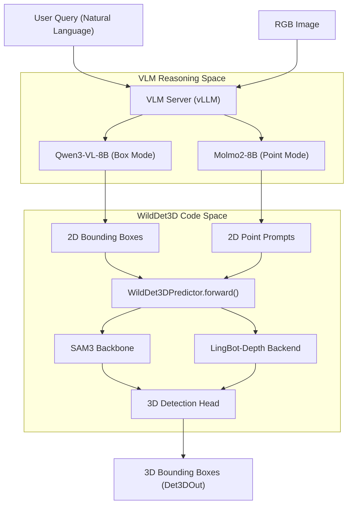
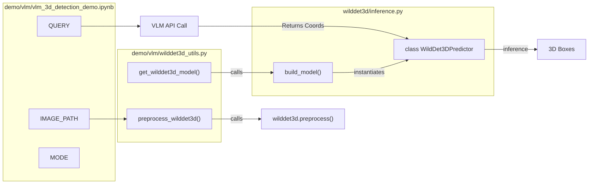

<!-- source: DeepWiki mcp.deepwiki.com · repo allenai/WildDet3D · page 6.3 VLM Integration Demo · fetched 2026-10-26 -->

# VLM Integration Demo

Relevant source files

The following files were used as context for generating this wiki page:

- [assets/demo_vlm.png](assets/demo_vlm.png)
- [demo/vlm/README.md](demo/vlm/README.md)
- [demo/vlm/assets/test_image_1.jpg](demo/vlm/assets/test_image_1.jpg)
- [demo/vlm/assets/test_image_2.jpg](demo/vlm/assets/test_image_2.jpg)
- [demo/vlm/assets/test_image_3.jpg](demo/vlm/assets/test_image_3.jpg)
- [demo/vlm/assets/test_image_4.jpg](demo/vlm/assets/test_image_4.jpg)
- [demo/vlm/requirements.txt](demo/vlm/requirements.txt)
- [demo/vlm/vlm_3d_detection_demo.ipynb](demo/vlm/vlm_3d_detection_demo.ipynb)
- [demo/vlm/wilddet3d_utils.py](demo/vlm/wilddet3d_utils.py)

The VLM Integration Demo showcases how to use modern Vision-Language Models (VLMs) as a high-level reasoning front-end for the WildDet3D detection pipeline. By leveraging the spatial reasoning capabilities of models like **Qwen3-VL** or **Molmo2**, users can perform 3D object detection using natural language queries. The VLM identifies objects of interest and generates 2D spatial prompts (boxes or points), which are then consumed by WildDet3D to produce accurate 3D bounding boxes.

## Overview and Purpose

The demo, located in `demo/vlm/`, provides a bridge between unstructured natural language and the structured geometric requirements of WildDet3D. It allows the system to detect objects that may not be present in standard detection taxonomies by using the VLM as a zero-shot open-vocabulary proposal generator.

### Supported VLM Modes
| Mode | VLM Model | Prompt Type | Mechanism |
| :--- | :--- | :--- | :--- |
| `box` | Qwen3-VL-8B | 2D Bounding Boxes | Tool calling / Coordinate strings |
| `point` | Molmo2-8B | 2D Points | Native pointing/grounding |

Sources: `demo/vlm/README.md:1-19`(), `demo/vlm/vlm_3d_detection_demo.ipynb:16-18`()

---

## System Architecture and Data Flow

The integration operates across two distinct environments to manage conflicting library requirements (e.g., `vllm` vs `vis4d`).

### VLM to WildDet3D Flow
The following diagram illustrates how a natural language query is transformed into a 3D detection.

**Natural Language to 3D Geometry Mapping**

Sources: `demo/vlm/vlm_3d_detection_demo.ipynb:7-23`(), `demo/vlm/README.md:9-18`()

---

## Implementation Details

### VLM Server (vLLM)
The VLM backend is intended to run using `vllm` in a dedicated conda environment. This server provides an OpenAI-compatible API that the demo notebook queries to retrieve spatial coordinates.

*   **Requirements**: `vllm >= 0.15.0`, `transformers >= 4.45.0`, and `qwen-vl-utils`.
*   **Configuration**: The notebook defaults to port `8002` for communicating with the VLM server.

Sources: `demo/vlm/requirements.txt:15-17`(), `demo/vlm/vlm_3d_detection_demo.ipynb:71-75`()

### Helper Utilities (`wilddet3d_utils.py`)
This file acts as a thin wrapper to simplify the initialization and preprocessing steps for the notebook environment.

*   **`get_wilddet3d_model`**: Wraps `wilddet3d.build_model`. It configures the `WildDet3DPredictor` with specific defaults for the demo, such as `use_predicted_intrinsics=True` and `skip_pretrained=True` [demo/vlm/wilddet3d_utils.py:24-55]().
*   **`preprocess_wilddet3d`**: Wraps `wilddet3d.preprocess` to prepare raw numpy images (H, W, 3) for the model, handling resizing and normalization [demo/vlm/wilddet3d_utils.py:58-73]().

### Path Injection
Because the demo resides in a subfolder, `wilddet3d_utils.py` performs manual `sys.path` manipulation to ensure the `wilddet3d` package and its submodules (`third_party/sam3`, `third_party/lingbot_depth`) are discoverable [demo/vlm/wilddet3d_utils.py:16-21]().

---

## Component Interaction Diagram

This diagram maps the notebook variables and utility functions to the core library entities.

**Code Entity Interaction**

Sources: `demo/vlm/wilddet3d_utils.py:24-73`(), `demo/vlm/vlm_3d_detection_demo.ipynb:40-75`()

---

## Setup and Execution

1.  **VLM Environment**: Create the `vllm` environment and install dependencies from `demo/vlm/requirements.txt` [demo/vlm/README.md:22-30]().
2.  **Model Assets**: Ensure the WildDet3D checkpoint is placed at `ckpt/wilddet3d.pt` [demo/vlm/vlm_3d_detection_demo.ipynb:63]().
3.  **Test Images**: The demo includes several test images in `demo/vlm/assets/`:
    *   `test_image_1.jpg`: Sheep in a field (Point mode demo).
    *   `test_image_2.jpg`: City bus (Box mode demo).
    *   `test_image_3.jpg`: Counter-intuitive scene (Box mode demo).
    *   `test_image_4.jpg`: Children (Point mode demo).
4.  **Running**: Activate the `wilddet3d` environment and launch the Jupyter notebook `vlm_3d_detection_demo.ipynb` [demo/vlm/README.md:32-38]().

Sources: `demo/vlm/README.md:20-39`(), `demo/vlm/vlm_3d_detection_demo.ipynb:44-49`()

---

