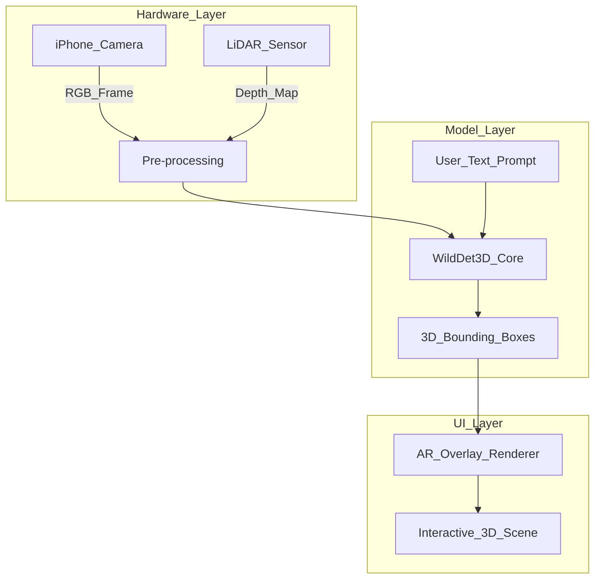
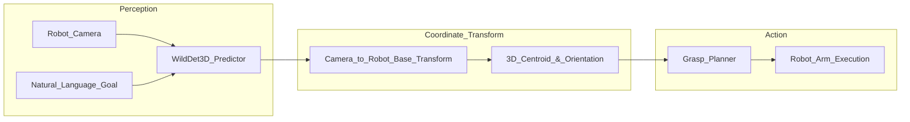

<!-- source: DeepWiki mcp.deepwiki.com · repo allenai/WildDet3D · page 6.4 Platform Demos: iPhone, Meta Quest & Robotics · fetched 2026-10-26 -->

# Platform Demos: iPhone, Meta Quest & Robotics

Relevant source files

The following files were used as context for generating this wiki page:

- [assets/demo_driving_1.gif](assets/demo_driving_1.gif)
- [assets/demo_driving_2.gif](assets/demo_driving_2.gif)
- [assets/demo_iphone.png](assets/demo_iphone.png)
- [assets/demo_meta_quest.gif](assets/demo_meta_quest.gif)
- [assets/demo_meta_quest.mp4](assets/demo_meta_quest.mp4)
- [assets/demo_meta_quest.png](assets/demo_meta_quest.png)
- [assets/demo_oracle_tennis.png](assets/demo_oracle_tennis.png)
- [assets/demo_robotics.gif](assets/demo_robotics.gif)
- [assets/demo_robotics.mp4](assets/demo_robotics.mp4)
- [assets/demo_robotics.png](assets/demo_robotics.png)
- [demo/iphone/README.md](demo/iphone/README.md)
- [demo/meta_quest/README.md](demo/meta_quest/README.md)
- [demo/robotics/README.md](demo/robotics/README.md)

This page documents the platform-specific implementations and deployment targets for WildDet3D. While the core model architecture remains consistent, these demos leverage specialized hardware—such as LiDAR on iPhone, passthrough AR on Meta Quest, and robotic manipulation pipelines—to provide real-time 3D perception in diverse environments.

## 1. iPhone App: On-Device Real-Time Detection

The iPhone application provides a portable, real-time implementation of WildDet3D, utilizing Apple's ARKit and LiDAR sensors for enhanced depth accuracy.

### 1.1 Implementation & Data Flow
The application operates in two primary modes: **Camera Mode** (live streaming) and **Upload Mode** (static photo analysis) `[demo/iphone/README.md:26-27]()`. In Camera Mode, the system fuses RGB frames with LiDAR-derived depth maps to provide high-fidelity inputs to the model.

**Key Features:**
*   **LiDAR Alignment:** Specifically utilizes the LiDAR sensor on iPhone 12 Pro and later for RGBD-enhanced detection `[demo/iphone/README.md:39-40]()`.
*   **Open-Vocabulary Interaction:** Users can input arbitrary text prompts to detect any object category in their immediate 3D environment `[demo/iphone/README.md:30-30]()`.
*   **Interactive 3D UI:** Supports tapping to select detections, viewing physical dimensions, and deleting individual boxes `[demo/iphone/README.md:29-29]()`.

### 1.2 System Architecture
The iPhone demo bridges the PyTorch-based WildDet3D model with iOS-native frameworks.

| Component | Role |
| :--- | :--- |
| **ARKit** | Provides camera pose and LiDAR depth map alignment. |
| **CoreML / Metal** | Handles on-device inference acceleration for the SAM3 backbone. |
| **Text Prompting** | Allows dynamic category definition at runtime. |

**Data Flow: iPhone RGBD Detection**

Sources: `[demo/iphone/README.md:1-40]()`

---

## 2. Meta Quest: AR/VR 3D Detection

The Meta Quest demo extends WildDet3D into immersive spatial computing, allowing users to detect and interact with 3D objects within a Virtual Reality (VR) or Augmented Reality (AR) passthrough environment.

### 2.1 Spatial Perception
The Quest integration focuses on projecting WildDet3D's outputs into the headset's global coordinate system. This enables "World-Locked" 3D boxes that remain stable as the user moves through a physical room.

**Visual Assets:**
*   **Static Overview:** `[assets/demo_meta_quest.png]()`
*   **Video Demo:** `[assets/demo_meta_quest.mp4]()`
*   **Animated Interaction:** `[assets/demo_meta_quest.gif]()`

**Implementation Goals:**
*   **Passthrough Integration:** Using the headset's cameras to perform 3D detection on the real world.
*   **Latency Optimization:** Ensuring the detection pipeline is fast enough to avoid motion sickness in VR.

Sources: `[demo/meta_quest/README.md:1-6]()`, `[assets/demo_meta_quest.png]()`, `[assets/demo_meta_quest.mp4]()`

---

## 3. Robotics: Manipulation Perception

The Robotics demo showcases WildDet3D as a perception front-end for robotic arms and autonomous agents. By providing accurate 3D bounding boxes and physical dimensions for novel objects, it enables zero-shot grasping and manipulation.

### 3.1 Manipulation Pipeline
In a typical robotics workflow, WildDet3D receives a request for an object (e.g., "pick up the blue screwdriver"). The model identifies the object's 3D centroid, orientation, and dimensions, which are then passed to a motion planner.

**Perception-to-Action Flow**

**Visual Documentation:**
*   **Robotics Overview:** `[assets/demo_robotics.png]()`
*   **Robotics Execution GIF:** `[assets/demo_robotics.gif]()`
*   **Full Manipulation Video:** `[assets/demo_robotics.mp4]()`

Sources: `[demo/robotics/README.md:1-3]()`, `[assets/demo_robotics.png]()`, `[assets/demo_robotics.mp4]()`

---

## 4. Platform Asset Summary

The following assets demonstrate the cross-platform capabilities of the WildDet3D model:

| Platform | Asset Type | File Path |
| :--- | :--- | :--- |
| **iPhone** | Static Image | `[assets/demo_iphone.png]()` |
| **Meta Quest** | GIF / MP4 | `[assets/demo_meta_quest.gif]()`, `[assets/demo_meta_quest.mp4]()` |
| **Robotics** | GIF / MP4 | `[assets/demo_robotics.gif]()`, `[assets/demo_robotics.mp4]()` |
| **Driving** | GIF | `[assets/demo_driving_1.gif]()`, `[assets/demo_driving_2.gif]()` |
| **General** | Oracle View | `[assets/demo_oracle_tennis.png]()` |

Sources: `[assets/demo_iphone.png]()`, `[assets/demo_meta_quest.mp4]()`, `[assets/demo_robotics.mp4]()`, `[assets/demo_driving_1.gif]()`

---

