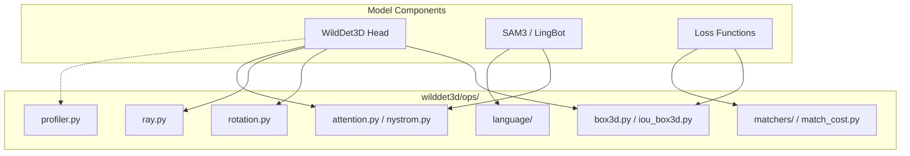

<!-- source: DeepWiki mcp.deepwiki.com · repo allenai/WildDet3D · page 7 Operations & Utilities · fetched 2026-10-26 -->

# Operations & Utilities

<details>
<summary>Relevant source files</summary>

The following files were used as context for generating this wiki page:

- [wilddet3d/__init__.py](wilddet3d/__init__.py)

</details>


The `wilddet3d/ops/` directory serves as the foundational utility library for the WildDet3D project. It contains highly optimized implementations for 3D geometric transformations, attention mechanisms, matching algorithms for set prediction, and language processing utilities. These operations are used across the model's backbones, 3D heads, and loss functions to ensure efficient and accurate monocular 3D detection.

The library is organized into specialized modules that handle the mathematical and computational heavy lifting of the pipeline, ranging from low-level CUDA-accelerated IoU calculations to high-level text encoding and profiling tools.

### System Architecture: Operations & Utilities

The following diagram illustrates how the various utility modules in `wilddet3d/ops/` support the core components of the WildDet3D architecture.

**Operations Utility Mapping**

Sources: [wilddet3d/__init__.py:1-29]()

---

### 3D Geometry Operations

The geometry utilities provide the mathematical backbone for handling 3D bounding boxes and camera projections. This includes specialized logic for 6D rotation representations, spherical harmonics, and ray generation for depth estimation.

*   **Box & IoU Calculations**: Implements 3D Intersection-over-Union (IoU) logic. It leverages `vis4d_cuda_ops` for high-performance calculations and includes robust checks for coplanar or non-zero volume boxes in `iou_box3d.py`.
*   **Rotational Logic**: Found in `rotation.py`, this module handles 6D rotation encodings used in the 3D head and computes relative SO3 angles for evaluation.
*   **Ray & Spherical Harmonics**: `ray.py` manages camera ray generation and includes implementations for spherical harmonics (e.g., `rsh_cart_8`) used in geometric feature extraction.
*   **2D Box Conversions**: `box2d.py` provides standardized conversions between various 2D box formats (XYXY, XYWH) required by the SAM3 backbone.

For technical details on implementation and mathematical formulations, see **[3D Geometry Operations (#7.1)]**.

---

### Attention, Matchers & Language Ops

This suite of utilities manages the interaction between visual features and textual/geometric prompts, as well as the optimization of the set-based prediction task.

*   **Efficient Attention**: Implements Nystrom-based attention in `attention.py` and `nystrom.py` to allow for long-range dependencies with reduced computational complexity compared to standard self-attention.
*   **Set Matching**: The `matchers/` directory and `match_cost.py` define the Hungarian matching cost functions. These are critical for the `BinaryHungarianMatcherV2` used during training to assign predicted boxes to ground truth labels.
*   **Language Processing**: `ops/language/` contains utilities for tokenization and text encoding, ensuring that textual prompts are correctly embedded for the open-vocabulary detection task.
*   **Profiling & Upsampling**: Includes `profiler.py` for CUDA-level timing and performance bottleneck identification, and `upsample.py` for feature map resolution management.

For details on the matching algorithms and attention implementations, see **[Attention, Matchers & Language Ops (#7.2)]**.

---

### Utility Integration in Code Space

The following diagram maps specific code entities within the `ops` directory to their functional roles in the detection pipeline.

**Code Entity Mapping: Utilities to Function**
```mermaid
graph LR
    subgraph "Geometric Logic"
        direction TB
        "rotation_6d_to_matrix"["rotation.py: rotation_6d_to_matrix"]
        "box3d_iou"["box3d.py: box3d_iou"]
        "rsh_cart_8"["ray.py: rsh_cart_8"]
    end

    subgraph "Matching & Attention"
        direction TB
        "NystromAttention"["nystrom.py: NystromAttention"]
        "BipartiteMatcher"["matchers/hungarian_matcher.py"]
        "FocalLossCost"["match_cost.py: FocalLossCost"]
    end

    subgraph "Language & System"
        direction TB
        "TextEncoder"["language/text_encoder.py"]
        "SimpleProfiler"["profiler.py: SimpleProfiler"]
    end

    "Geometric Logic" --> "3D Head Prediction"
    "Matching & Attention" --> "Loss Calculation"
    "Language & System" --> "Prompt Encoding"
```
Sources: [wilddet3d/__init__.py:1-29]()

---

