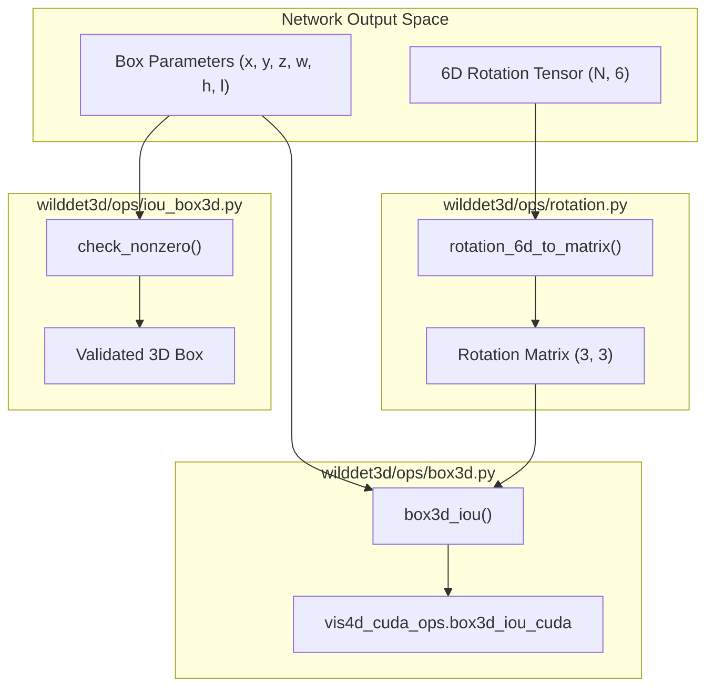
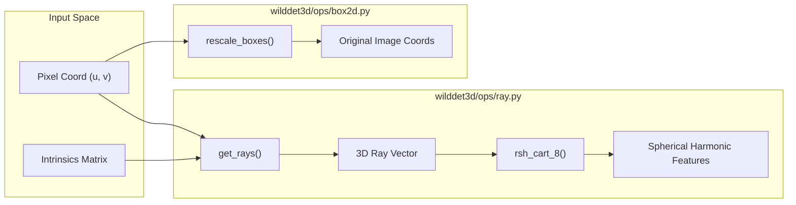

<!-- source: DeepWiki mcp.deepwiki.com · repo allenai/WildDet3D · page 7.1 3D Geometry Operations · fetched 2026-10-26 -->

# 3D Geometry Operations

Relevant source files

The following files were used as context for generating this wiki page:

- [wilddet3d/__init__.py](wilddet3d/__init__.py)
- [wilddet3d/connector.py](wilddet3d/connector.py)

This page documents the geometric utility library within `wilddet3d/ops`. These modules handle 3D bounding box calculations, rotation representations, ray generation for spherical harmonics, and 2D box format conversions. A primary component of the 3D operations is the integration with `vis4d_cuda_ops` for high-performance 3D Intersection over Union (IoU) computation.

## 3D Bounding Box Operations

The codebase provides two primary files for 3D box logic: `wilddet3d/ops/box3d.py` for high-performance IoU and `wilddet3d/ops/iou_box3d.py` for geometric validation.

### 3D Intersection over Union (IoU)
The `box3d_iou` function [wilddet3d/ops/box3d.py:11-34]() computes the IoU between two sets of 3D boxes. It leverages `vis4d_cuda_ops` to perform the heavy lifting of calculating the intersection volume of oriented 3D boxes.

- **Input Format**: Boxes are expected in `(N, 7)` or `(N, 9)` format, where the first 7 columns represent `[x, y, z, w, h, l, ry]` (center coordinates, dimensions, and yaw rotation) [wilddet3d/ops/box3d.py:14-16]().
- **Implementation**: The function checks if the input tensors are on a CUDA device. If so, it calls `vis4d_cuda_ops.box3d_iou_cuda`; otherwise, it raises a `NotImplementedError` as CPU-based oriented 3D IoU is not supported in this module [wilddet3d/ops/box3d.py:28-32]().

### Geometric Validation
The module `wilddet3d/ops/iou_box3d.py` contains utility functions to ensure boxes are mathematically valid before processing:
- **`check_coplanar`**: Validates if the vertices of the box faces lie on the same plane [wilddet3d/ops/iou_box3d.py:10-25]().
- **`check_nonzero`**: Ensures that the 3D box has a non-zero volume by checking that all dimensions (width, height, length) are greater than zero [wilddet3d/ops/iou_box3d.py:28-38]().

**Sources:**
- [wilddet3d/ops/box3d.py:11-34]()
- [wilddet3d/ops/iou_box3d.py:10-38]()

---

## Rotation Representations

WildDet3D uses a 6D representation for 3D rotations to avoid discontinuities associated with Euler angles or quaternions during neural network training. This logic is housed in `wilddet3d/ops/rotation.py`.

### 6D Rotation Encoding
The 6D representation is defined by two 3D vectors (the first two columns of a rotation matrix). The third column is recovered via a cross product to ensure orthonormality.

| Function | Purpose |
| :--- | :--- |
| `rotation_6d_to_matrix` | Converts a `(N, 6)` tensor into a `(N, 3, 3)` rotation matrix using Gram-Schmidt orthogonalization [wilddet3d/ops/rotation.py:34-58](). |
| `matrix_to_rotation_6d` | Extracts the first two columns of a rotation matrix to create a 6D representation [wilddet3d/ops/rotation.py:61-71](). |

### Relative Angle Calculation
The function `so3_relative_angle` [wilddet3d/ops/rotation.py:74-95]() computes the geodesic distance between two rotation matrices. It calculates the trace of $R_1 R_2^T$ to determine the angle of rotation required to align the two frames, which is frequently used in 3D evaluation metrics.

**Sources:**
- [wilddet3d/ops/rotation.py:34-95]()

---

## Ray Generation & Spherical Harmonics

The `wilddet3d/ops/ray.py` module provides utilities for mapping 2D image coordinates to 3D rays and encoding spatial information using spherical harmonics.

### Ray Casting
The `get_rays` function [wilddet3d/ops/ray.py:10-35]() generates 3D rays from pixel coordinates using camera intrinsics.
1. It takes pixel coordinates $(u, v)$ and the intrinsic matrix $K$.
2. It applies the inverse of $K$ to transform pixels into camera-space directions.
3. The resulting rays are normalized to unit length.

### Spherical Harmonics (RSH)
The function `rsh_cart_8` [wilddet3d/ops/ray.py:38-75]() implements Real Spherical Harmonics up to the 8th degree. This is used to encode the viewing direction or ray orientation into a high-dimensional feature vector, which helps the model reason about the geometric relationship between the camera and the object.

**Sources:**
- [wilddet3d/ops/ray.py:10-75]()

---

## 2D Box Conversions

The `wilddet3d/ops/box2d.py` module manages standard 2D bounding box transformations.

### Format Conversions
The system frequently switches between different 2D formats:
- **`xyxy_to_xywh`**: Converts `[xmin, ymin, xmax, ymax]` to `[xmin, ymin, width, height]` [wilddet3d/ops/box2d.py:10-22]().
- **`xywh_to_xyxy`**: The inverse operation, converting center-width-height or top-left-width-height to corner coordinates [wilddet3d/ops/box2d.py:25-37]().

### Coordinate Scaling
The `rescale_boxes` function [wilddet3d/ops/box2d.py:40-55]() scales 2D boxes based on image resizing factors. This is critical when the model performs inference on a fixed resolution (e.g., 1008x1008) but needs to report detections in the original image's coordinate system.

**Sources:**
- [wilddet3d/ops/box2d.py:10-55]()

---

## System Mapping: Geometry Data Flow

The following diagrams illustrate how natural language geometric concepts map to the specific functions and data structures in the `wilddet3d/ops` library.

### 3D Box & Rotation Flow
This diagram shows how raw network outputs (6D rotations and box parameters) are transformed into valid 3D geometries.

Title: Geometry Transformation Pipeline

**Sources:**
- [wilddet3d/ops/rotation.py:34-58]()
- [wilddet3d/ops/box3d.py:11-34]()
- [wilddet3d/ops/iou_box3d.py:28-38]()

### Ray and Coordinate Mapping
This diagram maps the process of converting 2D pixel prompts into 3D spatial features.

Title: Ray Generation and Feature Encoding

**Sources:**
- [wilddet3d/ops/ray.py:10-75]()
- [wilddet3d/ops/box2d.py:40-55]()

---

