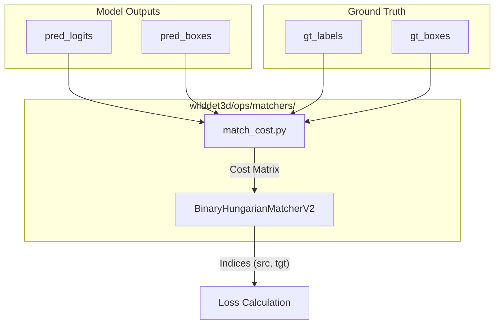
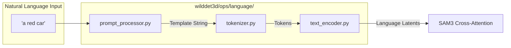

<!-- source: DeepWiki mcp.deepwiki.com · repo allenai/WildDet3D · page 7.2 Attention, Matchers & Language Ops · fetched 2026-10-26 -->

# Attention, Matchers & Language Ops

Relevant source files

The following files were used as context for generating this wiki page:

- [wilddet3d/__init__.py](wilddet3d/__init__.py)

This page documents the core utility operations within the `wilddet3d/ops/` directory. These modules provide the mathematical and architectural foundations for the model's transformer layers, the bipartite matching used during training, and the text encoding utilities required for open-vocabulary detection.

## Purpose and Scope

The `ops` library contains performance-critical implementations and standardized building blocks used across the SAM3 backbone and the 3D detection head:
*   **Attention Mechanisms**: Efficient transformer attention variants (Nystrom).
*   **Matchers**: Hungarian matching logic for bipartite assignment between predictions and ground truth.
*   **Language Ops**: Utilities for CLIP-based text encoding and prompt formatting.
*   **General Layers**: Standardized MLP architectures and upsampling modules.
*   **Profiling**: Helpers for CUDA synchronization and execution timing.

---

## Transformer & Attention Operations

WildDet3D utilizes Nystrom attention to reduce the computational complexity of the transformer layers, particularly when processing high-resolution feature maps.

### Nystrom Attention
The `NystromAttention` class implements the Nystrom method to approximate the standard softmax attention. It reduces the $O(n^2)$ complexity to $O(n)$ by sampling landmark points.

*   **Implementation**: `NystromAttention` [wilddet3d/ops/nystrom.py:10-104]().
*   **Iterative Reconstruction**: Uses the `IterativeInv` class [wilddet3d/ops/nystrom.py:107-133]() to compute the pseudo-inverse of the landmark matrix using the Schulz algorithm, ensuring numerical stability without explicit matrix inversion.
*   **Integration**: Wrapped in `NystromBlock` [wilddet3d/ops/attention.py:10-44]() which provides a standard residual block structure with LayerNorm and MLP.

### Multi-Head Attention Wrapper
The `MultiheadAttention` class in `wilddet3d/ops/attention.py` [wilddet3d/ops/attention.py:47-111]() provides a flexible wrapper around PyTorch's native `MultiheadAttention`, adding support for custom output projections and dropout configurations.

### MLP (Multi-Layer Perceptron)
The `MLP` class [wilddet3d/ops/mlp.py:7-40]() is a standard configurable feed-forward network used as the "FFN" component in transformer blocks. It supports variable hidden layers and different activation functions (defaulting to ReLU).

Sources: [wilddet3d/ops/nystrom.py:10-133](), [wilddet3d/ops/attention.py:10-111](), [wilddet3d/ops/mlp.py:7-40]().

---

## Bipartite Matchers & Cost Functions

WildDet3D uses Hungarian matching to associate predicted queries with ground truth objects during training. This is handled by a suite of cost functions and a central matcher class.

### Matching Cost Calculation
The system calculates a weighted sum of different costs to form the assignment matrix:
1.  **Classification Cost**: Focal loss or cross-entropy based costs [wilddet3d/ops/match_cost.py:10-72]().
2.  **BBox L1 Cost**: Geometric distance between 2D box coordinates [wilddet3d/ops/match_cost.py:75-108]().
3.  **GIoU Cost**: Generalized Intersection over Union for 2D boxes [wilddet3d/ops/match_cost.py:111-143]().

### Hungarian Matcher
The `BinaryHungarianMatcherV2` [wilddet3d/ops/matchers/hungarian_matcher.py:12-104]() performs the actual assignment. It constructs a cost matrix using the components above and solves the linear sum assignment problem using `scipy.optimize.linear_sum_assignment`.

| Cost Component | Code Entity | Role |
| :--- | :--- | :--- |
| **Classification** | `FocalLossCost` | Penalizes incorrect category predictions |
| **L1 Regression** | `BBoxL1Cost` | Penalizes 2D box center/size offset |
| **Overlap** | `IoUCost` | Penalizes low GIoU between predicted/GT boxes |

### Logic Flow: Matching Process
The diagram below illustrates how the matchers interact with the model outputs to produce indices for loss calculation.

**Matcher Data Flow**

Sources: [wilddet3d/ops/match_cost.py:10-143](), [wilddet3d/ops/matchers/hungarian_matcher.py:12-104]().

---

## Language Operations

The `wilddet3d/ops/language/` directory contains utilities for processing text prompts into embeddings compatible with the CLIP-based vision-language alignment.

### Text Encoding Utilities
*   **`tokenize`**: A wrapper for the CLIP tokenizer [wilddet3d/ops/language/tokenizer.py:10-25]().
*   **`CLIPTextEncoder`**: A module that encapsulates the CLIP text transformer to produce fixed-length feature vectors from string prompts [wilddet3d/ops/language/text_encoder.py:15-60]().

### Prompt Formatting
The system uses standardized templates to convert raw category names (e.g., "chair") into natural language sentences (e.g., "a photo of a chair"). This is managed by the `PromptProcessor` [wilddet3d/ops/language/prompt_processor.py:12-45](), which ensures consistency between training and inference.

**Language Space to Code Mapping**

Sources: [wilddet3d/ops/language/tokenizer.py:10-25](), [wilddet3d/ops/language/text_encoder.py:15-60](), [wilddet3d/ops/language/prompt_processor.py:12-45]().

---

## Miscellaneous Utilities

### Upsampling
The `Upsample` module [wilddet3d/ops/upsample.py:8-35]() provides a unified interface for bilinear or nearest-neighbor interpolation, often used when merging multi-scale features or upsampling depth maps to the original image resolution.

### CUDA Profiler
The `CudaProfiler` [wilddet3d/ops/profiler.py:10-55]() is a helper class used for benchmarking specific code blocks. It handles:
*   `torch.cuda.synchronize()` calls to ensure accurate timing.
*   A context manager interface (`with CudaProfiler("name"):`) for easy instrumentation.
*   Logging of mean/max execution times across multiple iterations.

### Path Injection
The repository uses a specific pattern in `wilddet3d/__init__.py` [wilddet3d/__init__.py:6-14]() to ensure that third-party submodules (`sam3` and `lingbot_depth`) are available to the internal `ops` by modifying `sys.path` at runtime.

Sources: [wilddet3d/ops/upsample.py:8-35](), [wilddet3d/ops/profiler.py:10-55](), [wilddet3d/__init__.py:6-14]().

---

