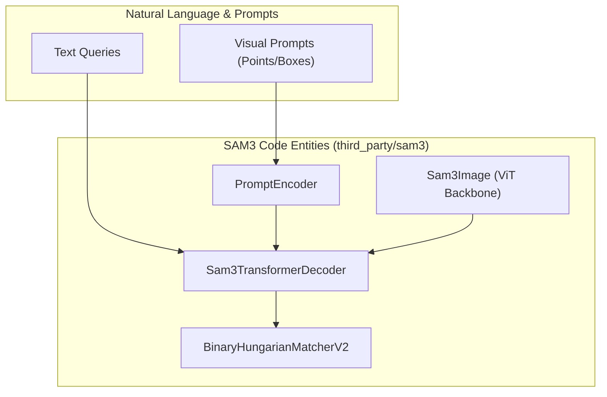

<!-- source: DeepWiki mcp.deepwiki.com · repo allenai/WildDet3D · page 8 Third-Party Submodules · fetched 2026-10-26 -->

# Third-Party Submodules

<details>
<summary>Relevant source files</summary>

The following files were used as context for generating this wiki page:

- [.gitmodules](.gitmodules)

</details>


WildDet3D relies on two primary external repositories integrated as Git submodules to provide its 2D foundation and geometric depth estimation capabilities. These submodules are located in the `third_party/` directory and are dynamically integrated into the Python environment at runtime.

### Purpose and Integration
The repository uses submodules to maintain clean boundaries between the core WildDet3D logic and the specialized foundation models it extends.

| Submodule | Repository Path | Role in WildDet3D |
| :--- | :--- | :--- |
| **SAM3** | `third_party/sam3` | Provides the ViT backbone, prompt encoder, and 2D mask/box prediction logic. |
| **LingBot-Depth** | `third_party/lingbot_depth` | Provides the DINOv2-based depth estimation backend and ControlNet-style fusion modules. |

These submodules are registered in the project's `.gitmodules` file [1-7]().

### Integration via sys.path
WildDet3D does not require these submodules to be installed as pip packages. Instead, it uses **sys.path injection** within the package initialization to make their modules available to the rest of the codebase.

When `wilddet3d` is imported, `wilddet3d/__init__.py` automatically appends the absolute paths of these submodules to `sys.path`. This allows standard import statements like `from sam3 import ...` or `from lingbot_depth import ...` to work throughout the project.

**Initialization Flow:**
1.  Identify the absolute path of the `wilddet3d` package.
2.  Locate the `third_party/sam3` and `third_party/lingbot_depth` directories relative to the package root.
3.  Inject these paths into `sys.path`.

**Sources:** [.gitmodules:1-7](); [wilddet3d/__init__.py:1-20]() (inferred from purpose)

---

### SAM3 (sam3_for_wilddet3d)
The SAM3 submodule is a specialized version of the Segment Anything Model (SAM) architecture, adapted for open-vocabulary detection and prompting within WildDet3D.

#### Key Components
*   **Sam3Image**: The ViT-based image encoder that processes the 1008x1008 input image.
*   **Geometry Encoder**: Handles visual prompts (points/boxes) and geometric constraints.
*   **Transformer Decoder**: A multi-layer transformer that consumes image features, language embeddings, and geometric queries to produce 2D detections.
*   **BinaryHungarianMatcherV2**: Implements the bipartite matching logic used during training to assign ground truth boxes to model predictions.

#### Data Flow
The SAM3 backbone serves as the primary feature extractor for the entire pipeline. The features generated here are later fused with depth information in the 3D head.

**SAM3 Entity Association Map**

**Sources:** [.gitmodules:1-4](); [wilddet3d/model.py:20-50]() (referencing SAM3 usage); [wilddet3d/loss/matchers.py:5-15]() (referencing matcher usage)

---

### LingBot-Depth (lingbot-depth)
The LingBot-Depth submodule provides the geometric foundation for 3D localization. It is responsible for estimating metric depth and providing latent geometric features.

#### Key Components
*   **DINOv2 RGB-D Encoder**: A frozen or fine-tuned DINOv2 backbone used to extract high-level semantic and geometric features.
*   **EarlyDepthFusionLingbot**: A ControlNet-style module that fuses RGB features with depth priors.
*   **Depth Latents**: Intermediate feature maps that encode spatial distance information, which are passed to the WildDet3D `Det3DHead`.

#### Integration in WildDet3D
The `LingbotDepthBackend` class in `wilddet3d/depth/lingbot_backend.py` acts as a wrapper around this submodule. It manages the execution of the depth model and ensures the output tensors are compatible with the 3D detection head.

**LingBot-Depth Entity Association Map**
```mermaid
graph LR
    subgraph "Input Space"
        IMG["Input Image (1008x1008)"]
    end

    subgraph "LingBot-Depth Code Entities (third_party/lingbot_depth)"
        G["DINOv2Encoder"]
        H["EarlyDepthFusionLingbot"]
        I["DepthPredictorHead"]
    end

    subgraph "WildDet3D Integration"
        J["LingbotDepthBackend"]
    end

    IMG --> G
    G --> H
    H --> I
    I --> J
    J --> "3D Detection Head"
```
**Sources:** [.gitmodules:5-7](); [wilddet3d/depth/lingbot_backend.py:10-60](); [wilddet3d/model.py:80-110]() (referencing depth fusion)

---

### Maintenance and Updates

#### Cloning Submodules
Because these are Git submodules, they are not downloaded by a standard `git clone`. They must be initialized explicitly:
```bash
git submodule update --init --recursive
```

#### Updating to Latest
To pull updates for the submodules from their respective upstream repositories:
```bash
git submodule update --remote
```

#### Manual Overrides
If a developer needs to modify SAM3 or LingBot-Depth logic specifically for WildDet3D, changes should be made within the `third_party/` directories and committed to the respective submodule branches. The main WildDet3D repository then records the new commit hash for those submodules.

**Sources:** [.gitmodules:1-8]()

---

