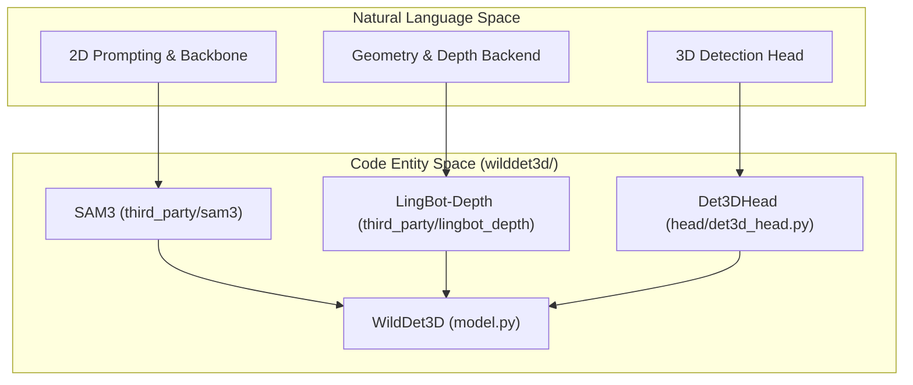
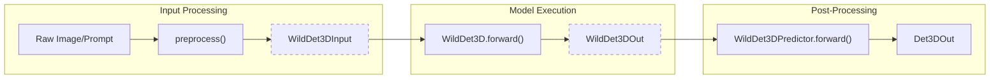

<!-- source: DeepWiki mcp.deepwiki.com · repo allenai/WildDet3D · page 9 Glossary · fetched 2026-10-26 -->

# Glossary

Relevant source files

The following files were used as context for generating this wiki page:

- [README.md](README.md)
- [assets/model_architecture.png](assets/model_architecture.png)
- [data/in_the_wild/annotations/InTheWild_v3_val.json](data/in_the_wild/annotations/InTheWild_v3_val.json)
- [docs/EVALUATION.md](docs/EVALUATION.md)
- [docs/INFERENCE.md](docs/INFERENCE.md)
- [wilddet3d/__init__.py](wilddet3d/__init__.py)
- [wilddet3d/connector.py](wilddet3d/connector.py)
- [wilddet3d/data/datasets/coco3d.py](wilddet3d/data/datasets/coco3d.py)

This page defines codebase-specific terms, abbreviations, and domain concepts used throughout WildDet3D. It provides technical implementation details and maps conceptual terms to their respective code entities.

## Core Concepts & Terminology

### Prompting Modes
WildDet3D operates in a promptable paradigm, where the model's behavior is dictated by the `prompt_text` and input geometry (boxes or points).

| Term | Implementation | Description |
|---|---|---|
| **Text Prompt** | `input_texts` | Open-vocabulary detection where the model identifies all instances matching the provided category strings. [docs/INFERENCE.md:61-75]() |
| **Visual Prompt** | `prompt_text="visual"` | One-to-many matching. Uses a provided 2D box/point as a visual exemplar to find all similar objects in the scene. [docs/INFERENCE.md:77-92]() |
| **Geometric Prompt** | `prompt_text="geometric"` | One-to-one lifting. Specifically converts a provided 2D prompt (box or point) into a 3D bounding box without searching for other instances. [docs/INFERENCE.md:106-116]() |
| **Hybrid Prompt** | `prompt_text="visual: <label>"` | Combines visual similarity with category constraints (e.g., "visual: car"). [docs/INFERENCE.md:11-13]() |

### Geometry & 3D Representation
*   **6D Rotation Encoding**: Instead of quaternions or Euler angles, WildDet3D uses a continuous 6D representation for 3D box orientation to facilitate smoother network convergence. [wilddet3d/data_types.py:147-147]()
*   **Predicted Intrinsics**: For "in-the-wild" images where camera parameters are unknown, the model predicts the camera intrinsic matrix $K$. [docs/INFERENCE.md:154-164]()
*   **Metric Depth**: The absolute distance from the camera in meters, predicted by the LingBot-Depth backend. [wilddet3d/data_types.py:152-152]()

---

## Code Entity Mapping: Natural Language to Implementation

The following diagrams bridge the gap between high-level system concepts and the specific classes/files that implement them.

### System Component Association
This diagram shows how the conceptual "Backends" and "Heads" map to the internal `WildDet3D` structure.

**Sources:** [wilddet3d/model.py:1-25](), [wilddet3d/__init__.py:7-14]()

### Data Flow & Type Mapping
This diagram tracks how a raw image and prompt are transformed into structured outputs through specific code entities.

**Sources:** [wilddet3d/data_types.py:1-30](), [wilddet3d/preprocessing.py:1-20](), [wilddet3d/inference.py:17-30]()

---

## Detailed Definitions

### SAM3 (Segment Anything Model 3)
The primary 2D backbone and prompt encoder. It processes the image and geometry prompts (points/boxes) to produce 2D detections and visual features.
*   **Implementation**: Integrated via `third_party/sam3`. [wilddet3d/__init__.py:8-12]()
*   **Role**: Handles the "Detection" part of "3D Detection" by providing high-quality 2D candidates and cross-modal embeddings.

### LingBot-Depth
The geometry backend responsible for monocular depth estimation and intrinsic prediction.
*   **Implementation**: `LingbotDepthBackend` in `third_party/lingbot_depth`. [wilddet3d/__init__.py:9-14]()
*   **Key Function**: Extracts `depth_latents` which are fused with SAM3 features to provide the 3D head with geometric context.

### Det3DHead
The module that "lifts" 2D features into 3D space.
*   **Implementation**: `wilddet3d/head/det3d_head.py`.
*   **Logic**: Uses cross-attention between 2D queries and depth features to regress 3D box parameters (center, dimensions, rotation).

### WildDet3DInput
A structured dataclass containing all necessary information for a single forward pass.
*   **Fields**: `images`, `intrinsics`, `input_boxes`, `input_points`, `input_texts`, `prompt_text`. [wilddet3d/data_types.py:16-25]()

### Point Sampling Modes
Used during training or when generating prompts from masks in `WildDet3DCollator`.
*   **`centered`**: Samples points farthest from mask edges using a distance transform. [wilddet3d/connector.py:80-110]()
*   **`random_mask`**: Uniformly samples points from the interior of a binary mask. [wilddet3d/connector.py:65-77]()
*   **`random_box`**: Samples points within a bounding box, assigning labels based on an underlying mask. [wilddet3d/connector.py:113-135]()

### Evaluation Benchmarks
*   **Omni3D**: A large-scale 3D object detection benchmark used for general training and evaluation. [docs/EVALUATION.md:21-35]()
*   **In-the-Wild**: A custom evaluation set for testing diverse categories in unconstrained environments. [docs/EVALUATION.md:82-95]()
*   **Stereo4D**: Evaluation focused on dynamic objects in stereo video sequences. [docs/EVALUATION.md:67-80]()

---
**Sources:**
- [wilddet3d/__init__.py:1-30]()
- [wilddet3d/data_types.py:1-160]()
- [wilddet3d/connector.py:34-135]()
- [docs/INFERENCE.md:5-155]()
- [docs/EVALUATION.md:1-120]()