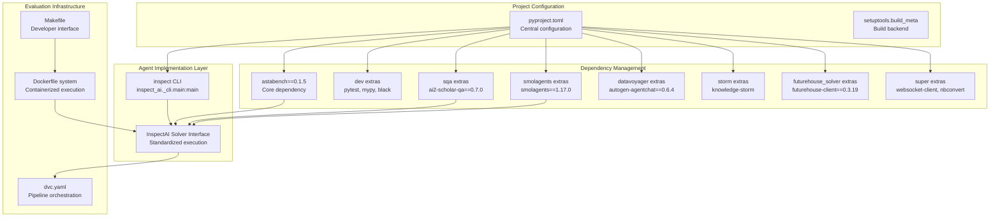
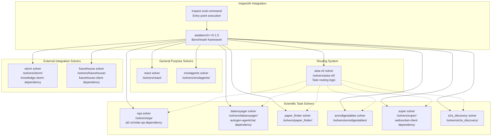
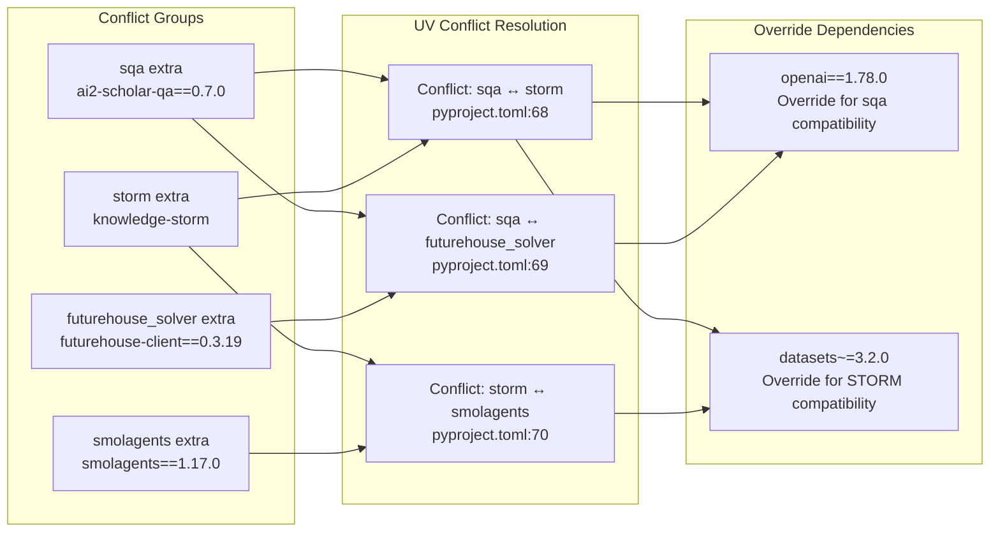

<!-- source: DeepWiki mcp.deepwiki.com · repo allenai/agent-baselines · page 1 Overview · fetched 2026-10-26 -->

# Overview

<details>
<summary>Relevant source files</summary>

The following files were used as context for generating this wiki page:

- [README.md](README.md)
- [pyproject.toml](pyproject.toml)

</details>


## Purpose and Scope

The agent-baselines repository provides baseline implementations of AI agents designed for evaluation against the AstaBench benchmarking suite. This framework serves as a comprehensive testbed for comparing different agent architectures, from general-purpose ReAct agents to specialized scientific task solvers. The repository implements agents as InspectAI solvers, enabling standardized evaluation across multiple tasks and models.

This document covers the high-level architecture and core systems within agent-baselines. For detailed installation instructions, see [Installation and Dependencies](#2.1). For information about running evaluations, see [Evaluation Pipeline](#3). For specific agent implementations, see [Agent Architecture](#4).

## High-Level System Architecture

The agent-baselines framework is built around a modular architecture that separates agent implementations, evaluation infrastructure, and dependency management:



Sources: [pyproject.toml:1-112](), [README.md:1-116]()

## Agent Solver Ecosystem

The repository implements multiple specialized agents as InspectAI solvers, organized by task domain and capability:



Sources: [pyproject.toml:29-54](), [README.md:26-49]()

## Key Components

### Project Configuration

The project uses a centralized configuration approach through `pyproject.toml`, which defines the build system, dependencies, and tooling configuration:

| Component | Purpose | Configuration Location |
|-----------|---------|------------------------|
| Build System | Package building with setuptools | [pyproject.toml:1-3]() |
| Core Dependencies | AstaBench integration | [pyproject.toml:10-12]() |
| Optional Dependencies | Modular solver requirements | [pyproject.toml:14-54]() |
| Package Discovery | Agent baselines module inclusion | [pyproject.toml:59-64]() |
| Tool Configuration | Development and quality tools | [pyproject.toml:81-111]() |

### Dependency Conflicts and Resolution

The project manages complex dependency conflicts between different solver implementations using UV's conflict resolution system:



Sources: [pyproject.toml:66-79]()

### Development and Quality Infrastructure

The project includes comprehensive development tooling integrated through the configuration system:

| Tool Category | Tools | Purpose |
|---------------|-------|---------|
| Code Formatting | `black==24.2.0`, `isort`, `autoflake` | Consistent code style |
| Testing | `pytest`, `pytest-asyncio` | Test execution and async support |
| Type Checking | `mypy==1.15`, `pandas-stubs` | Static type analysis |
| Linting | `flake8==7.2.0`, `flake8-pyproject` | Code quality checks |

The testing configuration supports both synchronous and asynchronous tests with strict loop isolation and optional expensive test markers.

Sources: [pyproject.toml:15-25](), [pyproject.toml:102-111]()

## Project Structure

The repository is organized around solver implementations with supporting infrastructure:

```
agent_baselines/
├── solvers/                    # Individual agent implementations
│   ├── react/                 # Basic ReAct agent
│   ├── smolagents/            # HuggingFace CodeAgent integration  
│   ├── sqa/                   # ScholarQA system
│   ├── datavoyager/           # Data analysis agent
│   ├── paper_finder/          # Paper search agent
│   ├── arxivdigestables/      # Literature table generator
│   ├── super/                 # Repository reproduction agent
│   ├── e2e_discovery/         # End-to-end discovery agent
│   ├── asta-v0/               # Task routing system
│   ├── storm/                 # Knowledge curation system
│   └── futurehouse/           # Literature review agent
├── dvc.yaml                   # DVC pipeline configuration
├── pyproject.toml             # Project configuration and dependencies
└── Makefile                   # Developer interface commands
```

Each solver directory contains standardized `setup.sh` and `demo.sh` scripts for installation and demonstration, providing a consistent interface across different agent implementations.

Sources: [README.md:13-14](), [README.md:49](), [pyproject.toml:59-64]()

---

