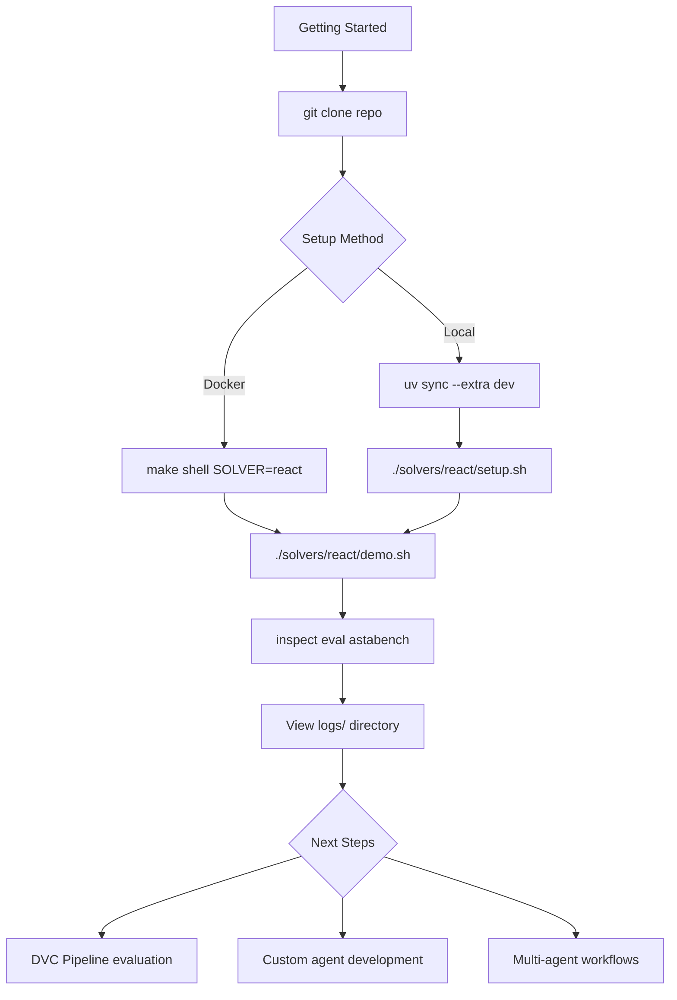
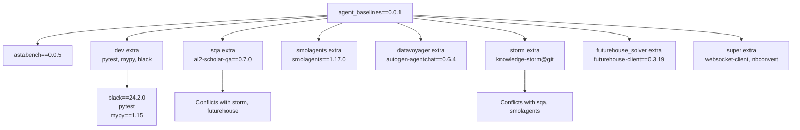
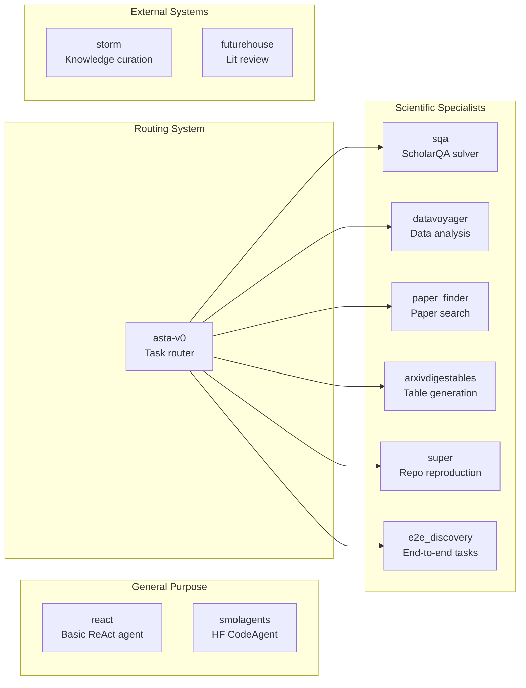
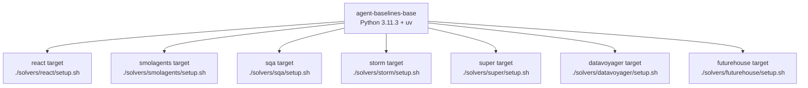

<!-- source: DeepWiki mcp.deepwiki.com · repo allenai/agent-baselines · page 2 Getting Started · fetched 2026-10-26 -->

# Getting Started

<details>
<summary>Relevant source files</summary>

The following files were used as context for generating this wiki page:

- [.github/workflows/ci-test.yml](.github/workflows/ci-test.yml)
- [Makefile](Makefile)
- [README.md](README.md)
- [docker/Dockerfile](docker/Dockerfile)
- [pyproject.toml](pyproject.toml)

</details>


This document provides a quick start guide for setting up and running your first agent evaluation with the agent-baselines framework. It covers the essential steps to install dependencies, run a basic evaluation, and understand the available agent types. For detailed installation instructions, see [Installation and Dependencies](#2.1). For comprehensive Docker setup, see [Docker Environment](#2.2).

## Quick Start Workflow

The agent-baselines framework follows a standardized workflow from setup to evaluation. The diagram below shows the essential steps using actual commands and file structures from the codebase:



**First-Time Setup Workflow**

Sources: [README.md:9-21](), [Makefile:75-82]()

## Installation and Dependency Structure

The project uses a modular dependency system with optional extras for different agent types. This allows you to install only the components you need:



**Modular Dependency Architecture**

| Extra | Purpose | Key Dependencies |
|-------|---------|------------------|
| `dev` | Development tools | `pytest`, `mypy`, `black` |
| `sqa` | Scientific Q&A agents | `ai2-scholar-qa` |
| `smolagents` | Code execution agents | `smolagents` |
| `datavoyager` | Data analysis agents | `autogen-agentchat` |
| `storm` | Knowledge curation | `knowledge-storm` |
| `futurehouse_solver` | Literature review | `futurehouse-client` |
| `super` | Repository reproduction | `websocket-client`, `nbconvert` |

Sources: [pyproject.toml:14-54](), [pyproject.toml:66-71]()

## Available Agent Categories

The framework provides several categories of agents, each implemented as InspectAI solvers:



**Agent Ecosystem by Specialization**

Sources: [README.md:26-48]()

## Running Your First Evaluation

### Option 1: Local Setup

```bash
# Clone and install
git clone https://github.com/allenai/agent-baselines.git
cd agent-baselines
uv sync --extra dev --extra react

# Set up a specific solver
./solvers/react/setup.sh

# Run a demo evaluation
./solvers/react/demo.sh
```

### Option 2: Docker Setup

```bash
# Build and enter container for specific solver
make shell SOLVER=react

# Inside container, run demo
./solvers/react/demo.sh
```

The Docker approach uses multi-stage builds with solver-specific targets:



**Docker Multi-Stage Build Targets**

Sources: [docker/Dockerfile:42-63](), [Makefile:12-21]()

## Basic Evaluation Commands

All agents are implemented as InspectAI solvers and can be evaluated using standard commands:

```bash
# Basic evaluation with react agent
inspect eval astabench --solver react --limit 5

# Evaluation with specific model
inspect eval astabench --solver sqa --model claude-3-sonnet-20240229

# Full benchmark run
astabench eval --solver asta-v0
```

The evaluation framework produces structured outputs in the `logs/` directory with detailed response traces and scoring metrics.

Sources: [README.md:5](), [README.md:13-14]()

## Development Environment

The Makefile provides standardized commands for development tasks:

| Command | Purpose | Docker Target |
|---------|---------|---------------|
| `make shell SOLVER=react` | Interactive development | `react` |
| `make test` | Run test suite | `agent-baselines-base` |
| `make format` | Code formatting | `agent-baselines-base` |
| `make mypy` | Type checking | `agent-baselines-base` |

Sources: [Makefile:75-82](), [Makefile:126-128]()

## Next Steps

After completing the basic setup:

1. **Detailed Installation**: See [Installation and Dependencies](#2.1) for comprehensive dependency management and troubleshooting
2. **Docker Deep Dive**: See [Docker Environment](#2.2) for advanced container usage and customization  
3. **Large-Scale Evaluation**: See [Evaluation Pipeline](#3) for DVC-based reproducible evaluation campaigns
4. **Agent Development**: See [Agent Architecture](#4) for understanding and extending the agent ecosystem
5. **Production Workflows**: See [Development Guide](#5) for CI/CD and collaboration practices

The framework is designed to scale from simple demos to comprehensive benchmarking campaigns across hundreds of model-task combinations.

Sources: [README.md:51-115]()

---

