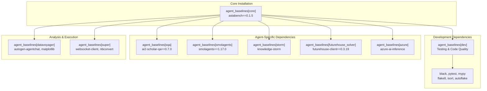
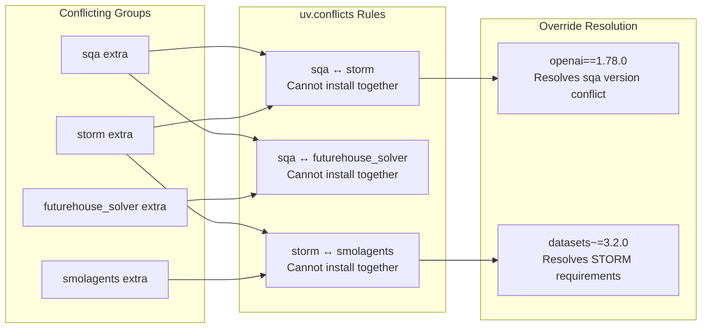

<!-- source: DeepWiki mcp.deepwiki.com · repo allenai/agent-baselines · page 2.1 Installation and Dependencies · fetched 2026-10-26 -->

# Installation and Dependencies

<details>
<summary>Relevant source files</summary>

The following files were used as context for generating this wiki page:

- [README.md](README.md)
- [pyproject.toml](pyproject.toml)

</details>


This document covers the installation process and modular dependency management system for the agent-baselines repository. It explains how to set up the core framework and selectively install dependencies for specific agents and functionality. For information about the Docker-based development environment, see [Docker Environment](#2.2).

## Prerequisites

The agent-baselines framework requires Python 3.11 or higher and uses the `uv` package manager for fast dependency resolution. The project is configured in [pyproject.toml:9]() with the requirement `requires-python = ">=3.11"`.

## Basic Installation

Clone the repository and install the base package:

```bash
git clone https://github.com/allenai/agent-baselines.git
cd agent-baselines
```

The core installation includes only the essential `astabench` dependency ([pyproject.toml:10-12]()), providing the foundational evaluation framework without any agent-specific dependencies.

**Sources:** [README.md:10-11](), [pyproject.toml:10-12]()

## Modular Dependency System

The project uses a modular dependency architecture where different agent implementations and development tools are organized into optional dependency groups. This allows users to install only the components they need.

### Dependency Group Architecture



### Installation Commands by Use Case

| Use Case | Installation Command | Dependencies Included |
|----------|---------------------|----------------------|
| Development | `pip install -e ".[dev]"` | Testing, linting, type checking |
| SQA Tasks | `pip install -e ".[sqa]"` | ScholarQA agent components |
| Code Agents | `pip install -e ".[smolagents]"` | HuggingFace CodeAgent |
| Data Analysis | `pip install -e ".[datavoyager]"` | AutoGen, matplotlib, IPython |
| Knowledge Curation | `pip install -e ".[storm]"` | STORM system |
| Literature Review | `pip install -e ".[futurehouse_solver]"` | FutureHouse client |
| Repository Tasks | `pip install -e ".[super]"` | WebSocket, Jupyter conversion |
| Azure Integration | `pip install -e ".[azure]"` | Azure AI inference |

**Sources:** [pyproject.toml:14-54]()

## Dependency Conflicts and Resolution

The project defines explicit conflict rules to prevent incompatible dependency combinations and uses override mechanisms to resolve version conflicts.

### Conflict Resolution System



The conflict rules are defined in [pyproject.toml:67-71]() and version overrides in [pyproject.toml:72-79]().

**Sources:** [pyproject.toml:67-79]()

## Environment Setup Options

### Package Manager Configuration

The project is configured to use `uv` as the package manager ([pyproject.toml:66]()) with specific conflict resolution and dependency override settings. The `uv` configuration includes:

- Conflict detection between incompatible extras
- Version overrides for problematic dependencies
- Custom source definitions for Git-based packages

### Agent-Specific Setup Scripts

Each agent implementation provides standardized setup scripts:

- `setup.sh` - Installs required dependencies and configures the environment
- `demo.sh` - Runs example evaluations with limited samples

Example workflow for setting up a specific agent:
```bash
cd solvers/sqa
./setup.sh
./demo.sh
```

### Development Tools Integration

The development dependency group ([pyproject.toml:15-25]()) includes:
- **Code formatting**: `black==24.2.0`, `isort`, `autoflake`
- **Testing**: `pytest`, `pytest-asyncio` 
- **Type checking**: `mypy==1.15`, `pandas-stubs`
- **Linting**: `flake8==7.2.0`, `flake8-pyproject==1.2.3`

**Sources:** [pyproject.toml:15-25](), [README.md:13-21](), [README.md:49]()

## Package Structure and Scripts

The project defines entry points and package discovery rules in [pyproject.toml:56-64](). The `inspect` command is registered as a script entry point, providing the primary interface for evaluation execution.

Package data includes configuration files for specific solvers:
- DataVoyager YAML configs: `agent_baselines/solvers/datavoyager/dv_core/config/*.yaml`
- Code agent configs: `agent_baselines/solvers/code_agent/*.yaml`

**Sources:** [pyproject.toml:56-64](), [pyproject.toml:96-97]()

## Verification

After installation, verify the setup by checking that the `inspect` command is available:

```bash
inspect --help
```

For agent-specific verification, use the provided demo scripts:
```bash
# Verify ReAct agent setup
./solvers/react/demo.sh

# Verify SQA agent setup (if installed)
./solvers/sqa/demo.sh
```

**Sources:** [README.md:20-21](), [README.md:49]()

---

