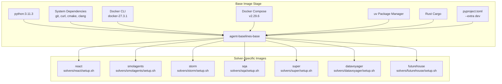
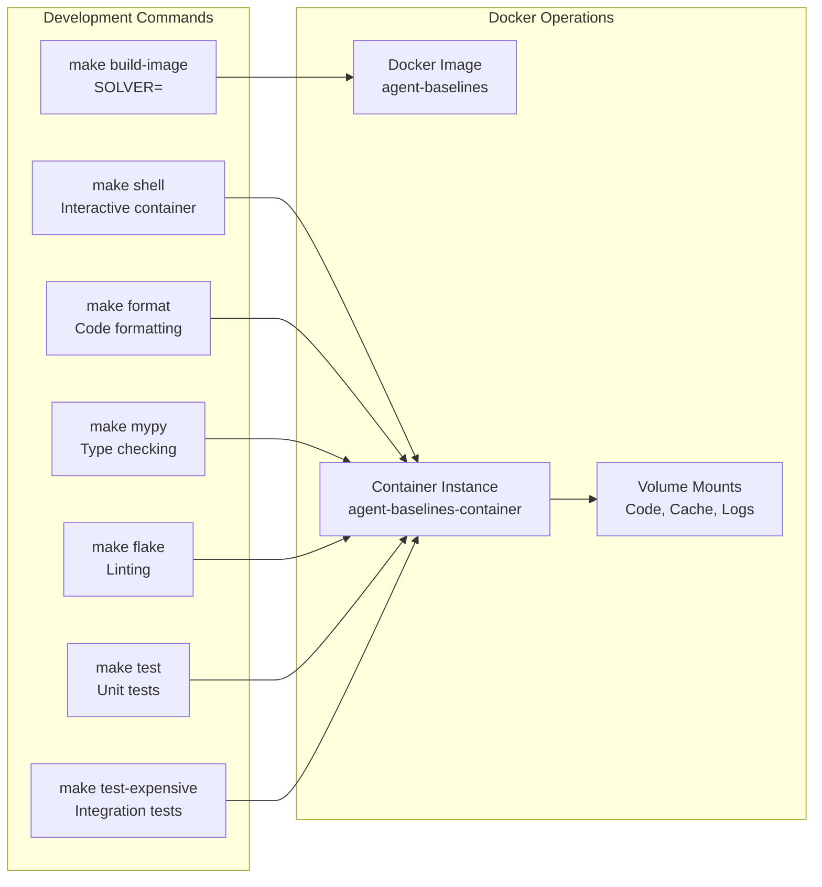
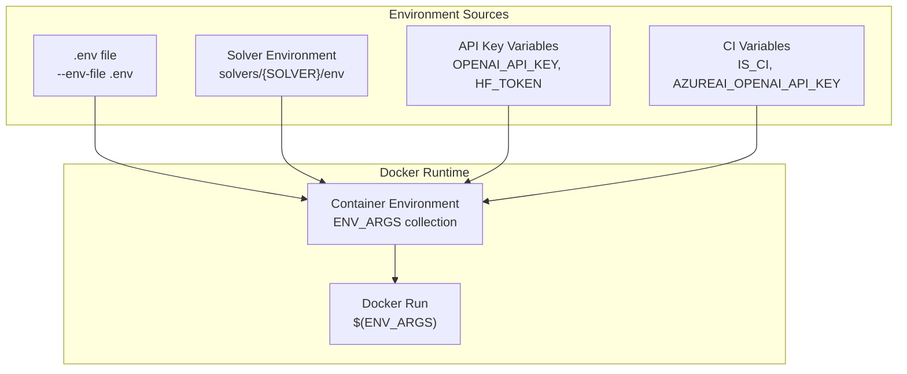
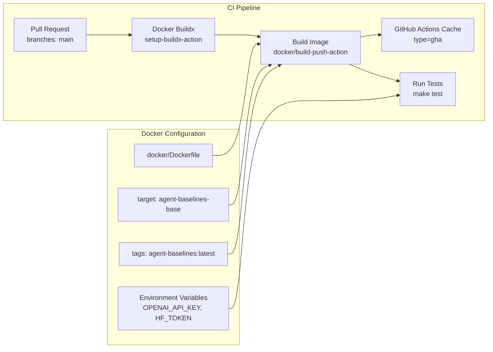
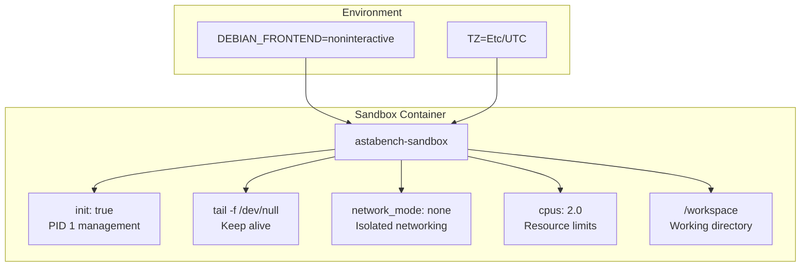

<!-- source: DeepWiki mcp.deepwiki.com · repo allenai/agent-baselines · page 2.2 Docker Environment · fetched 2026-10-26 -->

# Docker Environment

Relevant source files

The following files were used as context for generating this wiki page:

- [.github/workflows/ci-test.yml](.github/workflows/ci-test.yml)
- [Makefile](Makefile)
- [docker/Dockerfile](docker/Dockerfile)
- [tests/solvers/ci_sandbox_compose.yaml](tests/solvers/ci_sandbox_compose.yaml)

This document covers the Docker-based containerization system that provides consistent development, testing, and deployment environments for the agent-baselines framework. The Docker environment supports multi-stage builds for different solver types, integrated CI/CD workflows, and streamlined local development. For installation and dependency management details, see [Installation and Dependencies](#2.1). For CI/CD pipeline specifics, see [CI/CD Pipeline](#5.1).

## Multi-Stage Docker Architecture

The agent-baselines project uses a sophisticated multi-stage Docker build system defined in [docker/Dockerfile:1-63]() that creates a base image and multiple specialized solver images.

### Docker Build Stages

The base image installs core system dependencies and the development environment. Each solver stage extends the base with solver-specific dependencies through dedicated setup scripts.

Sources: [docker/Dockerfile:1-63]()

### Build Target Configuration

The build system supports targeting specific stages through the `TARGET` variable in [Makefile:15-21]():

| Build Target | Image Tag | Purpose |
|--------------|-----------|---------|
| `agent-baselines-base` | `agent-baselines` | Base development environment |
| `react` | `agent-baselines-react` | ReAct agent solver |
| `smolagents` | `agent-baselines-smolagents` | HuggingFace code agent |
| `storm` | `agent-baselines-storm` | Knowledge curation agent |
| `sqa` | `agent-baselines-sqa` | Scientific QA agent |
| `super` | `agent-baselines-super` | Repository reproduction agent |
| `datavoyager` | `agent-baselines-datavoyager` | Data analysis agent |
| `futurehouse` | `agent-baselines-futurehouse` | Literature review agent |

Sources: [Makefile:15-21](), [docker/Dockerfile:42-63]()

## Development Workflow

### Local Development Commands

The Makefile provides streamlined commands for Docker-based development:

The `make shell` command creates an interactive development environment with live code mounting and cache persistence through Docker volumes.

Sources: [Makefile:75-81](), [Makefile:94-136]()

### Environment Variable Management

The Docker environment supports flexible configuration through multiple sources defined in [Makefile:23-39]():

The system automatically detects and includes environment variables from multiple sources, with solver-specific environments loaded when `SOLVER` is specified.

Sources: [Makefile:23-39]()

## CI/CD Integration

### GitHub Actions Workflow

The Docker environment integrates with CI/CD through [.github/workflows/ci-test.yml:1-38]():

The CI system uses Docker layer caching to optimize build times and runs tests within the containerized environment.

Sources: [.github/workflows/ci-test.yml:17-37]()

### Local vs CI Environment Differences

The Makefile distinguishes between local and CI environments through [Makefile:44-59]():

| Environment | Mount Strategy | Test Command | Build Options |
|-------------|---------------|--------------|---------------|
| **Local** (`IS_CI != true`) | Live volume mounts | Interactive container | Standard build |
| **CI** (`IS_CI = true`) | No mounts | Ephemeral container | Quiet build (`--quiet`) |

Local development includes volume mounts for live code editing, while CI uses isolated containers with no external mounts.

Sources: [Makefile:44-59]()

## Sandbox Environment

### Testing Sandbox Configuration

The project includes a specialized sandbox environment for testing defined in [tests/solvers/ci_sandbox_compose.yaml:1-12]():

The sandbox provides isolated execution for code agents with network isolation and resource constraints.

Sources: [tests/solvers/ci_sandbox_compose.yaml:1-12]()

## Volume Management

### Persistent Storage Strategy

The Docker environment uses strategic volume mounting for development efficiency:

| Volume Mount | Purpose | Local Path | Container Path |
|--------------|---------|------------|----------------|
| **Code** | Live editing | `./agent_baselines` | `/agent-baselines/agent_baselines` |
| **Tests** | Test development | `./tests` | `/agent-baselines/tests` |
| **Logs** | Debug output | `./logs` | `/agent-baselines/logs` |
| **Cache** | Build optimization | `agent-baselines-cache` | `/root/.cache` |
| **Home** | User data | `agent-baselines-home` | `/root/.agent-baselines` |
| **Docker Socket** | Container access | `/var/run/docker.sock` | `/var/run/docker.sock` |

The volume strategy enables seamless development while maintaining container isolation.

Sources: [Makefile:50-56](), [Makefile:78]()

---

