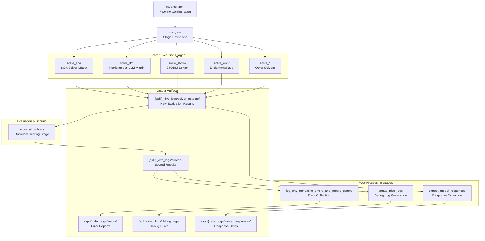
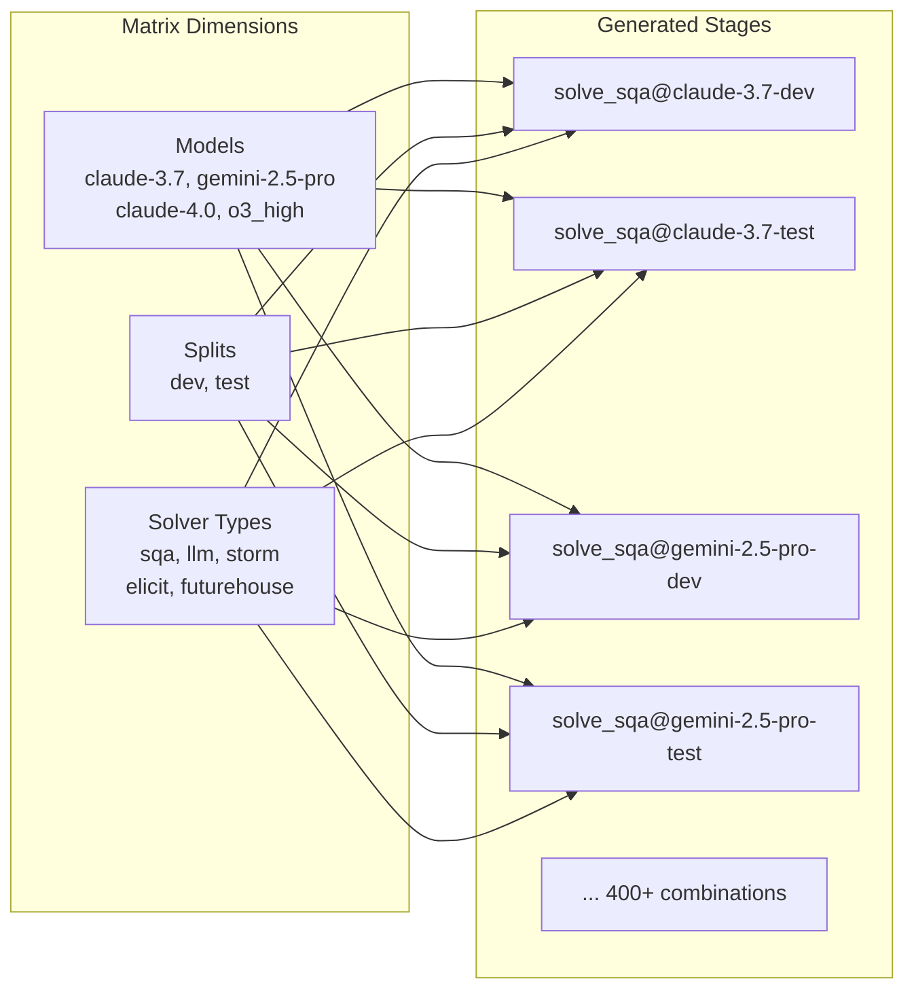
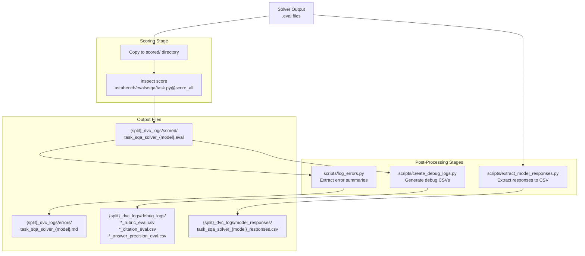
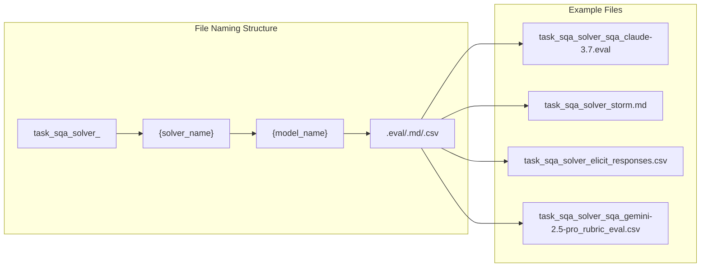

<!-- source: DeepWiki mcp.deepwiki.com · repo allenai/agent-baselines · page 3 Evaluation Pipeline · fetched 2026-10-26 -->

# Evaluation Pipeline

<details>
<summary>Relevant source files</summary>

The following files were used as context for generating this wiki page:

- [README.md](README.md)
- [dvc.lock](dvc.lock)
- [dvc.yaml](dvc.yaml)
- [params.yaml](params.yaml)
- [pyproject.toml](pyproject.toml)

</details>


This document covers the DVC-based evaluation pipeline system used for running reproducible, large-scale agent benchmarks in the agent-baselines repository. The pipeline orchestrates evaluation of multiple solver implementations across different models, datasets, and configurations, with automatic caching, scoring, and result management.

For information about individual agent implementations, see [Agent Architecture](#4). For details on running simple evaluations without DVC, see [Running Evaluations](#3.2).

## Pipeline Architecture

The evaluation pipeline is built on DVC (Data Version Control) and consists of multiple interconnected stages that process solver outputs through evaluation, scoring, and post-processing steps. The pipeline supports matrix execution to run hundreds of solver/model/split combinations in parallel.

### Core Pipeline Flow



Sources: [dvc.yaml:1-489](), [README.md:51-116]()

### Matrix Execution System

The pipeline uses DVC's matrix functionality to execute evaluations across multiple dimensions simultaneously:



Sources: [dvc.yaml:14-44](), [dvc.yaml:197-244](), [dvc.yaml:309-376]()

## Configuration System

### Parameter Management

The pipeline uses `params.yaml` for centralized configuration of evaluation parameters:

| Parameter | Purpose | Example Value |
|-----------|---------|---------------|
| `scorer_model` | Model used for scoring evaluations | `google/gemini-2.5-flash` |
| `sqa_scorer_version` | Version tag for scorer changes | `may-23-2025` |
| `sqa_solver_version` | Version tag for solver changes | `may-23-2025` |
| `limit` | Number of samples to evaluate | `1000` |

Sources: [params.yaml:1-5]()

### Stage Configuration Patterns

Each solver type has its own stage configuration with specific command patterns:

**SQA Solver Stage Example:**
```yaml
solve_sqa:
  matrix:
    model: [claude-3.7, gemini-2.5-pro, claude-4.0, o3_high]
    split: [dev, test]
  cmd: |
    INSPECT_EVAL_LOG_FILE_PATTERN=task_sqa_solver_sqa_${item.model}
    uv run --extra sqa
    inspect eval astabench/evals/sqa/task.py@sqa
    --solver agent_baselines/solvers/sqa/sqa.py@sqa_solver
    -S completion_model=${item.model}
    --limit=${limit}
```

Sources: [dvc.yaml:14-44]()

**Retrieverless LLM Stage Example:**
```yaml
solve_llm:
  matrix:
    model:
      - llm_name: openai/o4-mini
        llm_args: "--reasoning-effort high --reasoning-tokens 8192"
      - llm_name: anthropic/claude-sonnet-4-20250514
        llm_args: "--reasoning-tokens 8192"
```

Sources: [dvc.yaml:197-244]()

## Pipeline Stages

### Solver Execution Stages

The pipeline defines multiple solver execution stages, each targeting different agent types:

| Stage Name | Purpose | Solver Path | Extra Dependencies |
|------------|---------|-------------|-------------------|
| `solve_sqa` | SQA retrieval-augmented agents | `agent_baselines/solvers/sqa/sqa.py@sqa_solver` | `--extra sqa` |
| `solve_llm` | Direct LLM evaluation | `agent_baselines/solvers/sqa/formatted_llm.py@formatted_solver` | `--extra sqa` |
| `solve_storm` | Knowledge curation system | `agent_baselines/solvers/sqa/storm_solver.py@storm_solver` | `--extra storm` |
| `solve_elicit` | Memorized responses | `agent_baselines/solvers/sqa/elicit/memorized_solver.py@elicit_solver` | `--extra sqa` |
| `solve_futurehouse` | Literature review agents | `agent_baselines/solvers/futurehouse/futurehouse_solver.py` | `--extra futurehouse` |

Sources: [dvc.yaml:14-44](), [dvc.yaml:121-142](), [dvc.yaml:197-244](), [dvc.yaml:246-276]()

### Scoring and Post-Processing

All solver outputs go through a unified scoring pipeline:



Sources: [dvc.yaml:308-376](), [dvc.yaml:415-448](), [dvc.yaml:450-488]()

## Execution Workflows

### Basic Pipeline Commands

**Run entire pipeline:**
```bash
dvc repro
```

**Force re-execution ignoring cache:**
```bash
dvc repro --force
```

**Run specific stage:**
```bash
dvc repro solve_sqa@claude-3.7
```

**Run stage and all downstream dependencies:**
```bash
dvc repro score_sqa --force --downstream
```

Sources: [README.md:62-90]()

### Pipeline Status and Debugging

**Check which stages need to run:**
```bash
dvc status
```

**View pipeline dependencies:**
```bash
dvc dag
```

**Check specific stage status:**
```bash
dvc status solve_sqa@claude-3.7
```

### File Naming Conventions

The pipeline uses consistent naming patterns for output files:



Sources: [dvc.yaml:26-38](), [dvc.yaml:442-448](), [dvc.yaml:479-488]()

## Output Management and Caching

### Directory Structure

The pipeline organizes outputs into split-specific directories:

```
{dev|test}_dvc_logs/
├── solver_outputs/          # Raw evaluation results
│   ├── task_sqa_solver_sqa_claude-3.7.eval
│   ├── task_sqa_solver_storm.eval
│   └── task_sqa_solver_elicit.eval
├── scored/                  # Scored evaluation results
│   ├── task_sqa_solver_sqa_claude-3.7.eval
│   └── task_sqa_solver_storm.eval
├── errors/                  # Error summaries
│   ├── task_sqa_solver_sqa_claude-3.7.md
│   └── task_sqa_solver_storm.md
├── debug_logs/             # Debug CSV files
│   ├── task_sqa_solver_sqa_claude-3.7_rubric_eval.csv
│   ├── task_sqa_solver_sqa_claude-3.7_citation_eval.csv
│   └── task_sqa_solver_sqa_claude-3.7_answer_precision_eval.csv
└── model_responses/        # Extracted model responses
    ├── task_sqa_solver_sqa_claude-3.7_responses.csv
    └── task_sqa_solver_storm_responses.csv
```

Sources: [dvc.yaml:44](), [dvc.yaml:374-376](), [dvc.yaml:411-413]()

### Collaboration and Versioning

**Pull latest results from team cache:**
```bash
dvc pull
```

**Push local results to shared cache:**
```bash
dvc push
```

**Check cache synchronization status:**
```bash
dvc status --cloud
```

The `dvc.lock` file tracks exact versions and hashes of all pipeline artifacts, enabling reproducible results across team members.

Sources: [README.md:101-115](), [dvc.lock:1-2]()

### Cache Management

DVC automatically caches outputs based on input dependencies and commands. The cache considers:
- Input file hashes (dependencies)
- Parameter values from `params.yaml`
- Stage command definitions
- Solver/scorer version parameters

When any of these change, the stage will re-execute on the next `dvc repro` run.

Sources: [README.md:76-84](), [dvc.yaml:39-42]()

---

