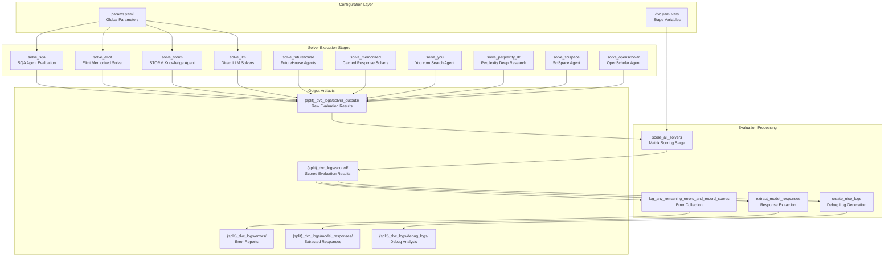
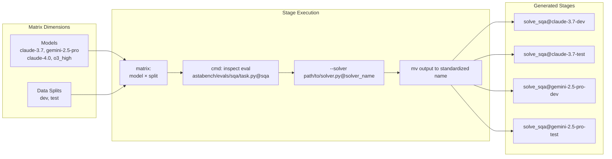
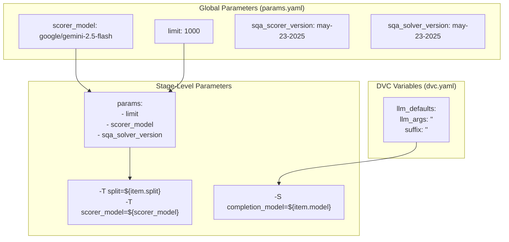
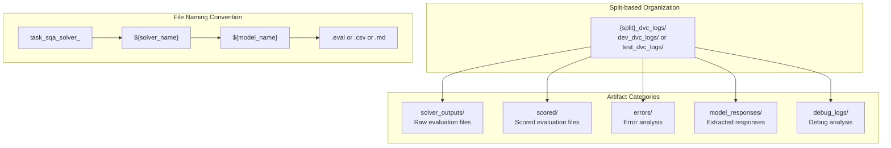
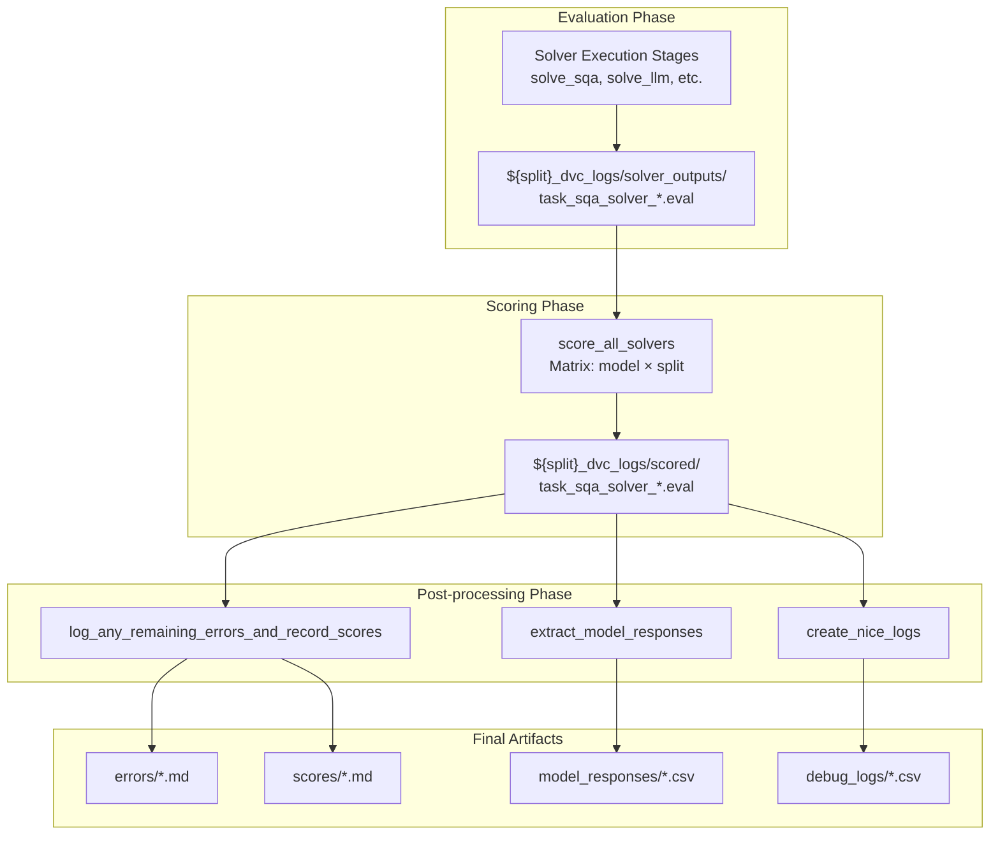

<!-- source: DeepWiki mcp.deepwiki.com · repo allenai/agent-baselines · page 3.1 DVC Pipeline Configuration · fetched 2026-10-26 -->

# DVC Pipeline Configuration

<details>
<summary>Relevant source files</summary>

The following files were used as context for generating this wiki page:

- [dvc.lock](dvc.lock)
- [dvc.yaml](dvc.yaml)
- [params.yaml](params.yaml)

</details>


This document describes the Data Version Control (DVC) pipeline configuration that orchestrates large-scale agent evaluations in the agent-baselines framework. The pipeline manages the execution of multiple AI agents across different models and data splits, handles scoring, and produces comprehensive evaluation results with reproducible versioning.

For information about running evaluations using this pipeline, see [Running Evaluations](#3.2). For details about the specific agent implementations being evaluated, see [Agent Architecture](#4).

## Pipeline Overview

The DVC pipeline is defined in `dvc.yaml` and provides a systematic approach to evaluating AI agents at scale. It coordinates the execution of over 400 model-solver combinations across development and test data splits, manages dependencies between evaluation and scoring stages, and ensures reproducible results through content-based caching.

The pipeline operates in three main phases: solver execution, scoring, and post-processing. Each phase is designed to handle failures gracefully with retry mechanisms and produces structured outputs for analysis.

**Pipeline Architecture**



Sources: [dvc.yaml:1-489]()

## Stage Types and Matrix Configuration

The pipeline utilizes DVC's matrix functionality to execute combinations of models and data splits systematically. Each solver type implements a specific evaluation pattern while maintaining consistent output structures.

**Matrix Execution Pattern**



Sources: [dvc.yaml:14-44](), [dvc.yaml:197-244]()

### Solver Stage Categories

The pipeline organizes solver stages into distinct categories based on their evaluation approach:

| Stage Name | Solver Type | Matrix Configuration | Key Parameters |
|------------|-------------|---------------------|----------------|
| `solve_sqa` | Retrieval-augmented agent | model × split | `completion_model`, `scorer_model` |
| `solve_llm` | Direct LLM evaluation | model × split | `llm_name`, `llm_args`, `suffix` |
| `solve_memorized` | Cached response lookup | model × split | `sys_name_or_path` |
| `solve_futurehouse` | External API agent | model × split | `agent`, `max_wait_time` |
| `solve_storm` | Knowledge curation | foreach split | Python 3.11 requirement |
| `solve_elicit` | Memorized Elicit responses | foreach split | Static configuration |

Sources: [dvc.yaml:13-45](), [dvc.yaml:196-306]()

## Parameter Management

The pipeline uses a layered parameter system combining global parameters from `params.yaml` with stage-specific variables defined in `dvc.yaml`.

**Parameter Structure**



Sources: [params.yaml:1-5](), [dvc.yaml:7-12]()

### LLM Configuration Matrix

The `solve_llm` stage demonstrates advanced parameter handling with structured model configurations:

```yaml
model:
  - <<: *llm_defaults
    llm_name: openai/o4-mini
    llm_args: "--reasoning-effort high --reasoning-tokens 8192"
  - <<: *llm_defaults
    llm_name: anthropic/claude-sonnet-4-20250514
    llm_args: "--reasoning-tokens 8192"
    suffix: "-thinking"
```

This structure allows for model-specific parameter overrides while maintaining consistent defaults across configurations.

Sources: [dvc.yaml:198-218]()

## Output File Organization

The pipeline produces structured outputs in split-specific directories following a consistent naming convention. Each evaluation generates multiple artifact types for comprehensive analysis.

**Output Directory Structure**



Sources: [dvc.yaml:43-44](), [dvc.yaml:374-413]()

### File Naming Patterns

The pipeline uses systematic file naming to organize outputs across hundreds of evaluation combinations:

- **Solver outputs**: `task_sqa_solver_${solver_name}_${model_name}.eval`
- **Scored results**: Same path structure in `scored/` directory
- **Error logs**: `task_sqa_solver_${model_name}.md`
- **Response extracts**: `task_sqa_solver_${model_name}_responses.csv`
- **Debug logs**: `task_sqa_solver_${model_name}_rubric_eval.csv`

For models with provider prefixes (e.g., `anthropic/claude-3-5-sonnet`), the pipeline automatically creates nested directory structures to maintain organization.

Sources: [dvc.yaml:237-238](), [dvc.yaml:360-361]()

## Execution Flow and Dependencies

The pipeline orchestrates complex dependencies between evaluation stages, scoring processes, and post-processing steps. Each stage explicitly declares its dependencies and outputs for proper execution ordering.

**Dependency Chain Architecture**



Sources: [dvc.yaml:308-376](), [dvc.yaml:415-489]()

### Scoring Matrix Configuration

The `score_all_solvers` stage demonstrates sophisticated dependency management with model-specific metadata:

```yaml
score_all_solvers:
  matrix:
    model:
      - name: openai/o4-mini
        is_retrieverless: true
      - name: sqa_claude-3.7
        is_retrieverless: false
  deps:
    - ${item.split}_dvc_logs/solver_outputs/task_sqa_solver_${item.model.name}.eval
  outs:
    - ${item.split}_dvc_logs/scored/task_sqa_solver_${item.model.name}.eval
```

This configuration ensures that scoring only executes after solver outputs are available and passes model-specific metadata to the scoring process.

Sources: [dvc.yaml:308-376]()

## Command Execution Patterns

Each stage implements a consistent command execution pattern using InspectAI evaluation framework with standardized parameter passing and output handling.

**Standard Execution Template**

```mermaid
graph LR
    subgraph "Environment Setup"
        LOG_PATTERN["INSPECT_EVAL_LOG_FILE_PATTERN=task_sqa_solver_${model}"]
        UV_EXTRA["uv run --extra ${dependency_group}"]
    end
    
    subgraph "InspectAI Execution"
        INSPECT_CMD["inspect eval astabench/evals/sqa/task.py@sqa"]
        DISPLAY["--display plain"]
        LOG_DIR["--log-dir ${split}_dvc_logs/solver_outputs/"]
        SOLVER_PATH["--solver path/to/solver.py@solver_function"]
    end
    
    subgraph "Parameter Injection"
        TASK_PARAMS["-T split=${split} -T scorer_model=${scorer_model}"]
        SOLVER_PARAMS["-S completion_model=${model}"]
        LIMITS["--limit=${limit} --retry-on-error=10"]
    end
    
    subgraph "Output Standardization"
        NO_SCORE["--no-score"]
        MV_CMD["mv latest_output standardized_name"]
    end
    
    LOG_PATTERN --> INSPECT_CMD
    UV_EXTRA --> INSPECT_CMD
    INSPECT_CMD --> DISPLAY
    DISPLAY --> LOG_DIR
    LOG_DIR --> SOLVER_PATH
    SOLVER_PATH --> TASK_PARAMS
    TASK_PARAMS --> SOLVER_PARAMS
    SOLVER_PARAMS --> LIMITS
    LIMITS --> NO_SCORE
    NO_SCORE --> MV_CMD
```



Sources: [dvc.yaml:25-38](), [dvc.yaml:224-238]()

The pipeline's systematic approach to command execution ensures consistent evaluation conditions across all solver types while accommodating solver-specific requirements through flexible parameter injection and dependency management.

---

