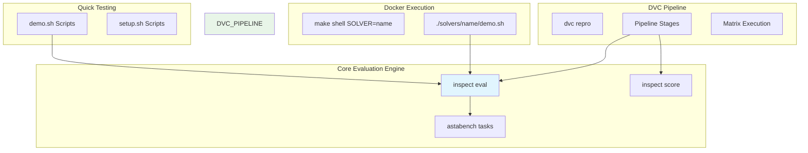
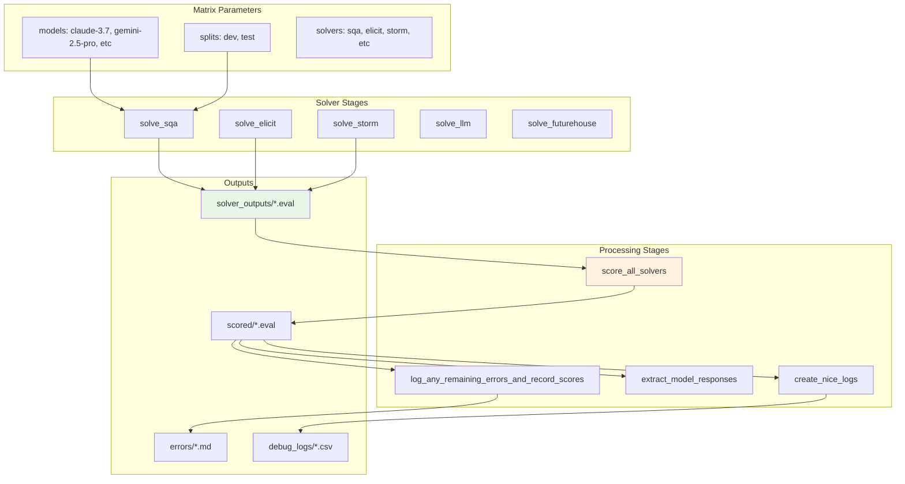
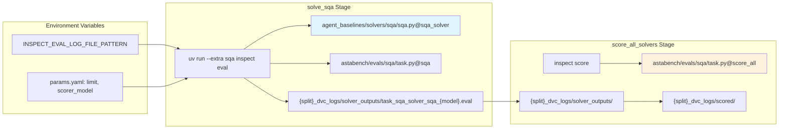

<!-- source: DeepWiki mcp.deepwiki.com · repo allenai/agent-baselines · page 3.2 Running Evaluations · fetched 2026-10-26 -->

# Running Evaluations

<details>
<summary>Relevant source files</summary>

The following files were used as context for generating this wiki page:

- [README.md](README.md)
- [dvc.lock](dvc.lock)
- [dvc.yaml](dvc.yaml)
- [params.yaml](params.yaml)
- [pyproject.toml](pyproject.toml)

</details>


This page covers practical methods for executing agent evaluations in the agent-baselines framework, from quick demos to comprehensive benchmark campaigns. For information about configuring the DVC pipeline structure, see [DVC Pipeline Configuration](#3.1). For details about specific agent implementations, see [Agent Architecture](#4).

## Evaluation Methods Overview

The agent-baselines framework provides three primary approaches for running evaluations:

1. **Individual Solver Demos** - Quick testing with `demo.sh` scripts
2. **Docker-based Execution** - Isolated environment testing using containers
3. **DVC Pipeline Evaluation** - Comprehensive, reproducible benchmark campaigns



**Evaluation Flow Architecture**

Sources: [README.md:7-23](), [README.md:51-115](), [dvc.yaml:1-489]()

## Individual Solver Demos

Each solver directory contains setup and demo scripts for quick testing:

### Setup and Demo Scripts

```bash
# Navigate to a solver directory
cd solvers/react

# Install dependencies
./setup.sh

# Run a limited evaluation demo
./demo.sh
```

Demo scripts typically run evaluations with limited samples (often 1-5 examples) to verify solver functionality. They use the underlying `inspect eval` command with specific solver configurations.

**Common Demo Script Pattern:**
- Install solver-specific dependencies
- Set environment variables
- Execute `inspect eval` with `--limit` parameter
- Output results to console or logs

Sources: [README.md:13-14](), [README.md:49]()

## Docker-based Execution

For consistent environments across different systems, use Docker containers:

```bash
# Start a Docker shell for a specific solver
make shell SOLVER=react

# Inside the container, run the demo
root:/astabench# ./solvers/react/demo.sh
```

The Docker approach ensures dependency isolation and reproducible environments, particularly useful when solvers have conflicting requirements.

Sources: [README.md:16-21]()

## DVC Pipeline Evaluation

The DVC pipeline provides comprehensive, reproducible evaluation campaigns that run multiple solvers across different models and dataset splits.

### Pipeline Architecture



**DVC Pipeline Stage Flow**

Sources: [dvc.yaml:13-489]()

### Matrix Execution Configuration

The pipeline uses matrix configurations to run evaluations across multiple dimensions:

| Stage | Matrix Dimensions | Example Values |
|-------|------------------|----------------|
| `solve_sqa` | model × split | claude-3.7 × dev, gemini-2.5-pro × test |
| `solve_llm` | model × split | openai/o4-mini × dev, anthropic/claude-sonnet-4 × test |
| `score_all_solvers` | model × split | All solver outputs × dev/test splits |

### Key Pipeline Commands

#### Running the Full Pipeline
```bash
# Install DVC
pip install 'dvc[s3]'

# Run all stages (uses cache to skip unchanged stages)
dvc repro

# Force run all stages (ignores cache)
dvc repro --force
```

#### Running Specific Stages
```bash
# Run specific solver stage
dvc repro solve_sqa@claude-3.7

# Run scoring for specific model
dvc repro score_all_solvers@sqa_claude-3.7-dev

# Run single stage without downstream dependencies
dvc repro score_sqa --force --single-item
```

#### Checking Pipeline Status
```bash
# Check which stages need to be run
dvc status

# Example output showing changed dependencies
# summarize_scores:
#   changed deps:
#     modified: dvc_logs/scored/task_sqa_solver_sqa_claude-3.7.eval
```

Sources: [README.md:62-99]()

### Pipeline Stage Details



**Detailed Stage Execution Flow**

Sources: [dvc.yaml:14-44](), [dvc.yaml:308-376]()

## Understanding Pipeline Parameters

The pipeline behavior is controlled by parameters in `params.yaml`:

| Parameter | Purpose | Example Value |
|-----------|---------|---------------|
| `limit` | Number of evaluation samples | `1000` |
| `scorer_model` | Model used for scoring | `google/gemini-2.5-flash` |
| `sqa_scorer_version` | Scorer version tag | `may-23-2025` |
| `sqa_solver_version` | Solver version tag | `may-23-2025` |

Sources: [params.yaml:1-4]()

## Output Structure and Results

### Directory Structure

```
{split}_dvc_logs/
├── solver_outputs/           # Raw solver evaluation files
│   └── task_sqa_solver_{solver}_{model}.eval
├── scored/                   # Scored evaluation files
│   └── task_sqa_solver_{solver}_{model}.eval
├── errors/                   # Error logs and summaries
│   └── task_sqa_solver_{solver}_{model}.md
├── scores/                   # Score summaries
│   └── task_sqa_solver_{solver}_{model}.md
├── model_responses/          # Extracted model responses
│   └── task_sqa_solver_{solver}_{model}_responses.csv
└── debug_logs/              # Detailed analysis
    ├── task_sqa_solver_{solver}_{model}_rubric_eval.csv
    ├── task_sqa_solver_{solver}_{model}_citation_eval.csv
    └── task_sqa_solver_{solver}_{model}_answer_precision_eval.csv
```

### File Naming Convention

The pipeline uses a consistent naming pattern: `task_{task_name}_solver_{solver_name}_{model_name}.eval`

Examples from the lock file:
- `task_sqa_solver_sqa_claude-3.7.eval`
- `task_sqa_solver_elicit.eval`
- `task_sqa_solver_storm.eval`

Sources: [dvc.lock:16](), [dvc.lock:268](), [dvc.lock:216]()

## Collaboration and Caching

### Sharing Results with Team

```bash
# Pull latest results from shared cache
dvc pull

# Push your results to shared cache
dvc push
```

The DVC cache system allows teams to share evaluation results without re-running expensive computations. The `dvc.lock` file tracks exact versions and checksums of all pipeline outputs.

### Cache Management

DVC automatically manages caching based on:
- Input file changes (detected via MD5 hashes)
- Parameter changes in `params.yaml`
- Stage definition changes in `dvc.yaml`
- Code changes in dependencies

Sources: [README.md:101-115]()

## Common Workflows

### Development Workflow
1. Test solver locally with demo script
2. Run limited evaluation with Docker
3. Submit to DVC pipeline for comprehensive evaluation
4. Share results with team via DVC cache

### Debugging Failed Evaluations
1. Check `dvc status` for stage dependencies
2. Examine error logs in `{split}_dvc_logs/errors/`
3. Review debug logs for detailed analysis
4. Use `--force` flag to re-run specific stages

### Performance Monitoring
1. Monitor evaluation progress through DVC stage completion
2. Check solver outputs for completion rates
3. Review error summaries for failure patterns
4. Analyze debug logs for performance insights

Sources: [README.md:76-90](), [dvc.yaml:378-413](), [dvc.yaml:415-448]()

---

