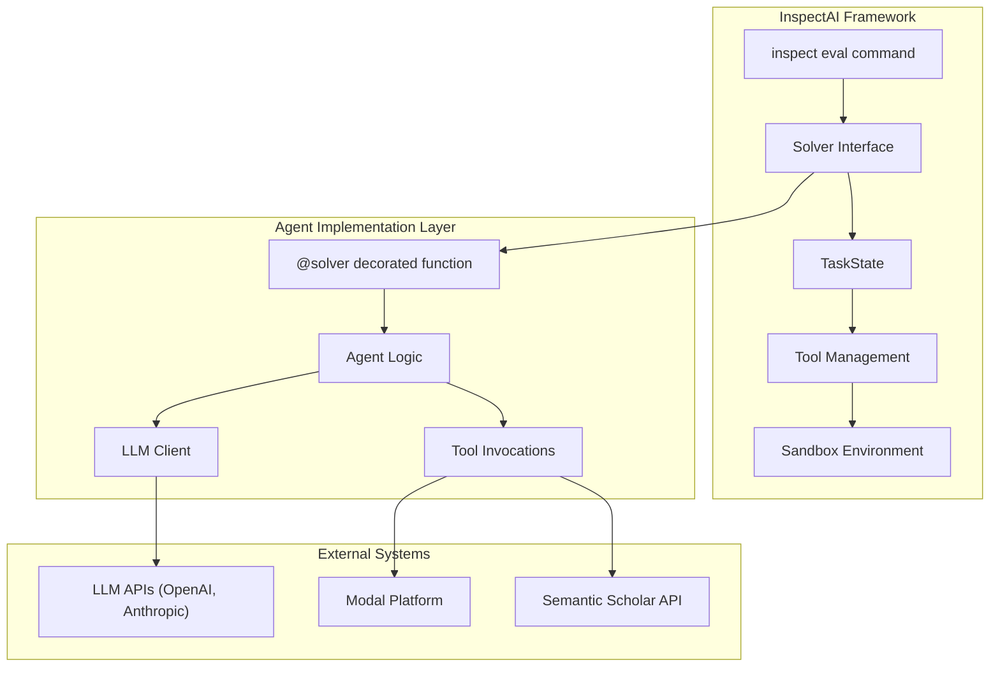
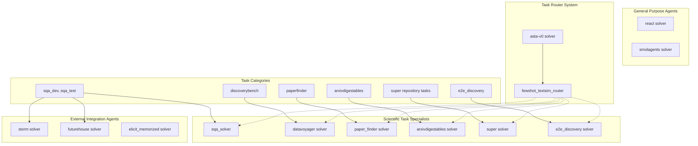
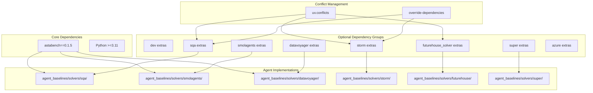
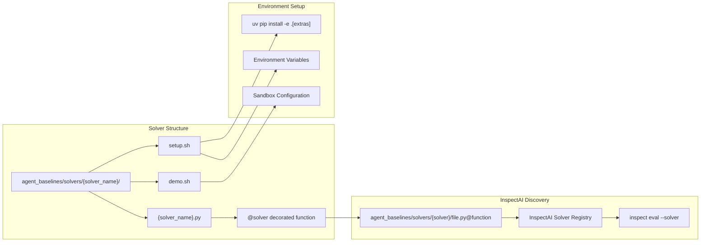
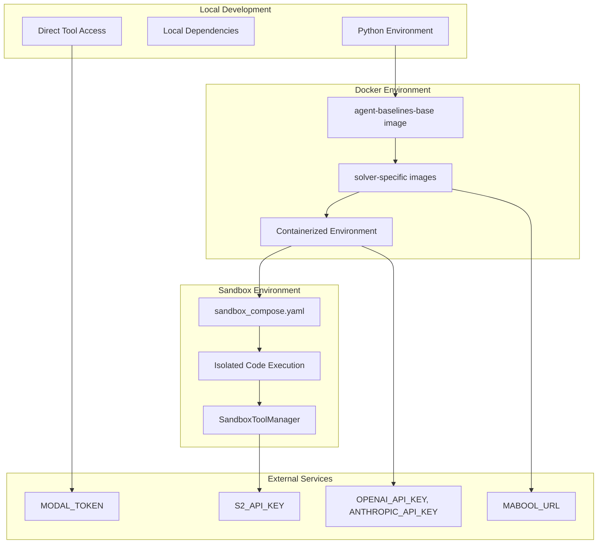

<!-- source: DeepWiki mcp.deepwiki.com · repo allenai/agent-baselines · page 4 Agent Architecture · fetched 2026-10-26 -->

# Agent Architecture

<details>
<summary>Relevant source files</summary>

The following files were used as context for generating this wiki page:

- [README.md](README.md)
- [pyproject.toml](pyproject.toml)
- [solvers/smolagents/README.md](solvers/smolagents/README.md)
- [solvers/sqa/demo.sh](solvers/sqa/demo.sh)

</details>


This document provides an overview of the agent ecosystem in agent-baselines, focusing on the architectural patterns, interfaces, and organizational structure that enables a diverse collection of AI agents to work within a unified evaluation framework. The architecture is built on top of InspectAI's solver interface and supports modular agent implementations with specialized capabilities.

For detailed information about specific agent implementations, see [Basic Agents](#4.1), [SQA Solvers](#4.2), [Asta Router System](#4.3), and [Specialized Agents](#4.4). For setup and installation details, see [Installation and Dependencies](#2.1).

## InspectAI Solver Interface

The agent-baselines framework is built on top of InspectAI's standardized solver interface, which provides a consistent execution model for all agents regardless of their internal implementation. This architecture enables uniform evaluation, logging, and orchestration across diverse agent types.

**InspectAI Solver Interface Architecture**



All agents in the repository implement the InspectAI solver pattern, which requires a function decorated with `@solver` that accepts a `TaskState` and returns a `TaskState`. This standardization enables consistent evaluation across all agent types using the `inspect eval` command.

**Sources:** [pyproject.toml:57](), [README.md:5](), [solvers/sqa/demo.sh:18-23]()

## Agent Categories and Specialization

The agent-baselines repository organizes agents into distinct categories based on their capabilities and target domains. This categorical structure reflects the modular dependency system and enables targeted deployment for specific task types.

**Agent Category Hierarchy**



### General Purpose Agents

General purpose agents provide foundational capabilities that work across multiple task types without domain-specific optimizations. These agents implement core patterns like ReAct loops and code-based tool execution.

| Agent | Implementation | Key Features |
|-------|---------------|--------------|
| `react` | Basic ReAct loop | LLM tool-calling, configurable max_steps |
| `smolagents` | HuggingFace CodeAgent | Python code execution, sandbox required |

### Scientific Task Specialists

Scientific task specialists are optimized for specific domains within scientific research and discovery. Each specialist includes domain-specific prompts, tools, and workflows tailored to their target tasks.

| Agent | Target Tasks | Specialization |
|-------|-------------|----------------|
| `sqa_solver` | SQA tasks | Literature Q&A with retrieval |
| `datavoyager` | DiscoveryBench | Data analysis and exploration |
| `paper_finder` | PaperFinder | Paper search and recommendation |
| `arxivdigestables` | Table generation | Literature review tables |
| `super` | Repository reproduction | Code analysis and execution |
| `e2e_discovery` | End-to-end discovery | Multi-step research workflows |

**Sources:** [README.md:26-48](), [pyproject.toml:29-54]()

## Modular Dependency System

The architecture employs a modular dependency system that allows selective installation of agent capabilities based on deployment requirements. This system prevents dependency conflicts while enabling rich functionality for specific agent types.

**Dependency Management Architecture**



### Dependency Conflicts and Resolution

The system manages several dependency conflicts through explicit conflict declarations and override mechanisms:

| Conflict Type | Affected Extras | Resolution |
|---------------|----------------|------------|
| OpenAI version conflicts | `sqa`, `storm`, `futurehouse_solver` | Override to `openai==1.78.0` |
| Datasets version conflicts | `storm` | Override to `datasets~=3.2.0` |
| Mutual exclusions | `sqa` ↔ `storm`, `sqa` ↔ `futurehouse_solver` | Declared conflicts |

**Sources:** [pyproject.toml:66-80](), [pyproject.toml:14-54]()

## Solver Discovery and Registration

The framework uses InspectAI's solver discovery mechanism to locate and register agent implementations. Solvers are organized in the `agent_baselines/solvers/` directory structure and can be invoked using module paths.

**Solver Registration Pattern**



### Solver Invocation Patterns

Solvers are invoked using the module path syntax that InspectAI recognizes:

```
agent_baselines/solvers/{solver_name}/{module}.py@{function_name}
```

For example, the SQA solver is invoked as:
```
agent_baselines/solvers/sqa/sqa.py@sqa_solver
```

Each solver directory includes standardized scripts:
- `setup.sh`: Environment setup and dependency installation
- `demo.sh`: Example invocation with limited samples
- `README.md`: Solver-specific documentation

**Sources:** [solvers/sqa/demo.sh:18-19](), [README.md:13-21](), [pyproject.toml:59-64]()

## Environment and Execution Contexts

The architecture supports multiple execution contexts to accommodate different agent requirements, from simple local execution to complex sandboxed environments with external service integration.

**Execution Context Architecture**



The smolagents solver specifically requires sandbox execution due to its code-based action mechanism, while other agents can run in simpler environments depending on their tool requirements.

**Sources:** [solvers/smolagents/README.md:9-11](), [solvers/sqa/demo.sh:6-16](), [README.md:16-21]()

---

