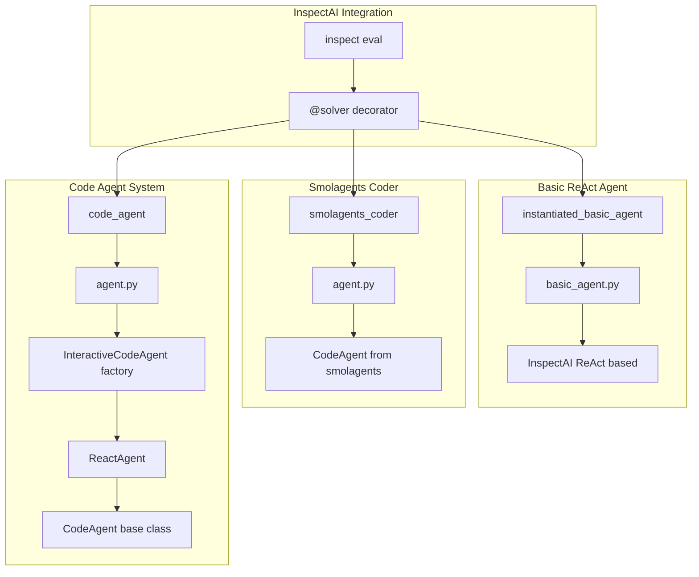
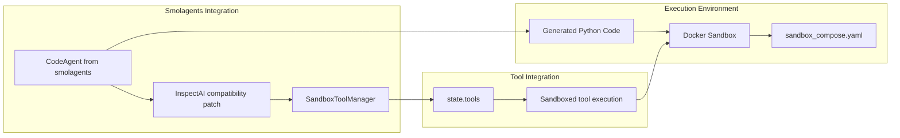
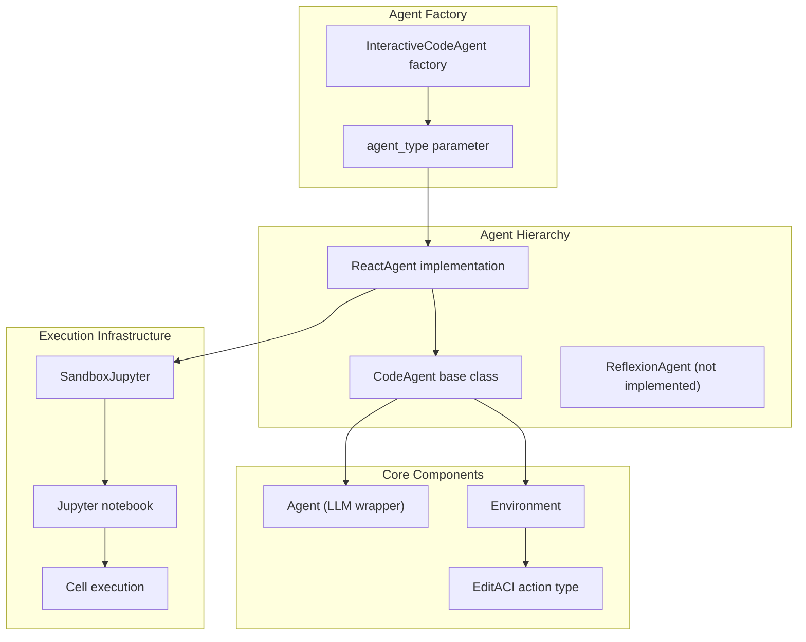

<!-- source: DeepWiki mcp.deepwiki.com · repo allenai/agent-baselines · page 4.1 Basic Agents · fetched 2026-10-26 -->

# Basic Agents

<details>
<summary>Relevant source files</summary>

The following files were used as context for generating this wiki page:

- [.github/workflows/ci-lint.yml](.github/workflows/ci-lint.yml)
- [agent_baselines/solvers/__init__.py](agent_baselines/solvers/__init__.py)
- [agent_baselines/solvers/arxivdigestables/asta_table_agent.py](agent_baselines/solvers/arxivdigestables/asta_table_agent.py)
- [agent_baselines/solvers/code_agent/README.md](agent_baselines/solvers/code_agent/README.md)
- [agent_baselines/solvers/code_agent/__init__.py](agent_baselines/solvers/code_agent/__init__.py)
- [agent_baselines/solvers/code_agent/agent.py](agent_baselines/solvers/code_agent/agent.py)
- [agent_baselines/solvers/code_agent/code_agent.py](agent_baselines/solvers/code_agent/code_agent.py)
- [solvers/datavoyager/demo.sh](solvers/datavoyager/demo.sh)
- [solvers/futurehouse/demo.sh](solvers/futurehouse/demo.sh)
- [solvers/react/README.md](solvers/react/README.md)
- [solvers/react/demo.sh](solvers/react/demo.sh)
- [solvers/smolagents/README.md](solvers/smolagents/README.md)
- [solvers/smolagents/demo.sh](solvers/smolagents/demo.sh)
- [solvers/sqa/demo.sh](solvers/sqa/demo.sh)

</details>


This document covers the fundamental agent implementations in the agent-baselines framework, including ReAct agents, code execution agents, and their core architectures. These agents provide the building blocks for more specialized implementations and demonstrate different approaches to tool-calling and code execution.

For information about scientific task specialists and routing systems, see [Specialized Agents](#4.4) and [Asta Router System](#4.3).

## Agent Implementation Overview

The agent-baselines framework provides three primary categories of basic agents, each with distinct approaches to task execution and tool interaction.

### Agent Types and Solver Registration



Sources: [solvers/react/README.md:1-15](), [solvers/smolagents/README.md:1-12](), [agent_baselines/solvers/code_agent/README.md:1-24](), [agent_baselines/solvers/code_agent/agent.py:9-16]()

## Basic ReAct Agent

The basic ReAct agent provides a straightforward implementation of the ReAct pattern using InspectAI's native tool-calling capabilities. It operates through observe-act loops where the LLM receives input, calls tools via JSON format, and processes responses.

### Key Features

| Feature | Description | Configuration |
|---------|-------------|---------------|
| Tool Integration | Supports any tools from `ToolsetConfig` | Various `with_*` flags |
| Step Control | Maximum observe-act iterations | `max_steps` parameter |
| AstaBench Compatibility | Supports submission tools | Built-in support |
| Native Tool-calling | Uses LLM's JSON tool format | No sandbox required |

### Common Configuration Options

The agent supports extensive configuration through solver parameters:

- `max_steps`: Controls maximum number of observe-act iterations
- `with_search_tools=0`: Disables search functionality  
- `with_table_editor=0`: Disables table editing tools
- `with_report_editor=0`: Disables report generation tools
- `with_thinking_tool=0`: Disables internal reasoning tool

Sources: [solvers/react/README.md:1-15](), [solvers/react/demo.sh:1-16]()

## Smolagents Coder  

The Smolagents Coder integrates the HuggingFace `smolagents` library's `CodeAgent` with InspectAI compatibility. Unlike the basic ReAct agent, it executes actions by generating and running Python code rather than using structured tool calls.

### Architecture and Requirements



### Key Differences from Basic ReAct

| Aspect | Basic ReAct | Smolagents Coder |
|--------|-------------|------------------|
| Action Method | JSON tool-calling | Python code generation |
| Sandbox Requirement | Optional | Mandatory |
| Tool Access | Direct LLM calls | `SandboxToolManager` |
| Model Support | All models | No OpenAI o3 reasoning |

Sources: [solvers/smolagents/README.md:1-12](), [solvers/smolagents/demo.sh:1-14]()

## Code Agent System

The code agent system provides a comprehensive framework for ReAct-style coding agents with Jupyter notebook functionality and file editing capabilities.

### Code Agent Architecture



### Implementation Components

The code agent system consists of several key classes:

- **`CodeAgent`**: Base class providing common functionality for prompt handling, LLM agent initialization, and environment setup
- **`ReactAgent`**: Async implementation of ReAct loop with Jupyter integration  
- **`Environment`**: Execution environment supporting action registration and step execution
- **`EditACI`**: Action type for code editing functionality
- **`Agent`**: LLM wrapper with trajectory storage and action generation

### Configuration Parameters

| Parameter | Type | Default | Description |
|-----------|------|---------|-------------|
| `agent_type` | str | "react" | Agent implementation type |
| `max_tries` | int | 10 | Maximum ReAct iterations |
| `json_output` | bool | False | Enforce JSON output format |
| `prompt_config_path` | str | None | YAML config for prompts |
| `cell_timeout` | int | 500 | Notebook cell timeout |
| `precompute_cells` | list | [] | Pre-execution cell list |

Sources: [agent_baselines/solvers/code_agent/code_agent.py:11-158](), [agent_baselines/solvers/code_agent/agent.py:9-77](), [agent_baselines/solvers/code_agent/README.md:1-24]()

## Usage Patterns and Examples

### Basic ReAct Agent Execution

```bash
uv run astabench eval \
  --solver agent_baselines/solvers/react/basic_agent.py@instantiated_basic_agent \
  --model openai/gpt-4.1-nano \
  -S max_steps=10 \
  -S with_search_tools=0
```

### Smolagents Coder Execution  

```bash
uv run astabench eval \
  --solver agent_baselines/solvers/smolagents/agent.py@smolagents_coder \
  --model openai/gpt-4.1-nano \
  --sandbox docker:agent_baselines/solvers/sandbox_util/sandbox_compose.yaml
```

### Code Agent Execution

```bash
inspect eval \
  --solver agent_baselines/solvers/code_agent/agent.py@code_agent \
  --model openai/gpt-4.1 \
  --sandbox docker:astabench/util/sandbox/sandbox_compose.yaml \
  -S agent_type=react -S max_tries=10
```

Sources: [solvers/react/demo.sh:1-16](), [solvers/smolagents/demo.sh:1-14](), [agent_baselines/solvers/code_agent/README.md:10-24]()

## Solver Integration Flow

```mermaid
graph LR
    subgraph "InspectAI Interface" 
        EVAL_CMD["inspect eval command"]
        SOLVER_PARAM["--solver parameter"]
        MODEL_PARAM["--model parameter"]
    end
    
    subgraph "Solver Resolution"
        FILE_PATH["Python file path"]
        SOLVER_NAME["@solver function name"]
        SOLVER_FUNC["Decorated solver function"]
    end
    
    subgraph "Agent Instantiation"
        TASKSTATE["TaskState input"]
        GENERATE["Generate function"]
        AGENT_INIT["Agent initialization"]
        AGENT_RUN["Agent execution loop"]
    end
    
    subgraph "Output Processing"
        RESPONSE["Agent response"]
        STATE_UPDATE["TaskState.output update"]
        COMPLETION["Final completion"]
    end
    
    EVAL_CMD --> SOLVER_PARAM
    SOLVER_PARAM --> FILE_PATH
    FILE_PATH --> SOLVER_NAME
    SOLVER_NAME --> SOLVER_FUNC
    
    SOLVER_FUNC --> TASKSTATE
    TASKSTATE --> GENERATE
    GENERATE --> AGENT_INIT
    AGENT_INIT --> AGENT_RUN
    
    AGENT_RUN --> RESPONSE
    RESPONSE --> STATE_UPDATE
    STATE_UPDATE --> COMPLETION
```



Sources: [agent_baselines/solvers/code_agent/agent.py:9-77](), [solvers/react/demo.sh:10-11](), [solvers/smolagents/demo.sh:10-11]()

---

