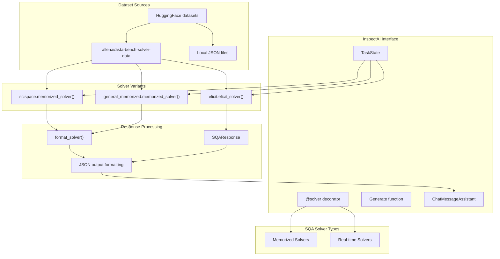
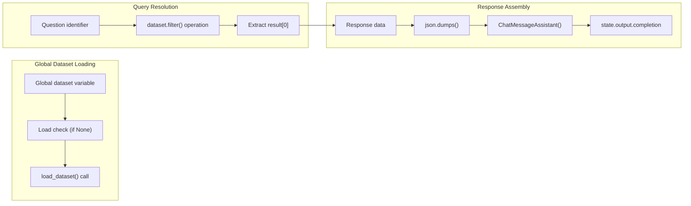
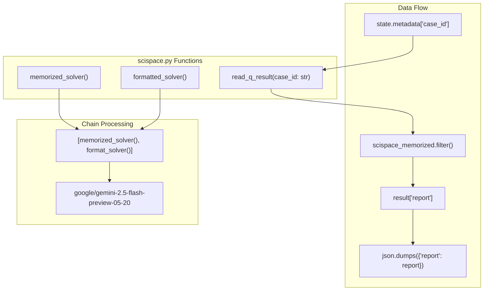
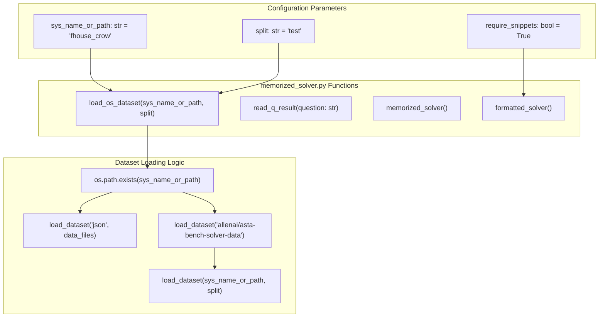
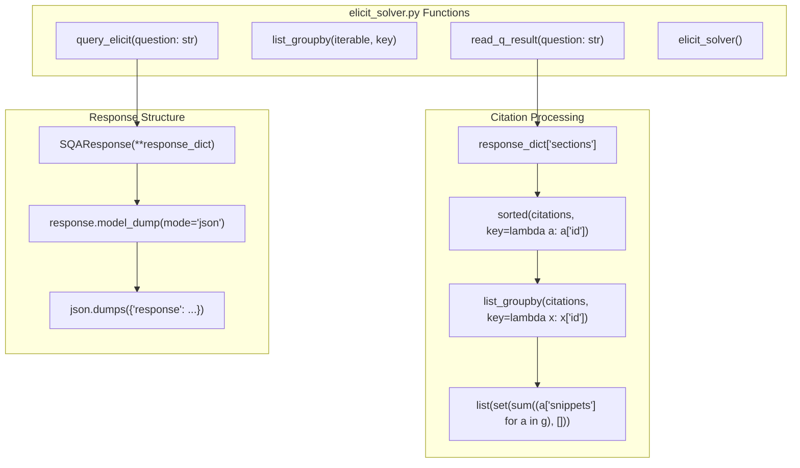

<!-- source: DeepWiki mcp.deepwiki.com · repo allenai/agent-baselines · page 4.2 SQA Solvers · fetched 2026-10-26 -->

# SQA Solvers

<details>
<summary>Relevant source files</summary>

The following files were used as context for generating this wiki page:

- [agent_baselines/solvers/sqa/elicit/memorized_solver.py](agent_baselines/solvers/sqa/elicit/memorized_solver.py)
- [agent_baselines/solvers/sqa/general_memorized/memorized_solver.py](agent_baselines/solvers/sqa/general_memorized/memorized_solver.py)
- [agent_baselines/solvers/sqa/scispace/scispace.py](agent_baselines/solvers/sqa/scispace/scispace.py)
- [solvers/smolagents/README.md](solvers/smolagents/README.md)
- [solvers/sqa/demo.sh](solvers/sqa/demo.sh)

</details>


## Purpose and Scope

This document covers the Scientific Question Answering (SQA) solvers in the agent-baselines framework. SQA solvers are specialized agents designed to answer scientific research questions by either retrieving pre-computed responses from memorized datasets or performing real-time analysis. These solvers implement the InspectAI solver interface and can be used standalone or as part of the Asta router system.

For information about the broader agent architecture and InspectAI solver interface, see [Agent Architecture](#4). For details about how the Asta router system dynamically selects SQA solvers based on task characteristics, see [Asta Router System](#4.3).

## SQA Solver Architecture

The SQA solver ecosystem consists of multiple variants that handle different data sources and response formats. All SQA solvers follow a common pattern of implementing the InspectAI `@solver` decorator and returning responses through the `ChatMessageAssistant` interface.

### Core Solver Components



Sources: [agent_baselines/solvers/sqa/scispace/scispace.py:1-41](), [agent_baselines/solvers/sqa/general_memorized/memorized_solver.py:1-67](), [agent_baselines/solvers/sqa/elicit/memorized_solver.py:1-63]()

## Memorized Solver Implementation

Memorized solvers return pre-computed responses by querying cached datasets. They follow a consistent pattern of loading datasets once globally and filtering by question identifiers.

### Dataset Loading Pattern



Sources: [agent_baselines/solvers/sqa/general_memorized/memorized_solver.py:14-35](), [agent_baselines/solvers/sqa/scispace/scispace.py:12-18]()

### Key Implementation Details

| Component | Scispace Variant | General Memorized | Elicit Variant |
|-----------|------------------|-------------------|-----------------|
| **Global Variable** | `scispace_memorized` | `os_dataset` | `elicit_memorized` |
| **Dataset Path** | `sqa/scispace/test.json` | `sqa/{sys_name_or_path}/{split}.json` | `sqa/elicit/responses.json` |
| **Question ID Source** | `state.metadata["case_id"]` | `state.metadata["initial_prompt"]` | `state.metadata["initial_prompt"]` |
| **Response Field** | `result["report"]` | `result["answer"]` | Full `SQAResponse` object |
| **Post-processing** | `format_solver()` chain | `format_solver()` chain | Direct JSON serialization |

Sources: [agent_baselines/solvers/sqa/scispace/scispace.py:17-18, 24-26](), [agent_baselines/solvers/sqa/general_memorized/memorized_solver.py:37-38, 44-45](), [agent_baselines/solvers/sqa/elicit/memorized_solver.py:20-21, 55-56]()

## Solver Function Implementations

### Scispace Solver

The scispace solver provides both memorized and formatted variants:



Sources: [agent_baselines/solvers/sqa/scispace/scispace.py:17-18, 22-31, 34-40]()

### General Memorized Solver

The general memorized solver supports configurable datasets and formatting options:



Sources: [agent_baselines/solvers/sqa/general_memorized/memorized_solver.py:17-34, 53-66]()

### Elicit Solver

The elicit solver handles structured responses with citations and sections:



Sources: [agent_baselines/solvers/sqa/elicit/memorized_solver.py:20-21, 24-49, 52-62]()

## Dataset Integration

### HuggingFace Datasets Configuration

All SQA solvers integrate with HuggingFace datasets through the `allenai/asta-bench-solver-data` repository. The dataset loading follows a consistent pattern:

| Solver | Dataset Path | Split | Filter Key |
|--------|--------------|-------|------------|
| **Scispace** | `sqa/scispace/test.json` | `train` | `case_id` |
| **General** | `sqa/{sys_name_or_path}/{split}.json` | Configurable | `question` |
| **Elicit** | `sqa/elicit/responses.json` | `train` | `id` |

Sources: [agent_baselines/solvers/sqa/scispace/scispace.py:12-14](), [agent_baselines/solvers/sqa/general_memorized/memorized_solver.py:28-32](), [agent_baselines/solvers/sqa/elicit/memorized_solver.py:13-17]()

### Error Handling and Fallbacks

The general memorized solver implements a three-tier fallback strategy for dataset loading:

1. **Local file path**: `load_dataset("json", data_files={split: sys_name_or_path})`
2. **Asta-bench repository**: `load_dataset("allenai/asta-bench-solver-data", data_files=f"sqa/{sys_name_or_path}/{split}.json")`
3. **Direct dataset name**: `load_dataset(sys_name_or_path, split=split)`

Sources: [agent_baselines/solvers/sqa/general_memorized/memorized_solver.py:21-34]()

## Usage and Execution

### Demo Script Configuration

The SQA solvers can be executed using the demo script which requires specific environment variables:

```bash
uv run inspect eval \
--solver agent_baselines/solvers/sqa/sqa.py@sqa_solver \
--model openai/gpt-4.1-nano \
--limit 1 \
astabench/sqa_dev
```

**Required Environment Variables:**
- `MODAL_TOKEN`: Required for execution
- `MODAL_TOKEN_SECRET`: Warning if not set  
- `S2_API_KEY`: Warning if not set (Semantic Scholar API)

Sources: [solvers/sqa/demo.sh:6-23]()

### Integration with Format Solvers

Most memorized solvers chain with `format_solver()` for response post-processing:

- **Model**: `google/gemini-2.5-flash-preview-05-20`
- **Snippets**: Configurable `require_snippets` parameter
- **Chain structure**: `chain([memorized_solver(), format_solver(...)])`

Sources: [agent_baselines/solvers/sqa/scispace/scispace.py:36-40](), [agent_baselines/solvers/sqa/general_memorized/memorized_solver.py:60-66]()

---

