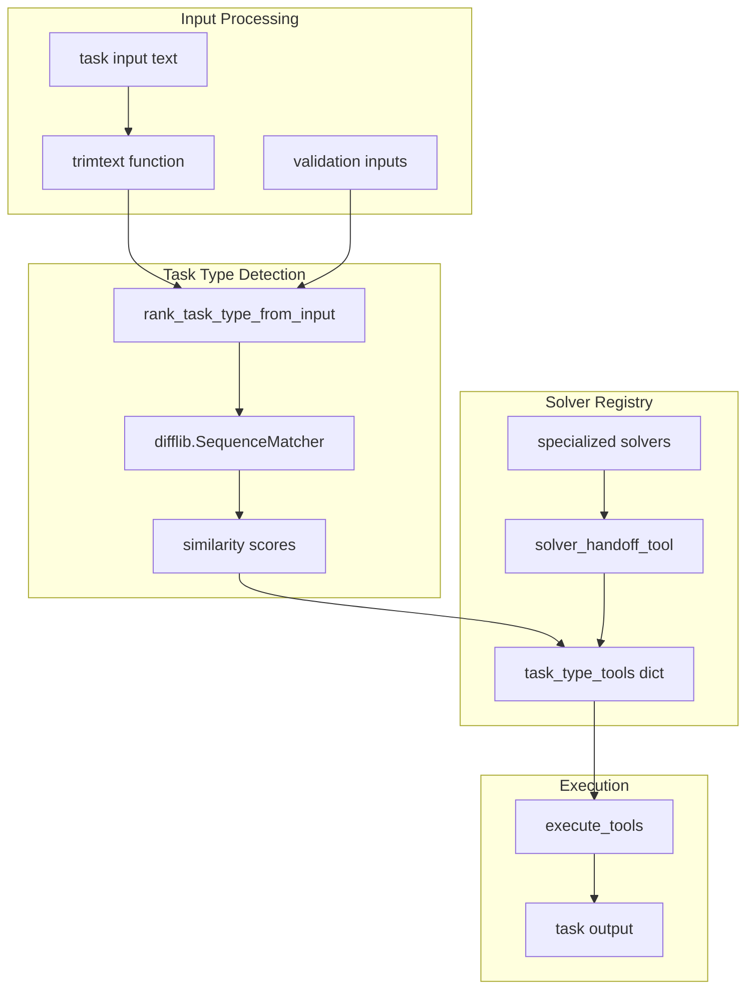
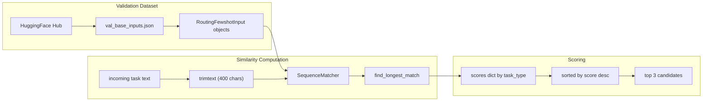
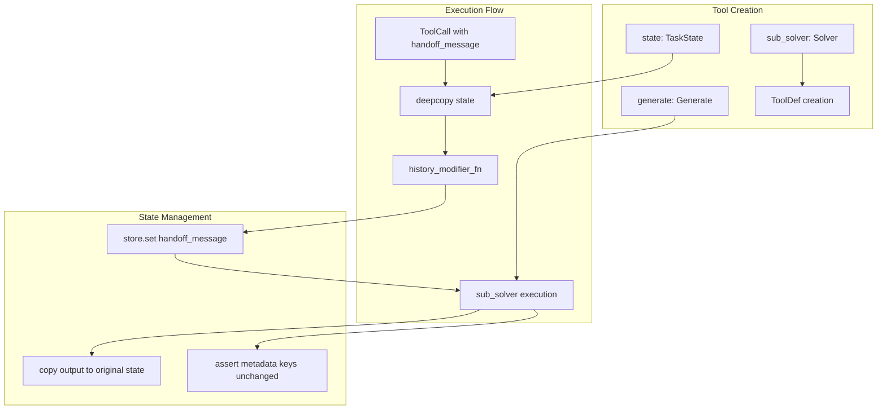

<!-- source: DeepWiki mcp.deepwiki.com · repo allenai/agent-baselines · page 4.3 Asta Router System · fetched 2026-10-26 -->

# Asta Router System

<details>
<summary>Relevant source files</summary>

The following files were used as context for generating this wiki page:

- [agent_baselines/solvers/asta/v0/asta.py](agent_baselines/solvers/asta/v0/asta.py)
- [agent_baselines/solvers/e2e_discovery/autoasta/autoasta_cached.py](agent_baselines/solvers/e2e_discovery/autoasta/autoasta_cached.py)
- [agent_baselines/solvers/e2e_discovery/codescientist/codescientist_cached.py](agent_baselines/solvers/e2e_discovery/codescientist/codescientist_cached.py)
- [solvers/arxivdigestables/README.md](solvers/arxivdigestables/README.md)
- [solvers/arxivdigestables/demo.sh](solvers/arxivdigestables/demo.sh)
- [solvers/arxivdigestables/env](solvers/arxivdigestables/env)
- [solvers/arxivdigestables/setup.sh](solvers/arxivdigestables/setup.sh)
- [solvers/asta-v0/README.md](solvers/asta-v0/README.md)
- [solvers/asta-v0/demo.sh](solvers/asta-v0/demo.sh)
- [solvers/asta-v0/env](solvers/asta-v0/env)
- [solvers/asta-v0/setup.sh](solvers/asta-v0/setup.sh)

</details>


The Asta Router System is an intelligent orchestrator that automatically detects task types and dispatches requests to specialized sub-agents. It uses text similarity matching against a validation dataset to achieve 100% routing accuracy, selecting the most appropriate solver for each input task.

For information about individual specialized agents that the router can dispatch to, see [Specialized Agents](#4.4). For basic agent implementations, see [Basic Agents](#4.1).

## Overview

The Asta-v0 router operates as a meta-solver that analyzes incoming tasks and routes them to task-specific solvers without requiring explicit task type annotations. The system is implemented in the `fewshot_textsim_router` solver and uses few-shot text similarity matching to determine the appropriate sub-agent.

Sources: [agent_baselines/solvers/asta/v0/asta.py:178-188](), [solvers/asta-v0/README.md:1-4]()

## Architecture

### Router Components



The router follows a clear pipeline: input preprocessing, task type detection via text similarity, tool selection, and execution handoff to the chosen specialized solver.

Sources: [agent_baselines/solvers/asta/v0/asta.py:141-176](), [agent_baselines/solvers/asta/v0/asta.py:286-323]()

### Supported Task Types and Solvers

| Task Type | Solver | Description | Model Configuration |
|-----------|--------|-------------|-------------------|
| `sqa` | `sqa_solver` | Scientific Question Answering | `claude-4.0` |
| `arxivdigestables` | `tables_solver` | Table generation from papers | `openai/o3-2025-04-16` |
| `super` | `code_agent` | Repository reproduction | `openai/gpt-4.1-2025-04-14` |
| `paper_finder` | `ai2i_paper_finder` | Paper search and retrieval | Uses MABOOL_URL service |
| `discoverybench` | `datavoyager_solver` | Data analysis tasks | Magentic One configuration |
| `e2e_discovery` | `autoasta_cached_solver` | End-to-end discovery | `claude-sonnet-4-20250514` |
| `other` | `instantiated_basic_agent` | Fallback for unrecognized tasks | `openai/o3-2025-04-16` |

Sources: [agent_baselines/solvers/asta/v0/asta.py:35-46](), [agent_baselines/solvers/asta/v0/asta.py:240-283]()

## Task Type Detection

### Text Similarity Matching



The system uses `difflib.SequenceMatcher` to find the longest common subsequence between the input text and validation examples. Text is trimmed to 400 characters (200 from start + 200 from end) to focus on the most relevant content.

Sources: [agent_baselines/solvers/asta/v0/asta.py:141-176](), [agent_baselines/solvers/asta/v0/asta.py:156-160]()

### Task Name Normalization

The `task_name_to_task_type` function normalizes raw task names by removing suffixes like `_test`, `_validation`, `_dev` and taking the first two underscore-separated components. This ensures consistent mapping to the supported task types defined in `TASK_TYPES`.

Sources: [agent_baselines/solvers/asta/v0/asta.py:49-59]()

## Handoff Mechanism

### Solver Handoff Tool



The `solver_handoff_tool` creates isolated execution environments for sub-solvers. It deep-copies the task state, applies optional history modifications, and ensures metadata integrity while allowing sub-solvers to operate independently.

Sources: [agent_baselines/solvers/asta/v0/asta.py:62-126]()

### History Modification

The router uses a `set_hist_to_original` function to reset the message history to the base state before handoff, ensuring each sub-solver receives the original task context without router-specific messages.

Sources: [agent_baselines/solvers/asta/v0/asta.py:211-212](), [agent_baselines/solvers/asta/v0/asta.py:224]()

## Configuration and Dependencies

### Environment Requirements

The router requires multiple environment variables for different sub-solvers:

- `MODAL_TOKEN` and `MODAL_TOKEN_SECRET`: For Modal platform execution
- `S2_API_KEY`: For Semantic Scholar API access  
- `MABOOL_URL`: For paper finder service

Sources: [solvers/asta-v0/env:1-5]()

### Dependency Installation

```bash
uv sync --extra sqa --extra datavoyager --extra super
```

The router requires multiple optional dependency groups to support all specialized solvers it can route to.

Sources: [solvers/asta-v0/setup.sh:3]()

### Validation Data Loading

The system loads validation examples from HuggingFace Hub using the `ASTA_SOLVER_DATA_REPO` and `ASTA_SOLVER_DATA_REVISION` constants. The validation data is structured as `RoutingFewshotInput` objects containing task name, input text, and canary values.

Sources: [agent_baselines/solvers/asta/v0/asta.py:128-139](), [agent_baselines/solvers/asta/v0/asta.py:27-33]()

## Usage

### Demo Execution

```bash
uv run astabench eval \
--solver agent_baselines/solvers/asta/v0/asta.py@fewshot_textsim_router \
--model mockllm/model \
--split validation \
--ignore-git \
--limit 1
```

The router is invoked using the `fewshot_textsim_router` solver function. Note that the top-level model setting is ignored since each sub-agent has its own model configuration.

Sources: [solvers/asta-v0/demo.sh:23-29]()

### Error Handling and Fallback

The router implements robust error handling with automatic fallback to the next highest-scoring task type if a sub-solver fails. It tries up to 3 task types before giving up, and uses an "other" category fallback for unrecognized task types.

Sources: [agent_baselines/solvers/asta/v0/asta.py:296-323]()

---

