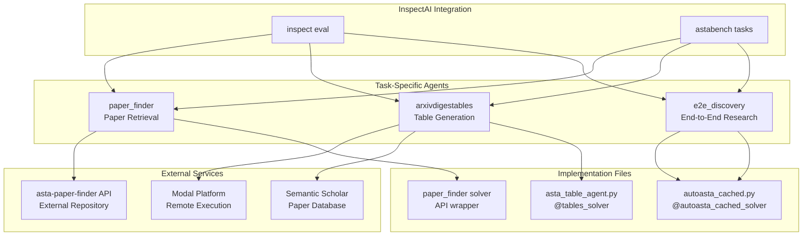
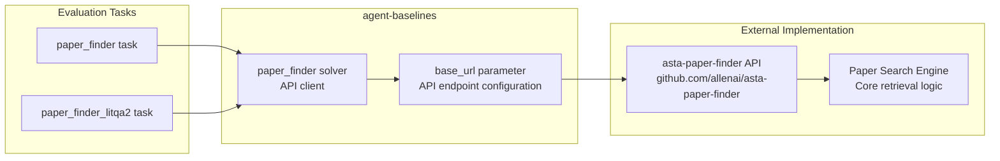
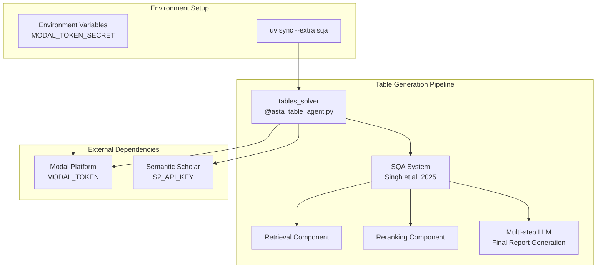
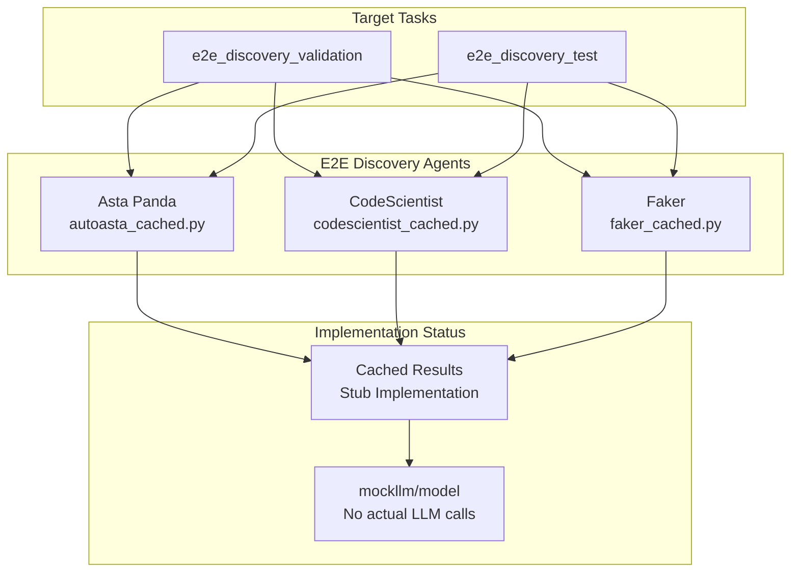

<!-- source: DeepWiki mcp.deepwiki.com · repo allenai/agent-baselines · page 4.4 Specialized Agents · fetched 2026-10-26 -->

# Specialized Agents

<details>
<summary>Relevant source files</summary>

The following files were used as context for generating this wiki page:

- [solvers/arxivdigestables/README.md](solvers/arxivdigestables/README.md)
- [solvers/arxivdigestables/demo.sh](solvers/arxivdigestables/demo.sh)
- [solvers/arxivdigestables/env](solvers/arxivdigestables/env)
- [solvers/arxivdigestables/setup.sh](solvers/arxivdigestables/setup.sh)
- [solvers/asta-v0/README.md](solvers/asta-v0/README.md)
- [solvers/asta-v0/env](solvers/asta-v0/env)
- [solvers/asta-v0/setup.sh](solvers/asta-v0/setup.sh)
- [solvers/e2e_discovery/README.md](solvers/e2e_discovery/README.md)
- [solvers/e2e_discovery/demo.sh](solvers/e2e_discovery/demo.sh)
- [solvers/e2e_discovery/env](solvers/e2e_discovery/env)
- [solvers/e2e_discovery/setup.sh](solvers/e2e_discovery/setup.sh)
- [solvers/paper_finder/README.md](solvers/paper_finder/README.md)

</details>


This document covers task-specific agents designed for specialized scientific and research workflows. These agents are optimized for particular domains such as paper retrieval, table generation, and end-to-end discovery tasks. For general-purpose agents like ReAct, see [Basic Agents](#4.1). For SQA solvers, see [SQA Solvers](#4.2). For the intelligent routing system that selects these specialized agents, see [Asta Router System](#4.3).

## Overview

The agent-baselines framework includes several specialized agents that target specific scientific research tasks. Unlike general-purpose agents that handle broad tool-calling scenarios, these agents are fine-tuned for particular workflows and integrate with domain-specific APIs and services.

### Specialized Agent Architecture



Sources: `solvers/paper_finder/README.md`, `solvers/arxivdigestables/README.md`, `solvers/e2e_discovery/README.md`

## Paper Finder Agent

The Paper Finder agent specializes in retrieving relevant academic papers for research queries. It is designed specifically for the `paper_finder` and `paper_finder_litqa2` evaluation tasks in the AstaBench framework.

### Architecture

The Paper Finder agent operates as an API wrapper rather than a standalone implementation. The core logic resides in an external repository, and the solver in this codebase acts as an interface to that service.



### Configuration

| Parameter | Description | Required |
|-----------|-------------|----------|
| `base_url` | API endpoint for the paper finder service | Yes |

The solver requires the external API to be deployed and accessible at the specified `base_url`. Setup instructions are available in the [asta-paper-finder repository](https://github.com/allenai/asta-paper-finder).

Sources: `solvers/paper_finder/README.md`

## ArxivDigestables Agent

The ArxivDigestables agent generates structured tables from academic papers, specifically designed for the `arxivdigestables_validation` task. It leverages the SQA (Scientific Question Answering) system for multi-step reasoning and paper analysis.

### Implementation Details



### Environment Requirements

The ArxivDigestables agent requires several environment variables and dependencies:

| Variable | Purpose | Required |
|----------|---------|----------|
| `MODAL_TOKEN` | Modal platform authentication | Yes |
| `MODAL_TOKEN_SECRET` | Modal token secret | Recommended |
| `S2_API_KEY` | Semantic Scholar API access | Recommended |

### Setup and Execution

```bash
# Install dependencies
uv sync --extra sqa

# Run evaluation
inspect eval \
  --solver agent_baselines/solvers/arxivdigestables/asta_table_agent.py@tables_solver \
  --model openai/gpt-4.1 \
  --limit 1 \
  astabench/arxivdigestables_validation
```

The solver implementation is located at [agent_baselines/solvers/arxivdigestables/asta_table_agent.py]().

Sources: `solvers/arxivdigestables/README.md`, `solvers/arxivdigestables/demo.sh`, `solvers/arxivdigestables/setup.sh`, `solvers/arxivdigestables/env`

## E2E Discovery Agents

The E2E Discovery system includes three specialized agents for end-to-end research discovery tasks: Asta Panda, CodeScientist, and Faker. Currently, these agents operate using cached results from their full implementations.

### Agent Variants



### Current Implementation

The E2E Discovery agents are not yet fully integrated into the agent-baselines framework. They currently fetch cached results from their real implementations rather than executing live reasoning.

#### Asta Panda Agent

The primary E2E Discovery agent, implemented as a cached solver:

```bash
# Demo execution
inspect eval \
  --solver agent_baselines/solvers/e2e_discovery/autoasta/autoasta_cached.py@autoasta_cached_solver \
  --model mockllm/model \
  --limit 1 \
  astabench/e2e_discovery_validation
```

The solver uses `mockllm/model` because results are pre-cached, eliminating the need for actual model calls during evaluation.

### File Structure

| Agent | Solver Path | Function |
|-------|-------------|----------|
| Asta Panda | `agent_baselines/solvers/e2e_discovery/autoasta/autoasta_cached.py` | `@autoasta_cached_solver` |
| CodeScientist | `agent_baselines/solvers/e2e_discovery/codescientist/` | Similar cached implementation |
| Faker | `agent_baselines/solvers/e2e_discovery/faker/` | Similar cached implementation |

Sources: `solvers/e2e_discovery/README.md`, `solvers/e2e_discovery/demo.sh`, `solvers/e2e_discovery/setup.sh`

## Integration with Routing

These specialized agents are designed to work with the Asta-v0 routing system, which automatically selects the appropriate agent based on task characteristics. The router can dynamically dispatch tasks to Paper Finder for paper retrieval, ArxivDigestables for table generation, or E2E Discovery agents for comprehensive research workflows.

For detailed information about the routing mechanism and how these agents are selected, see [Asta Router System](#4.3).

Sources: `solvers/asta-v0/README.md`

---

