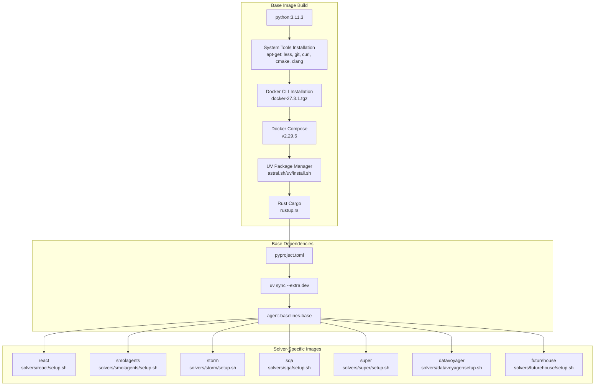
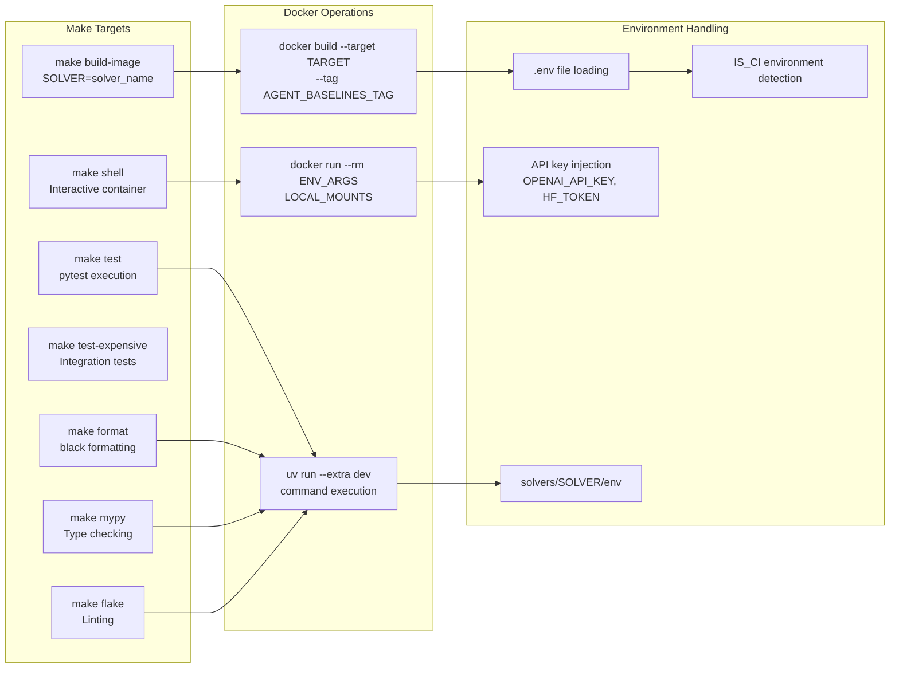
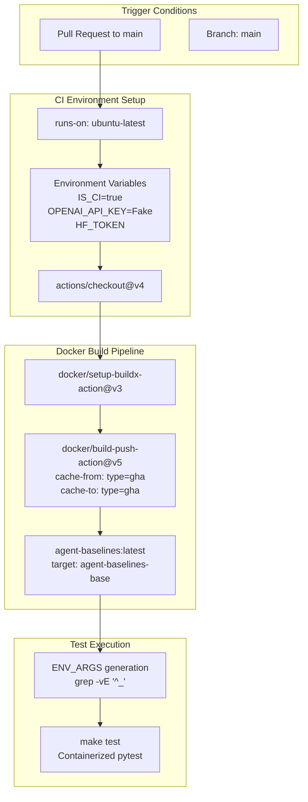
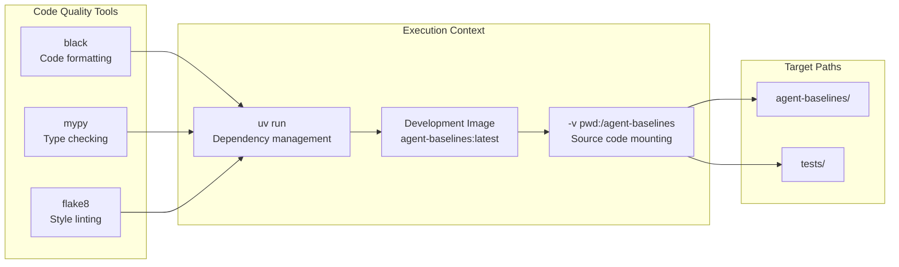
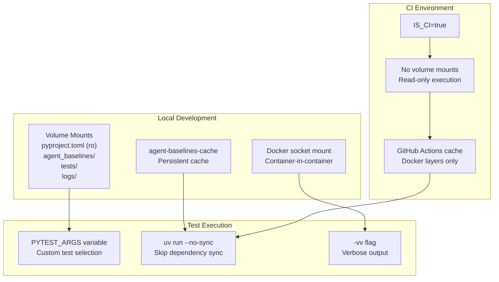

<!-- source: DeepWiki mcp.deepwiki.com · repo allenai/agent-baselines · page 5 Development Guide · fetched 2026-10-26 -->

# Development Guide

<details>
<summary>Relevant source files</summary>

The following files were used as context for generating this wiki page:

- [.github/workflows/ci-test.yml](.github/workflows/ci-test.yml)
- [Makefile](Makefile)
- [docker/Dockerfile](docker/Dockerfile)
- [setup.cfg](setup.cfg)

</details>


This document provides comprehensive instructions for developers contributing to the agent-baselines project. It covers the development workflow, Docker-based environment setup, continuous integration pipeline, code quality standards, and testing practices. For information about the evaluation pipeline and DVC configuration, see [Evaluation Pipeline](#3). For details about agent implementation and architecture, see [Agent Architecture](#4).

## Docker-Based Development Environment

The project uses a sophisticated Docker-based development environment with multi-stage builds to support different agent types and their dependencies. The development workflow is centered around containerized execution to ensure consistency across different development environments.

### Docker Build Architecture



The Docker build system supports building both the base image and solver-specific images. The base image `agent-baselines-base` contains all common dependencies, while solver-specific images extend the base with additional requirements.

**Sources:** [docker/Dockerfile:1-63]()

### Makefile Development Interface

The `Makefile` provides a unified interface for all development tasks, automatically handling Docker builds, environment variable injection, and container orchestration.



Key environment variables and mounting behavior:
- **Local Development**: Mounts source code directories for live editing
- **CI Environment**: Uses read-only container execution
- **Solver-Specific**: Loads `solvers/{SOLVER}/env` files automatically

**Sources:** [Makefile:1-137]()

## CI/CD Pipeline

The continuous integration pipeline uses GitHub Actions with Docker layer caching to ensure fast, reliable builds and comprehensive testing.

### GitHub Actions Workflow



The CI pipeline includes several key optimizations:
- **Layer Caching**: Uses GitHub Actions cache (`type=gha`) to speed up Docker builds
- **Environment Isolation**: Filters environment variables to exclude internal ones
- **Fake API Keys**: Provides placeholder values to prevent import-time failures

**Sources:** [.github/workflows/ci-test.yml:1-38]()

## Code Quality Standards

The project enforces code quality through automated tools integrated into both the development workflow and CI pipeline.

### Type Checking with mypy

The mypy configuration in `setup.cfg` provides flexible type checking suitable for a research codebase:

| Configuration | Value | Purpose |
|---------------|-------|---------|
| `python_version` | 3.11 | Target Python version |
| `disallow_untyped_defs` | False | Allow untyped functions for flexibility |
| `check_untyped_defs` | True | Check typed portions thoroughly |
| `no_implicit_optional` | True | Require explicit Optional annotations |
| `follow_untyped_imports` | True | Follow imports even if untyped |

**Ignored Import Modules**: The configuration ignores missing imports for optional dependencies:
- `pyasn1.*`, `langchain_*`, `autogen_*`, `smolagents.*`, `langgraph.*`, `litellm.*`

This approach allows the development image to run type checking without installing all optional solver dependencies.

**Sources:** [setup.cfg:1-49]()

### Code Formatting and Linting



All code quality tools run within the Docker container to ensure consistent environments. The `Makefile` provides convenience targets that automatically build the image if needed (in local development) or use the existing image (in CI).

**Sources:** [Makefile:86-121]()

## Testing Framework

The testing system uses pytest with different test categories and execution modes to support both fast development cycles and comprehensive validation.

### Test Execution Modes

| Command | Dependencies | Purpose | Environment |
|---------|-------------|---------|-------------|
| `make test` | `--extra dev --extra smolagents` | Fast unit tests | Standard pytest |
| `make test-expensive` | `--extra dev --extra inspect_evals --extra smolagents` | Integration tests | `-m expensive` marker |

### Environment-Specific Behavior



The testing system automatically detects the execution environment (`IS_CI`) and adjusts mounting and caching behavior accordingly. In local development, live code editing is supported through volume mounts, while CI uses immutable container execution.

**Sources:** [Makefile:44-59](), [Makefile:122-137]()

## Development Workflow

### Quick Start Commands

1. **Build base development image:**
   ```bash
   make build-image
   ```

2. **Enter interactive development shell:**
   ```bash
   make shell
   ```

3. **Run code quality checks:**
   ```bash
   make format mypy flake
   ```

4. **Execute tests:**
   ```bash
   make test
   # Or with specific test selection
   make test PYTEST_ARGS="-k test_name"
   ```

5. **Build solver-specific image:**
   ```bash
   make build-image SOLVER=react
   make shell SOLVER=react
   ```

### Environment Variable Management

The build system supports multiple methods for environment variable injection:

- **`.env` file**: Automatically loaded if present
- **Direct export**: `export OPENAI_API_KEY=...`
- **Solver-specific**: Automatically loads `solvers/{SOLVER}/env`
- **Make variable**: `SOLVER=react make shell`

**Sources:** [Makefile:23-39]()

This development guide provides the foundation for contributing to the agent-baselines project, ensuring consistent development practices and reliable code quality across all contributions.

---

