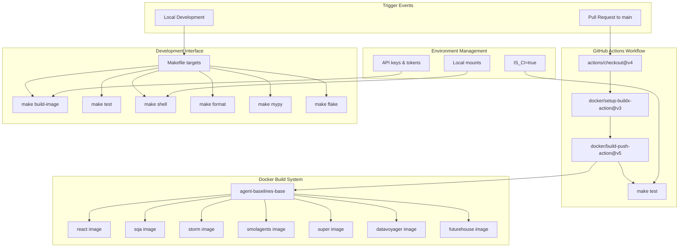
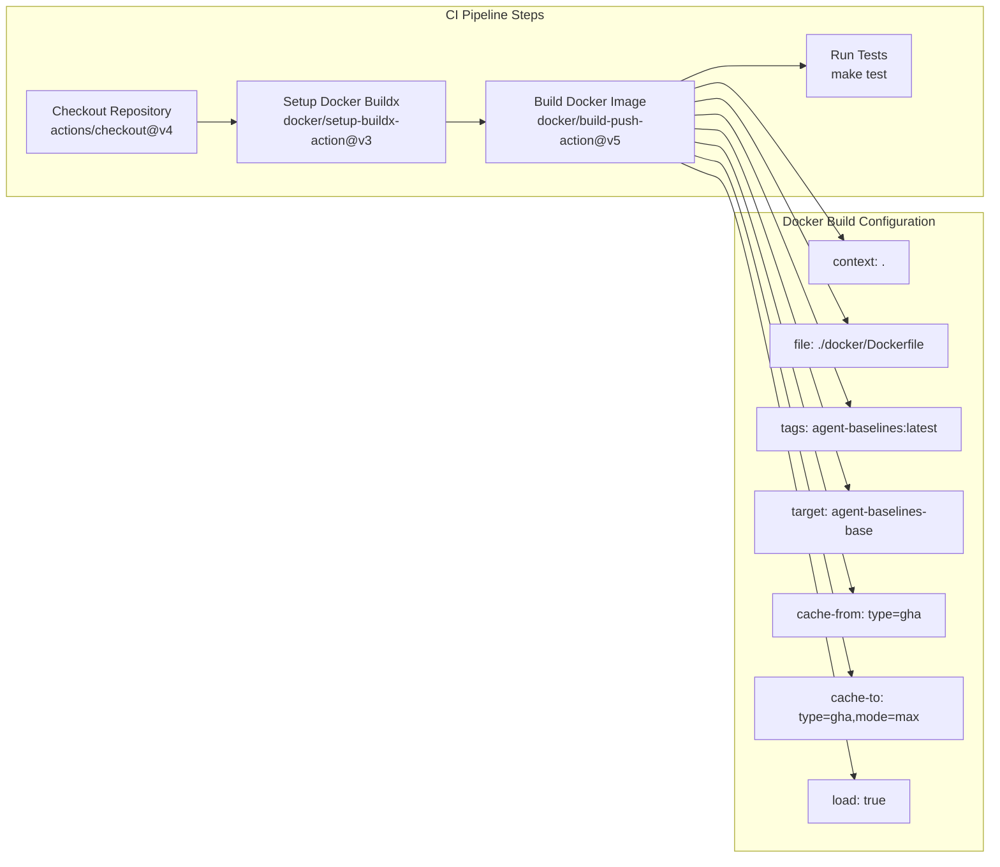
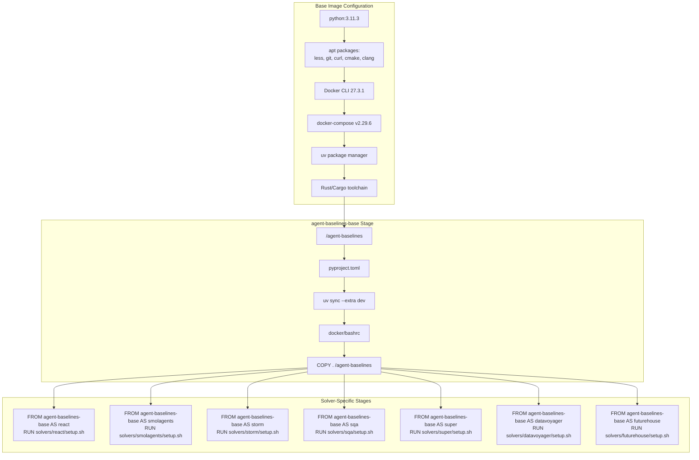
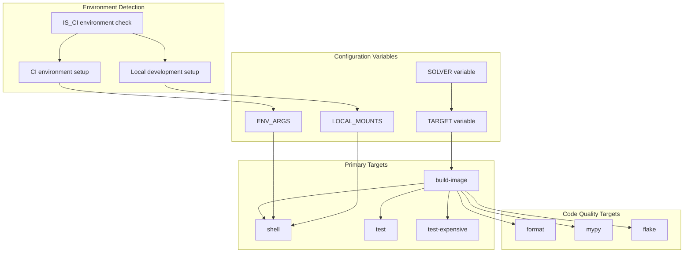
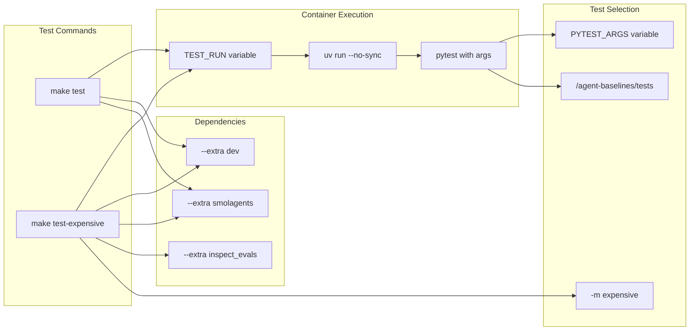
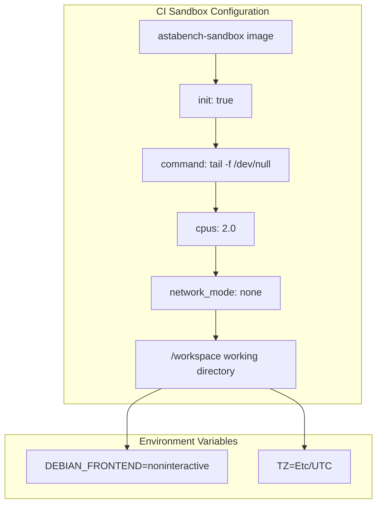
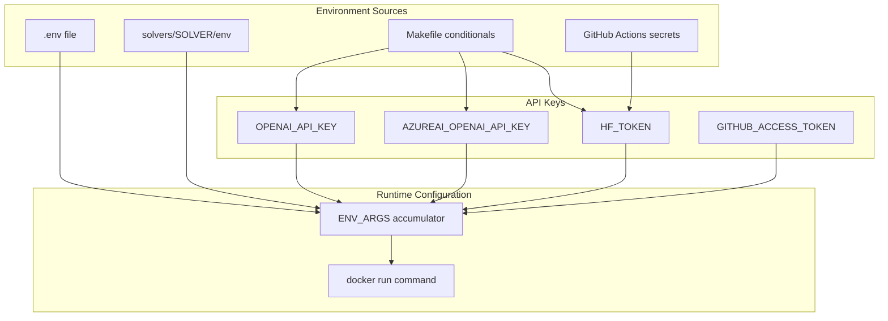

<!-- source: DeepWiki mcp.deepwiki.com · repo allenai/agent-baselines · page 5.1 CI/CD Pipeline · fetched 2026-10-26 -->

# CI/CD Pipeline

Relevant source files

The following files were used as context for generating this wiki page:

- [.github/workflows/ci-test.yml](.github/workflows/ci-test.yml)
- [Makefile](Makefile)
- [docker/Dockerfile](docker/Dockerfile)
- [tests/solvers/ci_sandbox_compose.yaml](tests/solvers/ci_sandbox_compose.yaml)

This document covers the CI/CD infrastructure for the agent-baselines repository, including GitHub Actions workflows, Docker build systems, and development tooling. The pipeline supports both local development and automated testing for a multi-agent evaluation framework.

For information about code quality tools and development standards, see [Code Quality and Configuration](#5.2). For Docker environment setup details, see [Docker Environment](#2.2).

## CI/CD Architecture Overview

The agent-baselines project uses a multi-layered CI/CD approach centered around Docker containerization and GitHub Actions automation.

### CI/CD System Architecture

Sources: [.github/workflows/ci-test.yml:1-38](), [Makefile:1-137](), [docker/Dockerfile:1-63]()

## GitHub Actions Pipeline

The CI pipeline is defined in `.github/workflows/ci-test.yml` and triggers on pull requests to the main branch.

### Workflow Configuration

The workflow runs on `ubuntu-latest` with the following environment setup:

| Environment Variable | Purpose | Source |
|---------------------|---------|---------|
| `IS_CI` | Flags CI environment behavior | [.github/workflows/ci-test.yml:11]() |
| `OPENAI_API_KEY` | Fake key to satisfy import requirements | [.github/workflows/ci-test.yml:12]() |
| `HF_TOKEN` | Hugging Face authentication | [.github/workflows/ci-test.yml:13]() |

### Pipeline Steps

The pipeline leverages GitHub Actions cache for Docker layers to improve build performance through the `type=gha` cache configuration.

Sources: [.github/workflows/ci-test.yml:15-38]()

## Docker Build System

The Docker build system uses a multi-stage approach to create specialized images for different agent solvers.

### Multi-Stage Build Architecture

Each solver stage inherits from `agent-baselines-base` and runs its specific setup script to install additional dependencies.

Sources: [docker/Dockerfile:1-63]()

## Development Workflow

The Makefile provides a unified interface for development tasks, with behavior that adapts between CI and local environments.

### Make Target Architecture

### Environment-Specific Configurations

The Makefile distinguishes between CI and local environments using the `IS_CI` variable:

**CI Environment** ([Makefile:44-48]()):
- No local volume mounts
- Simplified Docker run command
- Uses `--quiet` build flag
- Includes `/var/run/docker.sock` mount for Docker-in-Docker

**Local Environment** ([Makefile:50-58]()):
- Extensive volume mounts for development
- Cache volume persistence
- Real-time code synchronization
- Interactive shell support

Sources: [Makefile:1-137]()

## Testing Infrastructure

The testing system supports both basic and expensive test suites with different dependency requirements.

### Test Execution Flow

### Sandbox Testing

The CI system includes isolated sandbox testing using Docker Compose configuration:

Sources: [Makefile:126-136](), [tests/solvers/ci_sandbox_compose.yaml:1-12]()

## Environment Management

The system handles complex environment variable management for API keys, tokens, and configuration.

### Environment Variable Handling

The Makefile conditionally adds environment variables to `ENV_ARGS` based on their availability, supporting flexible deployment scenarios.

Sources: [Makefile:23-39](), [.github/workflows/ci-test.yml:10-13]()

---

