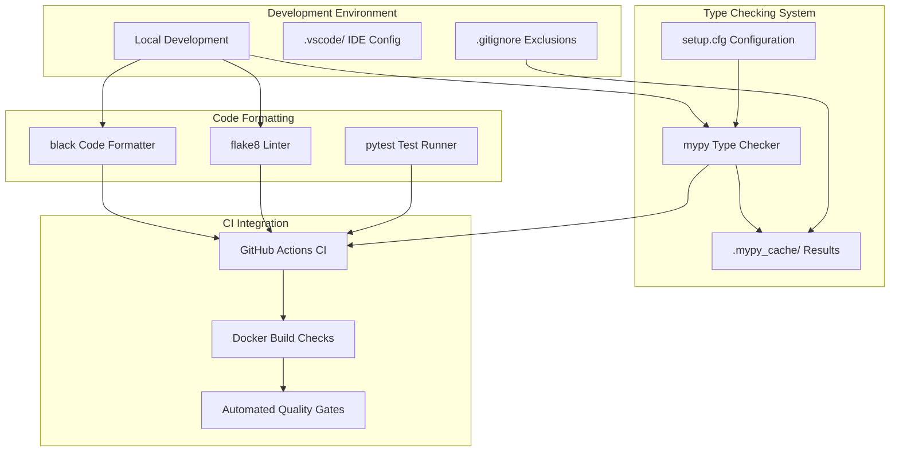
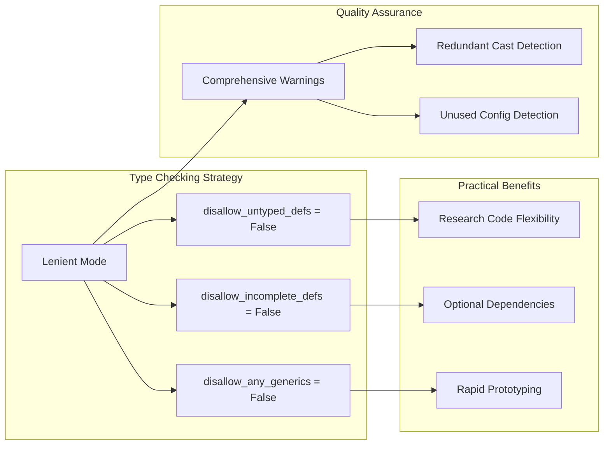
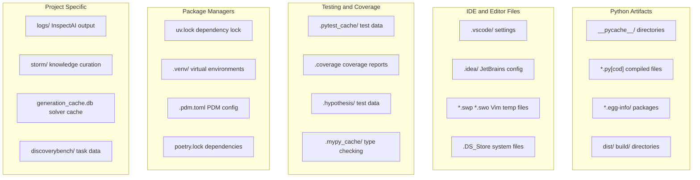
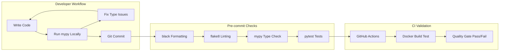

<!-- source: DeepWiki mcp.deepwiki.com · repo allenai/agent-baselines · page 5.2 Code Quality and Configuration · fetched 2026-10-26 -->

# Code Quality and Configuration

Relevant source files

The following files were used as context for generating this wiki page:

- [.gitignore](.gitignore)
- [setup.cfg](setup.cfg)

## Purpose and Scope

This document covers the code quality tools, type checking configuration, linting standards, and development practices used in the agent-baselines project. It focuses on the static analysis tools and configuration that ensure code consistency and catch errors before runtime.

For information about the CI/CD pipeline that automates these quality checks, see [CI/CD Pipeline](#5.1). For general development setup and Docker environments, see [Getting Started](#2).

## Code Quality Toolchain

The project employs a comprehensive set of tools to maintain code quality and consistency across the codebase.

### Static Analysis and Type Checking Pipeline

Sources: [.gitignore:152-155](), [setup.cfg:1-49]()

## MyPy Type Checking Configuration

The project uses MyPy for static type checking with a comprehensive configuration that balances strictness with practical development needs.

### Core MyPy Settings

The type checking configuration is centralized in `setup.cfg` and targets Python 3.11 compatibility:

| Setting | Value | Purpose |
|---------|--------|---------|
| `python_version` | 3.11 | Target Python version |
| `warn_redundant_casts` | True | Detect unnecessary type casts |
| `warn_unused_ignores` | True | Flag unused `# type: ignore` comments |
| `check_untyped_defs` | True | Analyze untyped function bodies |
| `no_implicit_optional` | True | Require explicit Optional typing |
| `strict_optional` | True | Strict None checking |

Sources: [setup.cfg:1-17]()

### Lenient Type Checking Approach

The configuration uses a lenient approach suitable for a research codebase with optional dependencies:

Sources: [setup.cfg:6-8](), [setup.cfg:12-16]()

### Optional Dependency Handling

The configuration includes specific ignore patterns for optional dependencies that may not be installed in all environments:

| Module Pattern | Purpose |
|----------------|---------|
| `pyasn1.*` | ASN.1 parsing library |
| `langchain_community.*` | LangChain community components |
| `langchain_core.*` | LangChain core functionality |
| `autogen_agentchat.*` | AutoGen agent chat system |
| `autogen_core.*` | AutoGen core components |
| `autogen_ext.*` | AutoGen extensions |
| `smolagents.*` | Hugging Face small agents |
| `langchain_openai.*` | LangChain OpenAI integration |
| `langgraph.*` | LangGraph workflow system |
| `litellm.*` | LiteLLM proxy library |

This approach allows MyPy to run successfully in development environments where not all optional dependencies are installed, such as the base Docker image.

Sources: [setup.cfg:18-49]()

## Git Ignore Patterns

The project maintains comprehensive exclusion patterns to keep the repository clean and avoid committing generated or sensitive files.

### Development Tool Exclusions

Sources: [.gitignore:1-201]()

### Project-Specific Exclusions

The gitignore includes several project-specific patterns that reflect the agent evaluation workflow:

- `logs/` - InspectAI evaluation log directory
- `generation_cache.db` - Solver response caching database  
- `astabench/evals/sqa/storm/` - STORM knowledge curation outputs
- `discoverybench/` - DiscoveryBench task data
- `CLAUDE.md` - AI-generated documentation files

Sources: [.gitignore:176-200]()

## Integration with Development Workflow

The code quality configuration integrates seamlessly with the development and CI/CD pipeline to maintain consistent standards.

### Local Development Integration

Sources: [setup.cfg:1-49](), [.gitignore:152-155]()

The configuration ensures that type checking works reliably across different environments by ignoring missing imports for optional dependencies while maintaining strict checking for core functionality. This approach supports the project's modular architecture where different solvers may require different optional dependencies.