# Page: Overview

# Overview

<details>
<summary>Relevant source files</summary>

The following files were used as context for generating this wiki page:

- [README.md](README.md)
- [pyproject.toml](pyproject.toml)

</details>


## Purpose and Scope

The agent-baselines repository provides baseline implementations of AI agents designed for evaluation against the AstaBench benchmarking suite. This framework serves as a comprehensive testbed for comparing different agent architectures, from general-purpose ReAct agents to specialized scientific task solvers. The repository implements agents as InspectAI solvers, enabling standardized evaluation across multiple tasks and models.

This document covers the high-level architecture and core systems within agent-baselines. For detailed installation instructions, see [Installation and Dependencies](#2.1). For information about running evaluations, see [Evaluation Pipeline](#3). For specific agent implementations, see [Agent Architecture](#4).

## High-Level System Architecture

The agent-baselines framework is built around a modular architecture that separates agent implementations, evaluation infrastructure, and dependency management:

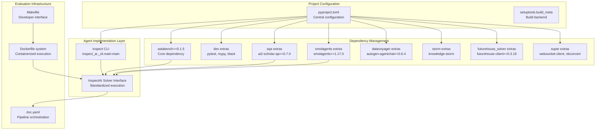

Sources: [pyproject.toml:1-112](), [README.md:1-116]()

## Agent Solver Ecosystem

The repository implements multiple specialized agents as InspectAI solvers, organized by task domain and capability:

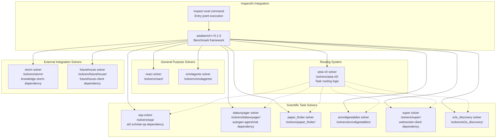

Sources: [pyproject.toml:29-54](), [README.md:26-49]()

## Key Components

### Project Configuration

The project uses a centralized configuration approach through `pyproject.toml`, which defines the build system, dependencies, and tooling configuration:

| Component | Purpose | Configuration Location |
|-----------|---------|------------------------|
| Build System | Package building with setuptools | [pyproject.toml:1-3]() |
| Core Dependencies | AstaBench integration | [pyproject.toml:10-12]() |
| Optional Dependencies | Modular solver requirements | [pyproject.toml:14-54]() |
| Package Discovery | Agent baselines module inclusion | [pyproject.toml:59-64]() |
| Tool Configuration | Development and quality tools | [pyproject.toml:81-111]() |

### Dependency Conflicts and Resolution

The project manages complex dependency conflicts between different solver implementations using UV's conflict resolution system:

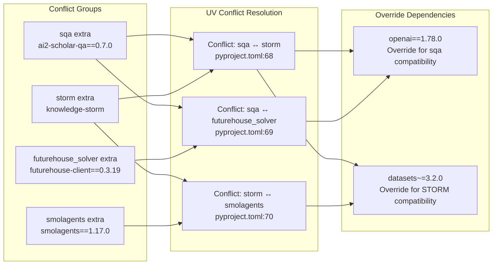

Sources: [pyproject.toml:66-79]()

### Development and Quality Infrastructure

The project includes comprehensive development tooling integrated through the configuration system:

| Tool Category | Tools | Purpose |
|---------------|-------|---------|
| Code Formatting | `black==24.2.0`, `isort`, `autoflake` | Consistent code style |
| Testing | `pytest`, `pytest-asyncio` | Test execution and async support |
| Type Checking | `mypy==1.15`, `pandas-stubs` | Static type analysis |
| Linting | `flake8==7.2.0`, `flake8-pyproject` | Code quality checks |

The testing configuration supports both synchronous and asynchronous tests with strict loop isolation and optional expensive test markers.

Sources: [pyproject.toml:15-25](), [pyproject.toml:102-111]()

## Project Structure

The repository is organized around solver implementations with supporting infrastructure:

```
agent_baselines/
├── solvers/                    # Individual agent implementations
│   ├── react/                 # Basic ReAct agent
│   ├── smolagents/            # HuggingFace CodeAgent integration  
│   ├── sqa/                   # ScholarQA system
│   ├── datavoyager/           # Data analysis agent
│   ├── paper_finder/          # Paper search agent
│   ├── arxivdigestables/      # Literature table generator
│   ├── super/                 # Repository reproduction agent
│   ├── e2e_discovery/         # End-to-end discovery agent
│   ├── asta-v0/               # Task routing system
│   ├── storm/                 # Knowledge curation system
│   └── futurehouse/           # Literature review agent
├── dvc.yaml                   # DVC pipeline configuration
├── pyproject.toml             # Project configuration and dependencies
└── Makefile                   # Developer interface commands
```

Each solver directory contains standardized `setup.sh` and `demo.sh` scripts for installation and demonstration, providing a consistent interface across different agent implementations.

Sources: [README.md:13-14](), [README.md:49](), [pyproject.toml:59-64]()

---

# Page: Getting Started

# Getting Started

<details>
<summary>Relevant source files</summary>

The following files were used as context for generating this wiki page:

- [.github/workflows/ci-test.yml](.github/workflows/ci-test.yml)
- [Makefile](Makefile)
- [README.md](README.md)
- [docker/Dockerfile](docker/Dockerfile)
- [pyproject.toml](pyproject.toml)

</details>


This document provides a quick start guide for setting up and running your first agent evaluation with the agent-baselines framework. It covers the essential steps to install dependencies, run a basic evaluation, and understand the available agent types. For detailed installation instructions, see [Installation and Dependencies](#2.1). For comprehensive Docker setup, see [Docker Environment](#2.2).

## Quick Start Workflow

The agent-baselines framework follows a standardized workflow from setup to evaluation. The diagram below shows the essential steps using actual commands and file structures from the codebase:

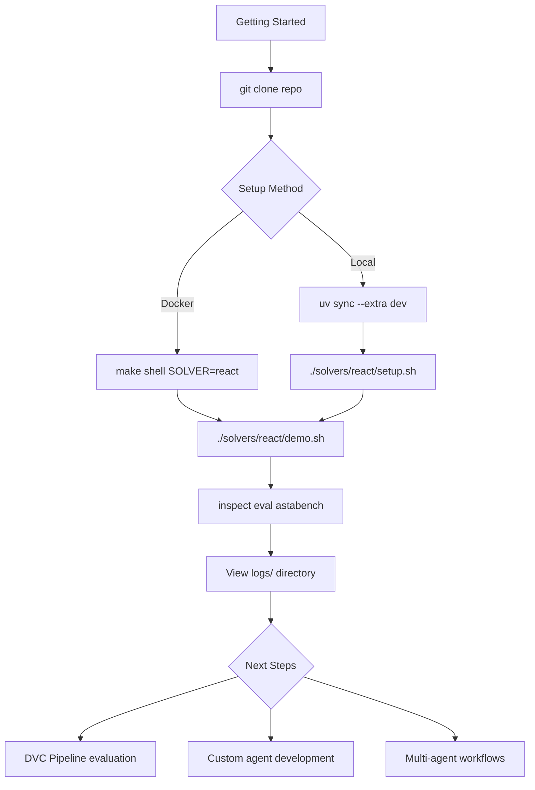

**First-Time Setup Workflow**

Sources: [README.md:9-21](), [Makefile:75-82]()

## Installation and Dependency Structure

The project uses a modular dependency system with optional extras for different agent types. This allows you to install only the components you need:

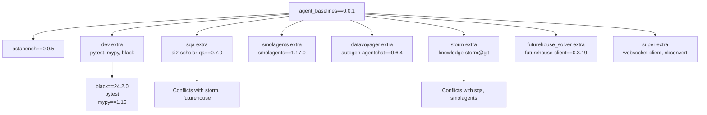

**Modular Dependency Architecture**

| Extra | Purpose | Key Dependencies |
|-------|---------|------------------|
| `dev` | Development tools | `pytest`, `mypy`, `black` |
| `sqa` | Scientific Q&A agents | `ai2-scholar-qa` |
| `smolagents` | Code execution agents | `smolagents` |
| `datavoyager` | Data analysis agents | `autogen-agentchat` |
| `storm` | Knowledge curation | `knowledge-storm` |
| `futurehouse_solver` | Literature review | `futurehouse-client` |
| `super` | Repository reproduction | `websocket-client`, `nbconvert` |

Sources: [pyproject.toml:14-54](), [pyproject.toml:66-71]()

## Available Agent Categories

The framework provides several categories of agents, each implemented as InspectAI solvers:

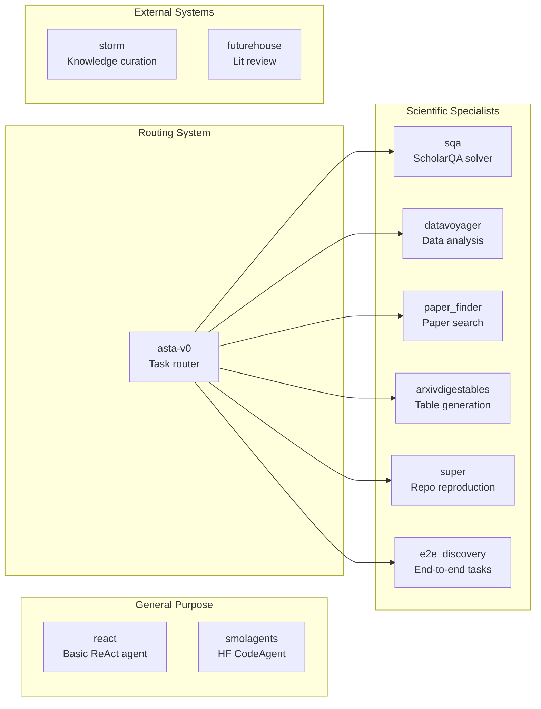

**Agent Ecosystem by Specialization**

Sources: [README.md:26-48]()

## Running Your First Evaluation

### Option 1: Local Setup

```bash
# Clone and install
git clone https://github.com/allenai/agent-baselines.git
cd agent-baselines
uv sync --extra dev --extra react

# Set up a specific solver
./solvers/react/setup.sh

# Run a demo evaluation
./solvers/react/demo.sh
```

### Option 2: Docker Setup

```bash
# Build and enter container for specific solver
make shell SOLVER=react

# Inside container, run demo
./solvers/react/demo.sh
```

The Docker approach uses multi-stage builds with solver-specific targets:

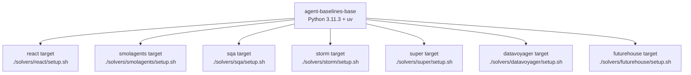

**Docker Multi-Stage Build Targets**

Sources: [docker/Dockerfile:42-63](), [Makefile:12-21]()

## Basic Evaluation Commands

All agents are implemented as InspectAI solvers and can be evaluated using standard commands:

```bash
# Basic evaluation with react agent
inspect eval astabench --solver react --limit 5

# Evaluation with specific model
inspect eval astabench --solver sqa --model claude-3-sonnet-20240229

# Full benchmark run
astabench eval --solver asta-v0
```

The evaluation framework produces structured outputs in the `logs/` directory with detailed response traces and scoring metrics.

Sources: [README.md:5](), [README.md:13-14]()

## Development Environment

The Makefile provides standardized commands for development tasks:

| Command | Purpose | Docker Target |
|---------|---------|---------------|
| `make shell SOLVER=react` | Interactive development | `react` |
| `make test` | Run test suite | `agent-baselines-base` |
| `make format` | Code formatting | `agent-baselines-base` |
| `make mypy` | Type checking | `agent-baselines-base` |

Sources: [Makefile:75-82](), [Makefile:126-128]()

## Next Steps

After completing the basic setup:

1. **Detailed Installation**: See [Installation and Dependencies](#2.1) for comprehensive dependency management and troubleshooting
2. **Docker Deep Dive**: See [Docker Environment](#2.2) for advanced container usage and customization  
3. **Large-Scale Evaluation**: See [Evaluation Pipeline](#3) for DVC-based reproducible evaluation campaigns
4. **Agent Development**: See [Agent Architecture](#4) for understanding and extending the agent ecosystem
5. **Production Workflows**: See [Development Guide](#5) for CI/CD and collaboration practices

The framework is designed to scale from simple demos to comprehensive benchmarking campaigns across hundreds of model-task combinations.

Sources: [README.md:51-115]()

---

# Page: Installation and Dependencies

# Installation and Dependencies

<details>
<summary>Relevant source files</summary>

The following files were used as context for generating this wiki page:

- [README.md](README.md)
- [pyproject.toml](pyproject.toml)

</details>


This document covers the installation process and modular dependency management system for the agent-baselines repository. It explains how to set up the core framework and selectively install dependencies for specific agents and functionality. For information about the Docker-based development environment, see [Docker Environment](#2.2).

## Prerequisites

The agent-baselines framework requires Python 3.11 or higher and uses the `uv` package manager for fast dependency resolution. The project is configured in [pyproject.toml:9]() with the requirement `requires-python = ">=3.11"`.

## Basic Installation

Clone the repository and install the base package:

```bash
git clone https://github.com/allenai/agent-baselines.git
cd agent-baselines
```

The core installation includes only the essential `astabench` dependency ([pyproject.toml:10-12]()), providing the foundational evaluation framework without any agent-specific dependencies.

**Sources:** [README.md:10-11](), [pyproject.toml:10-12]()

## Modular Dependency System

The project uses a modular dependency architecture where different agent implementations and development tools are organized into optional dependency groups. This allows users to install only the components they need.

### Dependency Group Architecture

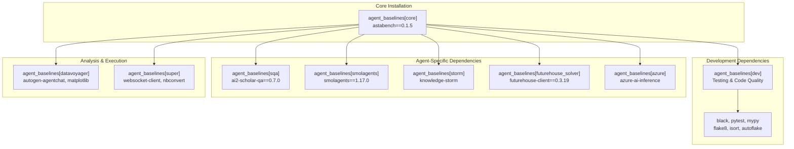

### Installation Commands by Use Case

| Use Case | Installation Command | Dependencies Included |
|----------|---------------------|----------------------|
| Development | `pip install -e ".[dev]"` | Testing, linting, type checking |
| SQA Tasks | `pip install -e ".[sqa]"` | ScholarQA agent components |
| Code Agents | `pip install -e ".[smolagents]"` | HuggingFace CodeAgent |
| Data Analysis | `pip install -e ".[datavoyager]"` | AutoGen, matplotlib, IPython |
| Knowledge Curation | `pip install -e ".[storm]"` | STORM system |
| Literature Review | `pip install -e ".[futurehouse_solver]"` | FutureHouse client |
| Repository Tasks | `pip install -e ".[super]"` | WebSocket, Jupyter conversion |
| Azure Integration | `pip install -e ".[azure]"` | Azure AI inference |

**Sources:** [pyproject.toml:14-54]()

## Dependency Conflicts and Resolution

The project defines explicit conflict rules to prevent incompatible dependency combinations and uses override mechanisms to resolve version conflicts.

### Conflict Resolution System

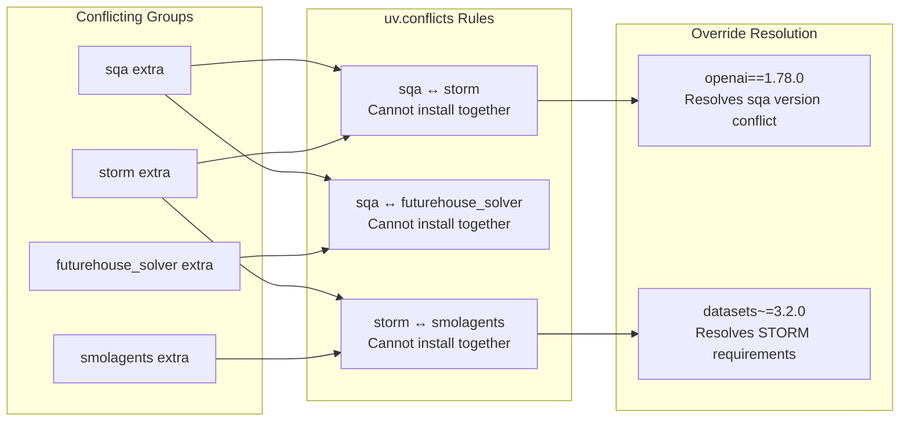

The conflict rules are defined in [pyproject.toml:67-71]() and version overrides in [pyproject.toml:72-79]().

**Sources:** [pyproject.toml:67-79]()

## Environment Setup Options

### Package Manager Configuration

The project is configured to use `uv` as the package manager ([pyproject.toml:66]()) with specific conflict resolution and dependency override settings. The `uv` configuration includes:

- Conflict detection between incompatible extras
- Version overrides for problematic dependencies
- Custom source definitions for Git-based packages

### Agent-Specific Setup Scripts

Each agent implementation provides standardized setup scripts:

- `setup.sh` - Installs required dependencies and configures the environment
- `demo.sh` - Runs example evaluations with limited samples

Example workflow for setting up a specific agent:
```bash
cd solvers/sqa
./setup.sh
./demo.sh
```

### Development Tools Integration

The development dependency group ([pyproject.toml:15-25]()) includes:
- **Code formatting**: `black==24.2.0`, `isort`, `autoflake`
- **Testing**: `pytest`, `pytest-asyncio` 
- **Type checking**: `mypy==1.15`, `pandas-stubs`
- **Linting**: `flake8==7.2.0`, `flake8-pyproject==1.2.3`

**Sources:** [pyproject.toml:15-25](), [README.md:13-21](), [README.md:49]()

## Package Structure and Scripts

The project defines entry points and package discovery rules in [pyproject.toml:56-64](). The `inspect` command is registered as a script entry point, providing the primary interface for evaluation execution.

Package data includes configuration files for specific solvers:
- DataVoyager YAML configs: `agent_baselines/solvers/datavoyager/dv_core/config/*.yaml`
- Code agent configs: `agent_baselines/solvers/code_agent/*.yaml`

**Sources:** [pyproject.toml:56-64](), [pyproject.toml:96-97]()

## Verification

After installation, verify the setup by checking that the `inspect` command is available:

```bash
inspect --help
```

For agent-specific verification, use the provided demo scripts:
```bash
# Verify ReAct agent setup
./solvers/react/demo.sh

# Verify SQA agent setup (if installed)
./solvers/sqa/demo.sh
```

**Sources:** [README.md:20-21](), [README.md:49]()

---

# Page: Docker Environment

# Docker Environment

<details>
<summary>Relevant source files</summary>

The following files were used as context for generating this wiki page:

- [.github/workflows/ci-test.yml](.github/workflows/ci-test.yml)
- [Makefile](Makefile)
- [docker/Dockerfile](docker/Dockerfile)
- [tests/solvers/ci_sandbox_compose.yaml](tests/solvers/ci_sandbox_compose.yaml)

</details>


This document covers the Docker-based containerization system that provides consistent development, testing, and deployment environments for the agent-baselines framework. The Docker environment supports multi-stage builds for different solver types, integrated CI/CD workflows, and streamlined local development. For installation and dependency management details, see [Installation and Dependencies](#2.1). For CI/CD pipeline specifics, see [CI/CD Pipeline](#5.1).

## Multi-Stage Docker Architecture

The agent-baselines project uses a sophisticated multi-stage Docker build system defined in [docker/Dockerfile:1-63]() that creates a base image and multiple specialized solver images.

### Docker Build Stages

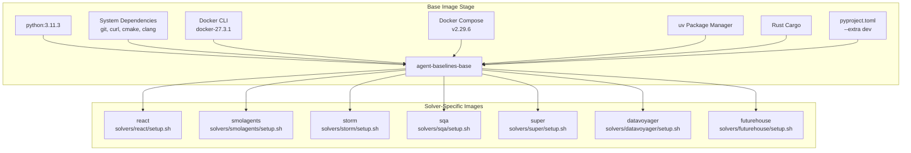

The base image installs core system dependencies and the development environment. Each solver stage extends the base with solver-specific dependencies through dedicated setup scripts.

Sources: [docker/Dockerfile:1-63]()

### Build Target Configuration

The build system supports targeting specific stages through the `TARGET` variable in [Makefile:15-21]():

| Build Target | Image Tag | Purpose |
|--------------|-----------|---------|
| `agent-baselines-base` | `agent-baselines` | Base development environment |
| `react` | `agent-baselines-react` | ReAct agent solver |
| `smolagents` | `agent-baselines-smolagents` | HuggingFace code agent |
| `storm` | `agent-baselines-storm` | Knowledge curation agent |
| `sqa` | `agent-baselines-sqa` | Scientific QA agent |
| `super` | `agent-baselines-super` | Repository reproduction agent |
| `datavoyager` | `agent-baselines-datavoyager` | Data analysis agent |
| `futurehouse` | `agent-baselines-futurehouse` | Literature review agent |

Sources: [Makefile:15-21](), [docker/Dockerfile:42-63]()

## Development Workflow

### Local Development Commands

The Makefile provides streamlined commands for Docker-based development:

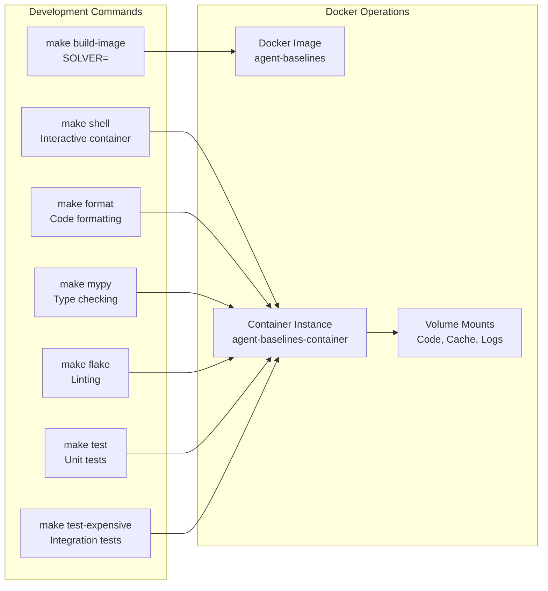

The `make shell` command creates an interactive development environment with live code mounting and cache persistence through Docker volumes.

Sources: [Makefile:75-81](), [Makefile:94-136]()

### Environment Variable Management

The Docker environment supports flexible configuration through multiple sources defined in [Makefile:23-39]():

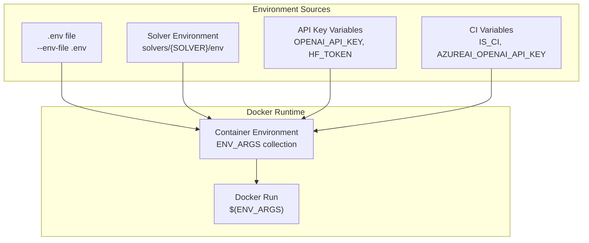

The system automatically detects and includes environment variables from multiple sources, with solver-specific environments loaded when `SOLVER` is specified.

Sources: [Makefile:23-39]()

## CI/CD Integration

### GitHub Actions Workflow

The Docker environment integrates with CI/CD through [.github/workflows/ci-test.yml:1-38]():

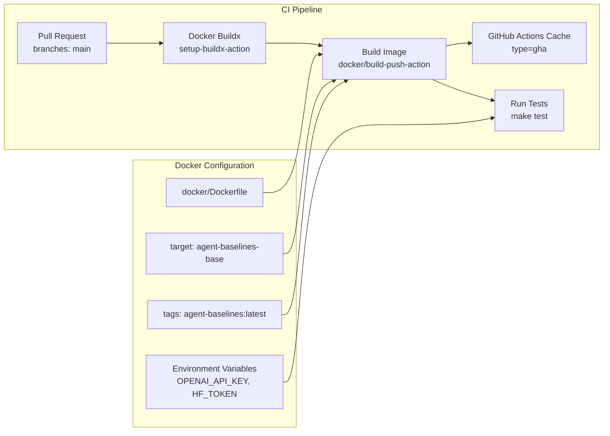

The CI system uses Docker layer caching to optimize build times and runs tests within the containerized environment.

Sources: [.github/workflows/ci-test.yml:17-37]()

### Local vs CI Environment Differences

The Makefile distinguishes between local and CI environments through [Makefile:44-59]():

| Environment | Mount Strategy | Test Command | Build Options |
|-------------|---------------|--------------|---------------|
| **Local** (`IS_CI != true`) | Live volume mounts | Interactive container | Standard build |
| **CI** (`IS_CI = true`) | No mounts | Ephemeral container | Quiet build (`--quiet`) |

Local development includes volume mounts for live code editing, while CI uses isolated containers with no external mounts.

Sources: [Makefile:44-59]()

## Sandbox Environment

### Testing Sandbox Configuration

The project includes a specialized sandbox environment for testing defined in [tests/solvers/ci_sandbox_compose.yaml:1-12]():

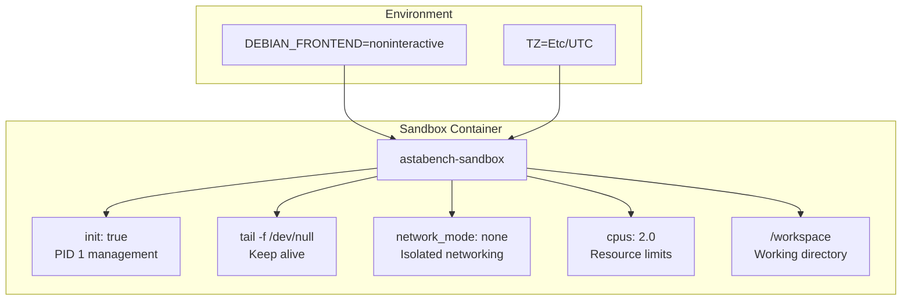

The sandbox provides isolated execution for code agents with network isolation and resource constraints.

Sources: [tests/solvers/ci_sandbox_compose.yaml:1-12]()

## Volume Management

### Persistent Storage Strategy

The Docker environment uses strategic volume mounting for development efficiency:

| Volume Mount | Purpose | Local Path | Container Path |
|--------------|---------|------------|----------------|
| **Code** | Live editing | `./agent_baselines` | `/agent-baselines/agent_baselines` |
| **Tests** | Test development | `./tests` | `/agent-baselines/tests` |
| **Logs** | Debug output | `./logs` | `/agent-baselines/logs` |
| **Cache** | Build optimization | `agent-baselines-cache` | `/root/.cache` |
| **Home** | User data | `agent-baselines-home` | `/root/.agent-baselines` |
| **Docker Socket** | Container access | `/var/run/docker.sock` | `/var/run/docker.sock` |

The volume strategy enables seamless development while maintaining container isolation.

Sources: [Makefile:50-56](), [Makefile:78]()

---

# Page: Evaluation Pipeline

# Evaluation Pipeline

<details>
<summary>Relevant source files</summary>

The following files were used as context for generating this wiki page:

- [README.md](README.md)
- [dvc.lock](dvc.lock)
- [dvc.yaml](dvc.yaml)
- [params.yaml](params.yaml)
- [pyproject.toml](pyproject.toml)

</details>


This document covers the DVC-based evaluation pipeline system used for running reproducible, large-scale agent benchmarks in the agent-baselines repository. The pipeline orchestrates evaluation of multiple solver implementations across different models, datasets, and configurations, with automatic caching, scoring, and result management.

For information about individual agent implementations, see [Agent Architecture](#4). For details on running simple evaluations without DVC, see [Running Evaluations](#3.2).

## Pipeline Architecture

The evaluation pipeline is built on DVC (Data Version Control) and consists of multiple interconnected stages that process solver outputs through evaluation, scoring, and post-processing steps. The pipeline supports matrix execution to run hundreds of solver/model/split combinations in parallel.

### Core Pipeline Flow

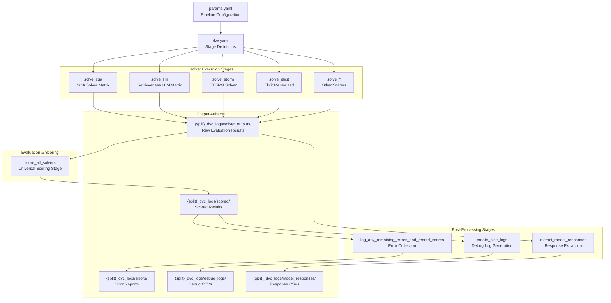

Sources: [dvc.yaml:1-489](), [README.md:51-116]()

### Matrix Execution System

The pipeline uses DVC's matrix functionality to execute evaluations across multiple dimensions simultaneously:

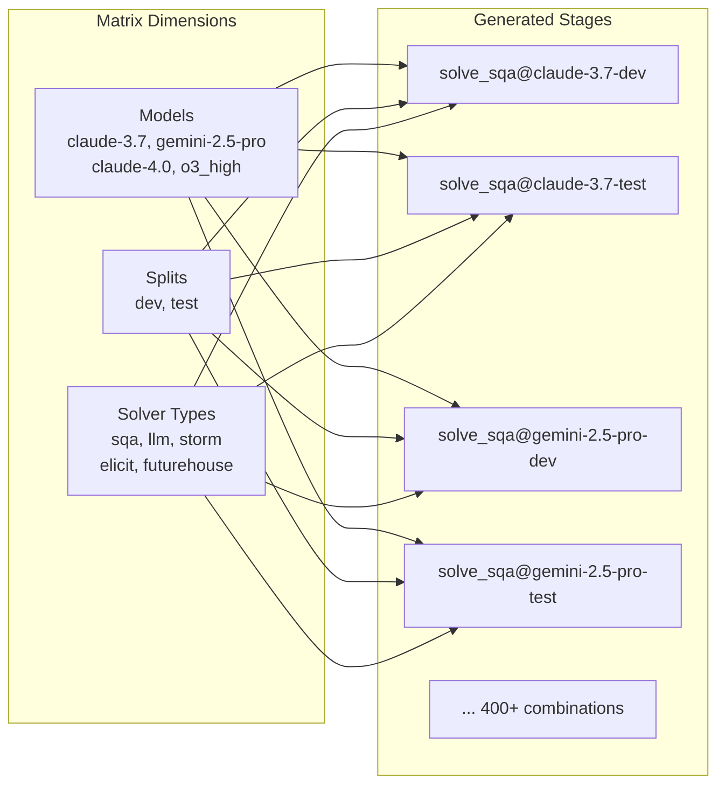

Sources: [dvc.yaml:14-44](), [dvc.yaml:197-244](), [dvc.yaml:309-376]()

## Configuration System

### Parameter Management

The pipeline uses `params.yaml` for centralized configuration of evaluation parameters:

| Parameter | Purpose | Example Value |
|-----------|---------|---------------|
| `scorer_model` | Model used for scoring evaluations | `google/gemini-2.5-flash` |
| `sqa_scorer_version` | Version tag for scorer changes | `may-23-2025` |
| `sqa_solver_version` | Version tag for solver changes | `may-23-2025` |
| `limit` | Number of samples to evaluate | `1000` |

Sources: [params.yaml:1-5]()

### Stage Configuration Patterns

Each solver type has its own stage configuration with specific command patterns:

**SQA Solver Stage Example:**
```yaml
solve_sqa:
  matrix:
    model: [claude-3.7, gemini-2.5-pro, claude-4.0, o3_high]
    split: [dev, test]
  cmd: |
    INSPECT_EVAL_LOG_FILE_PATTERN=task_sqa_solver_sqa_${item.model}
    uv run --extra sqa
    inspect eval astabench/evals/sqa/task.py@sqa
    --solver agent_baselines/solvers/sqa/sqa.py@sqa_solver
    -S completion_model=${item.model}
    --limit=${limit}
```

Sources: [dvc.yaml:14-44]()

**Retrieverless LLM Stage Example:**
```yaml
solve_llm:
  matrix:
    model:
      - llm_name: openai/o4-mini
        llm_args: "--reasoning-effort high --reasoning-tokens 8192"
      - llm_name: anthropic/claude-sonnet-4-20250514
        llm_args: "--reasoning-tokens 8192"
```

Sources: [dvc.yaml:197-244]()

## Pipeline Stages

### Solver Execution Stages

The pipeline defines multiple solver execution stages, each targeting different agent types:

| Stage Name | Purpose | Solver Path | Extra Dependencies |
|------------|---------|-------------|-------------------|
| `solve_sqa` | SQA retrieval-augmented agents | `agent_baselines/solvers/sqa/sqa.py@sqa_solver` | `--extra sqa` |
| `solve_llm` | Direct LLM evaluation | `agent_baselines/solvers/sqa/formatted_llm.py@formatted_solver` | `--extra sqa` |
| `solve_storm` | Knowledge curation system | `agent_baselines/solvers/sqa/storm_solver.py@storm_solver` | `--extra storm` |
| `solve_elicit` | Memorized responses | `agent_baselines/solvers/sqa/elicit/memorized_solver.py@elicit_solver` | `--extra sqa` |
| `solve_futurehouse` | Literature review agents | `agent_baselines/solvers/futurehouse/futurehouse_solver.py` | `--extra futurehouse` |

Sources: [dvc.yaml:14-44](), [dvc.yaml:121-142](), [dvc.yaml:197-244](), [dvc.yaml:246-276]()

### Scoring and Post-Processing

All solver outputs go through a unified scoring pipeline:

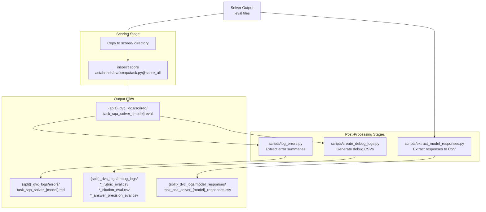

Sources: [dvc.yaml:308-376](), [dvc.yaml:415-448](), [dvc.yaml:450-488]()

## Execution Workflows

### Basic Pipeline Commands

**Run entire pipeline:**
```bash
dvc repro
```

**Force re-execution ignoring cache:**
```bash
dvc repro --force
```

**Run specific stage:**
```bash
dvc repro solve_sqa@claude-3.7
```

**Run stage and all downstream dependencies:**
```bash
dvc repro score_sqa --force --downstream
```

Sources: [README.md:62-90]()

### Pipeline Status and Debugging

**Check which stages need to run:**
```bash
dvc status
```

**View pipeline dependencies:**
```bash
dvc dag
```

**Check specific stage status:**
```bash
dvc status solve_sqa@claude-3.7
```

### File Naming Conventions

The pipeline uses consistent naming patterns for output files:

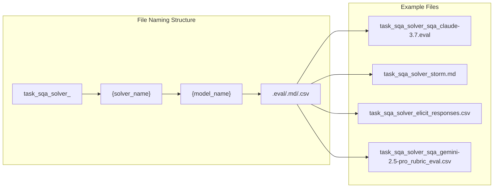

Sources: [dvc.yaml:26-38](), [dvc.yaml:442-448](), [dvc.yaml:479-488]()

## Output Management and Caching

### Directory Structure

The pipeline organizes outputs into split-specific directories:

```
{dev|test}_dvc_logs/
├── solver_outputs/          # Raw evaluation results
│   ├── task_sqa_solver_sqa_claude-3.7.eval
│   ├── task_sqa_solver_storm.eval
│   └── task_sqa_solver_elicit.eval
├── scored/                  # Scored evaluation results
│   ├── task_sqa_solver_sqa_claude-3.7.eval
│   └── task_sqa_solver_storm.eval
├── errors/                  # Error summaries
│   ├── task_sqa_solver_sqa_claude-3.7.md
│   └── task_sqa_solver_storm.md
├── debug_logs/             # Debug CSV files
│   ├── task_sqa_solver_sqa_claude-3.7_rubric_eval.csv
│   ├── task_sqa_solver_sqa_claude-3.7_citation_eval.csv
│   └── task_sqa_solver_sqa_claude-3.7_answer_precision_eval.csv
└── model_responses/        # Extracted model responses
    ├── task_sqa_solver_sqa_claude-3.7_responses.csv
    └── task_sqa_solver_storm_responses.csv
```

Sources: [dvc.yaml:44](), [dvc.yaml:374-376](), [dvc.yaml:411-413]()

### Collaboration and Versioning

**Pull latest results from team cache:**
```bash
dvc pull
```

**Push local results to shared cache:**
```bash
dvc push
```

**Check cache synchronization status:**
```bash
dvc status --cloud
```

The `dvc.lock` file tracks exact versions and hashes of all pipeline artifacts, enabling reproducible results across team members.

Sources: [README.md:101-115](), [dvc.lock:1-2]()

### Cache Management

DVC automatically caches outputs based on input dependencies and commands. The cache considers:
- Input file hashes (dependencies)
- Parameter values from `params.yaml`
- Stage command definitions
- Solver/scorer version parameters

When any of these change, the stage will re-execute on the next `dvc repro` run.

Sources: [README.md:76-84](), [dvc.yaml:39-42]()

---

# Page: DVC Pipeline Configuration

# DVC Pipeline Configuration

<details>
<summary>Relevant source files</summary>

The following files were used as context for generating this wiki page:

- [dvc.lock](dvc.lock)
- [dvc.yaml](dvc.yaml)
- [params.yaml](params.yaml)

</details>


This document describes the Data Version Control (DVC) pipeline configuration that orchestrates large-scale agent evaluations in the agent-baselines framework. The pipeline manages the execution of multiple AI agents across different models and data splits, handles scoring, and produces comprehensive evaluation results with reproducible versioning.

For information about running evaluations using this pipeline, see [Running Evaluations](#3.2). For details about the specific agent implementations being evaluated, see [Agent Architecture](#4).

## Pipeline Overview

The DVC pipeline is defined in `dvc.yaml` and provides a systematic approach to evaluating AI agents at scale. It coordinates the execution of over 400 model-solver combinations across development and test data splits, manages dependencies between evaluation and scoring stages, and ensures reproducible results through content-based caching.

The pipeline operates in three main phases: solver execution, scoring, and post-processing. Each phase is designed to handle failures gracefully with retry mechanisms and produces structured outputs for analysis.

**Pipeline Architecture**

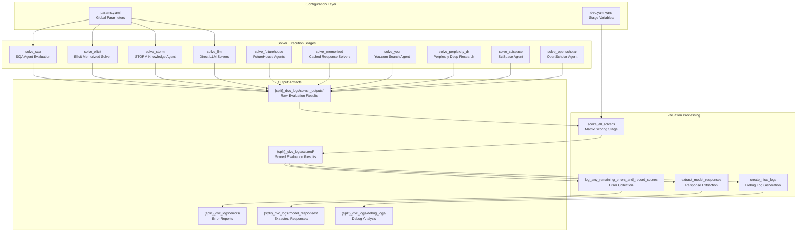

Sources: [dvc.yaml:1-489]()

## Stage Types and Matrix Configuration

The pipeline utilizes DVC's matrix functionality to execute combinations of models and data splits systematically. Each solver type implements a specific evaluation pattern while maintaining consistent output structures.

**Matrix Execution Pattern**

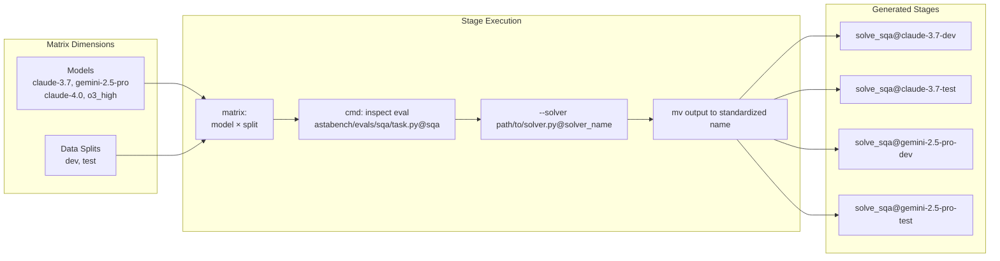

Sources: [dvc.yaml:14-44](), [dvc.yaml:197-244]()

### Solver Stage Categories

The pipeline organizes solver stages into distinct categories based on their evaluation approach:

| Stage Name | Solver Type | Matrix Configuration | Key Parameters |
|------------|-------------|---------------------|----------------|
| `solve_sqa` | Retrieval-augmented agent | model × split | `completion_model`, `scorer_model` |
| `solve_llm` | Direct LLM evaluation | model × split | `llm_name`, `llm_args`, `suffix` |
| `solve_memorized` | Cached response lookup | model × split | `sys_name_or_path` |
| `solve_futurehouse` | External API agent | model × split | `agent`, `max_wait_time` |
| `solve_storm` | Knowledge curation | foreach split | Python 3.11 requirement |
| `solve_elicit` | Memorized Elicit responses | foreach split | Static configuration |

Sources: [dvc.yaml:13-45](), [dvc.yaml:196-306]()

## Parameter Management

The pipeline uses a layered parameter system combining global parameters from `params.yaml` with stage-specific variables defined in `dvc.yaml`.

**Parameter Structure**

```mermaid
graph TD
    subgraph "Global Parameters (params.yaml)"
        SCORER["scorer_model: google/gemini-2.5-flash"]
        LIMIT["limit: 1000"]
        SQA_SCORER["sqa_scorer_version: may-23-2025"]
        SQA_SOLVER["sqa_solver_version: may-23-2025"]
    end
    
    subgraph "DVC Variables (dvc.yaml)"
        LLM_DEFAULTS["llm_defaults:<br/>llm_args: ''<br/>suffix: ''"]
    end
    
    subgraph "Stage-Level Parameters"
        STAGE_PARAMS["params:<br/>- limit<br/>- scorer_model<br/>- sqa_solver_version"]
        TASK_PARAMS["-T split=${item.split}<br/>-T scorer_model=${scorer_model}"]
        SOLVER_PARAMS["-S completion_model=${item.model}"]
    end
    
    SCORER --> STAGE_PARAMS
    LIMIT --> STAGE_PARAMS
    LLM_DEFAULTS --> SOLVER_PARAMS
    STAGE_PARAMS --> TASK_PARAMS
```

Sources: [params.yaml:1-5](), [dvc.yaml:7-12]()

### LLM Configuration Matrix

The `solve_llm` stage demonstrates advanced parameter handling with structured model configurations:

```yaml
model:
  - <<: *llm_defaults
    llm_name: openai/o4-mini
    llm_args: "--reasoning-effort high --reasoning-tokens 8192"
  - <<: *llm_defaults
    llm_name: anthropic/claude-sonnet-4-20250514
    llm_args: "--reasoning-tokens 8192"
    suffix: "-thinking"
```

This structure allows for model-specific parameter overrides while maintaining consistent defaults across configurations.

Sources: [dvc.yaml:198-218]()

## Output File Organization

The pipeline produces structured outputs in split-specific directories following a consistent naming convention. Each evaluation generates multiple artifact types for comprehensive analysis.

**Output Directory Structure**

```mermaid
graph TD
    subgraph "Split-based Organization"
        DEV_DIR["{split}_dvc_logs/<br/>dev_dvc_logs/ or test_dvc_logs/"]
    end
    
    subgraph "Artifact Categories"
        SOLVER_DIR["solver_outputs/<br/>Raw evaluation files"]
        SCORED_DIR["scored/<br/>Scored evaluation files"]
        ERROR_DIR["errors/<br/>Error analysis"]
        RESPONSE_DIR["model_responses/<br/>Extracted responses"]
        DEBUG_DIR["debug_logs/<br/>Debug analysis"]
    end
    
    subgraph "File Naming Convention"
        TASK_PREFIX["task_sqa_solver_"]
        SOLVER_NAME["${solver_name}"]
        MODEL_NAME["${model_name}"]
        EXTENSION[".eval or .csv or .md"]
    end
    
    DEV_DIR --> SOLVER_DIR
    DEV_DIR --> SCORED_DIR
    DEV_DIR --> ERROR_DIR
    DEV_DIR --> RESPONSE_DIR
    DEV_DIR --> DEBUG_DIR
    
    TASK_PREFIX --> SOLVER_NAME
    SOLVER_NAME --> MODEL_NAME
    MODEL_NAME --> EXTENSION
```

Sources: [dvc.yaml:43-44](), [dvc.yaml:374-413]()

### File Naming Patterns

The pipeline uses systematic file naming to organize outputs across hundreds of evaluation combinations:

- **Solver outputs**: `task_sqa_solver_${solver_name}_${model_name}.eval`
- **Scored results**: Same path structure in `scored/` directory
- **Error logs**: `task_sqa_solver_${model_name}.md`
- **Response extracts**: `task_sqa_solver_${model_name}_responses.csv`
- **Debug logs**: `task_sqa_solver_${model_name}_rubric_eval.csv`

For models with provider prefixes (e.g., `anthropic/claude-3-5-sonnet`), the pipeline automatically creates nested directory structures to maintain organization.

Sources: [dvc.yaml:237-238](), [dvc.yaml:360-361]()

## Execution Flow and Dependencies

The pipeline orchestrates complex dependencies between evaluation stages, scoring processes, and post-processing steps. Each stage explicitly declares its dependencies and outputs for proper execution ordering.

**Dependency Chain Architecture**

```mermaid
graph TD
    subgraph "Evaluation Phase"
        SOLVE_STAGES["Solver Execution Stages<br/>solve_sqa, solve_llm, etc."]
        SOLVER_OUTPUTS["${split}_dvc_logs/solver_outputs/<br/>task_sqa_solver_*.eval"]
    end
    
    subgraph "Scoring Phase" 
        SCORE_STAGE["score_all_solvers<br/>Matrix: model × split"]
        SCORED_OUTPUTS["${split}_dvc_logs/scored/<br/>task_sqa_solver_*.eval"]
    end
    
    subgraph "Post-processing Phase"
        LOG_ERRORS["log_any_remaining_errors_and_record_scores"]
        EXTRACT_RESP["extract_model_responses"]
        CREATE_LOGS["create_nice_logs"]
    end
    
    subgraph "Final Artifacts"
        ERROR_FILES["errors/*.md"]
        SCORE_FILES["scores/*.md"] 
        RESPONSE_FILES["model_responses/*.csv"]
        DEBUG_FILES["debug_logs/*.csv"]
    end
    
    SOLVE_STAGES --> SOLVER_OUTPUTS
    SOLVER_OUTPUTS --> SCORE_STAGE
    SCORE_STAGE --> SCORED_OUTPUTS
    SCORED_OUTPUTS --> LOG_ERRORS
    SCORED_OUTPUTS --> EXTRACT_RESP
    SCORED_OUTPUTS --> CREATE_LOGS
    
    LOG_ERRORS --> ERROR_FILES
    LOG_ERRORS --> SCORE_FILES
    EXTRACT_RESP --> RESPONSE_FILES
    CREATE_LOGS --> DEBUG_FILES
```

Sources: [dvc.yaml:308-376](), [dvc.yaml:415-489]()

### Scoring Matrix Configuration

The `score_all_solvers` stage demonstrates sophisticated dependency management with model-specific metadata:

```yaml
score_all_solvers:
  matrix:
    model:
      - name: openai/o4-mini
        is_retrieverless: true
      - name: sqa_claude-3.7
        is_retrieverless: false
  deps:
    - ${item.split}_dvc_logs/solver_outputs/task_sqa_solver_${item.model.name}.eval
  outs:
    - ${item.split}_dvc_logs/scored/task_sqa_solver_${item.model.name}.eval
```

This configuration ensures that scoring only executes after solver outputs are available and passes model-specific metadata to the scoring process.

Sources: [dvc.yaml:308-376]()

## Command Execution Patterns

Each stage implements a consistent command execution pattern using InspectAI evaluation framework with standardized parameter passing and output handling.

**Standard Execution Template**

```mermaid
graph LR
    subgraph "Environment Setup"
        LOG_PATTERN["INSPECT_EVAL_LOG_FILE_PATTERN=task_sqa_solver_${model}"]
        UV_EXTRA["uv run --extra ${dependency_group}"]
    end
    
    subgraph "InspectAI Execution"
        INSPECT_CMD["inspect eval astabench/evals/sqa/task.py@sqa"]
        DISPLAY["--display plain"]
        LOG_DIR["--log-dir ${split}_dvc_logs/solver_outputs/"]
        SOLVER_PATH["--solver path/to/solver.py@solver_function"]
    end
    
    subgraph "Parameter Injection"
        TASK_PARAMS["-T split=${split} -T scorer_model=${scorer_model}"]
        SOLVER_PARAMS["-S completion_model=${model}"]
        LIMITS["--limit=${limit} --retry-on-error=10"]
    end
    
    subgraph "Output Standardization"
        NO_SCORE["--no-score"]
        MV_CMD["mv latest_output standardized_name"]
    end
    
    LOG_PATTERN --> INSPECT_CMD
    UV_EXTRA --> INSPECT_CMD
    INSPECT_CMD --> DISPLAY
    DISPLAY --> LOG_DIR
    LOG_DIR --> SOLVER_PATH
    SOLVER_PATH --> TASK_PARAMS
    TASK_PARAMS --> SOLVER_PARAMS
    SOLVER_PARAMS --> LIMITS
    LIMITS --> NO_SCORE
    NO_SCORE --> MV_CMD
```

Sources: [dvc.yaml:25-38](), [dvc.yaml:224-238]()

The pipeline's systematic approach to command execution ensures consistent evaluation conditions across all solver types while accommodating solver-specific requirements through flexible parameter injection and dependency management.

---

# Page: Running Evaluations

# Running Evaluations

<details>
<summary>Relevant source files</summary>

The following files were used as context for generating this wiki page:

- [README.md](README.md)
- [dvc.lock](dvc.lock)
- [dvc.yaml](dvc.yaml)
- [params.yaml](params.yaml)
- [pyproject.toml](pyproject.toml)

</details>


This page covers practical methods for executing agent evaluations in the agent-baselines framework, from quick demos to comprehensive benchmark campaigns. For information about configuring the DVC pipeline structure, see [DVC Pipeline Configuration](#3.1). For details about specific agent implementations, see [Agent Architecture](#4).

## Evaluation Methods Overview

The agent-baselines framework provides three primary approaches for running evaluations:

1. **Individual Solver Demos** - Quick testing with `demo.sh` scripts
2. **Docker-based Execution** - Isolated environment testing using containers
3. **DVC Pipeline Evaluation** - Comprehensive, reproducible benchmark campaigns

```mermaid
graph TD
    subgraph "Quick Testing"
        DEMO["demo.sh Scripts"]
        SETUP["setup.sh Scripts"]
    end
    
    subgraph "Docker Execution"
        MAKE_SHELL["make shell SOLVER=name"]
        DOCKER_DEMO["./solvers/name/demo.sh"]
    end
    
    subgraph "DVC Pipeline"
        DVC_REPRO["dvc repro"]
        DVC_STAGES["Pipeline Stages"]
        DVC_MATRIX["Matrix Execution"]
    end
    
    subgraph "Core Evaluation Engine"
        INSPECT_EVAL["inspect eval"]
        INSPECT_SCORE["inspect score"]
        ASTABENCH["astabench tasks"]
    end
    
    DEMO --> INSPECT_EVAL
    DOCKER_DEMO --> INSPECT_EVAL
    DVC_STAGES --> INSPECT_EVAL
    DVC_STAGES --> INSPECT_SCORE
    
    INSPECT_EVAL --> ASTABENCH
    
    style DVC_PIPELINE fill:#e8f5e8
    style INSPECT_EVAL fill:#e1f5fe
```

**Evaluation Flow Architecture**

Sources: [README.md:7-23](), [README.md:51-115](), [dvc.yaml:1-489]()

## Individual Solver Demos

Each solver directory contains setup and demo scripts for quick testing:

### Setup and Demo Scripts

```bash
# Navigate to a solver directory
cd solvers/react

# Install dependencies
./setup.sh

# Run a limited evaluation demo
./demo.sh
```

Demo scripts typically run evaluations with limited samples (often 1-5 examples) to verify solver functionality. They use the underlying `inspect eval` command with specific solver configurations.

**Common Demo Script Pattern:**
- Install solver-specific dependencies
- Set environment variables
- Execute `inspect eval` with `--limit` parameter
- Output results to console or logs

Sources: [README.md:13-14](), [README.md:49]()

## Docker-based Execution

For consistent environments across different systems, use Docker containers:

```bash
# Start a Docker shell for a specific solver
make shell SOLVER=react

# Inside the container, run the demo
root:/astabench# ./solvers/react/demo.sh
```

The Docker approach ensures dependency isolation and reproducible environments, particularly useful when solvers have conflicting requirements.

Sources: [README.md:16-21]()

## DVC Pipeline Evaluation

The DVC pipeline provides comprehensive, reproducible evaluation campaigns that run multiple solvers across different models and dataset splits.

### Pipeline Architecture

```mermaid
graph TD
    subgraph "Solver Stages"
        SOLVE_SQA["solve_sqa"]
        SOLVE_ELICIT["solve_elicit"] 
        SOLVE_STORM["solve_storm"]
        SOLVE_LLM["solve_llm"]
        SOLVE_FUTUREHOUSE["solve_futurehouse"]
    end
    
    subgraph "Matrix Parameters"
        MODELS["models: claude-3.7, gemini-2.5-pro, etc"]
        SPLITS["splits: dev, test"]
        SOLVERS["solvers: sqa, elicit, storm, etc"]
    end
    
    subgraph "Processing Stages"
        SCORE_ALL["score_all_solvers"]
        LOG_ERRORS["log_any_remaining_errors_and_record_scores"]
        EXTRACT_RESP["extract_model_responses"]
        CREATE_LOGS["create_nice_logs"]
    end
    
    subgraph "Outputs"
        SOLVER_OUTPUTS["solver_outputs/*.eval"]
        SCORED_OUTPUTS["scored/*.eval"]
        ERROR_LOGS["errors/*.md"]
        DEBUG_LOGS["debug_logs/*.csv"]
    end
    
    MODELS --> SOLVE_SQA
    SPLITS --> SOLVE_SQA
    SOLVE_SQA --> SOLVER_OUTPUTS
    SOLVE_ELICIT --> SOLVER_OUTPUTS
    SOLVE_STORM --> SOLVER_OUTPUTS
    
    SOLVER_OUTPUTS --> SCORE_ALL
    SCORE_ALL --> SCORED_OUTPUTS
    SCORED_OUTPUTS --> LOG_ERRORS
    SCORED_OUTPUTS --> EXTRACT_RESP
    SCORED_OUTPUTS --> CREATE_LOGS
    
    LOG_ERRORS --> ERROR_LOGS
    CREATE_LOGS --> DEBUG_LOGS
    
    style SCORE_ALL fill:#fff3e0
    style SOLVER_OUTPUTS fill:#e8f5e8
```

**DVC Pipeline Stage Flow**

Sources: [dvc.yaml:13-489]()

### Matrix Execution Configuration

The pipeline uses matrix configurations to run evaluations across multiple dimensions:

| Stage | Matrix Dimensions | Example Values |
|-------|------------------|----------------|
| `solve_sqa` | model × split | claude-3.7 × dev, gemini-2.5-pro × test |
| `solve_llm` | model × split | openai/o4-mini × dev, anthropic/claude-sonnet-4 × test |
| `score_all_solvers` | model × split | All solver outputs × dev/test splits |

### Key Pipeline Commands

#### Running the Full Pipeline
```bash
# Install DVC
pip install 'dvc[s3]'

# Run all stages (uses cache to skip unchanged stages)
dvc repro

# Force run all stages (ignores cache)
dvc repro --force
```

#### Running Specific Stages
```bash
# Run specific solver stage
dvc repro solve_sqa@claude-3.7

# Run scoring for specific model
dvc repro score_all_solvers@sqa_claude-3.7-dev

# Run single stage without downstream dependencies
dvc repro score_sqa --force --single-item
```

#### Checking Pipeline Status
```bash
# Check which stages need to be run
dvc status

# Example output showing changed dependencies
# summarize_scores:
#   changed deps:
#     modified: dvc_logs/scored/task_sqa_solver_sqa_claude-3.7.eval
```

Sources: [README.md:62-99]()

### Pipeline Stage Details

```mermaid
graph LR
    subgraph "solve_sqa Stage"
        SQA_CMD["uv run --extra sqa inspect eval"]
        SQA_SOLVER["agent_baselines/solvers/sqa/sqa.py@sqa_solver"]
        SQA_TASK["astabench/evals/sqa/task.py@sqa"]
        SQA_OUTPUT["{split}_dvc_logs/solver_outputs/task_sqa_solver_sqa_{model}.eval"]
    end
    
    subgraph "score_all_solvers Stage"
        SCORE_CMD["inspect score"]
        SCORE_SCORER["astabench/evals/sqa/task.py@score_all"]
        SCORE_INPUT["{split}_dvc_logs/solver_outputs/"]
        SCORE_OUTPUT["{split}_dvc_logs/scored/"]
    end
    
    subgraph "Environment Variables"
        LOG_PATTERN["INSPECT_EVAL_LOG_FILE_PATTERN"]
        PARAMS_YAML["params.yaml: limit, scorer_model"]
    end
    
    SQA_CMD --> SQA_SOLVER
    SQA_CMD --> SQA_TASK
    SQA_CMD --> SQA_OUTPUT
    LOG_PATTERN --> SQA_CMD
    PARAMS_YAML --> SQA_CMD
    
    SQA_OUTPUT --> SCORE_INPUT
    SCORE_CMD --> SCORE_SCORER
    SCORE_INPUT --> SCORE_OUTPUT
    
    style SQA_SOLVER fill:#e1f5fe
    style SCORE_SCORER fill:#fff3e0
```

**Detailed Stage Execution Flow**

Sources: [dvc.yaml:14-44](), [dvc.yaml:308-376]()

## Understanding Pipeline Parameters

The pipeline behavior is controlled by parameters in `params.yaml`:

| Parameter | Purpose | Example Value |
|-----------|---------|---------------|
| `limit` | Number of evaluation samples | `1000` |
| `scorer_model` | Model used for scoring | `google/gemini-2.5-flash` |
| `sqa_scorer_version` | Scorer version tag | `may-23-2025` |
| `sqa_solver_version` | Solver version tag | `may-23-2025` |

Sources: [params.yaml:1-4]()

## Output Structure and Results

### Directory Structure

```
{split}_dvc_logs/
├── solver_outputs/           # Raw solver evaluation files
│   └── task_sqa_solver_{solver}_{model}.eval
├── scored/                   # Scored evaluation files
│   └── task_sqa_solver_{solver}_{model}.eval
├── errors/                   # Error logs and summaries
│   └── task_sqa_solver_{solver}_{model}.md
├── scores/                   # Score summaries
│   └── task_sqa_solver_{solver}_{model}.md
├── model_responses/          # Extracted model responses
│   └── task_sqa_solver_{solver}_{model}_responses.csv
└── debug_logs/              # Detailed analysis
    ├── task_sqa_solver_{solver}_{model}_rubric_eval.csv
    ├── task_sqa_solver_{solver}_{model}_citation_eval.csv
    └── task_sqa_solver_{solver}_{model}_answer_precision_eval.csv
```

### File Naming Convention

The pipeline uses a consistent naming pattern: `task_{task_name}_solver_{solver_name}_{model_name}.eval`

Examples from the lock file:
- `task_sqa_solver_sqa_claude-3.7.eval`
- `task_sqa_solver_elicit.eval`
- `task_sqa_solver_storm.eval`

Sources: [dvc.lock:16](), [dvc.lock:268](), [dvc.lock:216]()

## Collaboration and Caching

### Sharing Results with Team

```bash
# Pull latest results from shared cache
dvc pull

# Push your results to shared cache
dvc push
```

The DVC cache system allows teams to share evaluation results without re-running expensive computations. The `dvc.lock` file tracks exact versions and checksums of all pipeline outputs.

### Cache Management

DVC automatically manages caching based on:
- Input file changes (detected via MD5 hashes)
- Parameter changes in `params.yaml`
- Stage definition changes in `dvc.yaml`
- Code changes in dependencies

Sources: [README.md:101-115]()

## Common Workflows

### Development Workflow
1. Test solver locally with demo script
2. Run limited evaluation with Docker
3. Submit to DVC pipeline for comprehensive evaluation
4. Share results with team via DVC cache

### Debugging Failed Evaluations
1. Check `dvc status` for stage dependencies
2. Examine error logs in `{split}_dvc_logs/errors/`
3. Review debug logs for detailed analysis
4. Use `--force` flag to re-run specific stages

### Performance Monitoring
1. Monitor evaluation progress through DVC stage completion
2. Check solver outputs for completion rates
3. Review error summaries for failure patterns
4. Analyze debug logs for performance insights

Sources: [README.md:76-90](), [dvc.yaml:378-413](), [dvc.yaml:415-448]()

---

# Page: Agent Architecture

# Agent Architecture

<details>
<summary>Relevant source files</summary>

The following files were used as context for generating this wiki page:

- [README.md](README.md)
- [pyproject.toml](pyproject.toml)
- [solvers/smolagents/README.md](solvers/smolagents/README.md)
- [solvers/sqa/demo.sh](solvers/sqa/demo.sh)

</details>


This document provides an overview of the agent ecosystem in agent-baselines, focusing on the architectural patterns, interfaces, and organizational structure that enables a diverse collection of AI agents to work within a unified evaluation framework. The architecture is built on top of InspectAI's solver interface and supports modular agent implementations with specialized capabilities.

For detailed information about specific agent implementations, see [Basic Agents](#4.1), [SQA Solvers](#4.2), [Asta Router System](#4.3), and [Specialized Agents](#4.4). For setup and installation details, see [Installation and Dependencies](#2.1).

## InspectAI Solver Interface

The agent-baselines framework is built on top of InspectAI's standardized solver interface, which provides a consistent execution model for all agents regardless of their internal implementation. This architecture enables uniform evaluation, logging, and orchestration across diverse agent types.

**InspectAI Solver Interface Architecture**

```mermaid
graph TD
    subgraph "InspectAI Framework"
        CLI["inspect eval command"]
        SOLVER_INTERFACE["Solver Interface"]
        TASK_STATE["TaskState"]
        TOOLS["Tool Management"]
        SANDBOX["Sandbox Environment"]
    end
    
    subgraph "Agent Implementation Layer"
        SOLVER_FUNC["@solver decorated function"]
        AGENT_LOGIC["Agent Logic"]
        LLM_CLIENT["LLM Client"]
        TOOL_CALLS["Tool Invocations"]
    end
    
    subgraph "External Systems"
        LLM_APIS["LLM APIs (OpenAI, Anthropic)"]
        MODAL_PLATFORM["Modal Platform"]
        SEMANTIC_SCHOLAR["Semantic Scholar API"]
    end
    
    CLI --> SOLVER_INTERFACE
    SOLVER_INTERFACE --> TASK_STATE
    TASK_STATE --> TOOLS
    TOOLS --> SANDBOX
    
    SOLVER_INTERFACE --> SOLVER_FUNC
    SOLVER_FUNC --> AGENT_LOGIC
    AGENT_LOGIC --> LLM_CLIENT
    AGENT_LOGIC --> TOOL_CALLS
    
    LLM_CLIENT --> LLM_APIS
    TOOL_CALLS --> MODAL_PLATFORM
    TOOL_CALLS --> SEMANTIC_SCHOLAR
```

All agents in the repository implement the InspectAI solver pattern, which requires a function decorated with `@solver` that accepts a `TaskState` and returns a `TaskState`. This standardization enables consistent evaluation across all agent types using the `inspect eval` command.

**Sources:** [pyproject.toml:57](), [README.md:5](), [solvers/sqa/demo.sh:18-23]()

## Agent Categories and Specialization

The agent-baselines repository organizes agents into distinct categories based on their capabilities and target domains. This categorical structure reflects the modular dependency system and enables targeted deployment for specific task types.

**Agent Category Hierarchy**

```mermaid
graph TB
    subgraph "General Purpose Agents"
        REACT["react solver"]
        SMOL["smolagents solver"]
    end
    
    subgraph "Scientific Task Specialists"
        SQA["sqa_solver"]
        DATAVOYAGER["datavoyager solver"]
        PAPER_FINDER["paper_finder solver"]
        ARXIV_TABLES["arxivdigestables solver"]
        SUPER_AGENT["super solver"]
        E2E_DISCOVERY["e2e_discovery solver"]
    end
    
    subgraph "Task Router System"
        ASTA_V0["asta-v0 solver"]
        ROUTER["fewshot_textsim_router"]
    end
    
    subgraph "External Integration Agents"
        STORM["storm solver"]
        FUTUREHOUSE["futurehouse solver"]
        ELICIT["elicit_memorized solver"]
    end
    
    subgraph "Task Categories"
        SQA_TASKS["sqa_dev, sqa_test"]
        DISC_TASKS["discoverybench"]
        PAPER_TASKS["paperfinder"]
        TABLE_TASKS["arxivdigestables"]
        SUPER_TASKS["super repository tasks"]
        E2E_TASKS["e2e_discovery"]
    end
    
    ASTA_V0 --> ROUTER
    ROUTER -.-> SQA
    ROUTER -.-> DATAVOYAGER
    ROUTER -.-> PAPER_FINDER
    ROUTER -.-> ARXIV_TABLES
    ROUTER -.-> SUPER_AGENT
    ROUTER -.-> E2E_DISCOVERY
    
    SQA_TASKS --> SQA
    SQA_TASKS --> STORM
    SQA_TASKS --> FUTUREHOUSE
    DISC_TASKS --> DATAVOYAGER
    PAPER_TASKS --> PAPER_FINDER
    TABLE_TASKS --> ARXIV_TABLES
    SUPER_TASKS --> SUPER_AGENT
    E2E_TASKS --> E2E_DISCOVERY
```

### General Purpose Agents

General purpose agents provide foundational capabilities that work across multiple task types without domain-specific optimizations. These agents implement core patterns like ReAct loops and code-based tool execution.

| Agent | Implementation | Key Features |
|-------|---------------|--------------|
| `react` | Basic ReAct loop | LLM tool-calling, configurable max_steps |
| `smolagents` | HuggingFace CodeAgent | Python code execution, sandbox required |

### Scientific Task Specialists

Scientific task specialists are optimized for specific domains within scientific research and discovery. Each specialist includes domain-specific prompts, tools, and workflows tailored to their target tasks.

| Agent | Target Tasks | Specialization |
|-------|-------------|----------------|
| `sqa_solver` | SQA tasks | Literature Q&A with retrieval |
| `datavoyager` | DiscoveryBench | Data analysis and exploration |
| `paper_finder` | PaperFinder | Paper search and recommendation |
| `arxivdigestables` | Table generation | Literature review tables |
| `super` | Repository reproduction | Code analysis and execution |
| `e2e_discovery` | End-to-end discovery | Multi-step research workflows |

**Sources:** [README.md:26-48](), [pyproject.toml:29-54]()

## Modular Dependency System

The architecture employs a modular dependency system that allows selective installation of agent capabilities based on deployment requirements. This system prevents dependency conflicts while enabling rich functionality for specific agent types.

**Dependency Management Architecture**

```mermaid
graph TD
    subgraph "Core Dependencies"
        ASTABENCH["astabench==0.1.5"]
        PYTHON["Python >=3.11"]
    end
    
    subgraph "Optional Dependency Groups"
        DEV["dev extras"]
        SQA["sqa extras"]
        SMOL["smolagents extras"]
        DATA["datavoyager extras"]
        STORM["storm extras"]
        FUTURE["futurehouse_solver extras"]
        SUPER["super extras"]
        AZURE["azure extras"]
    end
    
    subgraph "Agent Implementations"
        SQA_SOLVER["agent_baselines/solvers/sqa/"]
        SMOL_SOLVER["agent_baselines/solvers/smolagents/"]
        DATA_SOLVER["agent_baselines/solvers/datavoyager/"]
        STORM_SOLVER["agent_baselines/solvers/storm/"]
        FUTURE_SOLVER["agent_baselines/solvers/futurehouse/"]
        SUPER_SOLVER["agent_baselines/solvers/super/"]
    end
    
    subgraph "Conflict Management"
        UV_CONFLICTS["uv.conflicts"]
        OVERRIDES["override-dependencies"]
    end
    
    ASTABENCH --> SQA_SOLVER
    ASTABENCH --> SMOL_SOLVER
    ASTABENCH --> DATA_SOLVER
    
    SQA --> SQA_SOLVER
    SMOL --> SMOL_SOLVER
    DATA --> DATA_SOLVER
    STORM --> STORM_SOLVER
    FUTURE --> FUTURE_SOLVER
    SUPER --> SUPER_SOLVER
    
    UV_CONFLICTS --> SQA
    UV_CONFLICTS --> STORM
    UV_CONFLICTS --> FUTURE
    OVERRIDES --> SQA
    OVERRIDES --> STORM
```

### Dependency Conflicts and Resolution

The system manages several dependency conflicts through explicit conflict declarations and override mechanisms:

| Conflict Type | Affected Extras | Resolution |
|---------------|----------------|------------|
| OpenAI version conflicts | `sqa`, `storm`, `futurehouse_solver` | Override to `openai==1.78.0` |
| Datasets version conflicts | `storm` | Override to `datasets~=3.2.0` |
| Mutual exclusions | `sqa` ↔ `storm`, `sqa` ↔ `futurehouse_solver` | Declared conflicts |

**Sources:** [pyproject.toml:66-80](), [pyproject.toml:14-54]()

## Solver Discovery and Registration

The framework uses InspectAI's solver discovery mechanism to locate and register agent implementations. Solvers are organized in the `agent_baselines/solvers/` directory structure and can be invoked using module paths.

**Solver Registration Pattern**

```mermaid
graph LR
    subgraph "Solver Structure"
        SOLVER_DIR["agent_baselines/solvers/{solver_name}/"]
        SOLVER_MODULE["{solver_name}.py"]
        SOLVER_FUNCTION["@solver decorated function"]
        SETUP_SCRIPT["setup.sh"]
        DEMO_SCRIPT["demo.sh"]
    end
    
    subgraph "InspectAI Discovery"
        MODULE_PATH["agent_baselines/solvers/{solver}/file.py@function"]
        REGISTRY["InspectAI Solver Registry"]
        EVAL_COMMAND["inspect eval --solver"]
    end
    
    subgraph "Environment Setup"
        UV_INSTALL["uv pip install -e .[extras]"]
        ENV_VARS["Environment Variables"]
        SANDBOX_CONFIG["Sandbox Configuration"]
    end
    
    SOLVER_DIR --> SOLVER_MODULE
    SOLVER_MODULE --> SOLVER_FUNCTION
    SOLVER_DIR --> SETUP_SCRIPT
    SOLVER_DIR --> DEMO_SCRIPT
    
    SOLVER_FUNCTION --> MODULE_PATH
    MODULE_PATH --> REGISTRY
    REGISTRY --> EVAL_COMMAND
    
    SETUP_SCRIPT --> UV_INSTALL
    SETUP_SCRIPT --> ENV_VARS
    DEMO_SCRIPT --> SANDBOX_CONFIG
```

### Solver Invocation Patterns

Solvers are invoked using the module path syntax that InspectAI recognizes:

```
agent_baselines/solvers/{solver_name}/{module}.py@{function_name}
```

For example, the SQA solver is invoked as:
```
agent_baselines/solvers/sqa/sqa.py@sqa_solver
```

Each solver directory includes standardized scripts:
- `setup.sh`: Environment setup and dependency installation
- `demo.sh`: Example invocation with limited samples
- `README.md`: Solver-specific documentation

**Sources:** [solvers/sqa/demo.sh:18-19](), [README.md:13-21](), [pyproject.toml:59-64]()

## Environment and Execution Contexts

The architecture supports multiple execution contexts to accommodate different agent requirements, from simple local execution to complex sandboxed environments with external service integration.

**Execution Context Architecture**

```mermaid
graph TD
    subgraph "Local Development"
        LOCAL_PYTHON["Python Environment"]
        LOCAL_DEPS["Local Dependencies"]
        LOCAL_TOOLS["Direct Tool Access"]
    end
    
    subgraph "Docker Environment"
        DOCKER_BASE["agent-baselines-base image"]
        DOCKER_SOLVER["solver-specific images"]
        CONTAINER_ENV["Containerized Environment"]
    end
    
    subgraph "Sandbox Environment"
        SANDBOX_COMPOSE["sandbox_compose.yaml"]
        ISOLATED_EXEC["Isolated Code Execution"]
        SANDBOX_TOOLS["SandboxToolManager"]
    end
    
    subgraph "External Services"
        MODAL_TOKEN["MODAL_TOKEN"]
        S2_API_KEY["S2_API_KEY"]
        LLM_KEYS["OPENAI_API_KEY, ANTHROPIC_API_KEY"]
        MABOOL_URL["MABOOL_URL"]
    end
    
    LOCAL_PYTHON --> DOCKER_BASE
    DOCKER_BASE --> DOCKER_SOLVER
    DOCKER_SOLVER --> CONTAINER_ENV
    CONTAINER_ENV --> SANDBOX_COMPOSE
    SANDBOX_COMPOSE --> ISOLATED_EXEC
    ISOLATED_EXEC --> SANDBOX_TOOLS
    
    LOCAL_TOOLS --> MODAL_TOKEN
    SANDBOX_TOOLS --> S2_API_KEY
    CONTAINER_ENV --> LLM_KEYS
    DOCKER_SOLVER --> MABOOL_URL
```

The smolagents solver specifically requires sandbox execution due to its code-based action mechanism, while other agents can run in simpler environments depending on their tool requirements.

**Sources:** [solvers/smolagents/README.md:9-11](), [solvers/sqa/demo.sh:6-16](), [README.md:16-21]()

---

# Page: Basic Agents

# Basic Agents

<details>
<summary>Relevant source files</summary>

The following files were used as context for generating this wiki page:

- [.github/workflows/ci-lint.yml](.github/workflows/ci-lint.yml)
- [agent_baselines/solvers/__init__.py](agent_baselines/solvers/__init__.py)
- [agent_baselines/solvers/arxivdigestables/asta_table_agent.py](agent_baselines/solvers/arxivdigestables/asta_table_agent.py)
- [agent_baselines/solvers/code_agent/README.md](agent_baselines/solvers/code_agent/README.md)
- [agent_baselines/solvers/code_agent/__init__.py](agent_baselines/solvers/code_agent/__init__.py)
- [agent_baselines/solvers/code_agent/agent.py](agent_baselines/solvers/code_agent/agent.py)
- [agent_baselines/solvers/code_agent/code_agent.py](agent_baselines/solvers/code_agent/code_agent.py)
- [solvers/datavoyager/demo.sh](solvers/datavoyager/demo.sh)
- [solvers/futurehouse/demo.sh](solvers/futurehouse/demo.sh)
- [solvers/react/README.md](solvers/react/README.md)
- [solvers/react/demo.sh](solvers/react/demo.sh)
- [solvers/smolagents/README.md](solvers/smolagents/README.md)
- [solvers/smolagents/demo.sh](solvers/smolagents/demo.sh)
- [solvers/sqa/demo.sh](solvers/sqa/demo.sh)

</details>


This document covers the fundamental agent implementations in the agent-baselines framework, including ReAct agents, code execution agents, and their core architectures. These agents provide the building blocks for more specialized implementations and demonstrate different approaches to tool-calling and code execution.

For information about scientific task specialists and routing systems, see [Specialized Agents](#4.4) and [Asta Router System](#4.3).

## Agent Implementation Overview

The agent-baselines framework provides three primary categories of basic agents, each with distinct approaches to task execution and tool interaction.

### Agent Types and Solver Registration

```mermaid
graph TB
    subgraph "InspectAI Integration"
        INSPECT["inspect eval"]
        SOLVER_REG["@solver decorator"]
    end
    
    subgraph "Basic ReAct Agent"
        REACT_SOLVER["instantiated_basic_agent"]
        REACT_FILE["basic_agent.py"]
        REACT_IMPL["InspectAI ReAct based"]
    end
    
    subgraph "Smolagents Coder"
        SMOL_SOLVER["smolagents_coder"] 
        SMOL_FILE["agent.py"]
        SMOL_IMPL["CodeAgent from smolagents"]
    end
    
    subgraph "Code Agent System"
        CODE_SOLVER["code_agent"]
        CODE_FILE["agent.py"]
        CODE_IMPL["InteractiveCodeAgent factory"]
        REACT_AGENT["ReactAgent"]
        CODE_BASE["CodeAgent base class"]
    end
    
    INSPECT --> SOLVER_REG
    SOLVER_REG --> REACT_SOLVER
    SOLVER_REG --> SMOL_SOLVER  
    SOLVER_REG --> CODE_SOLVER
    
    REACT_SOLVER --> REACT_FILE
    REACT_FILE --> REACT_IMPL
    
    SMOL_SOLVER --> SMOL_FILE
    SMOL_FILE --> SMOL_IMPL
    
    CODE_SOLVER --> CODE_FILE
    CODE_FILE --> CODE_IMPL
    CODE_IMPL --> REACT_AGENT
    REACT_AGENT --> CODE_BASE
```

Sources: [solvers/react/README.md:1-15](), [solvers/smolagents/README.md:1-12](), [agent_baselines/solvers/code_agent/README.md:1-24](), [agent_baselines/solvers/code_agent/agent.py:9-16]()

## Basic ReAct Agent

The basic ReAct agent provides a straightforward implementation of the ReAct pattern using InspectAI's native tool-calling capabilities. It operates through observe-act loops where the LLM receives input, calls tools via JSON format, and processes responses.

### Key Features

| Feature | Description | Configuration |
|---------|-------------|---------------|
| Tool Integration | Supports any tools from `ToolsetConfig` | Various `with_*` flags |
| Step Control | Maximum observe-act iterations | `max_steps` parameter |
| AstaBench Compatibility | Supports submission tools | Built-in support |
| Native Tool-calling | Uses LLM's JSON tool format | No sandbox required |

### Common Configuration Options

The agent supports extensive configuration through solver parameters:

- `max_steps`: Controls maximum number of observe-act iterations
- `with_search_tools=0`: Disables search functionality  
- `with_table_editor=0`: Disables table editing tools
- `with_report_editor=0`: Disables report generation tools
- `with_thinking_tool=0`: Disables internal reasoning tool

Sources: [solvers/react/README.md:1-15](), [solvers/react/demo.sh:1-16]()

## Smolagents Coder  

The Smolagents Coder integrates the HuggingFace `smolagents` library's `CodeAgent` with InspectAI compatibility. Unlike the basic ReAct agent, it executes actions by generating and running Python code rather than using structured tool calls.

### Architecture and Requirements

```mermaid
graph LR
    subgraph "Smolagents Integration"
        SMOL_AGENT["CodeAgent from smolagents"]
        PATCH["InspectAI compatibility patch"]
        SANDBOX_MGR["SandboxToolManager"]
    end
    
    subgraph "Execution Environment"
        DOCKER_SANDBOX["Docker Sandbox"]
        SANDBOX_COMPOSE["sandbox_compose.yaml"]
        PYTHON_CODE["Generated Python Code"]
    end
    
    subgraph "Tool Integration"
        STATE_TOOLS["state.tools"]
        TOOL_CALLS["Sandboxed tool execution"]
    end
    
    SMOL_AGENT --> PATCH
    PATCH --> SANDBOX_MGR
    SANDBOX_MGR --> STATE_TOOLS
    STATE_TOOLS --> TOOL_CALLS
    
    SMOL_AGENT --> PYTHON_CODE
    PYTHON_CODE --> DOCKER_SANDBOX
    DOCKER_SANDBOX --> SANDBOX_COMPOSE
    
    TOOL_CALLS --> DOCKER_SANDBOX
```

### Key Differences from Basic ReAct

| Aspect | Basic ReAct | Smolagents Coder |
|--------|-------------|------------------|
| Action Method | JSON tool-calling | Python code generation |
| Sandbox Requirement | Optional | Mandatory |
| Tool Access | Direct LLM calls | `SandboxToolManager` |
| Model Support | All models | No OpenAI o3 reasoning |

Sources: [solvers/smolagents/README.md:1-12](), [solvers/smolagents/demo.sh:1-14]()

## Code Agent System

The code agent system provides a comprehensive framework for ReAct-style coding agents with Jupyter notebook functionality and file editing capabilities.

### Code Agent Architecture

```mermaid
graph TB
    subgraph "Agent Factory"
        FACTORY["InteractiveCodeAgent factory"]
        AGENT_TYPE["agent_type parameter"]
    end
    
    subgraph "Agent Hierarchy"
        CODE_BASE["CodeAgent base class"]
        REACT_AGENT["ReactAgent implementation"]
        REFLEXION["ReflexionAgent (not implemented)"]
    end
    
    subgraph "Core Components"
        LLM_AGENT["Agent (LLM wrapper)"]
        ENVIRONMENT["Environment"]
        EDIT_ACI["EditACI action type"]
    end
    
    subgraph "Execution Infrastructure"
        SANDBOX_JUPYTER["SandboxJupyter"]
        NOTEBOOK["Jupyter notebook"]
        CELL_EXEC["Cell execution"]
    end
    
    FACTORY --> AGENT_TYPE
    AGENT_TYPE --> REACT_AGENT
    REACT_AGENT --> CODE_BASE
    CODE_BASE --> LLM_AGENT
    CODE_BASE --> ENVIRONMENT
    ENVIRONMENT --> EDIT_ACI
    
    REACT_AGENT --> SANDBOX_JUPYTER
    SANDBOX_JUPYTER --> NOTEBOOK
    NOTEBOOK --> CELL_EXEC
```

### Implementation Components

The code agent system consists of several key classes:

- **`CodeAgent`**: Base class providing common functionality for prompt handling, LLM agent initialization, and environment setup
- **`ReactAgent`**: Async implementation of ReAct loop with Jupyter integration  
- **`Environment`**: Execution environment supporting action registration and step execution
- **`EditACI`**: Action type for code editing functionality
- **`Agent`**: LLM wrapper with trajectory storage and action generation

### Configuration Parameters

| Parameter | Type | Default | Description |
|-----------|------|---------|-------------|
| `agent_type` | str | "react" | Agent implementation type |
| `max_tries` | int | 10 | Maximum ReAct iterations |
| `json_output` | bool | False | Enforce JSON output format |
| `prompt_config_path` | str | None | YAML config for prompts |
| `cell_timeout` | int | 500 | Notebook cell timeout |
| `precompute_cells` | list | [] | Pre-execution cell list |

Sources: [agent_baselines/solvers/code_agent/code_agent.py:11-158](), [agent_baselines/solvers/code_agent/agent.py:9-77](), [agent_baselines/solvers/code_agent/README.md:1-24]()

## Usage Patterns and Examples

### Basic ReAct Agent Execution

```bash
uv run astabench eval \
  --solver agent_baselines/solvers/react/basic_agent.py@instantiated_basic_agent \
  --model openai/gpt-4.1-nano \
  -S max_steps=10 \
  -S with_search_tools=0
```

### Smolagents Coder Execution  

```bash
uv run astabench eval \
  --solver agent_baselines/solvers/smolagents/agent.py@smolagents_coder \
  --model openai/gpt-4.1-nano \
  --sandbox docker:agent_baselines/solvers/sandbox_util/sandbox_compose.yaml
```

### Code Agent Execution

```bash
inspect eval \
  --solver agent_baselines/solvers/code_agent/agent.py@code_agent \
  --model openai/gpt-4.1 \
  --sandbox docker:astabench/util/sandbox/sandbox_compose.yaml \
  -S agent_type=react -S max_tries=10
```

Sources: [solvers/react/demo.sh:1-16](), [solvers/smolagents/demo.sh:1-14](), [agent_baselines/solvers/code_agent/README.md:10-24]()

## Solver Integration Flow

```mermaid
graph LR
    subgraph "InspectAI Interface" 
        EVAL_CMD["inspect eval command"]
        SOLVER_PARAM["--solver parameter"]
        MODEL_PARAM["--model parameter"]
    end
    
    subgraph "Solver Resolution"
        FILE_PATH["Python file path"]
        SOLVER_NAME["@solver function name"]
        SOLVER_FUNC["Decorated solver function"]
    end
    
    subgraph "Agent Instantiation"
        TASKSTATE["TaskState input"]
        GENERATE["Generate function"]
        AGENT_INIT["Agent initialization"]
        AGENT_RUN["Agent execution loop"]
    end
    
    subgraph "Output Processing"
        RESPONSE["Agent response"]
        STATE_UPDATE["TaskState.output update"]
        COMPLETION["Final completion"]
    end
    
    EVAL_CMD --> SOLVER_PARAM
    SOLVER_PARAM --> FILE_PATH
    FILE_PATH --> SOLVER_NAME
    SOLVER_NAME --> SOLVER_FUNC
    
    SOLVER_FUNC --> TASKSTATE
    TASKSTATE --> GENERATE
    GENERATE --> AGENT_INIT
    AGENT_INIT --> AGENT_RUN
    
    AGENT_RUN --> RESPONSE
    RESPONSE --> STATE_UPDATE
    STATE_UPDATE --> COMPLETION
```

Sources: [agent_baselines/solvers/code_agent/agent.py:9-77](), [solvers/react/demo.sh:10-11](), [solvers/smolagents/demo.sh:10-11]()

---

# Page: SQA Solvers

# SQA Solvers

<details>
<summary>Relevant source files</summary>

The following files were used as context for generating this wiki page:

- [agent_baselines/solvers/sqa/elicit/memorized_solver.py](agent_baselines/solvers/sqa/elicit/memorized_solver.py)
- [agent_baselines/solvers/sqa/general_memorized/memorized_solver.py](agent_baselines/solvers/sqa/general_memorized/memorized_solver.py)
- [agent_baselines/solvers/sqa/scispace/scispace.py](agent_baselines/solvers/sqa/scispace/scispace.py)
- [solvers/smolagents/README.md](solvers/smolagents/README.md)
- [solvers/sqa/demo.sh](solvers/sqa/demo.sh)

</details>


## Purpose and Scope

This document covers the Scientific Question Answering (SQA) solvers in the agent-baselines framework. SQA solvers are specialized agents designed to answer scientific research questions by either retrieving pre-computed responses from memorized datasets or performing real-time analysis. These solvers implement the InspectAI solver interface and can be used standalone or as part of the Asta router system.

For information about the broader agent architecture and InspectAI solver interface, see [Agent Architecture](#4). For details about how the Asta router system dynamically selects SQA solvers based on task characteristics, see [Asta Router System](#4.3).

## SQA Solver Architecture

The SQA solver ecosystem consists of multiple variants that handle different data sources and response formats. All SQA solvers follow a common pattern of implementing the InspectAI `@solver` decorator and returning responses through the `ChatMessageAssistant` interface.

### Core Solver Components

```mermaid
graph TD
    subgraph "InspectAI Interface"
        SOLVER_DEC["@solver decorator"]
        TASK_STATE["TaskState"]
        GENERATE["Generate function"]
        CHAT_MSG["ChatMessageAssistant"]
    end
    
    subgraph "SQA Solver Types"
        MEMORIZED["Memorized Solvers"]
        REALTIME["Real-time Solvers"]
    end
    
    subgraph "Dataset Sources"
        HF_DATASETS["HuggingFace datasets"]
        ASTA_BENCH["allenai/asta-bench-solver-data"]
        LOCAL_FILES["Local JSON files"]
    end
    
    subgraph "Solver Variants"
        SCISPACE["scispace.memorized_solver()"]
        GENERAL["general_memorized.memorized_solver()"]
        ELICIT["elicit.elicit_solver()"]
    end
    
    subgraph "Response Processing"
        FORMAT_SOLVER["format_solver()"]
        SQA_RESPONSE["SQAResponse"]
        JSON_OUTPUT["JSON output formatting"]
    end
    
    SOLVER_DEC --> MEMORIZED
    SOLVER_DEC --> REALTIME
    TASK_STATE --> SCISPACE
    TASK_STATE --> GENERAL
    TASK_STATE --> ELICIT
    
    HF_DATASETS --> ASTA_BENCH
    HF_DATASETS --> LOCAL_FILES
    ASTA_BENCH --> SCISPACE
    ASTA_BENCH --> GENERAL
    ASTA_BENCH --> ELICIT
    
    SCISPACE --> FORMAT_SOLVER
    GENERAL --> FORMAT_SOLVER
    ELICIT --> SQA_RESPONSE
    FORMAT_SOLVER --> JSON_OUTPUT
    SQA_RESPONSE --> JSON_OUTPUT
    JSON_OUTPUT --> CHAT_MSG
```

Sources: [agent_baselines/solvers/sqa/scispace/scispace.py:1-41](), [agent_baselines/solvers/sqa/general_memorized/memorized_solver.py:1-67](), [agent_baselines/solvers/sqa/elicit/memorized_solver.py:1-63]()

## Memorized Solver Implementation

Memorized solvers return pre-computed responses by querying cached datasets. They follow a consistent pattern of loading datasets once globally and filtering by question identifiers.

### Dataset Loading Pattern

```mermaid
graph LR
    subgraph "Global Dataset Loading"
        GLOBAL_VAR["Global dataset variable"]
        LOAD_CHECK["Load check (if None)"]
        DATASET_LOAD["load_dataset() call"]
    end
    
    subgraph "Query Resolution"
        QUESTION_ID["Question identifier"]
        FILTER_OP["dataset.filter() operation"]
        RESULT_EXTRACT["Extract result[0]"]
    end
    
    subgraph "Response Assembly"
        RESPONSE_DATA["Response data"]
        JSON_DUMP["json.dumps()"]
        CHAT_MESSAGE["ChatMessageAssistant()"]
        STATE_UPDATE["state.output.completion"]
    end
    
    GLOBAL_VAR --> LOAD_CHECK
    LOAD_CHECK --> DATASET_LOAD
    QUESTION_ID --> FILTER_OP
    FILTER_OP --> RESULT_EXTRACT
    RESULT_EXTRACT --> RESPONSE_DATA
    RESPONSE_DATA --> JSON_DUMP
    JSON_DUMP --> CHAT_MESSAGE
    CHAT_MESSAGE --> STATE_UPDATE
```

Sources: [agent_baselines/solvers/sqa/general_memorized/memorized_solver.py:14-35](), [agent_baselines/solvers/sqa/scispace/scispace.py:12-18]()

### Key Implementation Details

| Component | Scispace Variant | General Memorized | Elicit Variant |
|-----------|------------------|-------------------|-----------------|
| **Global Variable** | `scispace_memorized` | `os_dataset` | `elicit_memorized` |
| **Dataset Path** | `sqa/scispace/test.json` | `sqa/{sys_name_or_path}/{split}.json` | `sqa/elicit/responses.json` |
| **Question ID Source** | `state.metadata["case_id"]` | `state.metadata["initial_prompt"]` | `state.metadata["initial_prompt"]` |
| **Response Field** | `result["report"]` | `result["answer"]` | Full `SQAResponse` object |
| **Post-processing** | `format_solver()` chain | `format_solver()` chain | Direct JSON serialization |

Sources: [agent_baselines/solvers/sqa/scispace/scispace.py:17-18, 24-26](), [agent_baselines/solvers/sqa/general_memorized/memorized_solver.py:37-38, 44-45](), [agent_baselines/solvers/sqa/elicit/memorized_solver.py:20-21, 55-56]()

## Solver Function Implementations

### Scispace Solver

The scispace solver provides both memorized and formatted variants:

```mermaid
graph TD
    subgraph "scispace.py Functions"
        READ_Q["read_q_result(case_id: str)"]
        MEM_SOLVER["memorized_solver()"]
        FORM_SOLVER["formatted_solver()"]
    end
    
    subgraph "Data Flow"
        CASE_ID["state.metadata['case_id']"]
        FILTER_DS["scispace_memorized.filter()"]
        REPORT_FIELD["result['report']"]
        JSON_CONTENT["json.dumps({'report': report})"]
    end
    
    subgraph "Chain Processing"
        CHAIN_LIST["[memorized_solver(), format_solver()]"]
        GEMINI_MODEL["google/gemini-2.5-flash-preview-05-20"]
    end
    
    CASE_ID --> READ_Q
    READ_Q --> FILTER_DS
    FILTER_DS --> REPORT_FIELD
    REPORT_FIELD --> JSON_CONTENT
    MEM_SOLVER --> CHAIN_LIST
    FORM_SOLVER --> CHAIN_LIST
    CHAIN_LIST --> GEMINI_MODEL
```

Sources: [agent_baselines/solvers/sqa/scispace/scispace.py:17-18, 22-31, 34-40]()

### General Memorized Solver

The general memorized solver supports configurable datasets and formatting options:

```mermaid
graph TD
    subgraph "memorized_solver.py Functions"
        LOAD_OS["load_os_dataset(sys_name_or_path, split)"]
        READ_Q_RES["read_q_result(question: str)"]
        MEM_SOLVER_FUNC["memorized_solver()"]
        FORM_SOLVER_FUNC["formatted_solver()"]
    end
    
    subgraph "Configuration Parameters"
        SYS_NAME["sys_name_or_path: str = 'fhouse_crow'"]
        REQUIRE_SNIP["require_snippets: bool = True"]
        SPLIT_PARAM["split: str = 'test'"]
    end
    
    subgraph "Dataset Loading Logic"
        PATH_CHECK["os.path.exists(sys_name_or_path)"]
        LOCAL_LOAD["load_dataset('json', data_files)"]
        REMOTE_LOAD["load_dataset('allenai/asta-bench-solver-data')"]
        FALLBACK_LOAD["load_dataset(sys_name_or_path, split)"]
    end
    
    SYS_NAME --> LOAD_OS
    REQUIRE_SNIP --> FORM_SOLVER_FUNC
    SPLIT_PARAM --> LOAD_OS
    LOAD_OS --> PATH_CHECK
    PATH_CHECK --> LOCAL_LOAD
    PATH_CHECK --> REMOTE_LOAD
    REMOTE_LOAD --> FALLBACK_LOAD
```

Sources: [agent_baselines/solvers/sqa/general_memorized/memorized_solver.py:17-34, 53-66]()

### Elicit Solver

The elicit solver handles structured responses with citations and sections:

```mermaid
graph TD
    subgraph "elicit_solver.py Functions"
        READ_Q_ELICIT["read_q_result(question: str)"]
        LIST_GROUPBY["list_groupby(iterable, key)"]
        QUERY_ELICIT["query_elicit(question: str)"]
        ELICIT_SOLVER_FUNC["elicit_solver()"]
    end
    
    subgraph "Citation Processing"
        RESPONSE_DICT["response_dict['sections']"]
        CITATIONS_SORT["sorted(citations, key=lambda a: a['id'])"]
        GROUPBY_ID["list_groupby(citations, key=lambda x: x['id'])"]
        SNIPPETS_MERGE["list(set(sum((a['snippets'] for a in g), []))"]
    end
    
    subgraph "Response Structure"
        SQA_RESPONSE_CLASS["SQAResponse(**response_dict)"]
        MODEL_DUMP["response.model_dump(mode='json')"]
        JSON_RESPONSE["json.dumps({'response': ...})"]
    end
    
    READ_Q_ELICIT --> RESPONSE_DICT
    RESPONSE_DICT --> CITATIONS_SORT
    CITATIONS_SORT --> GROUPBY_ID
    GROUPBY_ID --> SNIPPETS_MERGE
    QUERY_ELICIT --> SQA_RESPONSE_CLASS
    SQA_RESPONSE_CLASS --> MODEL_DUMP
    MODEL_DUMP --> JSON_RESPONSE
```

Sources: [agent_baselines/solvers/sqa/elicit/memorized_solver.py:20-21, 24-49, 52-62]()

## Dataset Integration

### HuggingFace Datasets Configuration

All SQA solvers integrate with HuggingFace datasets through the `allenai/asta-bench-solver-data` repository. The dataset loading follows a consistent pattern:

| Solver | Dataset Path | Split | Filter Key |
|--------|--------------|-------|------------|
| **Scispace** | `sqa/scispace/test.json` | `train` | `case_id` |
| **General** | `sqa/{sys_name_or_path}/{split}.json` | Configurable | `question` |
| **Elicit** | `sqa/elicit/responses.json` | `train` | `id` |

Sources: [agent_baselines/solvers/sqa/scispace/scispace.py:12-14](), [agent_baselines/solvers/sqa/general_memorized/memorized_solver.py:28-32](), [agent_baselines/solvers/sqa/elicit/memorized_solver.py:13-17]()

### Error Handling and Fallbacks

The general memorized solver implements a three-tier fallback strategy for dataset loading:

1. **Local file path**: `load_dataset("json", data_files={split: sys_name_or_path})`
2. **Asta-bench repository**: `load_dataset("allenai/asta-bench-solver-data", data_files=f"sqa/{sys_name_or_path}/{split}.json")`
3. **Direct dataset name**: `load_dataset(sys_name_or_path, split=split)`

Sources: [agent_baselines/solvers/sqa/general_memorized/memorized_solver.py:21-34]()

## Usage and Execution

### Demo Script Configuration

The SQA solvers can be executed using the demo script which requires specific environment variables:

```bash
uv run inspect eval \
--solver agent_baselines/solvers/sqa/sqa.py@sqa_solver \
--model openai/gpt-4.1-nano \
--limit 1 \
astabench/sqa_dev
```

**Required Environment Variables:**
- `MODAL_TOKEN`: Required for execution
- `MODAL_TOKEN_SECRET`: Warning if not set  
- `S2_API_KEY`: Warning if not set (Semantic Scholar API)

Sources: [solvers/sqa/demo.sh:6-23]()

### Integration with Format Solvers

Most memorized solvers chain with `format_solver()` for response post-processing:

- **Model**: `google/gemini-2.5-flash-preview-05-20`
- **Snippets**: Configurable `require_snippets` parameter
- **Chain structure**: `chain([memorized_solver(), format_solver(...)])`

Sources: [agent_baselines/solvers/sqa/scispace/scispace.py:36-40](), [agent_baselines/solvers/sqa/general_memorized/memorized_solver.py:60-66]()

---

# Page: Asta Router System

# Asta Router System

<details>
<summary>Relevant source files</summary>

The following files were used as context for generating this wiki page:

- [agent_baselines/solvers/asta/v0/asta.py](agent_baselines/solvers/asta/v0/asta.py)
- [agent_baselines/solvers/e2e_discovery/autoasta/autoasta_cached.py](agent_baselines/solvers/e2e_discovery/autoasta/autoasta_cached.py)
- [agent_baselines/solvers/e2e_discovery/codescientist/codescientist_cached.py](agent_baselines/solvers/e2e_discovery/codescientist/codescientist_cached.py)
- [solvers/arxivdigestables/README.md](solvers/arxivdigestables/README.md)
- [solvers/arxivdigestables/demo.sh](solvers/arxivdigestables/demo.sh)
- [solvers/arxivdigestables/env](solvers/arxivdigestables/env)
- [solvers/arxivdigestables/setup.sh](solvers/arxivdigestables/setup.sh)
- [solvers/asta-v0/README.md](solvers/asta-v0/README.md)
- [solvers/asta-v0/demo.sh](solvers/asta-v0/demo.sh)
- [solvers/asta-v0/env](solvers/asta-v0/env)
- [solvers/asta-v0/setup.sh](solvers/asta-v0/setup.sh)

</details>


The Asta Router System is an intelligent orchestrator that automatically detects task types and dispatches requests to specialized sub-agents. It uses text similarity matching against a validation dataset to achieve 100% routing accuracy, selecting the most appropriate solver for each input task.

For information about individual specialized agents that the router can dispatch to, see [Specialized Agents](#4.4). For basic agent implementations, see [Basic Agents](#4.1).

## Overview

The Asta-v0 router operates as a meta-solver that analyzes incoming tasks and routes them to task-specific solvers without requiring explicit task type annotations. The system is implemented in the `fewshot_textsim_router` solver and uses few-shot text similarity matching to determine the appropriate sub-agent.

Sources: [agent_baselines/solvers/asta/v0/asta.py:178-188](), [solvers/asta-v0/README.md:1-4]()

## Architecture

### Router Components

```mermaid
graph TB
    subgraph "Input Processing"
        INPUT["task input text"]
        TRIM["trimtext function"]
        VALIDATE["validation inputs"]
    end
    
    subgraph "Task Type Detection"
        RANK["rank_task_type_from_input"]
        DIFF["difflib.SequenceMatcher"]
        SCORES["similarity scores"]
    end
    
    subgraph "Solver Registry"
        HANDOFF["solver_handoff_tool"]
        TOOLS["task_type_tools dict"]
        SOLVERS["specialized solvers"]
    end
    
    subgraph "Execution"
        EXECUTE["execute_tools"]
        RESULT["task output"]
    end
    
    INPUT --> TRIM
    TRIM --> RANK
    VALIDATE --> RANK
    RANK --> DIFF
    DIFF --> SCORES
    SCORES --> TOOLS
    HANDOFF --> TOOLS
    SOLVERS --> HANDOFF
    TOOLS --> EXECUTE
    EXECUTE --> RESULT
```

The router follows a clear pipeline: input preprocessing, task type detection via text similarity, tool selection, and execution handoff to the chosen specialized solver.

Sources: [agent_baselines/solvers/asta/v0/asta.py:141-176](), [agent_baselines/solvers/asta/v0/asta.py:286-323]()

### Supported Task Types and Solvers

| Task Type | Solver | Description | Model Configuration |
|-----------|--------|-------------|-------------------|
| `sqa` | `sqa_solver` | Scientific Question Answering | `claude-4.0` |
| `arxivdigestables` | `tables_solver` | Table generation from papers | `openai/o3-2025-04-16` |
| `super` | `code_agent` | Repository reproduction | `openai/gpt-4.1-2025-04-14` |
| `paper_finder` | `ai2i_paper_finder` | Paper search and retrieval | Uses MABOOL_URL service |
| `discoverybench` | `datavoyager_solver` | Data analysis tasks | Magentic One configuration |
| `e2e_discovery` | `autoasta_cached_solver` | End-to-end discovery | `claude-sonnet-4-20250514` |
| `other` | `instantiated_basic_agent` | Fallback for unrecognized tasks | `openai/o3-2025-04-16` |

Sources: [agent_baselines/solvers/asta/v0/asta.py:35-46](), [agent_baselines/solvers/asta/v0/asta.py:240-283]()

## Task Type Detection

### Text Similarity Matching

```mermaid
graph LR
    subgraph "Validation Dataset"
        HF["HuggingFace Hub"]
        VAL["val_base_inputs.json"]
        INPUTS["RoutingFewshotInput objects"]
    end
    
    subgraph "Similarity Computation"
        TASK_INPUT["incoming task text"]
        TRIM_FUNC["trimtext (400 chars)"]
        SEQ_MATCHER["SequenceMatcher"]
        LCS["find_longest_match"]
    end
    
    subgraph "Scoring"
        SCORES_DICT["scores dict by task_type"]
        SORTED["sorted by score desc"]
        TOP3["top 3 candidates"]
    end
    
    HF --> VAL
    VAL --> INPUTS
    TASK_INPUT --> TRIM_FUNC
    INPUTS --> SEQ_MATCHER
    TRIM_FUNC --> SEQ_MATCHER
    SEQ_MATCHER --> LCS
    LCS --> SCORES_DICT
    SCORES_DICT --> SORTED
    SORTED --> TOP3
```

The system uses `difflib.SequenceMatcher` to find the longest common subsequence between the input text and validation examples. Text is trimmed to 400 characters (200 from start + 200 from end) to focus on the most relevant content.

Sources: [agent_baselines/solvers/asta/v0/asta.py:141-176](), [agent_baselines/solvers/asta/v0/asta.py:156-160]()

### Task Name Normalization

The `task_name_to_task_type` function normalizes raw task names by removing suffixes like `_test`, `_validation`, `_dev` and taking the first two underscore-separated components. This ensures consistent mapping to the supported task types defined in `TASK_TYPES`.

Sources: [agent_baselines/solvers/asta/v0/asta.py:49-59]()

## Handoff Mechanism

### Solver Handoff Tool

```mermaid
graph TB
    subgraph "Tool Creation"
        SUB_SOLVER["sub_solver: Solver"]
        STATE["state: TaskState"]
        GENERATE["generate: Generate"]
        TOOL_DEF["ToolDef creation"]
    end
    
    subgraph "Execution Flow"
        TOOL_CALL["ToolCall with handoff_message"]
        STATE_COPY["deepcopy state"]
        HIST_MOD["history_modifier_fn"]
        SUB_EXEC["sub_solver execution"]
    end
    
    subgraph "State Management"
        STORE_SET["store.set handoff_message"]
        OUTPUT_COPY["copy output to original state"]
        METADATA_CHECK["assert metadata keys unchanged"]
    end
    
    SUB_SOLVER --> TOOL_DEF
    STATE --> STATE_COPY
    GENERATE --> SUB_EXEC
    TOOL_CALL --> STATE_COPY
    STATE_COPY --> HIST_MOD
    HIST_MOD --> STORE_SET
    STORE_SET --> SUB_EXEC
    SUB_EXEC --> OUTPUT_COPY
    SUB_EXEC --> METADATA_CHECK
```

The `solver_handoff_tool` creates isolated execution environments for sub-solvers. It deep-copies the task state, applies optional history modifications, and ensures metadata integrity while allowing sub-solvers to operate independently.

Sources: [agent_baselines/solvers/asta/v0/asta.py:62-126]()

### History Modification

The router uses a `set_hist_to_original` function to reset the message history to the base state before handoff, ensuring each sub-solver receives the original task context without router-specific messages.

Sources: [agent_baselines/solvers/asta/v0/asta.py:211-212](), [agent_baselines/solvers/asta/v0/asta.py:224]()

## Configuration and Dependencies

### Environment Requirements

The router requires multiple environment variables for different sub-solvers:

- `MODAL_TOKEN` and `MODAL_TOKEN_SECRET`: For Modal platform execution
- `S2_API_KEY`: For Semantic Scholar API access  
- `MABOOL_URL`: For paper finder service

Sources: [solvers/asta-v0/env:1-5]()

### Dependency Installation

```bash
uv sync --extra sqa --extra datavoyager --extra super
```

The router requires multiple optional dependency groups to support all specialized solvers it can route to.

Sources: [solvers/asta-v0/setup.sh:3]()

### Validation Data Loading

The system loads validation examples from HuggingFace Hub using the `ASTA_SOLVER_DATA_REPO` and `ASTA_SOLVER_DATA_REVISION` constants. The validation data is structured as `RoutingFewshotInput` objects containing task name, input text, and canary values.

Sources: [agent_baselines/solvers/asta/v0/asta.py:128-139](), [agent_baselines/solvers/asta/v0/asta.py:27-33]()

## Usage

### Demo Execution

```bash
uv run astabench eval \
--solver agent_baselines/solvers/asta/v0/asta.py@fewshot_textsim_router \
--model mockllm/model \
--split validation \
--ignore-git \
--limit 1
```

The router is invoked using the `fewshot_textsim_router` solver function. Note that the top-level model setting is ignored since each sub-agent has its own model configuration.

Sources: [solvers/asta-v0/demo.sh:23-29]()

### Error Handling and Fallback

The router implements robust error handling with automatic fallback to the next highest-scoring task type if a sub-solver fails. It tries up to 3 task types before giving up, and uses an "other" category fallback for unrecognized task types.

Sources: [agent_baselines/solvers/asta/v0/asta.py:296-323]()

---

# Page: Specialized Agents

# Specialized Agents

<details>
<summary>Relevant source files</summary>

The following files were used as context for generating this wiki page:

- [solvers/arxivdigestables/README.md](solvers/arxivdigestables/README.md)
- [solvers/arxivdigestables/demo.sh](solvers/arxivdigestables/demo.sh)
- [solvers/arxivdigestables/env](solvers/arxivdigestables/env)
- [solvers/arxivdigestables/setup.sh](solvers/arxivdigestables/setup.sh)
- [solvers/asta-v0/README.md](solvers/asta-v0/README.md)
- [solvers/asta-v0/env](solvers/asta-v0/env)
- [solvers/asta-v0/setup.sh](solvers/asta-v0/setup.sh)
- [solvers/e2e_discovery/README.md](solvers/e2e_discovery/README.md)
- [solvers/e2e_discovery/demo.sh](solvers/e2e_discovery/demo.sh)
- [solvers/e2e_discovery/env](solvers/e2e_discovery/env)
- [solvers/e2e_discovery/setup.sh](solvers/e2e_discovery/setup.sh)
- [solvers/paper_finder/README.md](solvers/paper_finder/README.md)

</details>


This document covers task-specific agents designed for specialized scientific and research workflows. These agents are optimized for particular domains such as paper retrieval, table generation, and end-to-end discovery tasks. For general-purpose agents like ReAct, see [Basic Agents](#4.1). For SQA solvers, see [SQA Solvers](#4.2). For the intelligent routing system that selects these specialized agents, see [Asta Router System](#4.3).

## Overview

The agent-baselines framework includes several specialized agents that target specific scientific research tasks. Unlike general-purpose agents that handle broad tool-calling scenarios, these agents are fine-tuned for particular workflows and integrate with domain-specific APIs and services.

### Specialized Agent Architecture

```mermaid
graph TD
    subgraph "Task-Specific Agents"
        PF["paper_finder<br/>Paper Retrieval"]
        AT["arxivdigestables<br/>Table Generation"] 
        E2E["e2e_discovery<br/>End-to-End Research"]
    end
    
    subgraph "External Services"
        PF_API["asta-paper-finder API<br/>External Repository"]
        MODAL["Modal Platform<br/>Remote Execution"]
        S2["Semantic Scholar<br/>Paper Database"]
    end
    
    subgraph "InspectAI Integration"
        EVAL["inspect eval"]
        TASKS["astabench tasks"]
    end
    
    subgraph "Implementation Files"
        PF_SOLVER["paper_finder solver<br/>API wrapper"]
        AT_SOLVER["asta_table_agent.py<br/>@tables_solver"]
        E2E_CACHED["autoasta_cached.py<br/>@autoasta_cached_solver"]
    end
    
    EVAL --> PF
    EVAL --> AT
    EVAL --> E2E
    
    PF --> PF_API
    AT --> MODAL
    AT --> S2
    E2E --> E2E_CACHED
    
    PF --> PF_SOLVER
    AT --> AT_SOLVER
    E2E --> E2E_CACHED
    
    TASKS --> PF
    TASKS --> AT
    TASKS --> E2E
```

Sources: `solvers/paper_finder/README.md`, `solvers/arxivdigestables/README.md`, `solvers/e2e_discovery/README.md`

## Paper Finder Agent

The Paper Finder agent specializes in retrieving relevant academic papers for research queries. It is designed specifically for the `paper_finder` and `paper_finder_litqa2` evaluation tasks in the AstaBench framework.

### Architecture

The Paper Finder agent operates as an API wrapper rather than a standalone implementation. The core logic resides in an external repository, and the solver in this codebase acts as an interface to that service.

```mermaid
graph LR
    subgraph "agent-baselines"
        PF_SOLVER["paper_finder solver<br/>API client"]
        CONFIG["base_url parameter<br/>API endpoint configuration"]
    end
    
    subgraph "External Implementation"
        API["asta-paper-finder API<br/>github.com/allenai/asta-paper-finder"]
        ENGINE["Paper Search Engine<br/>Core retrieval logic"]
    end
    
    subgraph "Evaluation Tasks"
        PF_TASK["paper_finder task"]
        LITQA_TASK["paper_finder_litqa2 task"]
    end
    
    PF_SOLVER --> CONFIG
    CONFIG --> API
    API --> ENGINE
    
    PF_TASK --> PF_SOLVER
    LITQA_TASK --> PF_SOLVER
```

### Configuration

| Parameter | Description | Required |
|-----------|-------------|----------|
| `base_url` | API endpoint for the paper finder service | Yes |

The solver requires the external API to be deployed and accessible at the specified `base_url`. Setup instructions are available in the [asta-paper-finder repository](https://github.com/allenai/asta-paper-finder).

Sources: `solvers/paper_finder/README.md`

## ArxivDigestables Agent

The ArxivDigestables agent generates structured tables from academic papers, specifically designed for the `arxivdigestables_validation` task. It leverages the SQA (Scientific Question Answering) system for multi-step reasoning and paper analysis.

### Implementation Details

```mermaid
graph TD
    subgraph "Table Generation Pipeline"
        SOLVER["tables_solver<br/>@asta_table_agent.py"]
        SQA["SQA System<br/>Singh et al. 2025"]
        RETRIEVAL["Retrieval Component"]
        RERANK["Reranking Component"]
        LLM["Multi-step LLM<br/>Final Report Generation"]
    end
    
    subgraph "External Dependencies"
        MODAL_SVC["Modal Platform<br/>MODAL_TOKEN"]
        S2_SVC["Semantic Scholar<br/>S2_API_KEY"]
    end
    
    subgraph "Environment Setup"
        UV_SYNC["uv sync --extra sqa"]
        ENV_VARS["Environment Variables<br/>MODAL_TOKEN_SECRET"]
    end
    
    SOLVER --> SQA
    SQA --> RETRIEVAL
    SQA --> RERANK
    SQA --> LLM
    
    SOLVER --> MODAL_SVC
    SOLVER --> S2_SVC
    
    UV_SYNC --> SOLVER
    ENV_VARS --> MODAL_SVC
```

### Environment Requirements

The ArxivDigestables agent requires several environment variables and dependencies:

| Variable | Purpose | Required |
|----------|---------|----------|
| `MODAL_TOKEN` | Modal platform authentication | Yes |
| `MODAL_TOKEN_SECRET` | Modal token secret | Recommended |
| `S2_API_KEY` | Semantic Scholar API access | Recommended |

### Setup and Execution

```bash
# Install dependencies
uv sync --extra sqa

# Run evaluation
inspect eval \
  --solver agent_baselines/solvers/arxivdigestables/asta_table_agent.py@tables_solver \
  --model openai/gpt-4.1 \
  --limit 1 \
  astabench/arxivdigestables_validation
```

The solver implementation is located at [agent_baselines/solvers/arxivdigestables/asta_table_agent.py]().

Sources: `solvers/arxivdigestables/README.md`, `solvers/arxivdigestables/demo.sh`, `solvers/arxivdigestables/setup.sh`, `solvers/arxivdigestables/env`

## E2E Discovery Agents

The E2E Discovery system includes three specialized agents for end-to-end research discovery tasks: Asta Panda, CodeScientist, and Faker. Currently, these agents operate using cached results from their full implementations.

### Agent Variants

```mermaid
graph TD
    subgraph "E2E Discovery Agents"
        PANDA["Asta Panda<br/>autoasta_cached.py"]
        CODE["CodeScientist<br/>codescientist_cached.py"]
        FAKER["Faker<br/>faker_cached.py"]
    end
    
    subgraph "Implementation Status"
        CACHED["Cached Results<br/>Stub Implementation"]
        MOCK["mockllm/model<br/>No actual LLM calls"]
    end
    
    subgraph "Target Tasks"
        E2E_VAL["e2e_discovery_validation"]
        E2E_TEST["e2e_discovery_test"]
    end
    
    PANDA --> CACHED
    CODE --> CACHED  
    FAKER --> CACHED
    
    CACHED --> MOCK
    
    E2E_VAL --> PANDA
    E2E_VAL --> CODE
    E2E_VAL --> FAKER
    
    E2E_TEST --> PANDA
    E2E_TEST --> CODE
    E2E_TEST --> FAKER
```

### Current Implementation

The E2E Discovery agents are not yet fully integrated into the agent-baselines framework. They currently fetch cached results from their real implementations rather than executing live reasoning.

#### Asta Panda Agent

The primary E2E Discovery agent, implemented as a cached solver:

```bash
# Demo execution
inspect eval \
  --solver agent_baselines/solvers/e2e_discovery/autoasta/autoasta_cached.py@autoasta_cached_solver \
  --model mockllm/model \
  --limit 1 \
  astabench/e2e_discovery_validation
```

The solver uses `mockllm/model` because results are pre-cached, eliminating the need for actual model calls during evaluation.

### File Structure

| Agent | Solver Path | Function |
|-------|-------------|----------|
| Asta Panda | `agent_baselines/solvers/e2e_discovery/autoasta/autoasta_cached.py` | `@autoasta_cached_solver` |
| CodeScientist | `agent_baselines/solvers/e2e_discovery/codescientist/` | Similar cached implementation |
| Faker | `agent_baselines/solvers/e2e_discovery/faker/` | Similar cached implementation |

Sources: `solvers/e2e_discovery/README.md`, `solvers/e2e_discovery/demo.sh`, `solvers/e2e_discovery/setup.sh`

## Integration with Routing

These specialized agents are designed to work with the Asta-v0 routing system, which automatically selects the appropriate agent based on task characteristics. The router can dynamically dispatch tasks to Paper Finder for paper retrieval, ArxivDigestables for table generation, or E2E Discovery agents for comprehensive research workflows.

For detailed information about the routing mechanism and how these agents are selected, see [Asta Router System](#4.3).

Sources: `solvers/asta-v0/README.md`

---

# Page: Development Guide

# Development Guide

<details>
<summary>Relevant source files</summary>

The following files were used as context for generating this wiki page:

- [.github/workflows/ci-test.yml](.github/workflows/ci-test.yml)
- [Makefile](Makefile)
- [docker/Dockerfile](docker/Dockerfile)
- [setup.cfg](setup.cfg)

</details>


This document provides comprehensive instructions for developers contributing to the agent-baselines project. It covers the development workflow, Docker-based environment setup, continuous integration pipeline, code quality standards, and testing practices. For information about the evaluation pipeline and DVC configuration, see [Evaluation Pipeline](#3). For details about agent implementation and architecture, see [Agent Architecture](#4).

## Docker-Based Development Environment

The project uses a sophisticated Docker-based development environment with multi-stage builds to support different agent types and their dependencies. The development workflow is centered around containerized execution to ensure consistency across different development environments.

### Docker Build Architecture

```mermaid
graph TD
    subgraph "Base Image Build"
        BASE["python:3.11.3"]
        TOOLS["System Tools Installation<br/>apt-get: less, git, curl, cmake, clang"]
        DOCKER_CLI["Docker CLI Installation<br/>docker-27.3.1.tgz"]
        COMPOSE["Docker Compose<br/>v2.29.6"]
        UV["UV Package Manager<br/>astral.sh/uv/install.sh"]
        CARGO["Rust Cargo<br/>rustup.rs"]
    end
    
    subgraph "Base Dependencies"
        PYPROJECT["pyproject.toml"]
        UV_SYNC["uv sync --extra dev"]
        BASE_IMAGE["agent-baselines-base"]
    end
    
    subgraph "Solver-Specific Images"
        REACT_IMG["react<br/>solvers/react/setup.sh"]
        SMOL_IMG["smolagents<br/>solvers/smolagents/setup.sh"]
        STORM_IMG["storm<br/>solvers/storm/setup.sh"]
        SQA_IMG["sqa<br/>solvers/sqa/setup.sh"]
        SUPER_IMG["super<br/>solvers/super/setup.sh"]
        DATA_IMG["datavoyager<br/>solvers/datavoyager/setup.sh"]
        FUTURE_IMG["futurehouse<br/>solvers/futurehouse/setup.sh"]
    end
    
    BASE --> TOOLS
    TOOLS --> DOCKER_CLI
    DOCKER_CLI --> COMPOSE
    COMPOSE --> UV
    UV --> CARGO
    CARGO --> PYPROJECT
    PYPROJECT --> UV_SYNC
    UV_SYNC --> BASE_IMAGE
    
    BASE_IMAGE --> REACT_IMG
    BASE_IMAGE --> SMOL_IMG
    BASE_IMAGE --> STORM_IMG
    BASE_IMAGE --> SQA_IMG
    BASE_IMAGE --> SUPER_IMG
    BASE_IMAGE --> DATA_IMG
    BASE_IMAGE --> FUTURE_IMG
```

The Docker build system supports building both the base image and solver-specific images. The base image `agent-baselines-base` contains all common dependencies, while solver-specific images extend the base with additional requirements.

**Sources:** [docker/Dockerfile:1-63]()

### Makefile Development Interface

The `Makefile` provides a unified interface for all development tasks, automatically handling Docker builds, environment variable injection, and container orchestration.

```mermaid
graph LR
    subgraph "Make Targets"
        BUILD["make build-image<br/>SOLVER=solver_name"]
        SHELL["make shell<br/>Interactive container"]
        TEST["make test<br/>pytest execution"]
        TEST_EXP["make test-expensive<br/>Integration tests"]
        FORMAT["make format<br/>black formatting"]
        MYPY["make mypy<br/>Type checking"]
        FLAKE["make flake<br/>Linting"]
    end
    
    subgraph "Docker Operations"
        BUILD_CMD["docker build --target TARGET<br/>--tag AGENT_BASELINES_TAG"]
        RUN_CMD["docker run --rm ENV_ARGS<br/>LOCAL_MOUNTS"]
        UV_RUN["uv run --extra dev<br/>command execution"]
    end
    
    subgraph "Environment Handling"
        ENV_FILE[".env file loading"]
        API_KEYS["API key injection<br/>OPENAI_API_KEY, HF_TOKEN"]
        SOLVER_ENV["solvers/SOLVER/env"]
        CI_ENV["IS_CI environment detection"]
    end
    
    BUILD --> BUILD_CMD
    SHELL --> RUN_CMD
    TEST --> UV_RUN
    FORMAT --> UV_RUN
    MYPY --> UV_RUN
    FLAKE --> UV_RUN
    
    BUILD_CMD --> ENV_FILE
    RUN_CMD --> API_KEYS
    UV_RUN --> SOLVER_ENV
    ENV_FILE --> CI_ENV
```

Key environment variables and mounting behavior:
- **Local Development**: Mounts source code directories for live editing
- **CI Environment**: Uses read-only container execution
- **Solver-Specific**: Loads `solvers/{SOLVER}/env` files automatically

**Sources:** [Makefile:1-137]()

## CI/CD Pipeline

The continuous integration pipeline uses GitHub Actions with Docker layer caching to ensure fast, reliable builds and comprehensive testing.

### GitHub Actions Workflow

```mermaid
graph TD
    subgraph "Trigger Conditions"
        PR["Pull Request to main"]
        BRANCH["Branch: main"]
    end
    
    subgraph "CI Environment Setup"
        UBUNTU["runs-on: ubuntu-latest"]
        ENV_VARS["Environment Variables<br/>IS_CI=true<br/>OPENAI_API_KEY=Fake<br/>HF_TOKEN"]
        CHECKOUT["actions/checkout@v4"]
    end
    
    subgraph "Docker Build Pipeline"
        BUILDX["docker/setup-buildx-action@v3"]
        BUILD_CACHE["docker/build-push-action@v5<br/>cache-from: type=gha<br/>cache-to: type=gha"]
        IMAGE_TAG["agent-baselines:latest<br/>target: agent-baselines-base"]
    end
    
    subgraph "Test Execution"
        ENV_INJECTION["ENV_ARGS generation<br/>grep -vE '^_'"]
        MAKE_TEST["make test<br/>Containerized pytest"]
    end
    
    PR --> UBUNTU
    UBUNTU --> ENV_VARS
    ENV_VARS --> CHECKOUT
    CHECKOUT --> BUILDX
    BUILDX --> BUILD_CACHE
    BUILD_CACHE --> IMAGE_TAG
    IMAGE_TAG --> ENV_INJECTION
    ENV_INJECTION --> MAKE_TEST
```

The CI pipeline includes several key optimizations:
- **Layer Caching**: Uses GitHub Actions cache (`type=gha`) to speed up Docker builds
- **Environment Isolation**: Filters environment variables to exclude internal ones
- **Fake API Keys**: Provides placeholder values to prevent import-time failures

**Sources:** [.github/workflows/ci-test.yml:1-38]()

## Code Quality Standards

The project enforces code quality through automated tools integrated into both the development workflow and CI pipeline.

### Type Checking with mypy

The mypy configuration in `setup.cfg` provides flexible type checking suitable for a research codebase:

| Configuration | Value | Purpose |
|---------------|-------|---------|
| `python_version` | 3.11 | Target Python version |
| `disallow_untyped_defs` | False | Allow untyped functions for flexibility |
| `check_untyped_defs` | True | Check typed portions thoroughly |
| `no_implicit_optional` | True | Require explicit Optional annotations |
| `follow_untyped_imports` | True | Follow imports even if untyped |

**Ignored Import Modules**: The configuration ignores missing imports for optional dependencies:
- `pyasn1.*`, `langchain_*`, `autogen_*`, `smolagents.*`, `langgraph.*`, `litellm.*`

This approach allows the development image to run type checking without installing all optional solver dependencies.

**Sources:** [setup.cfg:1-49]()

### Code Formatting and Linting

```mermaid
graph LR
    subgraph "Code Quality Tools"
        BLACK["black<br/>Code formatting"]
        MYPY["mypy<br/>Type checking"]
        FLAKE8["flake8<br/>Style linting"]
    end
    
    subgraph "Execution Context"
        DEV_IMG["Development Image<br/>agent-baselines:latest"]
        UV_RUN["uv run<br/>Dependency management"]
        VOLUME_MOUNT["-v pwd:/agent-baselines<br/>Source code mounting"]
    end
    
    subgraph "Target Paths"
        SRC_PATH["agent-baselines/"]
        TEST_PATH["tests/"]
    end
    
    BLACK --> UV_RUN
    MYPY --> UV_RUN
    FLAKE8 --> UV_RUN
    
    UV_RUN --> DEV_IMG
    DEV_IMG --> VOLUME_MOUNT
    VOLUME_MOUNT --> SRC_PATH
    VOLUME_MOUNT --> TEST_PATH
```

All code quality tools run within the Docker container to ensure consistent environments. The `Makefile` provides convenience targets that automatically build the image if needed (in local development) or use the existing image (in CI).

**Sources:** [Makefile:86-121]()

## Testing Framework

The testing system uses pytest with different test categories and execution modes to support both fast development cycles and comprehensive validation.

### Test Execution Modes

| Command | Dependencies | Purpose | Environment |
|---------|-------------|---------|-------------|
| `make test` | `--extra dev --extra smolagents` | Fast unit tests | Standard pytest |
| `make test-expensive` | `--extra dev --extra inspect_evals --extra smolagents` | Integration tests | `-m expensive` marker |

### Environment-Specific Behavior

```mermaid
graph TD
    subgraph "Local Development"
        LOCAL_MOUNTS["Volume Mounts<br/>pyproject.toml (ro)<br/>agent_baselines/<br/>tests/<br/>logs/"]
        CACHE_VOLUME["agent-baselines-cache<br/>Persistent cache"]
        DOCKER_SOCKET["Docker socket mount<br/>Container-in-container"]
    end
    
    subgraph "CI Environment"
        CI_FLAG["IS_CI=true"]
        NO_MOUNTS["No volume mounts<br/>Read-only execution"]
        CI_CACHE["GitHub Actions cache<br/>Docker layers only"]
    end
    
    subgraph "Test Execution"
        PYTEST_ARGS["PYTEST_ARGS variable<br/>Custom test selection"]
        UV_SYNC["uv run --no-sync<br/>Skip dependency sync"]
        TEST_VERBOSE["-vv flag<br/>Verbose output"]
    end
    
    LOCAL_MOUNTS --> PYTEST_ARGS
    CACHE_VOLUME --> UV_SYNC
    DOCKER_SOCKET --> TEST_VERBOSE
    
    CI_FLAG --> NO_MOUNTS
    NO_MOUNTS --> CI_CACHE
    CI_CACHE --> UV_SYNC
```

The testing system automatically detects the execution environment (`IS_CI`) and adjusts mounting and caching behavior accordingly. In local development, live code editing is supported through volume mounts, while CI uses immutable container execution.

**Sources:** [Makefile:44-59](), [Makefile:122-137]()

## Development Workflow

### Quick Start Commands

1. **Build base development image:**
   ```bash
   make build-image
   ```

2. **Enter interactive development shell:**
   ```bash
   make shell
   ```

3. **Run code quality checks:**
   ```bash
   make format mypy flake
   ```

4. **Execute tests:**
   ```bash
   make test
   # Or with specific test selection
   make test PYTEST_ARGS="-k test_name"
   ```

5. **Build solver-specific image:**
   ```bash
   make build-image SOLVER=react
   make shell SOLVER=react
   ```

### Environment Variable Management

The build system supports multiple methods for environment variable injection:

- **`.env` file**: Automatically loaded if present
- **Direct export**: `export OPENAI_API_KEY=...`
- **Solver-specific**: Automatically loads `solvers/{SOLVER}/env`
- **Make variable**: `SOLVER=react make shell`

**Sources:** [Makefile:23-39]()

This development guide provides the foundation for contributing to the agent-baselines project, ensuring consistent development practices and reliable code quality across all contributions.

---

# Page: CI/CD Pipeline

# CI/CD Pipeline

<details>
<summary>Relevant source files</summary>

The following files were used as context for generating this wiki page:

- [.github/workflows/ci-test.yml](.github/workflows/ci-test.yml)
- [Makefile](Makefile)
- [docker/Dockerfile](docker/Dockerfile)
- [tests/solvers/ci_sandbox_compose.yaml](tests/solvers/ci_sandbox_compose.yaml)

</details>


This document covers the CI/CD infrastructure for the agent-baselines repository, including GitHub Actions workflows, Docker build systems, and development tooling. The pipeline supports both local development and automated testing for a multi-agent evaluation framework.

For information about code quality tools and development standards, see [Code Quality and Configuration](#5.2). For Docker environment setup details, see [Docker Environment](#2.2).

## CI/CD Architecture Overview

The agent-baselines project uses a multi-layered CI/CD approach centered around Docker containerization and GitHub Actions automation.

### CI/CD System Architecture

```mermaid
graph TB
    subgraph "Trigger Events"
        PR["Pull Request to main"]
        LOCAL["Local Development"]
    end
    
    subgraph "GitHub Actions Workflow"
        CHECKOUT["actions/checkout@v4"]
        BUILDX["docker/setup-buildx-action@v3"]
        BUILD["docker/build-push-action@v5"]
        TEST_RUN["make test"]
    end
    
    subgraph "Docker Build System"
        BASE["agent-baselines-base"]
        REACT_IMG["react image"]
        SQA_IMG["sqa image"] 
        STORM_IMG["storm image"]
        SMOL_IMG["smolagents image"]
        SUPER_IMG["super image"]
        DATA_IMG["datavoyager image"]
        FUTURE_IMG["futurehouse image"]
    end
    
    subgraph "Development Interface"
        MAKEFILE["Makefile targets"]
        BUILD_CMD["make build-image"]
        TEST_CMD["make test"]
        SHELL_CMD["make shell"]
        FORMAT_CMD["make format"]
        MYPY_CMD["make mypy"]
        FLAKE_CMD["make flake"]
    end
    
    subgraph "Environment Management"
        ENV_CI["IS_CI=true"]
        ENV_LOCAL["Local mounts"]
        ENV_VARS["API keys & tokens"]
    end
    
    PR --> CHECKOUT
    LOCAL --> MAKEFILE
    
    CHECKOUT --> BUILDX
    BUILDX --> BUILD
    BUILD --> BASE
    BUILD --> TEST_RUN
    
    BASE --> REACT_IMG
    BASE --> SQA_IMG
    BASE --> STORM_IMG
    BASE --> SMOL_IMG
    BASE --> SUPER_IMG
    BASE --> DATA_IMG
    BASE --> FUTURE_IMG
    
    MAKEFILE --> BUILD_CMD
    MAKEFILE --> TEST_CMD
    MAKEFILE --> SHELL_CMD
    MAKEFILE --> FORMAT_CMD
    MAKEFILE --> MYPY_CMD
    MAKEFILE --> FLAKE_CMD
    
    ENV_CI --> TEST_RUN
    ENV_LOCAL --> SHELL_CMD
    ENV_VARS --> BUILD_CMD
```

Sources: [.github/workflows/ci-test.yml:1-38](), [Makefile:1-137](), [docker/Dockerfile:1-63]()

## GitHub Actions Pipeline

The CI pipeline is defined in `.github/workflows/ci-test.yml` and triggers on pull requests to the main branch.

### Workflow Configuration

The workflow runs on `ubuntu-latest` with the following environment setup:

| Environment Variable | Purpose | Source |
|---------------------|---------|---------|
| `IS_CI` | Flags CI environment behavior | [.github/workflows/ci-test.yml:11]() |
| `OPENAI_API_KEY` | Fake key to satisfy import requirements | [.github/workflows/ci-test.yml:12]() |
| `HF_TOKEN` | Hugging Face authentication | [.github/workflows/ci-test.yml:13]() |

### Pipeline Steps

```mermaid
graph LR
    subgraph "CI Pipeline Steps"
        STEP1["Checkout Repository<br/>actions/checkout@v4"]
        STEP2["Setup Docker Buildx<br/>docker/setup-buildx-action@v3"]
        STEP3["Build Docker Image<br/>docker/build-push-action@v5"]
        STEP4["Run Tests<br/>make test"]
    end
    
    subgraph "Docker Build Configuration"
        CONTEXT["context: ."]
        DOCKERFILE["file: ./docker/Dockerfile"]
        TAG["tags: agent-baselines:latest"]
        TARGET["target: agent-baselines-base"]
        CACHE_FROM["cache-from: type=gha"]
        CACHE_TO["cache-to: type=gha,mode=max"]
        LOAD["load: true"]
    end
    
    STEP1 --> STEP2
    STEP2 --> STEP3
    STEP3 --> STEP4
    
    STEP3 --> CONTEXT
    STEP3 --> DOCKERFILE
    STEP3 --> TAG
    STEP3 --> TARGET
    STEP3 --> CACHE_FROM
    STEP3 --> CACHE_TO
    STEP3 --> LOAD
```

The pipeline leverages GitHub Actions cache for Docker layers to improve build performance through the `type=gha` cache configuration.

Sources: [.github/workflows/ci-test.yml:15-38]()

## Docker Build System

The Docker build system uses a multi-stage approach to create specialized images for different agent solvers.

### Multi-Stage Build Architecture

```mermaid
graph TB
    subgraph "Base Image Configuration"
        PYTHON["python:3.11.3"]
        APT_DEPS["apt packages:<br/>less, git, curl, cmake, clang"]
        DOCKER_CLI["Docker CLI 27.3.1"]
        COMPOSE["docker-compose v2.29.6"]
        UV["uv package manager"]
        CARGO["Rust/Cargo toolchain"]
    end
    
    subgraph "agent-baselines-base Stage"
        WORKDIR["/agent-baselines"]
        PYPROJECT["pyproject.toml"]
        UV_SYNC["uv sync --extra dev"]
        BASHRC["docker/bashrc"]
        COPY_ALL["COPY . /agent-baselines"]
    end
    
    subgraph "Solver-Specific Stages"
        REACT_STAGE["FROM agent-baselines-base AS react<br/>RUN solvers/react/setup.sh"]
        SMOL_STAGE["FROM agent-baselines-base AS smolagents<br/>RUN solvers/smolagents/setup.sh"]
        STORM_STAGE["FROM agent-baselines-base AS storm<br/>RUN solvers/storm/setup.sh"]
        SQA_STAGE["FROM agent-baselines-base AS sqa<br/>RUN solvers/sqa/setup.sh"]
        SUPER_STAGE["FROM agent-baselines-base AS super<br/>RUN solvers/super/setup.sh"]
        DATA_STAGE["FROM agent-baselines-base AS datavoyager<br/>RUN solvers/datavoyager/setup.sh"]
        FUTURE_STAGE["FROM agent-baselines-base AS futurehouse<br/>RUN solvers/futurehouse/setup.sh"]
    end
    
    PYTHON --> APT_DEPS
    APT_DEPS --> DOCKER_CLI
    DOCKER_CLI --> COMPOSE
    COMPOSE --> UV
    UV --> CARGO
    CARGO --> WORKDIR
    
    WORKDIR --> PYPROJECT
    PYPROJECT --> UV_SYNC
    UV_SYNC --> BASHRC
    BASHRC --> COPY_ALL
    
    COPY_ALL --> REACT_STAGE
    COPY_ALL --> SMOL_STAGE
    COPY_ALL --> STORM_STAGE
    COPY_ALL --> SQA_STAGE
    COPY_ALL --> SUPER_STAGE
    COPY_ALL --> DATA_STAGE
    COPY_ALL --> FUTURE_STAGE
```

Each solver stage inherits from `agent-baselines-base` and runs its specific setup script to install additional dependencies.

Sources: [docker/Dockerfile:1-63]()

## Development Workflow

The Makefile provides a unified interface for development tasks, with behavior that adapts between CI and local environments.

### Make Target Architecture

```mermaid
graph TB
    subgraph "Primary Targets"
        BUILD["build-image"]
        SHELL["shell"]
        TEST["test"]
        TEST_EXP["test-expensive"]
    end
    
    subgraph "Code Quality Targets"
        FORMAT["format"]
        MYPY["mypy"]
        FLAKE["flake"]
    end
    
    subgraph "Configuration Variables"
        SOLVER_VAR["SOLVER variable"]
        TARGET_VAR["TARGET variable"]
        ENV_ARGS["ENV_ARGS"]
        LOCAL_MOUNTS["LOCAL_MOUNTS"]
    end
    
    subgraph "Environment Detection"
        IS_CI_CHECK["IS_CI environment check"]
        LOCAL_ENV["Local development setup"]
        CI_ENV["CI environment setup"]
    end
    
    BUILD --> SHELL
    BUILD --> TEST
    BUILD --> TEST_EXP
    BUILD --> FORMAT
    BUILD --> MYPY
    BUILD --> FLAKE
    
    SOLVER_VAR --> TARGET_VAR
    TARGET_VAR --> BUILD
    ENV_ARGS --> SHELL
    LOCAL_MOUNTS --> SHELL
    
    IS_CI_CHECK --> LOCAL_ENV
    IS_CI_CHECK --> CI_ENV
    LOCAL_ENV --> LOCAL_MOUNTS
    CI_ENV --> ENV_ARGS
```

### Environment-Specific Configurations

The Makefile distinguishes between CI and local environments using the `IS_CI` variable:

**CI Environment** ([Makefile:44-48]()):
- No local volume mounts
- Simplified Docker run command
- Uses `--quiet` build flag
- Includes `/var/run/docker.sock` mount for Docker-in-Docker

**Local Environment** ([Makefile:50-58]()):
- Extensive volume mounts for development
- Cache volume persistence
- Real-time code synchronization
- Interactive shell support

Sources: [Makefile:1-137]()

## Testing Infrastructure

The testing system supports both basic and expensive test suites with different dependency requirements.

### Test Execution Flow

```mermaid
graph LR
    subgraph "Test Commands"
        MAKE_TEST["make test"]
        MAKE_EXP["make test-expensive"]
    end
    
    subgraph "Container Execution"
        TEST_RUN_VAR["TEST_RUN variable"]
        UV_RUN["uv run --no-sync"]
        PYTEST_CMD["pytest with args"]
    end
    
    subgraph "Dependencies"
        DEV_EXTRA["--extra dev"]
        SMOL_EXTRA["--extra smolagents"]
        INSPECT_EXTRA["--extra inspect_evals"]
    end
    
    subgraph "Test Selection"
        PYTEST_ARGS["PYTEST_ARGS variable"]
        EXPENSIVE_MARKER["-m expensive"]
        TEST_PATH["/agent-baselines/tests"]
    end
    
    MAKE_TEST --> TEST_RUN_VAR
    MAKE_EXP --> TEST_RUN_VAR
    TEST_RUN_VAR --> UV_RUN
    UV_RUN --> PYTEST_CMD
    
    MAKE_TEST --> DEV_EXTRA
    MAKE_TEST --> SMOL_EXTRA
    MAKE_EXP --> DEV_EXTRA
    MAKE_EXP --> SMOL_EXTRA
    MAKE_EXP --> INSPECT_EXTRA
    
    PYTEST_CMD --> PYTEST_ARGS
    MAKE_EXP --> EXPENSIVE_MARKER
    PYTEST_CMD --> TEST_PATH
```

### Sandbox Testing

The CI system includes isolated sandbox testing using Docker Compose configuration:

```mermaid
graph TB
    subgraph "CI Sandbox Configuration"
        SANDBOX_IMG["astabench-sandbox image"]
        INIT_TRUE["init: true"]
        TAIL_CMD["command: tail -f /dev/null"]
        CPU_LIMIT["cpus: 2.0"]
        NO_NETWORK["network_mode: none"]
        WORKSPACE["/workspace working directory"]
    end
    
    subgraph "Environment Variables"
        DEBIAN_FRONTEND["DEBIAN_FRONTEND=noninteractive"]
        TZ_UTC["TZ=Etc/UTC"]
    end
    
    SANDBOX_IMG --> INIT_TRUE
    INIT_TRUE --> TAIL_CMD
    TAIL_CMD --> CPU_LIMIT
    CPU_LIMIT --> NO_NETWORK
    NO_NETWORK --> WORKSPACE
    
    WORKSPACE --> DEBIAN_FRONTEND
    WORKSPACE --> TZ_UTC
```

Sources: [Makefile:126-136](), [tests/solvers/ci_sandbox_compose.yaml:1-12]()

## Environment Management

The system handles complex environment variable management for API keys, tokens, and configuration.

### Environment Variable Handling

```mermaid
graph TB
    subgraph "Environment Sources"
        MAKEFILE_VARS["Makefile conditionals"]
        ENV_FILE[".env file"]
        SOLVER_ENV["solvers/SOLVER/env"]
        GITHUB_SECRETS["GitHub Actions secrets"]
    end
    
    subgraph "API Keys"
        OPENAI_KEY["OPENAI_API_KEY"]
        AZURE_KEY["AZUREAI_OPENAI_API_KEY"]
        HF_TOKEN_VAR["HF_TOKEN"]
        GITHUB_TOKEN["GITHUB_ACCESS_TOKEN"]
    end
    
    subgraph "Runtime Configuration"
        ENV_ARGS_VAR["ENV_ARGS accumulator"]
        DOCKER_RUN["docker run command"]
    end
    
    MAKEFILE_VARS --> OPENAI_KEY
    MAKEFILE_VARS --> AZURE_KEY
    MAKEFILE_VARS --> HF_TOKEN_VAR
    ENV_FILE --> ENV_ARGS_VAR
    SOLVER_ENV --> ENV_ARGS_VAR
    GITHUB_SECRETS --> HF_TOKEN_VAR
    
    OPENAI_KEY --> ENV_ARGS_VAR
    AZURE_KEY --> ENV_ARGS_VAR
    HF_TOKEN_VAR --> ENV_ARGS_VAR
    GITHUB_TOKEN --> ENV_ARGS_VAR
    
    ENV_ARGS_VAR --> DOCKER_RUN
```

The Makefile conditionally adds environment variables to `ENV_ARGS` based on their availability, supporting flexible deployment scenarios.

Sources: [Makefile:23-39](), [.github/workflows/ci-test.yml:10-13]()

---

# Page: Code Quality and Configuration

# Code Quality and Configuration

<details>
<summary>Relevant source files</summary>

The following files were used as context for generating this wiki page:

- [.gitignore](.gitignore)
- [setup.cfg](setup.cfg)

</details>


## Purpose and Scope

This document covers the code quality tools, type checking configuration, linting standards, and development practices used in the agent-baselines project. It focuses on the static analysis tools and configuration that ensure code consistency and catch errors before runtime.

For information about the CI/CD pipeline that automates these quality checks, see [CI/CD Pipeline](#5.1). For general development setup and Docker environments, see [Getting Started](#2).

## Code Quality Toolchain

The project employs a comprehensive set of tools to maintain code quality and consistency across the codebase.

### Static Analysis and Type Checking Pipeline

```mermaid
graph TB
    subgraph "Development Environment"
        DEV["Local Development"]
        VSCODE[".vscode/ IDE Config"]
        GITIGNORE[".gitignore Exclusions"]
    end
    
    subgraph "Type Checking System"
        MYPY["mypy Type Checker"]
        SETUP_CFG["setup.cfg Configuration"]
        MYPY_CACHE[".mypy_cache/ Results"]
    end
    
    subgraph "Code Formatting"
        BLACK["black Code Formatter"]
        FLAKE8["flake8 Linter"]
        PYTEST["pytest Test Runner"]
    end
    
    subgraph "CI Integration"
        GITHUB_ACTIONS["GitHub Actions CI"]
        DOCKER_BUILD["Docker Build Checks"]
        CODE_QUALITY["Automated Quality Gates"]
    end
    
    DEV --> MYPY
    DEV --> BLACK
    DEV --> FLAKE8
    SETUP_CFG --> MYPY
    MYPY --> MYPY_CACHE
    GITIGNORE --> MYPY_CACHE
    
    BLACK --> GITHUB_ACTIONS
    FLAKE8 --> GITHUB_ACTIONS
    MYPY --> GITHUB_ACTIONS
    PYTEST --> GITHUB_ACTIONS
    
    GITHUB_ACTIONS --> DOCKER_BUILD
    DOCKER_BUILD --> CODE_QUALITY
```

Sources: [.gitignore:152-155](), [setup.cfg:1-49]()

## MyPy Type Checking Configuration

The project uses MyPy for static type checking with a comprehensive configuration that balances strictness with practical development needs.

### Core MyPy Settings

The type checking configuration is centralized in `setup.cfg` and targets Python 3.11 compatibility:

| Setting | Value | Purpose |
|---------|--------|---------|
| `python_version` | 3.11 | Target Python version |
| `warn_redundant_casts` | True | Detect unnecessary type casts |
| `warn_unused_ignores` | True | Flag unused `# type: ignore` comments |
| `check_untyped_defs` | True | Analyze untyped function bodies |
| `no_implicit_optional` | True | Require explicit Optional typing |
| `strict_optional` | True | Strict None checking |

Sources: [setup.cfg:1-17]()

### Lenient Type Checking Approach

The configuration uses a lenient approach suitable for a research codebase with optional dependencies:

```mermaid
graph LR
    subgraph "Type Checking Strategy"
        LENIENT["Lenient Mode"]
        UNTYPED["disallow_untyped_defs = False"]
        INCOMPLETE["disallow_incomplete_defs = False"] 
        GENERICS["disallow_any_generics = False"]
    end
    
    subgraph "Practical Benefits"
        RESEARCH["Research Code Flexibility"]
        OPTIONAL["Optional Dependencies"]
        RAPID["Rapid Prototyping"]
    end
    
    subgraph "Quality Assurance"
        WARNINGS["Comprehensive Warnings"]
        CASTS["Redundant Cast Detection"]
        CONFIGS["Unused Config Detection"]
    end
    
    LENIENT --> UNTYPED
    LENIENT --> INCOMPLETE
    LENIENT --> GENERICS
    
    UNTYPED --> RESEARCH
    INCOMPLETE --> OPTIONAL
    GENERICS --> RAPID
    
    LENIENT --> WARNINGS
    WARNINGS --> CASTS
    WARNINGS --> CONFIGS
```

Sources: [setup.cfg:6-8](), [setup.cfg:12-16]()

### Optional Dependency Handling

The configuration includes specific ignore patterns for optional dependencies that may not be installed in all environments:

| Module Pattern | Purpose |
|----------------|---------|
| `pyasn1.*` | ASN.1 parsing library |
| `langchain_community.*` | LangChain community components |
| `langchain_core.*` | LangChain core functionality |
| `autogen_agentchat.*` | AutoGen agent chat system |
| `autogen_core.*` | AutoGen core components |
| `autogen_ext.*` | AutoGen extensions |
| `smolagents.*` | Hugging Face small agents |
| `langchain_openai.*` | LangChain OpenAI integration |
| `langgraph.*` | LangGraph workflow system |
| `litellm.*` | LiteLLM proxy library |

This approach allows MyPy to run successfully in development environments where not all optional dependencies are installed, such as the base Docker image.

Sources: [setup.cfg:18-49]()

## Git Ignore Patterns

The project maintains comprehensive exclusion patterns to keep the repository clean and avoid committing generated or sensitive files.

### Development Tool Exclusions

```mermaid
graph TB
    subgraph "Python Artifacts"
        PYCACHE["__pycache__/ directories"]
        BYTECODE["*.py[cod] compiled files"]
        EGGS["*.egg-info/ packages"]
        DIST["dist/ build/ directories"]
    end
    
    subgraph "IDE and Editor Files"
        VSCODE[".vscode/ settings"]
        IDEA[".idea/ JetBrains config"]
        VIM["*.swp *.swo Vim temp files"]
        MACOS[".DS_Store system files"]
    end
    
    subgraph "Testing and Coverage"
        PYTEST_CACHE[".pytest_cache/ test data"]
        COVERAGE[".coverage coverage reports"]
        HYPOTHESIS[".hypothesis/ test data"]
        MYPY_CACHE[".mypy_cache/ type checking"]
    end
    
    subgraph "Package Managers"
        UV_LOCK["uv.lock dependency lock"]
        VENV[".venv/ virtual environments"]
        PDMTOML[".pdm.toml PDM config"]
        POETRY["poetry.lock dependencies"]
    end
    
    subgraph "Project Specific"
        LOGS["logs/ InspectAI output"]
        STORM["storm/ knowledge curation"]
        CACHE["generation_cache.db solver cache"]
        DISCOVERY["discoverybench/ task data"]
    end
```

Sources: [.gitignore:1-201]()

### Project-Specific Exclusions

The gitignore includes several project-specific patterns that reflect the agent evaluation workflow:

- `logs/` - InspectAI evaluation log directory
- `generation_cache.db` - Solver response caching database  
- `astabench/evals/sqa/storm/` - STORM knowledge curation outputs
- `discoverybench/` - DiscoveryBench task data
- `CLAUDE.md` - AI-generated documentation files

Sources: [.gitignore:176-200]()

## Integration with Development Workflow

The code quality configuration integrates seamlessly with the development and CI/CD pipeline to maintain consistent standards.

### Local Development Integration

```mermaid
graph LR
    subgraph "Developer Workflow"
        CODE["Write Code"]
        MYPY_LOCAL["Run mypy Locally"]
        FIX["Fix Type Issues"]
        COMMIT["Git Commit"]
    end
    
    subgraph "Pre-commit Checks"
        BLACK_FORMAT["black Formatting"]
        FLAKE8_LINT["flake8 Linting"]  
        MYPY_CHECK["mypy Type Check"]
        TEST_RUN["pytest Tests"]
    end
    
    subgraph "CI Validation"
        GITHUB_CI["GitHub Actions"]
        DOCKER_CHECK["Docker Build Test"]
        QUALITY_GATE["Quality Gate Pass/Fail"]
    end
    
    CODE --> MYPY_LOCAL
    MYPY_LOCAL --> FIX
    FIX --> CODE
    MYPY_LOCAL --> COMMIT
    
    COMMIT --> BLACK_FORMAT
    BLACK_FORMAT --> FLAKE8_LINT
    FLAKE8_LINT --> MYPY_CHECK
    MYPY_CHECK --> TEST_RUN
    
    TEST_RUN --> GITHUB_CI
    GITHUB_CI --> DOCKER_CHECK
    DOCKER_CHECK --> QUALITY_GATE
```

Sources: [setup.cfg:1-49](), [.gitignore:152-155]()

The configuration ensures that type checking works reliably across different environments by ignoring missing imports for optional dependencies while maintaining strict checking for core functionality. This approach supports the project's modular architecture where different solvers may require different optional dependencies.