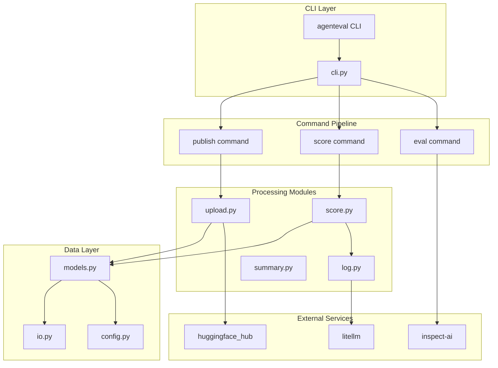
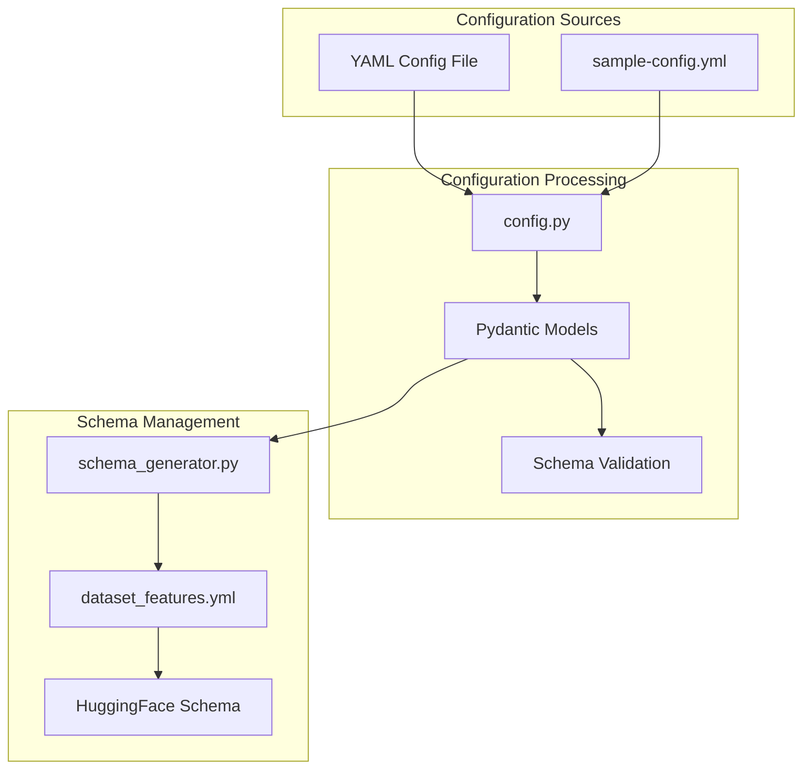
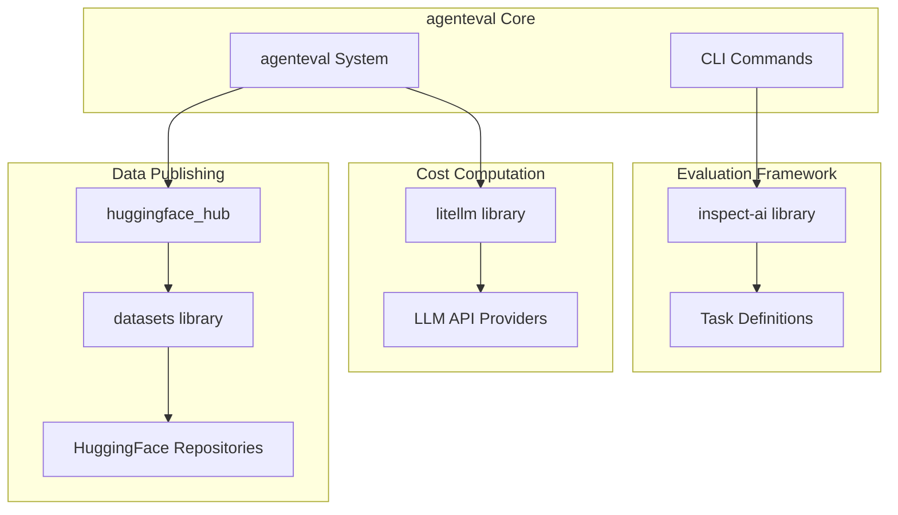

<!-- source: DeepWiki mcp.deepwiki.com · repo allenai/agent-eval · page 1 Overview · fetched 2026-10-26 -->

# Overview

Relevant source files

The following files were used as context for generating this wiki page:

- [README.md](README.md)
- [pyproject.toml](pyproject.toml)

This document introduces the `agent-eval` toolkit, explaining its purpose as a comprehensive agent evaluation system and its high-level architecture. For detailed usage instructions, see [User Guide](#3). For development information, see [Development](#5).

## Purpose and Scope

The `agent-eval` toolkit is a Python package that provides a complete workflow for evaluating AI agents on standardized task suites. It serves as an orchestration layer that coordinates various AI/ML tools to deliver a three-stage evaluation pipeline: execution, scoring, and publication.

The system addresses three primary evaluation challenges:
1. **Standardized Task Suite Management**: Configuration-driven evaluation suites using YAML specifications
2. **Cost Tracking and Analysis**: Automatic extraction of token usage from evaluation logs with cost computation via LiteLLM
3. **Result Publication and Leaderboards**: Automated submission of results to HuggingFace datasets for leaderboard distribution

**Sources**: [README.md:1-7](), [pyproject.toml:5-8]()

## System Architecture

The `agent-eval` system follows a modular architecture with clear separation between CLI orchestration, data processing, and external integrations.

### Core System Components

**Sources**: [pyproject.toml:37-38](), [README.md:14-36]()

### Data Flow Pipeline

The system processes evaluation data through a three-stage transformation pipeline, where each stage produces structured outputs for the next stage.

```mermaid
graph LR
    subgraph "Input Stage"
        YAML_CONFIG["YAML Config"]
        AGENT_CODE["Agent Implementation"]
    end
    
    subgraph "Evaluation Stage"
        AGENTEVAL_EVAL["agenteval eval"]
        INSPECT_RUNNER["Inspect AI Runner"]
        RAW_LOGS["Raw Evaluation Logs"]
        AGENTEVAL_JSON["agenteval.json"]
    end
    
    subgraph "Scoring Stage"
        AGENTEVAL_SCORE["agenteval score"]
        LOG_PARSER["Log Processing"]
        LITELLM_COSTS["LiteLLM Cost Computation"]
        TASK_RESULTS["TaskResult Objects"]
    end
    
    subgraph "Publication Stage"
        AGENTEVAL_PUBLISH["agenteval publish"]
        SUMMARY_STATS["Summary Statistics"]
        HF_UPLOAD["HuggingFace Upload"]
        LEADERBOARD_DATA["Leaderboard Dataset"]
    end
    
    YAML_CONFIG --> AGENTEVAL_EVAL
    AGENT_CODE --> AGENTEVAL_EVAL
    AGENTEVAL_EVAL --> INSPECT_RUNNER
    INSPECT_RUNNER --> RAW_LOGS
    RAW_LOGS --> AGENTEVAL_JSON
    
    AGENTEVAL_JSON --> AGENTEVAL_SCORE
    AGENTEVAL_SCORE --> LOG_PARSER
    LOG_PARSER --> LITELLM_COSTS
    LITELLM_COSTS --> TASK_RESULTS
    
    TASK_RESULTS --> AGENTEVAL_PUBLISH
    AGENTEVAL_PUBLISH --> SUMMARY_STATS
    SUMMARY_STATS --> HF_UPLOAD
    HF_UPLOAD --> LEADERBOARD_DATA
```

**Sources**: [README.md:14-36]()

## Core Components

### CLI Interface

The primary user interface is the `agenteval` command-line tool, implemented through the Click framework. The CLI provides three main commands that form the evaluation pipeline.

| Command | Purpose | Primary Output |
|---------|---------|----------------|
| `eval` | Execute evaluations using Inspect AI | `agenteval.json` with raw results |
| `score` | Process logs and compute metrics | Updated `agenteval.json` with scores |
| `publish` | Upload results to HuggingFace | Dataset on HuggingFace Hub |

**Sources**: [pyproject.toml:11-14](), [pyproject.toml:37-38](), [README.md:14-36]()

### Configuration System

Evaluations are defined through YAML configuration files that specify task suites, metrics, and submission metadata. The configuration system uses Pydantic models for validation and schema management.

**Sources**: [README.md:20-24](), [pyproject.toml:50-51]()

### Data Models

The system uses strongly-typed Pydantic models to represent evaluation data throughout the pipeline. These models serve as the source of truth for data schemas and enable automatic generation of HuggingFace dataset schemas.

**Sources**: [pyproject.toml:15]()

## External Integrations

The `agent-eval` toolkit integrates with three primary external systems, each serving a specific role in the evaluation pipeline.

### Integration Architecture

**Sources**: [pyproject.toml:11-20](), [README.md:3](), [README.md:38-46]()

### Key Integration Points

1. **Inspect AI**: Provides the evaluation execution framework for running agent tasks
2. **LiteLLM**: Enables cost computation by extracting token usage from evaluation logs
3. **HuggingFace Hub**: Serves as the publication platform for results and leaderboard data

For detailed information about these integrations, see [External Integrations](#4.2).

**Sources**: [README.md:3-6](), [pyproject.toml:11-20]()

## Package Structure

The `agent-eval` package is distributed as a Python package with a clear entry point and dependency management through setuptools.

| Component | Implementation | Purpose |
|-----------|----------------|---------|
| Package Name | `agent-eval` | PyPI package identifier |
| CLI Entry Point | `agenteval.cli:cli` | Main command interface |
| Python Requirement | `>=3.10` | Minimum Python version |
| Core Dependencies | Click, Inspect AI, LiteLLM, Pydantic | Essential functionality |
| Data Dependencies | HuggingFace Hub, PyArrow, Datasets | Publication and data handling |

**Sources**: [pyproject.toml:5-20](), [pyproject.toml:37-38]()

---

