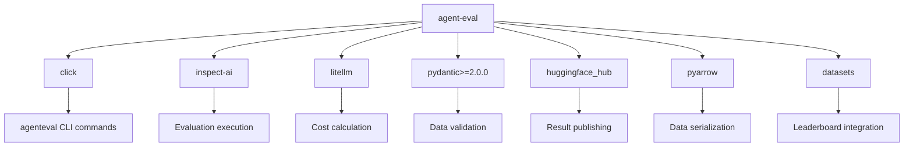
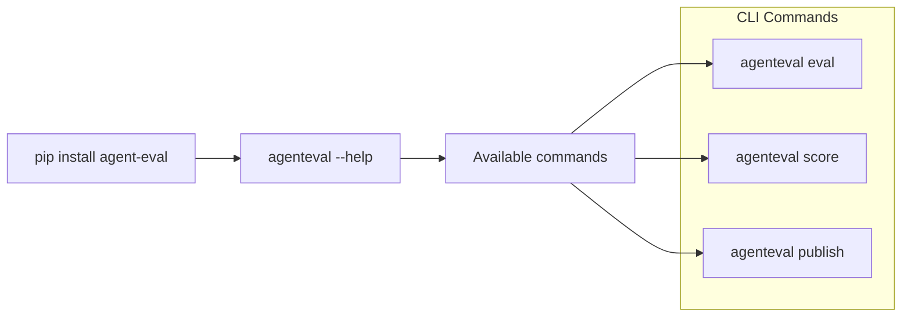
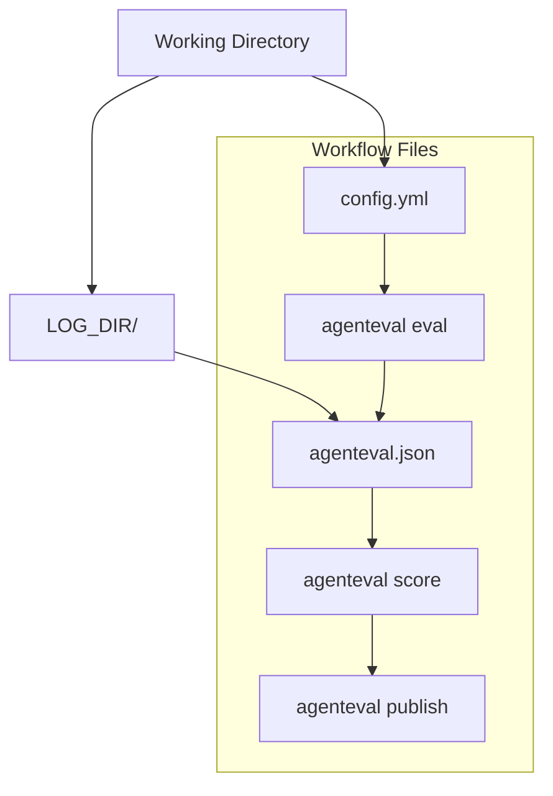

<!-- source: DeepWiki mcp.deepwiki.com · repo allenai/agent-eval · page 2 Installation and Setup · fetched 2026-10-26 -->

# Installation and Setup

<details>
<summary>Relevant source files</summary>

The following files were used as context for generating this wiki page:

- [README.md](README.md)
- [pyproject.toml](pyproject.toml)

</details>


This document covers the installation of the agent-eval toolkit and initial setup steps required to run your first evaluation. It includes system requirements, installation methods, dependency management, and verification procedures.

For detailed configuration of evaluation suites, see [Configuration](#3.1). For comprehensive usage instructions, see [User Guide](#3). For development setup, see [Development Setup](#5.1).

## System Requirements

Agent-eval requires Python 3.10 or higher and integrates with several external systems for evaluation execution and result publication.

### Python Version Requirements

The package requires Python 3.10 as specified in [pyproject.toml:10]():

| Requirement | Version |
|-------------|---------|
| Python | ≥ 3.10 |

### Core Dependencies

Agent-eval relies on several key external libraries for its functionality:


**Dependency Integration Overview**

The dependencies serve specific architectural roles as defined in [pyproject.toml:11-20]():

| Dependency | Purpose | Usage in Agent-eval |
|------------|---------|-------------------|
| `click` | CLI framework | Command-line interface implementation |
| `inspect-ai` | Evaluation framework | Task execution and evaluation logic |
| `litellm` | LLM cost tracking | Token usage extraction and cost computation |
| `pydantic` | Data validation | Schema definitions and data models |
| `huggingface_hub` | Dataset publishing | Leaderboard result uploads |
| `pyarrow` | Data serialization | Efficient data format handling |
| `datasets` | Dataset management | HuggingFace dataset integration |

Sources: [pyproject.toml:10-20]()

## Installation Methods

### PyPI Installation (Recommended)

Install agent-eval from the Python Package Index using pip:

```bash
pip install agent-eval
```

This installs the stable release version as specified in [pyproject.toml:7]() and automatically handles all required dependencies listed in [pyproject.toml:11-20]().

### Development Installation

For development or contributing to agent-eval, install with development dependencies:

```bash
pip install agent-eval[dev]
```

The development dependencies include testing and code formatting tools as defined in [pyproject.toml:26-35]():

| Tool | Purpose |
|------|---------|
| `black==24.2.0` | Code formatting |
| `isort` | Import sorting |
| `autoflake` | Unused import removal |
| `pytest` | Testing framework |
| `pytest-asyncio` | Async testing support |
| `mypy==1.15` | Type checking |
| `types-PyYAML` | Type stubs for YAML |
| `types-setuptools` | Type stubs for setuptools |

Sources: [README.md:10](), [pyproject.toml:26-35]()

## Installation Verification

### Command Line Interface Verification

After installation, verify that the `agenteval` CLI is available and properly configured:


**CLI Verification Workflow**

The CLI entry point is configured in [pyproject.toml:38]() as `agenteval = "agenteval.cli:cli"`. Test the installation by running:

```bash
agenteval --help
```

This should display the main CLI help with available commands: `eval`, `score`, and `publish`.

### Dependency Verification

Verify that key dependencies are properly installed and accessible:

```bash
python -c "import inspect_ai, litellm, huggingface_hub; print('All dependencies available')"
```

Sources: [pyproject.toml:37-38](), [README.md:15-36]()

## Initial Configuration

### HuggingFace Authentication (Optional)

If you plan to publish results to HuggingFace datasets, configure authentication:

```bash
huggingface-cli login
```

This is required for the `agenteval publish` command functionality described in [README.md:33-36]().

### Environment Setup

Agent-eval integrates with external evaluation frameworks and APIs. Ensure relevant environment variables are configured for:

- **LiteLLM API keys**: For cost calculation functionality
- **Inspect AI settings**: For evaluation execution
- **HuggingFace tokens**: For dataset publishing

### Directory Structure

Agent-eval expects specific file organization for evaluations:


**Expected Directory Structure**

The evaluation workflow creates and expects specific files as described in [README.md:16-36]():

- Configuration file (e.g., `sample-config.yml`)
- Log directory for storing evaluation results
- `agenteval.json` file generated during evaluation

Sources: [README.md:38-46]()

## Quick Start Validation

### Sample Configuration

Agent-eval includes a sample configuration file for testing basic functionality. The configuration format is referenced in [README.md:20]() as `sample-config.yml`.

### First Evaluation Test

Once installed and configured, test the complete workflow:

1. **Prepare configuration**: Create or use a sample configuration file
2. **Run evaluation**: Execute `agenteval eval --config-path CONFIG_PATH --split SPLIT LOG_DIR`
3. **Score results**: Run `agenteval score LOG_DIR`
4. **Verify output**: Check that `agenteval.json` is generated in the log directory

This validates the complete installation and basic functionality of the three-stage pipeline (eval → score → publish).

Sources: [README.md:15-30]()

## Next Steps

After successful installation and verification:

- **Configuration**: Learn about evaluation suite configuration in [Configuration](#3.1)
- **Usage**: Follow the complete user guide in [User Guide](#3)
- **CLI Reference**: Review all available commands in [CLI Reference](#3.3)
- **Development**: Set up development environment following [Development Setup](#5.1)

The installation provides access to the complete agent-eval toolkit for running evaluations, computing scores, and publishing results to leaderboards.

---

