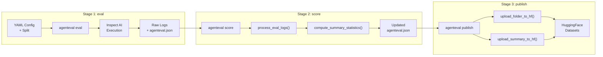
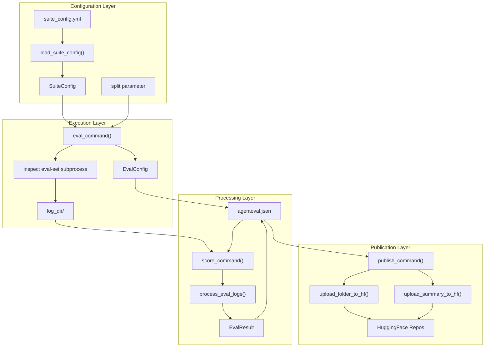

<!-- source: DeepWiki mcp.deepwiki.com · repo allenai/agent-eval · page 3 User Guide · fetched 2026-10-26 -->

# User Guide

<details>
<summary>Relevant source files</summary>

The following files were used as context for generating this wiki page:

- [README.md](README.md)
- [src/agenteval/cli.py](src/agenteval/cli.py)

</details>


This guide provides comprehensive instructions for using agent-eval to run evaluations on agent systems using the Inspect AI framework. It covers the complete workflow from configuration through evaluation execution to results publication.

The guide focuses on practical usage of the three-stage evaluation pipeline: `eval` → `score` → `publish`. For detailed configuration syntax, see [Configuration](#3.1). For step-by-step execution instructions, see [Running Evaluations](#3.2). For complete CLI command reference, see [CLI Reference](#3.3).

## Overview of the Evaluation Workflow

Agent-eval implements a three-stage pipeline that transforms agent evaluation configurations into published leaderboard results. Each stage produces specific outputs that feed into the next stage.

**Agent-Eval Three-Stage Pipeline**


Sources: [src/agenteval/cli.py:333-429](), [src/agenteval/cli.py:100-196](), [src/agenteval/cli.py:199-330]()

## Core Concepts and Code Entities

The agent-eval system operates on several key data structures and files that flow through the evaluation pipeline.

**Core Data Flow and Code Entities**


Sources: [src/agenteval/cli.py:11-15](), [src/agenteval/config.py](), [src/agenteval/models.py](), [src/agenteval/score.py](), [src/agenteval/upload.py]()

## Quick Start Example

Here's a complete example of running an evaluation from start to finish:

### 1. Run Evaluation
```bash
agenteval eval --config-path suite_config.yml --split test_split --log-dir ./logs/my_run
```

This command:
- Loads configuration via `load_suite_config()` from [src/agenteval/config.py]()
- Creates an `EvalConfig` object and writes initial `agenteval.json`
- Executes `inspect eval-set` subprocess with the configured tasks
- Verifies git reproducibility via `verify_git_reproducibility()`

### 2. Score Results
```bash  
agenteval score ./logs/my_run
```

This command:
- Loads `EvalResult` from existing `agenteval.json`
- Calls `process_eval_logs()` to extract metrics and costs
- Runs `compute_summary_statistics()` to aggregate results
- Updates `agenteval.json` with scored results

### 3. Publish to Leaderboard
```bash
agenteval publish --agent-name "MyAgent" --submissions-repo-id "org/submissions" --results-repo-id "org/results" ./logs/my_run
```

This command:
- Validates the `EvalResult` is fully scored
- Uploads log directory via `upload_folder_to_hf()`
- Uploads summary data via `upload_summary_to_hf()`
- Updates `agenteval.json` with publication metadata

Sources: [src/agenteval/cli.py:371-427](), [src/agenteval/cli.py:118-194](), [src/agenteval/cli.py:240-327]()

## Key Files and Data Structures

| File/Object | Purpose | Created By | Used By |
|-------------|---------|------------|---------|
| `suite_config.yml` | Evaluation suite configuration | User | `eval` command |
| `agenteval.json` | Evaluation metadata and results | `eval`, updated by `score` | All commands |
| `log_dir/` | Inspect AI evaluation logs | `inspect eval-set` | `score` command |
| `EvalConfig` | Initial evaluation configuration | `eval` command | Serialized to JSON |
| `EvalResult` | Complete evaluation results | `score` command | `publish` command |
| `SuiteConfig` | Parsed YAML configuration | `load_suite_config()` | `eval` command |

### The agenteval.json File

The `agenteval.json` file is the central data store that evolves through the pipeline:

1. **After eval**: Contains `EvalConfig` with `suite_config` and `split`
2. **After score**: Upgraded to `EvalResult` with `results`, `eval_specs`, and summary statistics  
3. **After publish**: Enhanced with `submission` metadata including URLs and timestamps

The file uses Pydantic models for validation and serialization via `EvalResult.model_validate_json()` and `EvalResult.save_json()`.

Sources: [src/agenteval/cli.py:17](), [src/agenteval/cli.py:401-403](), [src/agenteval/cli.py:124-132](), [src/agenteval/cli.py:187](), [src/agenteval/cli.py:325-326]()

## Advanced Usage Considerations

### Git Reproducibility

The `eval` command enforces git reproducibility by default via `verify_git_reproducibility()`:
- Checks for uncommitted changes in working directory
- Ensures current commit exists on remote repository  
- Warns about untracked files
- Can be bypassed with `--ignore-git` flag (not recommended)

### Error Handling

The `score` command implements comprehensive error handling:
- Warns about multiple evaluation specs in logs from mixed runs
- Identifies missing tasks via `eval_result.find_missing_tasks()`
- Exits with error code if metric computation fails
- Validates configuration version consistency

### HuggingFace Integration

The `publish` command requires proper HuggingFace setup:
- Uses `HfApi.whoami()` to determine username if not provided
- Sanitizes usernames and agent names via `sanitize_path_component()`
- Uploads to separate repositories for submissions and results
- Automatically adds dataset metadata if missing

Sources: [src/agenteval/cli.py:20-93](), [src/agenteval/cli.py:161-172](), [src/agenteval/cli.py:276-294]()

---

