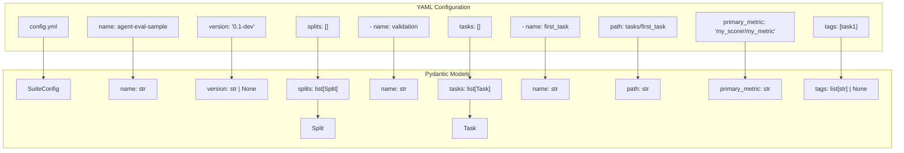
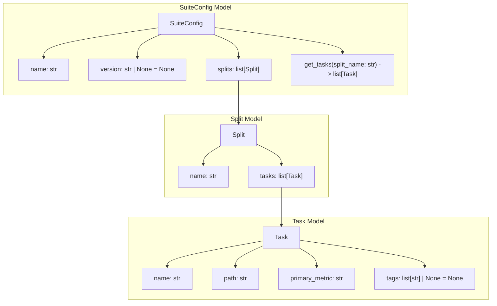
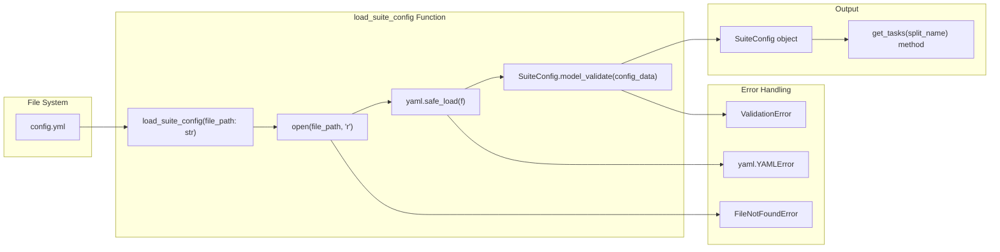

<!-- source: DeepWiki mcp.deepwiki.com · repo allenai/agent-eval · page 3.1 Configuration · fetched 2026-10-26 -->

# Configuration

<details>
<summary>Relevant source files</summary>

The following files were used as context for generating this wiki page:

- [sample-config.yml](sample-config.yml)
- [src/agenteval/config.py](src/agenteval/config.py)

</details>


This document explains how to configure evaluation suites using YAML configuration files. Configuration files define the tasks, splits, and metadata for evaluation runs in agent-eval. For information about running evaluations with these configurations, see [Running Evaluations](#3.2). For detailed CLI command reference, see [CLI Reference](#3.3).

## Configuration File Structure

Agent-eval uses YAML configuration files to define evaluation suites. A configuration file specifies the suite metadata, splits (e.g., validation, test), and the tasks within each split.

### Configuration Schema Mapping

The following diagram shows how YAML configuration elements map to the corresponding Pydantic data models:



Sources: [src/agenteval/config.py:9-40](), [sample-config.yml:1-21]()

### Basic Configuration Example

Here is the structure of a basic configuration file:

```yaml
name: agent-eval-sample
version: "0.1-dev"

splits:
  - name: validation
    tasks:
      - name: first_task
        path: tasks/first_task
        primary_metric: 'my_scorer/my_metric'
        tags:
          - task1

  - name: test
    tasks:
      - name: second_task
        path: tasks/second_task
        primary_metric: 'my_scorer/mean'
        tags:
          - task2
```

Sources: [sample-config.yml:1-21]()

## Data Models and Validation

Agent-eval uses Pydantic models to validate and structure configuration data. The configuration system consists of three main models:

### Configuration Data Model Hierarchy



Sources: [src/agenteval/config.py:9-62]()

### Field Descriptions

| Model | Field | Type | Description |
|-------|-------|------|-------------|
| `SuiteConfig` | `name` | `str` | Name of the evaluation suite |
| `SuiteConfig` | `version` | `str \| None` | Version of the suite (e.g., '1.0.0.dev1') |
| `SuiteConfig` | `splits` | `list[Split]` | List of splits in the suite |
| `Split` | `name` | `str` | Name of the split (e.g., 'validation', 'test') |
| `Split` | `tasks` | `list[Task]` | List of tasks associated with the split |
| `Task` | `name` | `str` | Canonical task name used by the leaderboard |
| `Task` | `path` | `str` | Path to the task definition used by Inspect AI |
| `Task` | `primary_metric` | `str` | Primary metric for the task, used for summary scores |
| `Task` | `tags` | `list[str] \| None` | List of tags for computing summary scores for task groups |

Sources: [src/agenteval/config.py:9-40]()

## Configuration Loading Process

The configuration loading process involves file parsing, YAML validation, and Pydantic model validation:

### Configuration Loading Flow



Sources: [src/agenteval/config.py:64-87]()

### Loading Configuration Files

The `load_suite_config` function handles configuration file loading with comprehensive error handling:

```python
# Example usage (do not copy this code)
config = load_suite_config("path/to/config.yml")
validation_tasks = config.get_tasks("validation")
```

The function performs the following validation steps:

1. **File Existence**: Checks if the configuration file exists
2. **YAML Parsing**: Validates YAML syntax using `yaml.safe_load`
3. **Schema Validation**: Uses Pydantic `model_validate` to ensure data structure compliance
4. **Split Access**: Provides `get_tasks()` method for retrieving tasks by split name

Sources: [src/agenteval/config.py:64-87]()

## Configuration Best Practices

### Task Naming and Organization

- Use descriptive task names that clearly identify the evaluation scenario
- Organize tasks into logical splits (e.g., `validation`, `test`, `dev`)
- Use consistent naming conventions across your evaluation suite

### Primary Metrics

The `primary_metric` field should reference a scorer and metric combination that will be computed during evaluation:

- Format: `'scorer_name/metric_name'`
- Examples: `'my_scorer/accuracy'`, `'my_scorer/mean'`, `'standard_scorer/f1'`
- This metric is used for generating summary statistics and leaderboard rankings

### Tags for Task Grouping

Tags enable grouping related tasks for aggregate scoring:

- Use tags to group tasks by domain, difficulty, or evaluation type
- Tags are used when computing summary scores across task groups
- Multiple tags can be assigned to a single task

### Version Management

- Use semantic versioning for suite versions (e.g., `"1.0.0"`, `"2.1.0-dev"`)
- Include version information to track evaluation suite evolution
- Version field is optional but recommended for reproducibility

Sources: [src/agenteval/config.py:16-20](), [sample-config.yml:1-21]()

---

