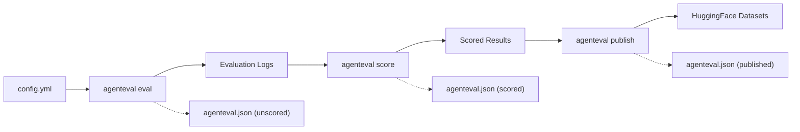
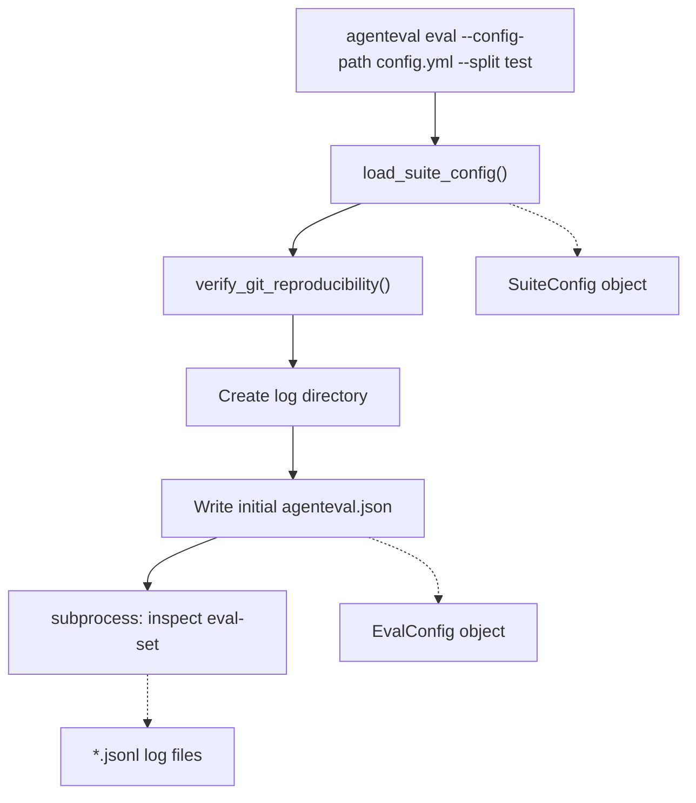
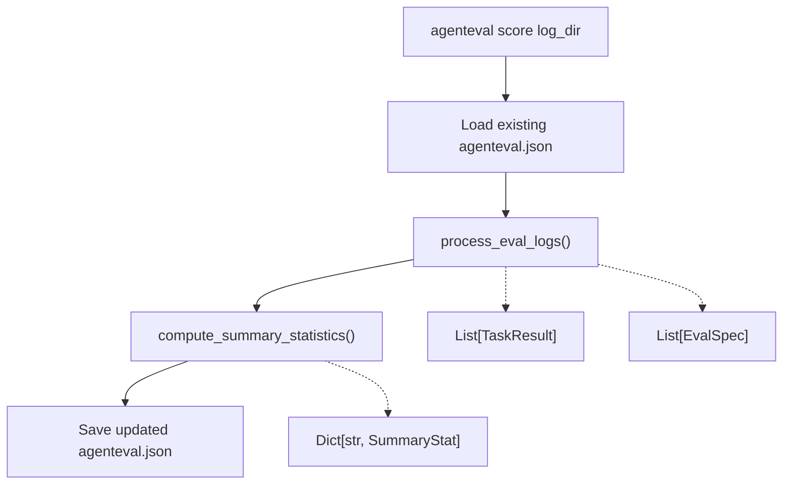
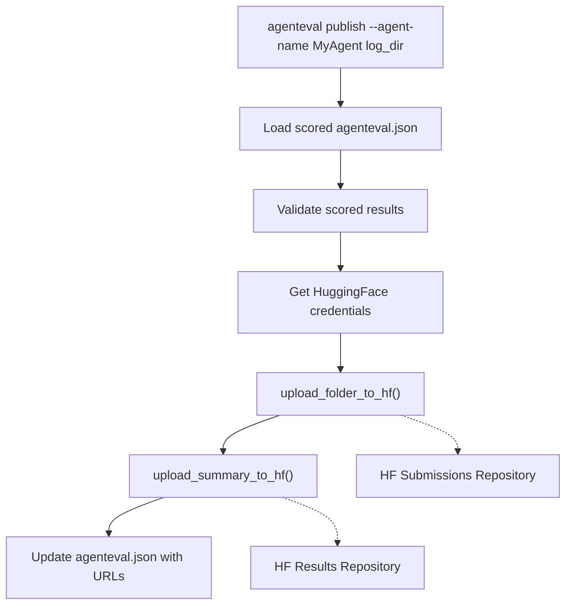
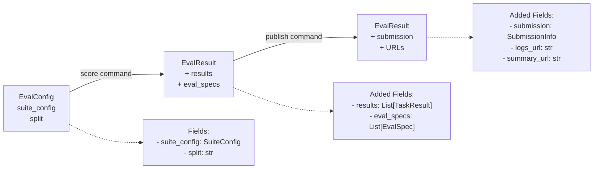

<!-- source: DeepWiki mcp.deepwiki.com · repo allenai/agent-eval · page 3.2 Running Evaluations · fetched 2026-10-26 -->

# Running Evaluations

<details>
<summary>Relevant source files</summary>

The following files were used as context for generating this wiki page:

- [README.md](README.md)
- [src/agenteval/cli.py](src/agenteval/cli.py)
- [src/agenteval/summary.py](src/agenteval/summary.py)
- [tests/test_summary_utils.py](tests/test_summary_utils.py)

</details>


This page provides a step-by-step guide through the core evaluation workflow in agent-eval. The evaluation process consists of three sequential stages: `eval`, `score`, and `publish`. Each stage transforms evaluation data and produces outputs that feed into the next stage.

For information about configuring evaluation suites, see [Configuration](#3.1). For detailed CLI command reference, see [CLI Reference](#3.3).

## Workflow Overview

The agent-eval system implements a three-stage pipeline that transforms evaluation configurations into published leaderboard results:

**Evaluation Workflow**


Each stage operates on the `agenteval.json` file in the log directory, progressively enriching it with evaluation data, computed metrics, and publication metadata.

Sources: [src/agenteval/cli.py:95-433]()

## Stage 1: Running Evaluations

The `eval` command executes evaluation tasks using Inspect AI and creates the initial log directory structure.

**Evaluation Execution Flow**


### Key Operations

The `eval_command` function performs these operations:

1. **Configuration Loading**: Uses `load_suite_config()` to parse the YAML configuration file [src/agenteval/cli.py:380]()
2. **Git Reproducibility Check**: Calls `verify_git_reproducibility()` to ensure the codebase state can be reproduced [src/agenteval/cli.py:384]()
3. **Log Directory Creation**: Creates a timestamped log directory if none is specified [src/agenteval/cli.py:389-395]()
4. **Initial JSON Creation**: Writes an `EvalConfig` object to `agenteval.json` [src/agenteval/cli.py:401-403]()
5. **Inspect AI Execution**: Runs `inspect eval-set` as a subprocess with the configured tasks [src/agenteval/cli.py:408-416]()

### File Outputs

After successful evaluation:
- Log directory contains `.jsonl` files with detailed evaluation logs
- `agenteval.json` contains basic configuration (`EvalConfig` object)
- Directory structure: `logs/{suite}_{version}_{split}_{timestamp}/`

Sources: [src/agenteval/cli.py:371-428](), [src/agenteval/cli.py:20-92]()

## Stage 2: Scoring Results

The `score` command processes evaluation logs, extracts metrics, and computes summary statistics.

**Scoring Data Flow**


### Processing Operations

The `score_command` function orchestrates several data processing steps:

1. **Load Existing Results**: Loads `EvalResult` from `agenteval.json` or creates new one [src/agenteval/cli.py:124-155]()
2. **Log Processing**: Calls `process_eval_logs()` to extract `TaskResult` objects from log files [src/agenteval/cli.py:157]()
3. **Statistics Computation**: Uses `compute_summary_statistics()` to aggregate metrics [src/agenteval/cli.py:174-178]()
4. **Validation**: Checks for missing tasks and processing errors [src/agenteval/cli.py:169-171](), [src/agenteval/cli.py:182-184]()
5. **Persistence**: Saves the enriched `EvalResult` back to `agenteval.json` [src/agenteval/cli.py:187]()

### Data Transformations

The scoring stage transforms raw log data into structured metrics:

| Input | Processing Function | Output |
|-------|-------------------|---------|
| `.jsonl` log files | `process_eval_logs()` | `List[TaskResult]` with metrics and costs |
| `TaskResult` objects | `compute_summary_statistics()` | `Dict[str, SummaryStat]` for tasks, tags, and overall |
| Raw cost data | Cost extraction via LiteLLM | `model_costs` field in `TaskResult` |

Sources: [src/agenteval/cli.py:118-194](), [src/agenteval/summary.py:38-118]()

## Stage 3: Publishing Results

The `publish` command uploads scored results to HuggingFace datasets for leaderboard integration.

**Publication Upload Flow**


### Publication Operations

The `publish_command` function handles the upload workflow:

1. **Result Validation**: Ensures `agenteval.json` contains scored results via `is_scored()` [src/agenteval/cli.py:268-270]()
2. **HuggingFace Authentication**: Gets user credentials via `HfApi.whoami()` [src/agenteval/cli.py:277-286]()
3. **Metadata Population**: Fills `submission` fields with agent information and timestamp [src/agenteval/cli.py:297-301]()
4. **Log Upload**: Uses `upload_folder_to_hf()` to upload entire log directory [src/agenteval/cli.py:313-316]()
5. **Summary Upload**: Uses `upload_summary_to_hf()` to upload processed results [src/agenteval/cli.py:319-323]()
6. **Final Update**: Saves publication URLs back to `agenteval.json` [src/agenteval/cli.py:326-327]()

### Repository Structure

Published data is organized in HuggingFace repositories:

```
submissions-repo/
└── {config_name}/
    └── {split}/
        └── {username}_{agent_name}_{timestamp}/
            ├── agenteval.json
            ├── task1.jsonl
            └── task2.jsonl

results-repo/
└── {config_name}/
    └── {split}/
        └── {username}_{agent_name}_{timestamp}.json
```

Sources: [src/agenteval/cli.py:240-328](), [src/agenteval/upload.py]()

## File State Transitions

The `agenteval.json` file evolves through distinct states during the workflow:

**agenteval.json Evolution**


Each stage validates the expected file state and adds new data:

| Stage | Input State | Validation | Output State |
|-------|-------------|------------|--------------|
| `eval` | None | Config file exists | `EvalConfig` object created |
| `score` | `EvalConfig` or `EvalResult` | Log files present | `EvalResult` with metrics |
| `publish` | `EvalResult` | `is_scored()` returns true | `EvalResult` with publication metadata |

Sources: [src/agenteval/models.py](), [src/agenteval/cli.py:124-128](), [src/agenteval/cli.py:268-270]()

## Error Handling and Troubleshooting

The workflow includes several validation and error handling mechanisms:

### Git Reproducibility Checks

The `verify_git_reproducibility()` function enforces reproducible evaluations:
- Checks for uncommitted changes [src/agenteval/cli.py:65-70]()
- Warns about untracked files [src/agenteval/cli.py:58-62]()
- Verifies commit exists on remote [src/agenteval/cli.py:74-85]()

### Scoring Validation

The scoring stage performs comprehensive validation:
- Checks for missing tasks via `find_missing_tasks()` [src/agenteval/cli.py:169-171]()
- Warns about multiple evaluation specs [src/agenteval/cli.py:162-166]()
- Aborts on metric computation errors [src/agenteval/cli.py:182-184]()

### Publication Requirements

The publish command validates upload readiness:
- Ensures results are scored [src/agenteval/cli.py:268-270]()
- Validates suite config version [src/agenteval/cli.py:304-306]()
- Requires HuggingFace authentication [src/agenteval/cli.py:284-286]()

Common error scenarios and their resolutions:

| Error | Cause | Resolution |
|-------|-------|------------|
| "Git working directory contains uncommitted changes" | Dirty git state | Commit changes or use `--ignore-git` |
| "No scored results found" | Running publish before score | Run `agenteval score` first |
| "Missing tasks in result set" | Incomplete evaluation logs | Re-run evaluation or check task configuration |

Sources: [src/agenteval/cli.py:20-92](), [src/agenteval/cli.py:169-171](), [src/agenteval/cli.py:268-270]()

---

