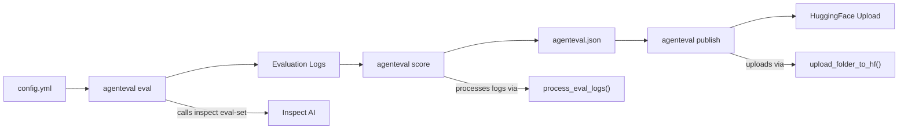
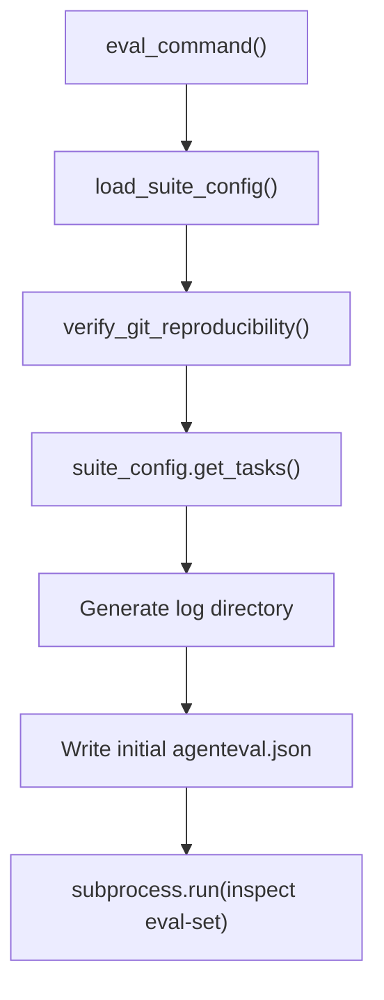
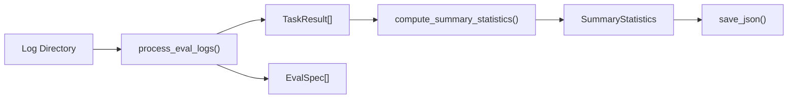
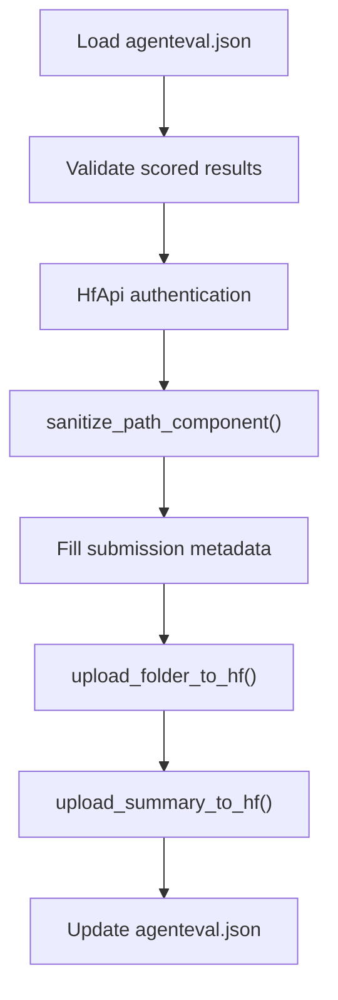
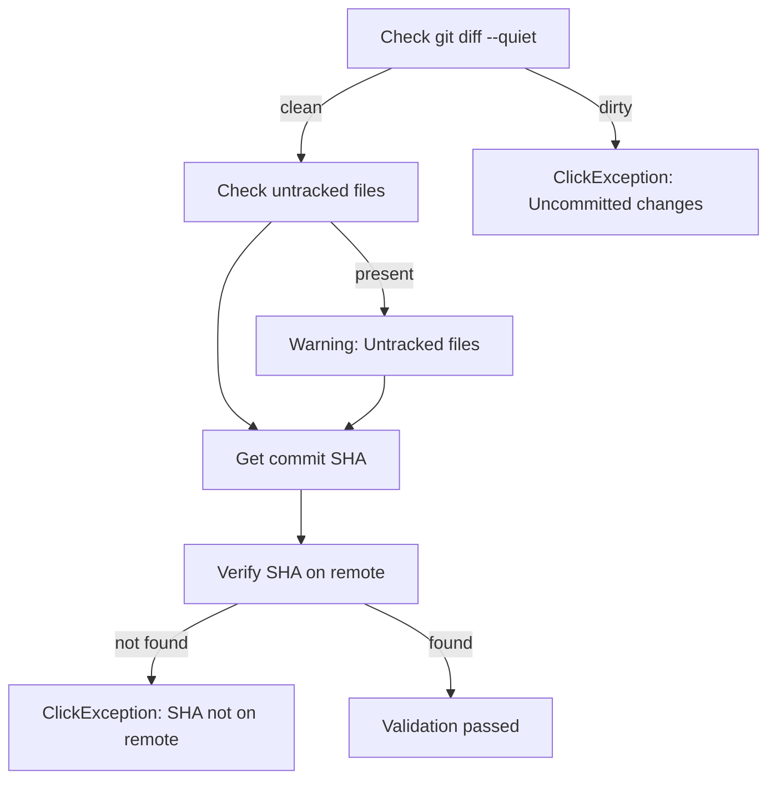

<!-- source: DeepWiki mcp.deepwiki.com · repo allenai/agent-eval · page 3.3 CLI Reference · fetched 2026-10-26 -->

# CLI Reference

<details>
<summary>Relevant source files</summary>

The following files were used as context for generating this wiki page:

- [src/agenteval/cli.py](src/agenteval/cli.py)

</details>


This document provides comprehensive reference documentation for all `agenteval` command-line interface commands and their options. The CLI provides a three-stage pipeline for agent evaluation: `eval` → `score` → `publish`.

For configuration file format and schema details, see [Configuration](#3.1). For step-by-step usage guidance, see [Running Evaluations](#3.2).

## Command Overview

The `agenteval` CLI provides three main commands that form a sequential workflow:

### CLI Command Flow



**Sources:** [src/agenteval/cli.py:95-433]()

## eval Command

Executes agent evaluations using Inspect AI's `eval-set` command with specified configuration and tasks.

### Syntax
```bash
agenteval eval --config-path CONFIG --split SPLIT [OPTIONS] [INSPECT_ARGS...]
```

### Required Arguments

| Option | Type | Description |
|--------|------|-------------|
| `--config-path` | string | Path to YAML configuration file |
| `--split` | string | Configuration data split to evaluate |

### Optional Arguments

| Option | Type | Default | Description |
|--------|------|---------|-------------|
| `--log-dir` | string | Auto-generated | Directory for evaluation logs |
| `--ignore-git` | flag | false | Skip git reproducibility checks |
| `--display` | string | "plain" | Display format for inspect output |
| `[INSPECT_ARGS...]` | various | - | Additional arguments passed to `inspect eval-set` |

### Behavior

1. **Git Reproducibility Check**: Validates working directory is clean and committed (unless `--ignore-git` specified)
2. **Task Resolution**: Loads tasks from configuration file based on split
3. **Log Directory Creation**: Auto-generates timestamped directory if not specified
4. **Evaluation Execution**: Calls `inspect eval-set` with resolved tasks and arguments
5. **Result Initialization**: Creates initial `agenteval.json` with configuration metadata

### Implementation Details



**Sources:** [src/agenteval/cli.py:333-428](), [src/agenteval/cli.py:20-92]()

## score Command

Processes evaluation logs and computes summary statistics, storing results in `agenteval.json`.

### Syntax
```bash
agenteval score LOG_DIR [OPTIONS]
```

### Required Arguments

| Argument | Type | Description |
|----------|------|-------------|
| `LOG_DIR` | path | Directory containing evaluation logs |

### Optional Arguments

| Option | Type | Description |
|--------|------|-------------|
| `--config-path` | string | Path to YAML config (ignored if `agenteval.json` exists) |
| `--split` | string | Config data split (ignored if `agenteval.json` exists) |

### Behavior

1. **Result Loading**: Loads existing `agenteval.json` if present, otherwise creates new `EvalResult`
2. **Log Processing**: Calls `process_eval_logs()` to extract task results and evaluation specs
3. **Statistics Computation**: Generates summary statistics via `compute_summary_statistics()`
4. **Validation**: Checks for missing tasks and multiple evaluation specs
5. **Persistence**: Saves updated results to `agenteval.json`

### Data Processing Pipeline



**Sources:** [src/agenteval/cli.py:100-196]()

## publish Command

Uploads scored evaluation results to HuggingFace Hub for leaderboard integration.

### Syntax
```bash
agenteval publish LOG_DIR --agent-name NAME [OPTIONS]
```

### Required Arguments

| Argument/Option | Type | Description |
|-----------------|------|-------------|
| `LOG_DIR` | path | Directory containing scored results |
| `--agent-name` | string | Descriptive name for the agent submission |

### Optional Arguments

| Option | Type | Default | Description |
|--------|------|---------|-------------|
| `--submissions-repo-id` | string | `$SUBMISSIONS_REPO_ID` | HF repository for submission logs |
| `--results-repo-id` | string | `$RESULTS_REPO_ID` | HF repository for result summaries |
| `--username` | string | HF account name | HF username/organization |
| `--agent-description` | string | - | Description of the agent |
| `--agent-url` | string | - | URL to agent repository/docs |

### Upload Process



### File Organization

Submissions are organized in HuggingFace repositories as:
```
{config_name}/{split}/{username}_{agent_name}_{timestamp}/
├── logs/           # Evaluation logs
└── summary.json    # Summary statistics
```

**Sources:** [src/agenteval/cli.py:199-330]()

## Git Reproducibility

The `eval` command enforces git reproducibility by default to ensure evaluation results can be reproduced.

### Verification Process



### Requirements

- Working directory must be clean (no uncommitted changes)
- Current commit must exist on remote repository
- Warns about untracked files (but doesn't fail)

Use `--ignore-git` to bypass these checks (not recommended for production evaluations).

**Sources:** [src/agenteval/cli.py:20-92]()

## Error Handling

### Common Error Scenarios

| Command | Error Condition | Solution |
|---------|----------------|----------|
| `eval` | Git working directory dirty | Commit changes or use `--ignore-git` |
| `eval` | Commit not on remote | Push changes or use `--ignore-git` |
| `score` | Missing `agenteval.json` and no config | Provide `--config-path` and `--split` |
| `score` | Split mismatch | Ensure CLI split matches JSON split |
| `publish` | No scored results | Run `score` command first |
| `publish` | Missing HF authentication | Configure HuggingFace Hub authentication |

### Exit Codes

- `0`: Success
- `1`: Error during execution (via `click.ClickException` or `sys.exit(1)`)

**Sources:** [src/agenteval/cli.py:65-92](), [src/agenteval/cli.py:130-153](), [src/agenteval/cli.py:262-286]()

## File Outputs

### agenteval.json Structure

The CLI commands work with a central `agenteval.json` file that evolves through the workflow:

1. **After `eval`**: Contains `EvalConfig` with suite configuration and split
2. **After `score`**: Enhanced with `TaskResult[]`, `EvalSpec[]`, and scoring metadata  
3. **After `publish`**: Includes submission metadata and HuggingFace URLs

### Constants

- `EVAL_FILENAME = "agenteval.json"` - Standard filename for results

**Sources:** [src/agenteval/cli.py:17](), [src/agenteval/cli.py:400-403](), [src/agenteval/cli.py:186-187](), [src/agenteval/cli.py:325-327]()

---

