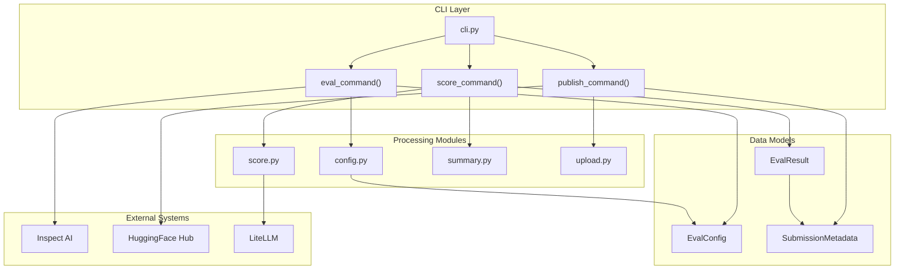
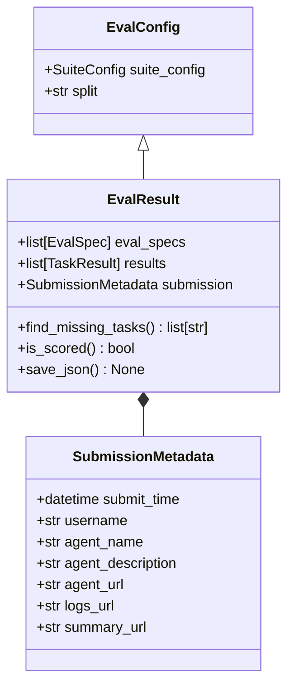
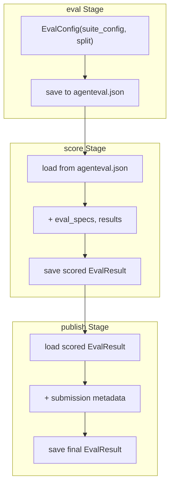
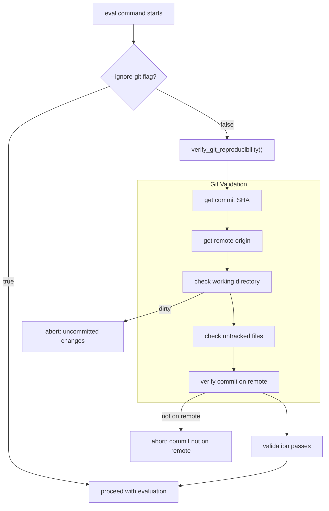
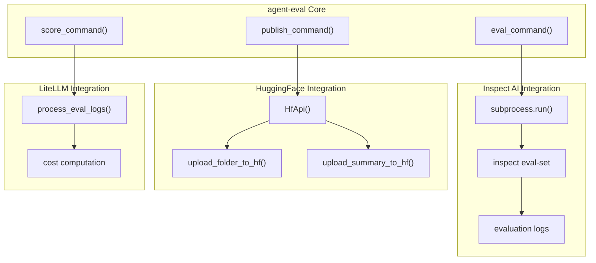

<!-- source: DeepWiki mcp.deepwiki.com · repo allenai/agent-eval · page 4 Architecture · fetched 2026-10-26 -->

# Architecture

Relevant source files

The following files were used as context for generating this wiki page:

- [src/agenteval/cli.py](src/agenteval/cli.py)
- [src/agenteval/models.py](src/agenteval/models.py)

This document provides a deep dive into agent-eval's internal architecture, covering the core components, data flow, and design patterns that enable the system's three-stage evaluation pipeline. 

For information about using the CLI commands, see [CLI Reference](#3.3). For details about individual data processing steps, see [Data Processing Pipeline](#4.1). For external system integrations, see [External Integrations](#4.2).

## System Overview

Agent-eval implements a three-stage pipeline architecture that transforms agent evaluation configurations into published leaderboard results. The system is designed as an orchestration layer that coordinates between existing tools like Inspect AI, LiteLLM, and HuggingFace Hub.

### Core Pipeline Architecture

*Sources: [src/agenteval/cli.py:95-433](), [src/agenteval/models.py:1-90]()*

The architecture follows a clear separation of concerns where the CLI layer orchestrates the pipeline, data models provide structure, and processing modules handle the core logic.

## Data Flow Through Pipeline Stages

The system processes evaluation data through three distinct stages, each with specific inputs, outputs, and responsibilities.

### Three-Stage Data Transformation

```mermaid
graph LR
    subgraph "Stage 1: eval"
        YAMLConfig["YAML Config"]
        eval_command_func["eval_command()"]
        InspectEval["inspect eval-set"]
        RawLogs["Raw Logs"]
        agenteval_json["agenteval.json"]
    end
    
    subgraph "Stage 2: score"
        score_command_func["score_command()"]
        process_eval_logs["process_eval_logs()"]
        TaskResult["TaskResult[]"]
        compute_summary["compute_summary_statistics()"]
        ScoredResult["Scored EvalResult"]
    end
    
    subgraph "Stage 3: publish"
        publish_command_func["publish_command()"]
        upload_folder["upload_folder_to_hf()"]
        upload_summary["upload_summary_to_hf()"]
        HFLeaderboard["HF Leaderboard"]
    end
    
    YAMLConfig --> eval_command_func
    eval_command_func --> InspectEval
    InspectEval --> RawLogs
    eval_command_func --> agenteval_json
    
    RawLogs --> score_command_func
    agenteval_json --> score_command_func
    score_command_func --> process_eval_logs
    process_eval_logs --> TaskResult
    TaskResult --> compute_summary
    compute_summary --> ScoredResult
    
    ScoredResult --> publish_command_func
    publish_command_func --> upload_folder
    publish_command_func --> upload_summary
    upload_folder --> HFLeaderboard
    upload_summary --> HFLeaderboard
```

*Sources: [src/agenteval/cli.py:333-428](), [src/agenteval/cli.py:100-195](), [src/agenteval/cli.py:199-329]()*

Each stage produces artifacts that serve as inputs to the next stage, with `agenteval.json` serving as the central state file that accumulates data throughout the pipeline.

## Core Components and Responsibilities

### CLI Command Layer

The CLI layer in [src/agenteval/cli.py]() provides the primary interface and orchestrates all system operations. Each command has distinct responsibilities:

| Command | Function | Primary Responsibility |
|---------|----------|----------------------|
| `eval` | `eval_command()` | Execute evaluations via Inspect AI and initialize result tracking |
| `score` | `score_command()` | Process evaluation logs into structured results and compute metrics |
| `publish` | `publish_command()` | Upload results to HuggingFace and update leaderboards |

*Sources: [src/agenteval/cli.py:333-428](), [src/agenteval/cli.py:100-195](), [src/agenteval/cli.py:199-329]()*

### Data Model Layer

The data models in [src/agenteval/models.py]() provide the core data structures that flow through the system:

*Sources: [src/agenteval/models.py:12-18](), [src/agenteval/models.py:33-89](), [src/agenteval/models.py:20-31]()*

`EvalResult` serves as the central data structure that accumulates information throughout the pipeline, starting as a simple `EvalConfig` and growing to include results and submission metadata.

## State Management and Persistence

The system uses a file-based state management approach centered around the `agenteval.json` file, which serves as the persistent state store throughout the evaluation pipeline.

### State File Evolution

*Sources: [src/agenteval/cli.py:400-403](), [src/agenteval/cli.py:124-155](), [src/agenteval/cli.py:260-327](), [src/agenteval/models.py:57-89]()*

The constant `EVAL_FILENAME = "agenteval.json"` [src/agenteval/cli.py:17]() defines the standard filename used across all commands for state persistence.

## Reproducibility and Validation

Agent-eval implements several mechanisms to ensure evaluation reproducibility and result validation.

### Git Reproducibility Verification

*Sources: [src/agenteval/cli.py:20-92](), [src/agenteval/cli.py:383-384]()*

The `verify_git_reproducibility()` function ensures that evaluations can be reproduced by requiring a clean working directory and verifying that the current commit exists on the remote repository.

## External System Integration Points

Agent-eval integrates with external systems through well-defined interfaces that abstract away implementation details.

### Integration Architecture

*Sources: [src/agenteval/cli.py:408-421](), [src/agenteval/cli.py:249-250](), [src/agenteval/cli.py:277-278](), [src/agenteval/cli.py:313-323]()*

The system uses subprocess calls to Inspect AI rather than direct imports, maintaining loose coupling and allowing for independent evolution of the evaluation framework.

## Key Architectural Patterns

Agent-eval employs several key architectural patterns that enable its functionality:

1. **Pipeline Architecture**: Clear three-stage processing with distinct responsibilities
2. **State Accumulation**: Central state file that grows through pipeline stages  
3. **External Tool Orchestration**: Coordinates existing tools rather than reimplementing functionality
4. **Reproducibility-First Design**: Git-based validation ensures evaluations can be reproduced
5. **Schema-Driven Development**: Pydantic models serve as the contract between components

For detailed information about data processing within each stage, see [Data Processing Pipeline](#4.1). For specifics about external integrations, see [External Integrations](#4.2). For data model details, see [Data Models](#4.4).

*Sources: [src/agenteval/cli.py:1-433](), [src/agenteval/models.py:1-90]()*

---

