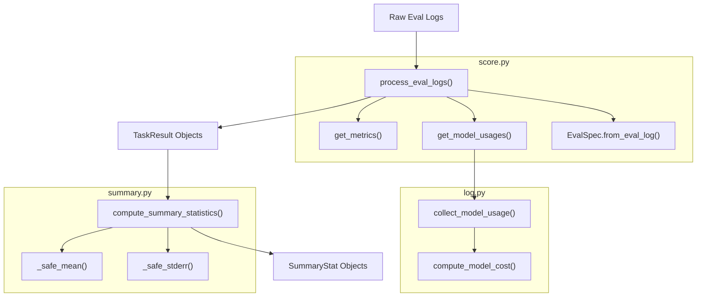
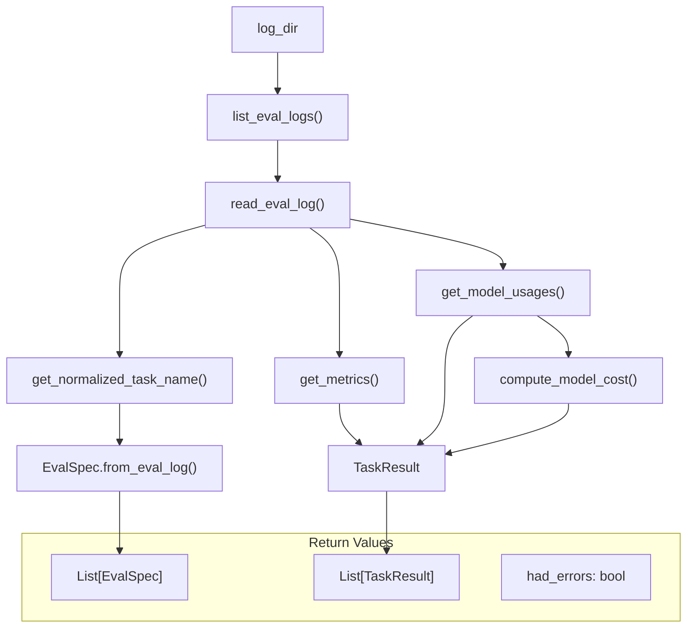
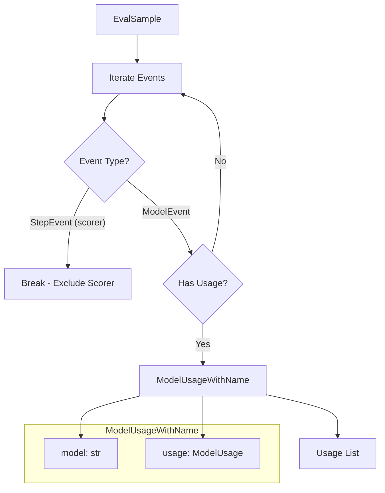
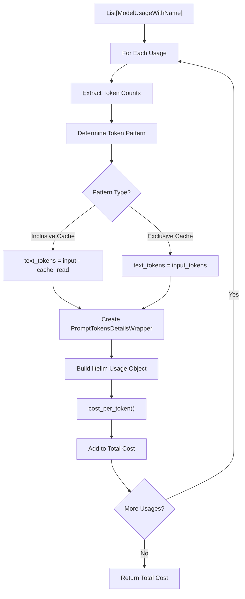
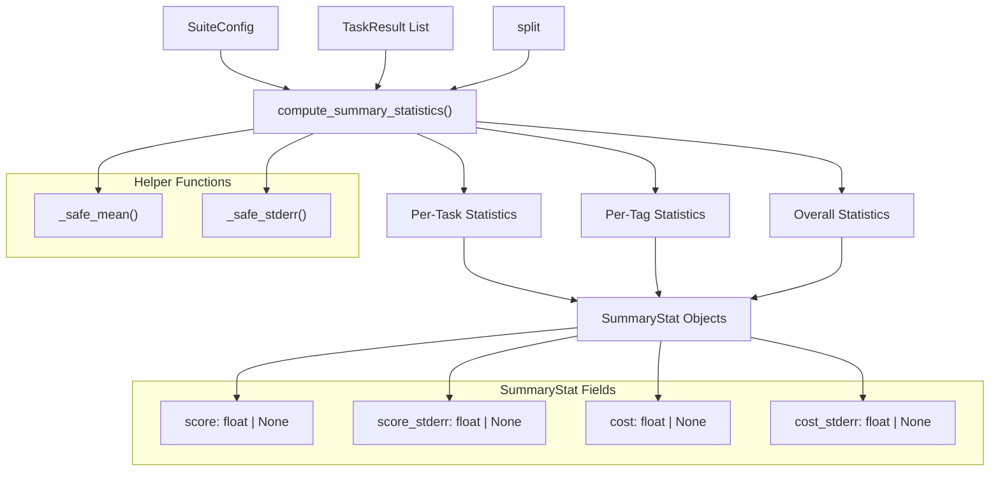
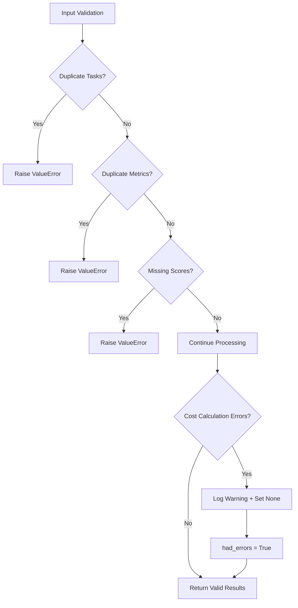

<!-- source: DeepWiki mcp.deepwiki.com · repo allenai/agent-eval · page 4.1 Data Processing Pipeline · fetched 2026-10-26 -->

# Data Processing Pipeline

Relevant source files

The following files were used as context for generating this wiki page:

- [src/agenteval/log.py](src/agenteval/log.py)
- [src/agenteval/score.py](src/agenteval/score.py)
- [src/agenteval/summary.py](src/agenteval/summary.py)
- [tests/test_summary_utils.py](tests/test_summary_utils.py)

This document describes how agent-eval transforms raw evaluation logs into structured results and summary statistics. The data processing pipeline consists of three main stages: log processing, model usage computation, and summary statistics generation. For information about external integrations with Inspect AI and LiteLLM, see [External Integrations](#4.2). For details about the data models used throughout the pipeline, see [Data Models](#4.4).

## Pipeline Overview

The data processing pipeline takes raw evaluation logs generated by Inspect AI and transforms them through multiple stages to produce structured results suitable for analysis and publication.

### Core Data Flow

*Sources: [src/agenteval/score.py:101-160](), [src/agenteval/log.py:21-92](), [src/agenteval/summary.py:38-118]()*

## Log Processing Stage

The log processing stage is implemented in [src/agenteval/score.py]() and serves as the entry point for transforming raw Inspect AI evaluation logs into structured `TaskResult` objects.

### Process Evaluation Logs Function

The `process_eval_logs()` function is the main orchestrator that reads evaluation logs from a directory and processes them into structured results:

*Sources: [src/agenteval/score.py:101-160]()*

### Key Processing Steps

| Step | Function | Purpose |
|------|----------|---------|
| Log Discovery | `list_eval_logs()` | Find all evaluation log files in directory |
| Log Reading | `read_eval_log()` | Parse individual log files |
| Task Normalization | `get_normalized_task_name()` | Remove namespace prefixes from task names |
| Metrics Extraction | `get_metrics()` | Extract performance metrics from log results |
| Usage Collection | `get_model_usages()` | Collect model usage data for cost computation |
| Spec Generation | `EvalSpec.from_eval_log()` | Create evaluation specification objects |

### TaskResult Structure

The `TaskResult` class encapsulates all processed data for a single evaluation task:

- `task_name`: Normalized task identifier
- `metrics`: List of `Metric` objects with names and values
- `model_usages`: Optional list of model usage data per sample
- `model_costs`: Optional list of computed costs per sample

*Sources: [src/agenteval/score.py:47-61](), [src/agenteval/score.py:63-79](), [src/agenteval/score.py:82-88](), [src/agenteval/score.py:91-98]()*

## Model Usage and Cost Computation

The model usage and cost computation logic is implemented in [src/agenteval/log.py]() and handles the complex task of extracting usage statistics and computing costs from evaluation logs.

### Model Usage Collection

The `collect_model_usage()` function extracts model usage data from individual evaluation samples:

*Sources: [src/agenteval/log.py:21-35]()*

### Cost Computation Algorithm

The `compute_model_cost()` function implements sophisticated cost calculation that handles cached tokens:

The cost computation handles two token counting patterns:
- **Inclusive Pattern**: Input tokens include cached tokens (requires subtraction)
- **Exclusive Pattern**: Input tokens exclude cached tokens (Anthropic style)

*Sources: [src/agenteval/log.py:38-92]()*

## Summary Statistics Generation

The summary statistics stage, implemented in [src/agenteval/summary.py](), aggregates individual task results into meaningful summary statistics across different dimensions.

### Summary Computation Architecture

*Sources: [src/agenteval/summary.py:38-118](), [src/agenteval/summary.py:11-16]()*

### Statistical Aggregation Logic

The summary system computes three types of aggregated statistics:

| Aggregation Type | Key Pattern | Purpose |
|------------------|-------------|---------|
| Per-Task | `task/{task_name}` | Individual task performance |
| Per-Tag | `tag/{tag_name}` | Performance grouped by task tags |
| Overall | `overall` | Aggregate performance across all tasks |

### Safe Statistical Functions

The pipeline implements robust statistical functions that handle missing data:

- `_safe_mean()`: Computes mean with different handling for scores (treats `None` as 0) vs costs (requires all values)
- `_safe_stderr()`: Computes standard error, returning `None` if any values are missing or insufficient data

*Sources: [src/agenteval/summary.py:18-36](), [tests/test_summary_utils.py:8-41]()*

## Error Handling and Data Quality

The pipeline implements comprehensive error handling to ensure data quality:

### Validation Checks

*Sources: [src/agenteval/score.py:117-119](), [src/agenteval/score.py:73-78](), [src/agenteval/score.py:67-68](), [src/agenteval/log.py:86-91]()*

The pipeline maintains data integrity through:
- **Duplicate Detection**: Prevents duplicate tasks and metrics from corrupting results
- **Missing Data Handling**: Gracefully handles missing scores or usage data
- **Cost Calculation Fallback**: Logs warnings but continues processing when cost calculation fails
- **Error Reporting**: Returns a boolean flag indicating if any errors occurred during processing

---

