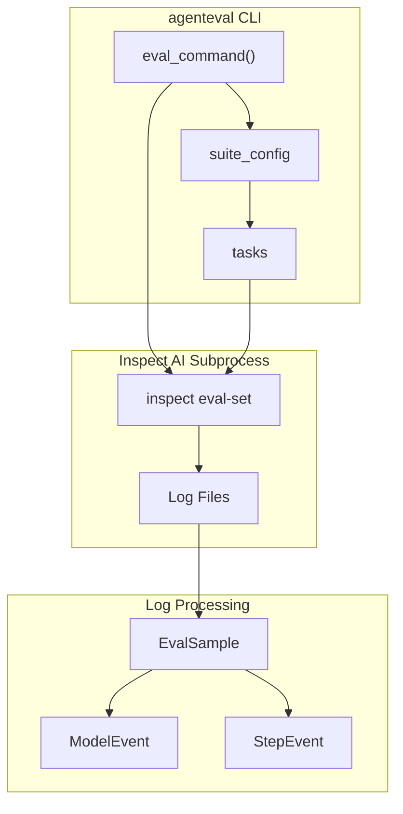
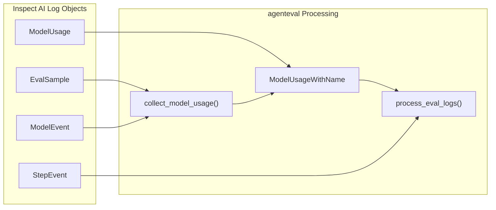
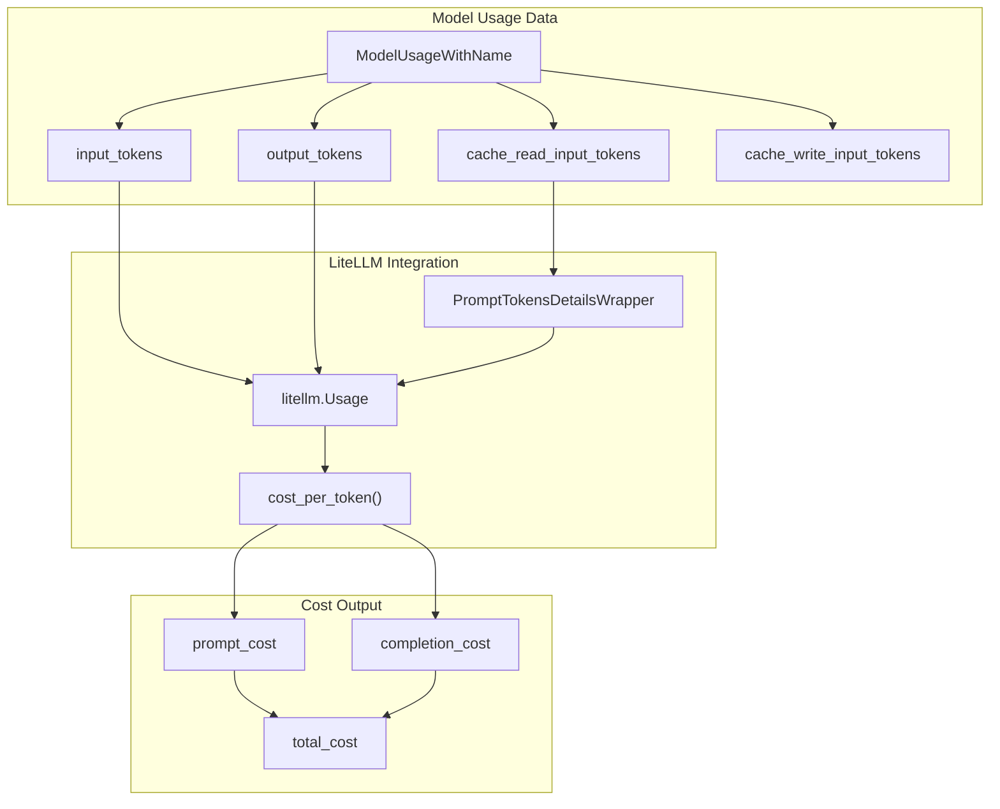
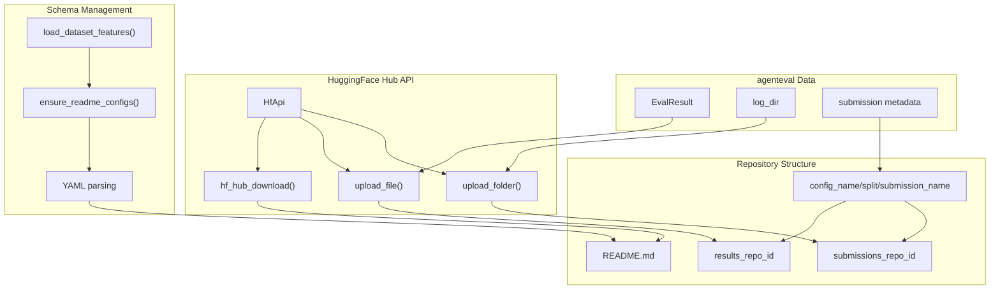
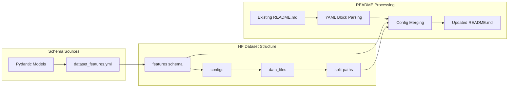
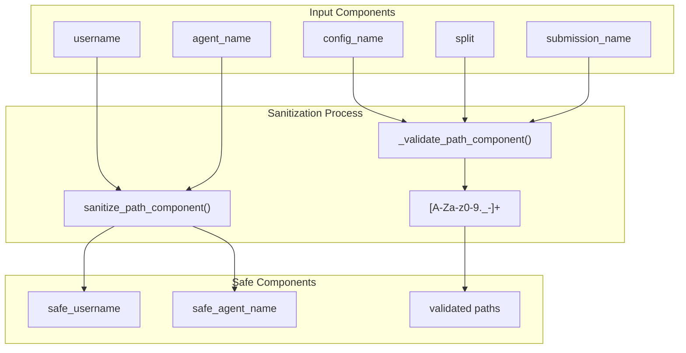
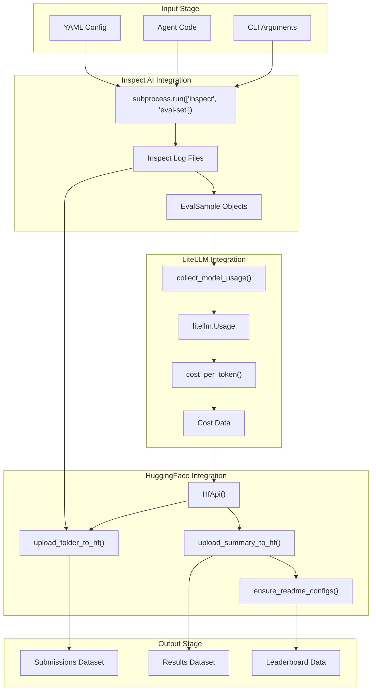

<!-- source: DeepWiki mcp.deepwiki.com · repo allenai/agent-eval · page 4.2 External Integrations · fetched 2026-10-26 -->

# External Integrations

Relevant source files

The following files were used as context for generating this wiki page:

- [src/agenteval/cli.py](src/agenteval/cli.py)
- [src/agenteval/log.py](src/agenteval/log.py)
- [src/agenteval/upload.py](src/agenteval/upload.py)

This document describes how agent-eval integrates with external systems to provide its evaluation pipeline functionality. Agent-eval acts as an orchestration layer that coordinates three primary external integrations: Inspect AI for evaluation execution, LiteLLM for cost calculation, and HuggingFace Hub for data publication and leaderboards.

For information about the internal data processing pipeline that consumes data from these integrations, see [Data Processing Pipeline](#4.1). For details about the data schemas used in HuggingFace uploads, see [Schema Management](#4.3).

## Inspect AI Integration

Agent-eval uses Inspect AI as its core evaluation execution engine. The integration is implemented through subprocess calls to the `inspect eval-set` command rather than direct API usage, providing flexibility in argument passing and maintaining separation between the orchestration and execution layers.

### Evaluation Execution Flow

The `eval_command` function constructs and executes the Inspect AI command with the following key components:

- **Task Resolution**: Uses `suite_config.get_tasks(split)` to determine which tasks to run
- **Command Construction**: Builds the full subprocess command including user arguments, log directory, and task paths
- **Log Directory Management**: Creates timestamped log directories when none is specified
- **Git Reproducibility**: Enforces git cleanliness checks before execution via `verify_git_reproducibility()`

Sources: [src/agenteval/cli.py:333-429]()

### Log Data Consumption

Agent-eval processes Inspect AI logs through the `inspect_ai.log` module, specifically working with `EvalSample`, `ModelEvent`, and `StepEvent` objects to extract evaluation results and model usage data.

The `collect_model_usage` function filters out scorer model calls by breaking when encountering `StepEvent` objects with `type == "scorer"`, ensuring only agent model usage is tracked.

Sources: [src/agenteval/log.py:21-36](), [src/agenteval/score.py]()

## LiteLLM Integration

Agent-eval uses LiteLLM for computing model usage costs across different AI providers. The integration handles complex token accounting including cached tokens for providers like Anthropic.

### Cost Calculation Pipeline

The `compute_model_cost` function handles two different token accounting patterns:

1. **Standard Pattern**: `input_tokens` includes cached tokens
2. **Anthropic Pattern**: `input_tokens` excludes cached tokens, requiring separate accounting

The function constructs a `litellm.Usage` object with proper token distribution and calls `cost_per_token()` to get provider-specific pricing.

Sources: [src/agenteval/log.py:38-93]()

### Token Accounting Logic

The cost calculation includes sophisticated logic for handling cached tokens:

| Token Type | Standard Pattern | Anthropic Pattern |
|------------|------------------|-------------------|
| `input_tokens` | Includes cached | Excludes cached |
| `cache_read_input_tokens` | Subtracted from input | Added to prompt total |
| `cache_write_input_tokens` | Subtracted from input | Added to prompt total |
| `text_tokens` | input - cache_read | input (no adjustment) |

Sources: [src/agenteval/log.py:54-66]()

## HuggingFace Hub Integration

Agent-eval integrates deeply with HuggingFace Hub for publishing evaluation results, managing datasets, and maintaining leaderboards. The integration spans file uploads, dataset schema management, and README configuration.

### Publication Architecture

The publication process involves two separate repositories:

- **Submissions Repository**: Stores complete evaluation logs organized by `config_name/split/submission_name/`
- **Results Repository**: Stores JSON summaries organized by `config_name/split/submission_name.json`

Sources: [src/agenteval/cli.py:240-328](), [src/agenteval/upload.py:129-175]()

### Dataset Schema Management

HuggingFace dataset integration requires sophisticated README.md management to define dataset configurations and splits:

The `ensure_readme_configs` function:

1. Downloads existing README.md or creates new one
2. Parses YAML frontmatter block
3. Merges new config/split information
4. Updates features schema from `load_dataset_features()`
5. Uploads updated README.md

Sources: [src/agenteval/upload.py:15-117](), [src/agenteval/schema_generator.py]()

### Path Sanitization and Validation

HuggingFace uploads require careful path component validation and sanitization:

- `sanitize_path_component()`: Replaces invalid characters with underscores for user-provided names
- `_validate_path_component()`: Strictly validates system-generated components, raising errors for invalid characters

Sources: [src/agenteval/upload.py:118-127]()

## Integration Architecture Overview

The external integrations work together in a coordinated pipeline that transforms agent code into published leaderboard results:

This architecture ensures:

- **Separation of Concerns**: Each external system handles its specialized functionality
- **Data Flow Integrity**: Results flow through structured transformations from logs to published datasets
- **Schema Consistency**: HuggingFace datasets maintain consistent structure through automated README management
- **Cost Transparency**: Model usage costs are calculated across all providers using standardized interfaces

Sources: [src/agenteval/cli.py:333-429](), [src/agenteval/log.py:21-93](), [src/agenteval/upload.py:15-175]()

---

