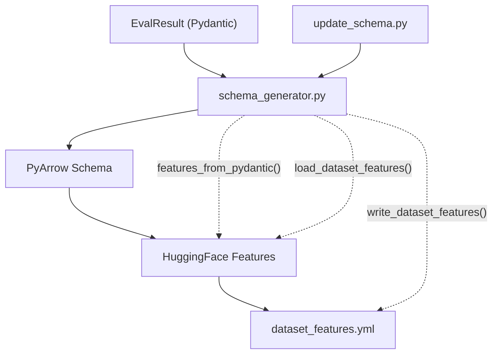
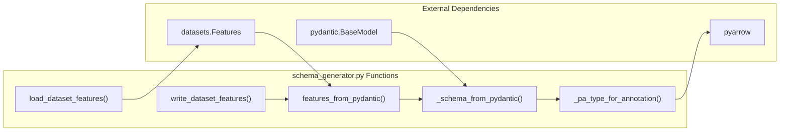
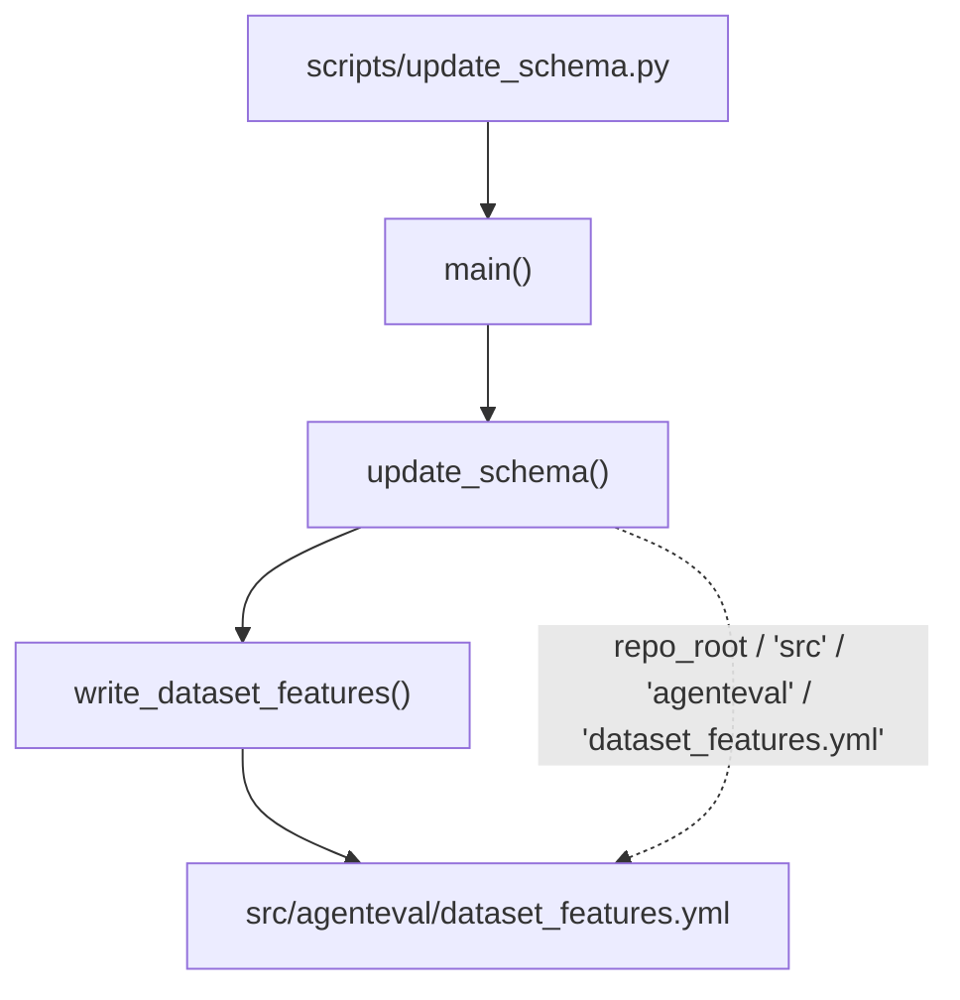
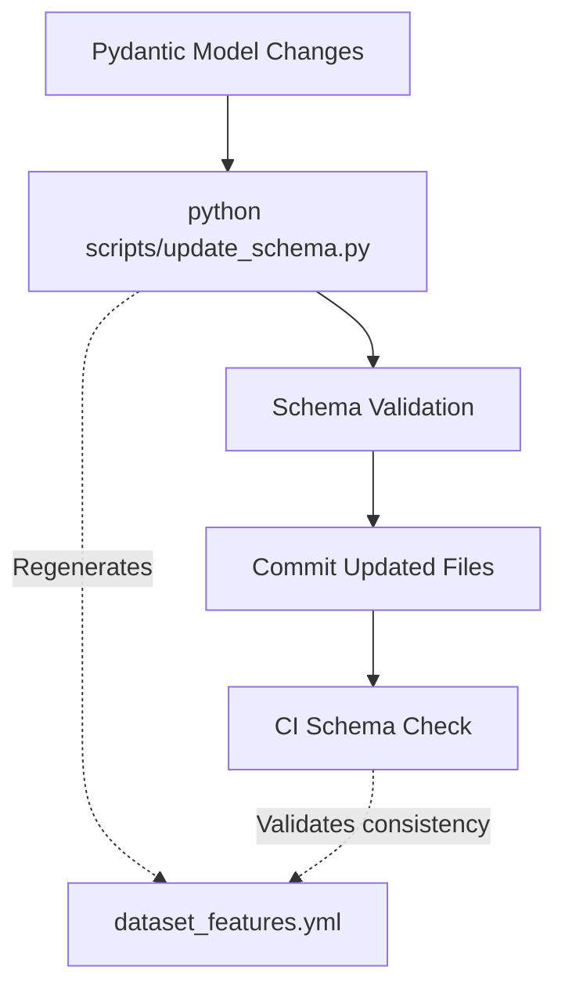

<!-- source: DeepWiki mcp.deepwiki.com · repo allenai/agent-eval · page 4.3 Schema Management · fetched 2026-10-26 -->

# Schema Management

<details>
<summary>Relevant source files</summary>

The following files were used as context for generating this wiki page:

- [scripts/update_schema.py](scripts/update_schema.py)
- [src/agenteval/dataset_features.yml](src/agenteval/dataset_features.yml)
- [src/agenteval/schema_generator.py](src/agenteval/schema_generator.py)

</details>


This document covers how agent-eval defines, generates, and maintains data schemas for HuggingFace datasets. The schema management system ensures consistent data structures across evaluation results and enables seamless integration with HuggingFace Hub for dataset publishing.

For information about the core data models that schemas are generated from, see [Data Models](#4.4). For details on HuggingFace integration, see [External Integrations](#4.2).

## Schema Generation Pipeline

Agent-eval uses a schema-first design where Pydantic models serve as the source of truth for data structures. The system automatically generates HuggingFace Dataset schemas from these Pydantic models to ensure consistency between internal data processing and published datasets.

### Schema Generation Flow



**Schema Generation Pipeline**

The pipeline transforms Pydantic model definitions into HuggingFace-compatible schemas through PyArrow intermediate representation. The `EvalResult` model drives the entire schema definition process.

Sources: [src/agenteval/schema_generator.py:1-96](), [src/agenteval/models.py]()

### Type Mapping System

The schema generator maps Python type annotations to PyArrow data types, which then convert to HuggingFace Features:

| Python Type | PyArrow Type | HuggingFace Feature |
|-------------|--------------|-------------------|
| `str` | `pa.string()` | `string` |
| `int` | `pa.int64()` | `int64` |
| `float` | `pa.float64()` | `float64` |
| `bool` | `pa.bool_()` | `bool` |
| `datetime.datetime` | `pa.timestamp("us")` | `timestamp[us, tz=UTC]` |
| `list[T]` | `pa.list_(T)` | `list` or `sequence` |
| `BaseModel` | `pa.struct(fields)` | `struct` |

Sources: [src/agenteval/schema_generator.py:18-47]()

## Core Components

### SchemaGenerator Module

The `schema_generator.py` module provides the core functionality for converting between Pydantic models and HuggingFace schemas:



**Core Schema Generator Functions**

Key functions handle the conversion process:
- `_pa_type_for_annotation()` maps Python types to PyArrow types
- `_schema_from_pydantic()` extracts field definitions from Pydantic models  
- `features_from_pydantic()` creates HuggingFace Features from Pydantic models
- `write_dataset_features()` serializes schema to YAML
- `load_dataset_features()` deserializes schema from YAML

Sources: [src/agenteval/schema_generator.py:18-96]()

### Update Script

The `update_schema.py` script provides a convenient way to regenerate the schema file:



**Schema Update Workflow**

The script locates the repository root, determines the output path, and regenerates the schema file from the current Pydantic model definitions.

Sources: [scripts/update_schema.py:1-24]()

## Schema File Structure

The generated `dataset_features.yml` file defines the structure of evaluation result datasets published to HuggingFace Hub:

### Top-Level Schema Elements

| Field | Type | Description |
|-------|------|-------------|
| `suite_config` | `struct` | Configuration metadata for the evaluation suite |
| `split` | `string` | Dataset split identifier |
| `results` | `list` | Individual task evaluation results |
| `submission` | `struct` | Submission metadata and timestamps |

Sources: [src/agenteval/dataset_features.yml:1-72]()

### Suite Configuration Schema

The suite configuration captures evaluation setup information:

```yaml
suite_config:
  struct:
  - name: name
    dtype: string
  - name: version  
    dtype: string
  - name: splits
    list:
    - name: name
      dtype: string
    - name: tasks
      list:
      - name: name
        dtype: string
      - name: path
        dtype: string
      - name: primary_metric
        dtype: string
      - name: tags
        sequence: string
```

Sources: [src/agenteval/dataset_features.yml:1-20]()

### Results Schema Structure

The results section defines how task evaluation outcomes are structured:

```yaml
results:
  list:
  - name: task_name
    dtype: string
  - name: metrics
    list:
    - name: name
      dtype: string
    - name: value
      dtype: float64
  - name: model_usages
    list:
      list:
      - name: model
        dtype: string
      - name: usage
        struct:
        - name: input_tokens
          dtype: int64
        - name: output_tokens
          dtype: int64
        - name: total_tokens
          dtype: int64
```

This nested structure accommodates multiple tasks, each with multiple metrics and detailed token usage tracking per model.

Sources: [src/agenteval/dataset_features.yml:23-53]()

## Maintenance Workflow

### Schema Regeneration Process

When Pydantic models change, the schema must be regenerated to maintain consistency:



**Schema Maintenance Process**

The maintenance workflow ensures schema consistency through automated regeneration and validation checks.

Sources: [scripts/update_schema.py:1-24](), [src/agenteval/schema_generator.py:72-79]()

### Special Field Handling

The schema generator includes special handling for certain fields:

- `submit_time` fields receive explicit UTC timezone specification: `pa.timestamp("us", tz="UTC")`
- Fields marked with `exclude=True` in Pydantic models are omitted from the schema
- Union types are simplified to their non-None alternatives for Optional fields

Sources: [src/agenteval/schema_generator.py:55-59](), [src/agenteval/schema_generator.py:21-26]()

### Schema Loading

The system supports loading schemas both from the packaged YAML file and external files:

```python
# Load packaged schema
features = load_dataset_features()

# Load custom schema  
features = load_dataset_features("/path/to/custom/schema.yml")
```

This flexibility enables testing with modified schemas while maintaining a stable default configuration.

Sources: [src/agenteval/schema_generator.py:82-95]()

---

