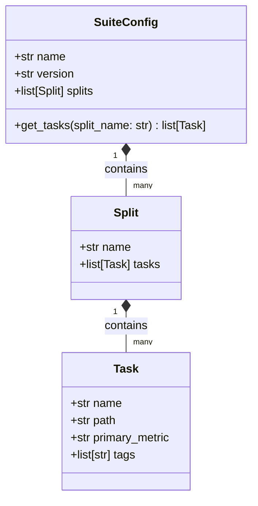
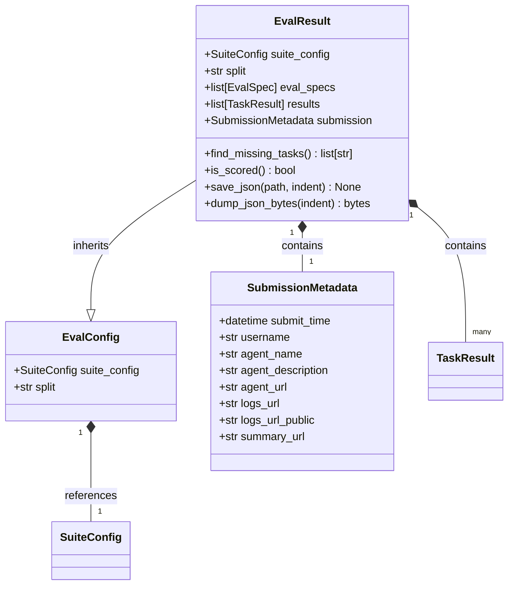
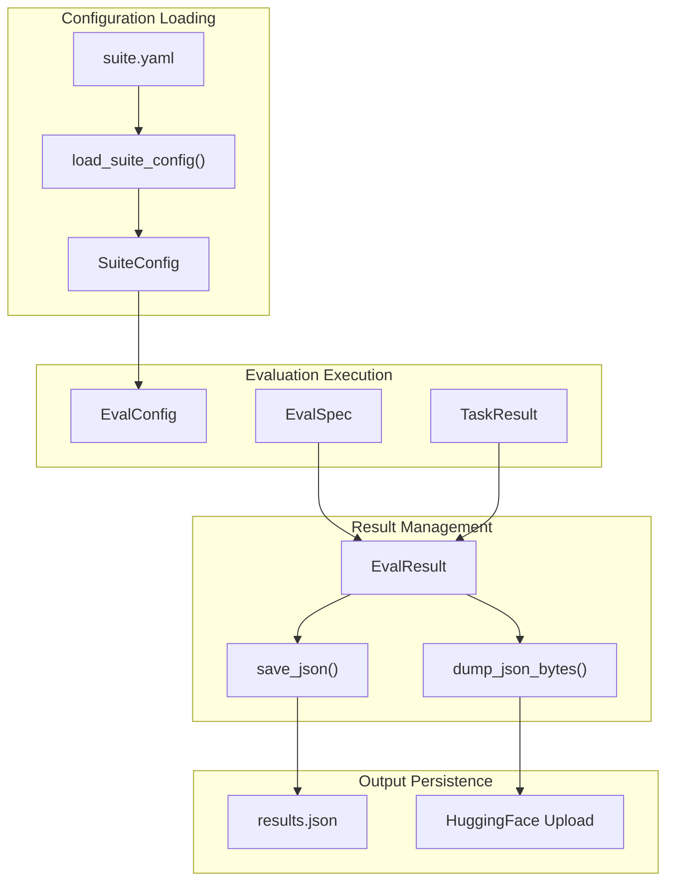
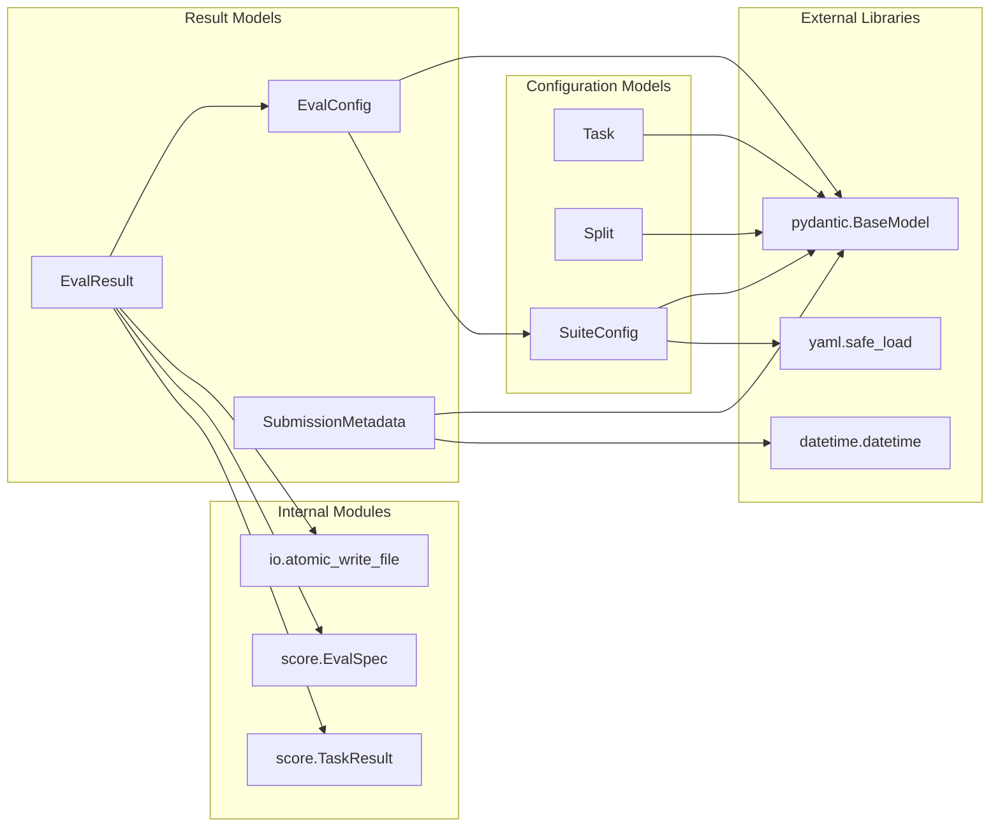

<!-- source: DeepWiki mcp.deepwiki.com · repo allenai/agent-eval · page 4.4 Data Models · fetched 2026-10-26 -->

# Data Models

<details>
<summary>Relevant source files</summary>

The following files were used as context for generating this wiki page:

- [src/agenteval/config.py](src/agenteval/config.py)
- [src/agenteval/models.py](src/agenteval/models.py)

</details>


This page documents the core data structures and models used throughout the agent-eval system. These Pydantic-based models define the schema for configuration files, evaluation results, and data exchange formats used in the eval → score → publish pipeline.

For information about how these models are used in schema generation for HuggingFace datasets, see [Schema Management](#4.3). For details about the data processing pipeline that transforms raw logs into these structured models, see [Data Processing Pipeline](#4.1).

## Configuration Models

The configuration models define the structure for evaluation suite definitions loaded from YAML files. These models provide the foundation for organizing tasks, splits, and evaluation parameters.

### SuiteConfig Model Hierarchy



**Task Model Structure**

The `Task` class [src/agenteval/config.py:9-21]() represents individual evaluation tasks with the following key fields:

| Field | Type | Purpose |
|-------|------|---------|
| `name` | `str` | Canonical task name used by leaderboards |
| `path` | `str` | Task definition path used by Inspect AI |
| `primary_metric` | `str` | Primary metric for summary score computation |
| `tags` | `list[str] \| None` | Optional tags for task grouping |

**Split and Suite Organization**

The `Split` class [src/agenteval/config.py:23-28]() groups related tasks together, while `SuiteConfig` [src/agenteval/config.py:31-61]() serves as the top-level container. The `SuiteConfig.get_tasks()` method provides task retrieval with error handling for invalid split names.

Sources: [src/agenteval/config.py:9-61]()

## Evaluation Result Models

The evaluation result models capture the outputs of the evaluation pipeline, including metadata, task results, and submission information for publication.

### EvalResult Model Architecture



**EvalConfig Base Class**

The `EvalConfig` class [src/agenteval/models.py:12-18]() provides the foundational fields that link evaluation results to their configuration:

- `suite_config`: Reference to the complete suite configuration
- `split`: Identifier for the specific split being evaluated

**SubmissionMetadata Structure**

The `SubmissionMetadata` class [src/agenteval/models.py:20-31]() captures publication-related information:

| Field | Type | Purpose |
|-------|------|---------|
| `submit_time` | `datetime \| None` | Timestamp of submission |
| `username` | `str \| None` | Submitter identification |
| `agent_name` | `str \| None` | Display name for the agent |
| `agent_description` | `str \| None` | Agent description text |
| `agent_url` | `str \| None` | Link to agent implementation |
| `logs_url` | `str \| None` | Private logs location |
| `logs_url_public` | `str \| None` | Public logs location |
| `summary_url` | `str \| None` | Summary results location |

Sources: [src/agenteval/models.py:12-31]()

## Model Integration and Data Flow

The data models integrate with the broader system architecture through a well-defined flow from configuration loading through result publication.

### Data Model Pipeline Integration



**Configuration Loading Process**

The `load_suite_config()` function [src/agenteval/config.py:64-87]() handles YAML parsing and validation, converting raw configuration files into structured `SuiteConfig` objects with comprehensive error handling for file not found, YAML parsing errors, and validation failures.

**Result Serialization Methods**

The `EvalResult` class provides two serialization methods:

- `save_json()` [src/agenteval/models.py:57-73](): Atomic file writing using `atomic_write_file()` for safe persistence
- `dump_json_bytes()` [src/agenteval/models.py:75-89](): In-memory serialization for HuggingFace uploads

Sources: [src/agenteval/config.py:64-87](), [src/agenteval/models.py:57-89]()

## Model Validation and State Management

The data models implement validation logic and state management methods to ensure data integrity throughout the evaluation pipeline.

### EvalResult State Management

```mermaid
stateDiagram-v2
    [*] --> Unscored : EvalResult created
    Unscored --> Scored : results populated
    Scored --> Published : submission metadata added
    
    state Unscored {
        is_scored() : returns False
        find_missing_tasks() : returns task list
    }
    
    state Scored {
        is_scored() : returns True
        find_missing_tasks() : returns empty or partial list
    }
    
    state Published {
        submission : contains metadata
        save_json() : persists to file
        dump_json_bytes() : serializes for upload
    }
```

**Missing Task Detection**

The `find_missing_tasks()` method [src/agenteval/models.py:38-46]() compares the configured tasks from `suite_config.get_tasks(split)` against the actual `results` to identify incomplete evaluations. This enables validation of evaluation completeness before publication.

**Scoring State Validation**

The `is_scored()` method [src/agenteval/models.py:48-55]() provides a simple boolean check for whether the evaluation contains actual results (`results is not None and len(results) > 0`), enabling conditional logic in the processing pipeline.

**Field Exclusion Strategy**

The `EvalResult` model uses Pydantic's `Field(exclude=True)` for `eval_specs` [src/agenteval/models.py:34](), preventing internal evaluation specifications from being serialized in output files while maintaining them for processing.

Sources: [src/agenteval/models.py:34-55]()

## External Dependencies and Integration Points

The data models integrate with external libraries and systems through well-defined interfaces and serialization formats.

### Model Dependency Graph



**Pydantic Integration**

All models inherit from `pydantic.BaseModel`, providing automatic validation, serialization, and type checking. The models use Pydantic's `Field()` for advanced configuration like exclusion rules and default factories.

**Atomic Write Integration**

The `EvalResult.save_json()` method uses `atomic_write_file()` from the `io` module [src/agenteval/models.py:73](), ensuring safe file operations that prevent data corruption during write failures.

**Score Module Integration**

The models reference `EvalSpec` and `TaskResult` from the `score` module [src/agenteval/models.py:9](), creating a clear separation between data structures and processing logic while maintaining type safety.

Sources: [src/agenteval/models.py:1-10](), [src/agenteval/config.py:5-6]()

---

