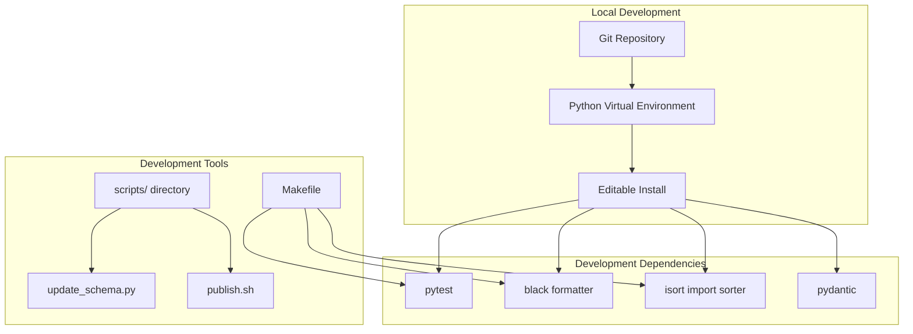
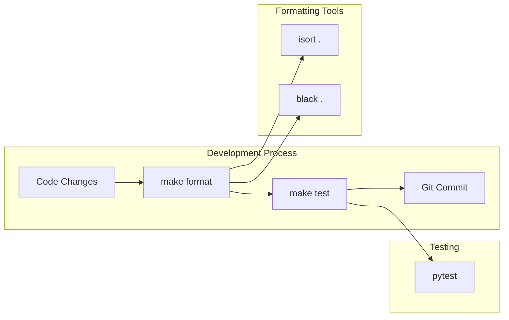
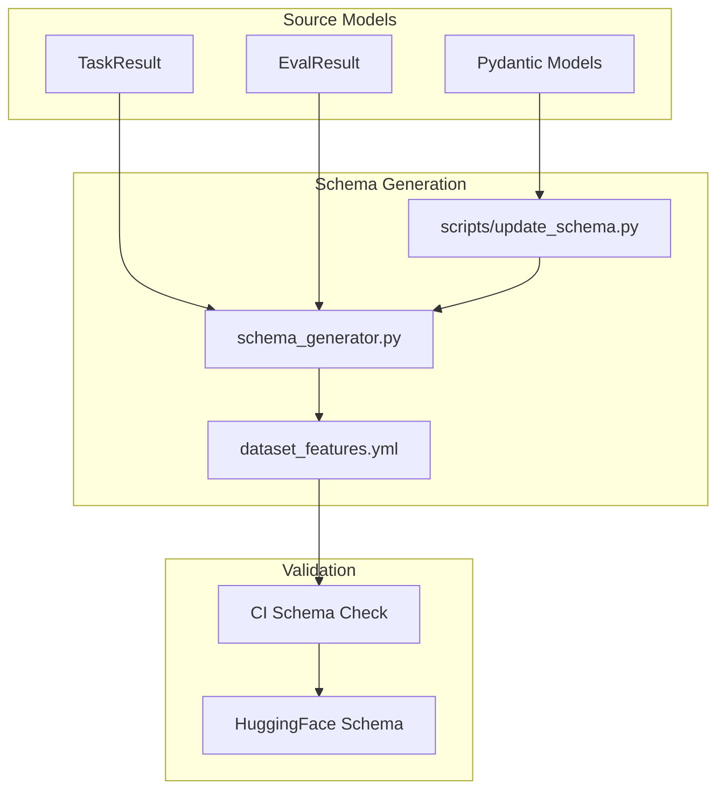
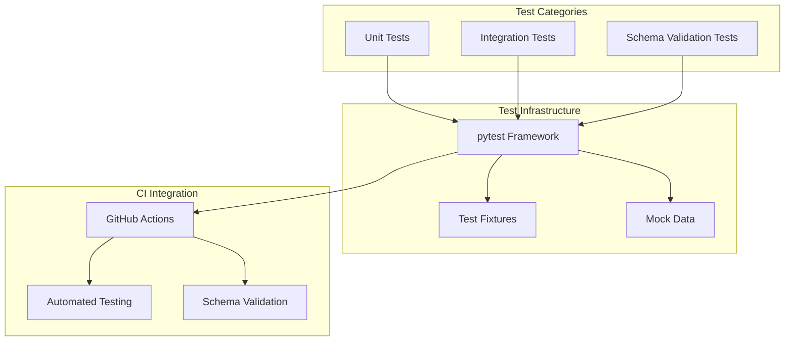
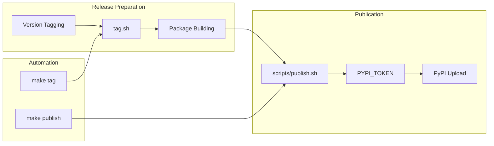

<!-- source: DeepWiki mcp.deepwiki.com · repo allenai/agent-eval · page 5 Development · fetched 2026-10-26 -->

# Development

<details>
<summary>Relevant source files</summary>

The following files were used as context for generating this wiki page:

- [Development.md](Development.md)
- [Makefile](Makefile)

</details>


This document provides a comprehensive guide for developers contributing to the agent-eval toolkit. It covers development environment setup, coding practices, testing procedures, schema management, and the release process. For information about using agent-eval as an end user, see [User Guide](#3). For information about the internal architecture, see [Architecture](#4).

## Development Environment

Setting up a development environment for agent-eval involves cloning the repository and installing development dependencies.

### Environment Setup

The development setup follows standard Python packaging practices with additional dependencies for code quality tools:

```bash
git clone https://github.com/allenai/agent-eval
cd agent-eval
pip install -e ".[dev]"
```

This installs the package in editable mode with development dependencies including testing frameworks, code formatters, and schema generation tools.

**Development Environment Components**


Sources: [Development.md:1-25](), [Makefile:1-25]()

## Code Quality and Formatting

The codebase maintains consistent code quality through automated formatting and linting tools integrated into the development workflow.

### Formatting Workflow

The project uses `black` for code formatting and `isort` for import organization:

| Tool | Purpose | Configuration |
|------|---------|---------------|
| `black` | Code formatting | Standard configuration |
| `isort` | Import sorting | Compatible with black |
| `pytest` | Unit testing | Test discovery and execution |

The formatting process is automated through the Makefile:

**Code Quality Pipeline**


Sources: [Makefile:3-7](), [Makefile:22-24]()

## Schema Management

The agent-eval system maintains strict schema compatibility with HuggingFace datasets through automated schema generation and validation.

### Schema Update Process

The schema management system ensures that Pydantic models remain synchronized with HuggingFace dataset schemas:

**Schema Generation Workflow**


The schema update process is triggered when Pydantic models change:

1. Models are modified in the codebase
2. CI detects schema inconsistency
3. Developer runs schema update command
4. New schema is generated and committed

Sources: [Development.md:16-24](), [Makefile:17-20]()

## Testing Framework

The testing infrastructure ensures code quality and prevents regressions through comprehensive test coverage.

### Test Execution

Testing is managed through `pytest` with simple execution commands:

**Testing Architecture**


Sources: [Makefile:22-24]()

## Publication and Release Process

The publication workflow handles versioning, packaging, and distribution to PyPI through automated scripts.

### Release Workflow

The release process involves version tagging and automated publishing:

**Publication Pipeline**


The publication process requires authentication through environment variables and follows these steps:

1. Set PYPI_TOKEN environment variable
2. Execute publication script
3. Package is built and uploaded to PyPI

Sources: [Development.md:8-14](), [Makefile:8-15]()

## Development Tasks

The Makefile provides convenient commands for common development tasks:

| Command | Purpose | Implementation |
|---------|---------|----------------|
| `make format` | Format code with black and isort | Runs formatting tools |
| `make test` | Execute test suite | Runs pytest |
| `make tag` | Create version tag | Executes tagging script |
| `make publish` | Publish to PyPI | Runs publication script |
| `make update-schema` | Update HF schema | Regenerates dataset schema |

This structured approach ensures consistent development practices and maintains code quality across contributions to the agent-eval toolkit.

Sources: [Makefile:1-25](), [Development.md:1-25]()

---

