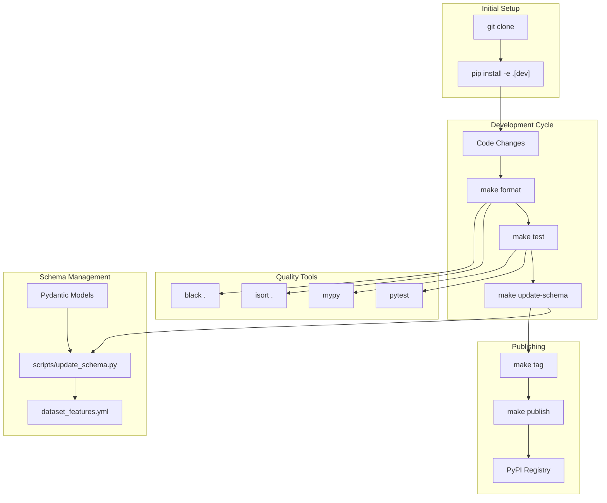
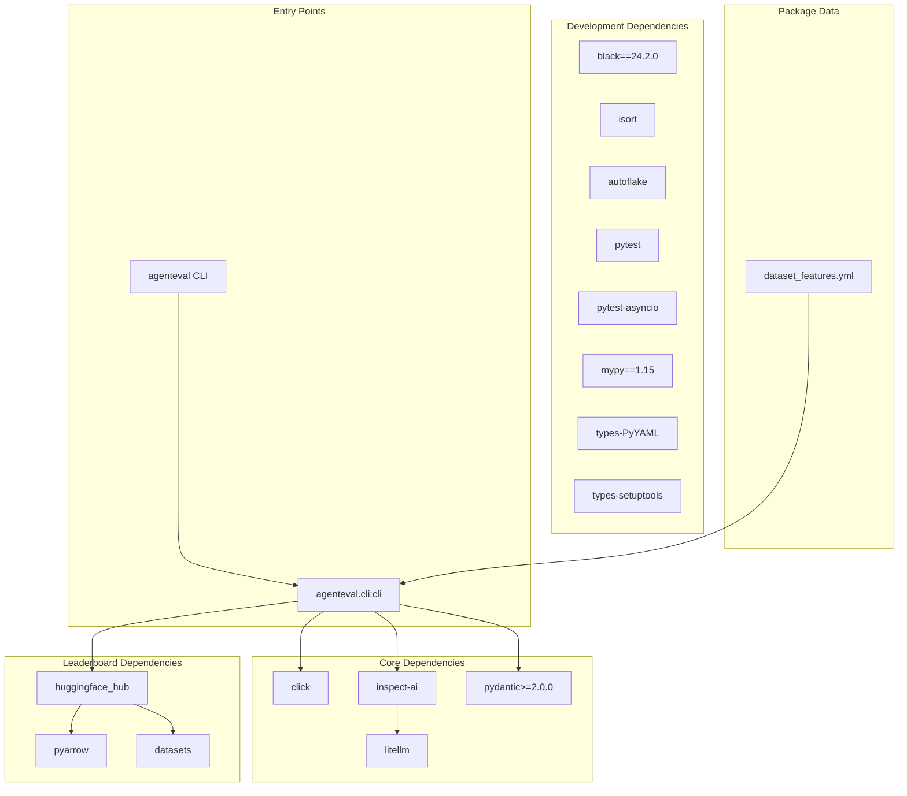

<!-- source: DeepWiki mcp.deepwiki.com · repo allenai/agent-eval · page 5.1 Development Setup · fetched 2026-10-26 -->

# Development Setup

<details>
<summary>Relevant source files</summary>

The following files were used as context for generating this wiki page:

- [Development.md](Development.md)
- [Makefile](Makefile)
- [pyproject.toml](pyproject.toml)

</details>


This document covers setting up a development environment for contributing to the agent-eval codebase. It includes environment setup, development dependencies, development workflow, and key development commands.

For information about running tests and continuous integration, see [Testing and CI](#5.2). For information about the release process, see [Release Process](#5.3).

## Prerequisites and Environment Setup

The agent-eval project requires Python 3.10 or higher and uses a standard Python package development setup with setuptools.

### Initial Setup

1. Clone the repository from `https://github.com/allenai/agent-eval`
2. Install the package in development mode with development dependencies:

```bash
pip install -e ".[dev]"
```

This installs the package in editable mode with all development dependencies defined in the `dev` optional dependency group.

**Sources:** [Development.md:1-5](), [pyproject.toml:10](), [pyproject.toml:25-35]()

## Development Dependencies and Tools

The development environment includes several code quality and testing tools configured in the `pyproject.toml` file.

| Tool | Version | Purpose |
|------|---------|---------|
| `black` | 24.2.0 | Code formatting |
| `isort` | latest | Import sorting |
| `autoflake` | latest | Remove unused imports |
| `pytest` | latest | Test framework |
| `pytest-asyncio` | latest | Async testing support |
| `mypy` | 1.15 | Type checking |
| `types-PyYAML` | latest | Type stubs for PyYAML |
| `types-setuptools` | latest | Type stubs for setuptools |

The project uses strict versioning for `black` and `mypy` to ensure consistent formatting and type checking across development environments.

**Sources:** [pyproject.toml:25-35]()

## Development Workflow

The development workflow follows a standard Python package development pattern with integrated code quality tools and automated schema management.

### Development Workflow Diagram



**Sources:** [Makefile:1-25](), [Development.md:1-25]()

## Package Build System

The project uses a modern Python packaging setup with `setuptools` and follows PEP 621 standards for project metadata.

### Build System Configuration

The build system is configured through several key sections in `pyproject.toml`:

| Section | Purpose | Key Configuration |
|---------|---------|-------------------|
| `[build-system]` | Build backend | `setuptools>=61`, `wheel` |
| `[project]` | Package metadata | name, version, dependencies |
| `[project.scripts]` | CLI entry points | `agenteval = "agenteval.cli:cli"` |
| `[tool.setuptools]` | Package discovery | source in `src/` directory |
| `[tool.pytest.ini_options]` | Test configuration | test paths and patterns |

The package structure follows the `src` layout pattern, with the main package located in `src/agenteval/`.

### Package Dependencies Structure



**Sources:** [pyproject.toml:1-52]()

## Development Commands

The project provides several Makefile targets and scripts for common development tasks.

### Available Make Targets

| Command | Purpose | Implementation |
|---------|---------|----------------|
| `make format` | Code formatting | Runs `isort` and `black` |
| `make test` | Run test suite | Executes `pytest` |
| `make update-schema` | Update HF dataset schema | Runs `scripts/update_schema.py` |
| `make tag` | Version tagging | Executes `tag.sh` script |
| `make publish` | Publish to PyPI | Runs `scripts/publish.sh` |

### Schema Management Workflow

The project includes automated schema management for HuggingFace dataset compatibility:

1. Pydantic models define the data structure
2. `scripts/update_schema.py` generates the schema from models
3. The schema is saved to `dataset_features.yml`
4. CI checks ensure schema consistency

This prevents schema inference problems on HuggingFace and maintains compatibility as the data models evolve.

**Sources:** [Makefile:1-25](), [Development.md:16-24]()

## Development Environment Variables

For publishing packages to PyPI, the development environment requires:

- `PYPI_TOKEN`: Authentication token for PyPI package uploads

This token is used by the `scripts/publish.sh` script during the publishing workflow.

**Sources:** [Development.md:9-14]()

## Package Data Management

The package includes static data files that are distributed with the package:

- `dataset_features.yml`: HuggingFace dataset schema definition
- Located in the `agenteval` package directory
- Automatically included via `tool.setuptools.package-data` configuration

This ensures that schema definitions are available at runtime for dataset operations.

**Sources:** [pyproject.toml:50-51]()

---

