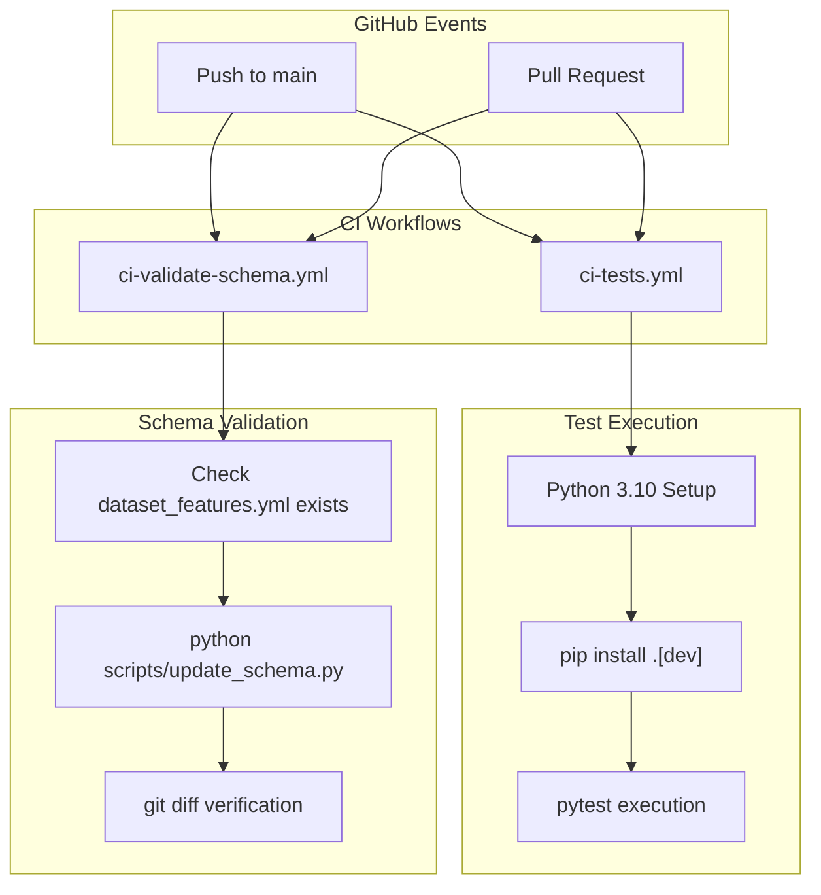
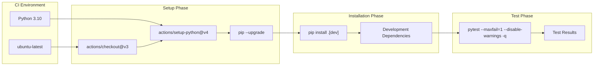
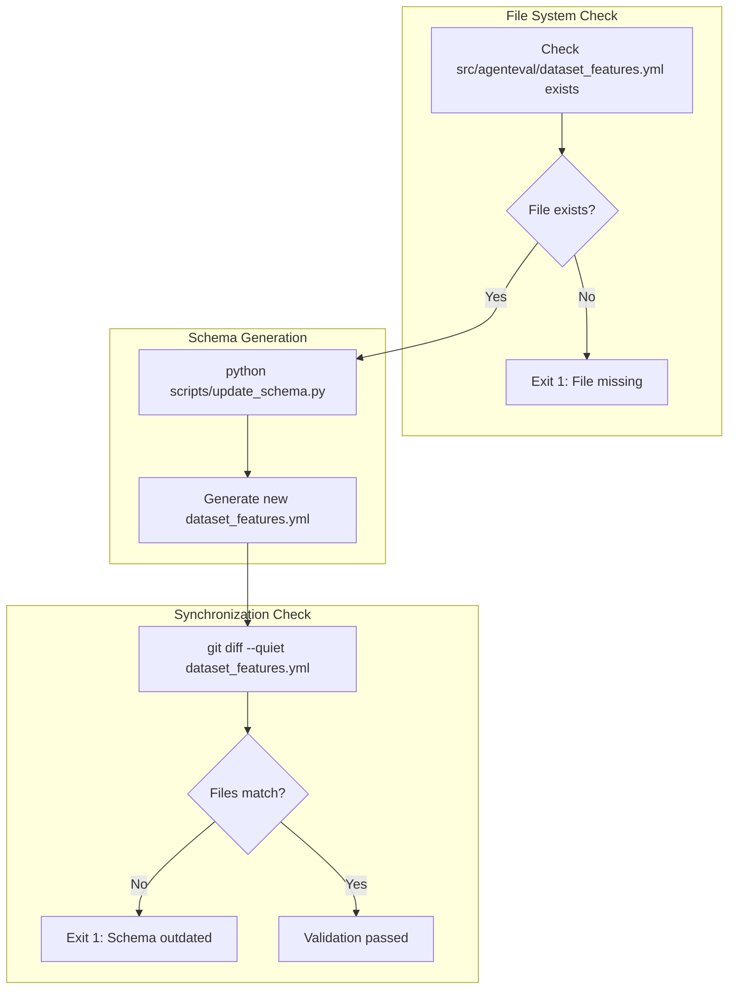

<!-- source: DeepWiki mcp.deepwiki.com · repo allenai/agent-eval · page 5.2 Testing and CI · fetched 2026-10-26 -->

# Testing and CI

<details>
<summary>Relevant source files</summary>

The following files were used as context for generating this wiki page:

- [.github/workflows/ci-tests.yml](.github/workflows/ci-tests.yml)
- [.github/workflows/ci-validate-schema.yml](.github/workflows/ci-validate-schema.yml)

</details>


This document covers the testing framework and continuous integration (CI) setup for agent-eval. It explains how automated tests are executed, how schema validation ensures data consistency, and how developers can run tests locally during development.

For information about setting up a development environment, see [Development Setup](#5.1). For details about the release process that follows successful CI validation, see [Release Process](#5.3).

## CI Pipeline Overview

The agent-eval project uses GitHub Actions for continuous integration with two main workflows that run on every push and pull request to the main branch:

1. **CI Tests** - Executes the full test suite using pytest
2. **Schema Validation** - Ensures the dataset schema remains synchronized with the codebase

### CI Pipeline Architecture



**Sources:** [.github/workflows/ci-tests.yml:1-29](), [.github/workflows/ci-validate-schema.yml:1-41]()

## Test Execution Workflow

The main testing workflow is defined in the `ci-tests.yml` file and follows a standard Python testing pattern optimized for rapid feedback.

### Test Configuration

| Step | Command | Purpose |
|------|---------|---------|
| Python Setup | `python-version: '3.10'` | Ensures consistent Python environment |
| Dependency Installation | `pip install .[dev]` | Installs package with development dependencies |
| Test Execution | `pytest --maxfail=1 --disable-warnings -q` | Runs tests with fail-fast and quiet output |

The pytest configuration uses specific flags for CI optimization:
- `--maxfail=1`: Stops execution after first failure for faster feedback
- `--disable-warnings`: Reduces noise in CI output  
- `-q`: Quiet mode for cleaner logs

### Test Execution Flow



**Sources:** [.github/workflows/ci-tests.yml:14-28]()

## Schema Validation Workflow

The schema validation workflow ensures that the `dataset_features.yml` file remains synchronized with the Pydantic models defined in the codebase. This is critical for maintaining consistency between the Python data models and the HuggingFace dataset schema.

### Validation Process Steps

The validation follows a three-step verification process:

1. **Existence Check**: Verifies `dataset_features.yml` exists in the expected location
2. **Regeneration**: Runs the schema generation script to create an updated version
3. **Synchronization Verification**: Uses git diff to ensure the existing file matches the generated version

### Schema Validation Flow



**Sources:** [.github/workflows/ci-validate-schema.yml:25-40]()

## Local Testing Setup

For developers working on agent-eval, the CI setup can be replicated locally using the same commands executed in the GitHub Actions workflows.

### Running Tests Locally

To execute tests in the same environment as CI:

```bash
# Install development dependencies
pip install .[dev]

# Run the full test suite with CI flags
pytest --maxfail=1 --disable-warnings -q
```

### Schema Validation Locally

To validate schema synchronization before committing:

```bash
# Check if schema file exists
ls src/agenteval/dataset_features.yml

# Regenerate schema
python scripts/update_schema.py

# Check for differences
git diff src/agenteval/dataset_features.yml
```

If the `git diff` command shows differences, the schema file needs to be committed with the updated version.

### Development Dependencies

The `[dev]` extra in the pip installation includes testing frameworks and development tools required for the full CI pipeline. This ensures local development environments match the CI environment configuration.

**Sources:** [.github/workflows/ci-tests.yml:24-28](), [.github/workflows/ci-validate-schema.yml:32-40]()

## CI Integration Points

The CI system integrates with several key components of the agent-eval architecture:

- **Schema Generator**: The `scripts/update_schema.py` script that generates HuggingFace dataset schemas
- **Development Dependencies**: Testing frameworks and tools installed via `pip install .[dev]`
- **Git Reproducibility**: Schema validation ensures reproducible dataset schemas across environments
- **Package Structure**: CI validates the complete package installation and import paths

This testing and CI setup ensures that all changes to agent-eval maintain compatibility with external integrations while preserving the reproducibility guarantees that are central to the evaluation framework's design.

**Sources:** [.github/workflows/ci-tests.yml:1-29](), [.github/workflows/ci-validate-schema.yml:1-41]()

---

