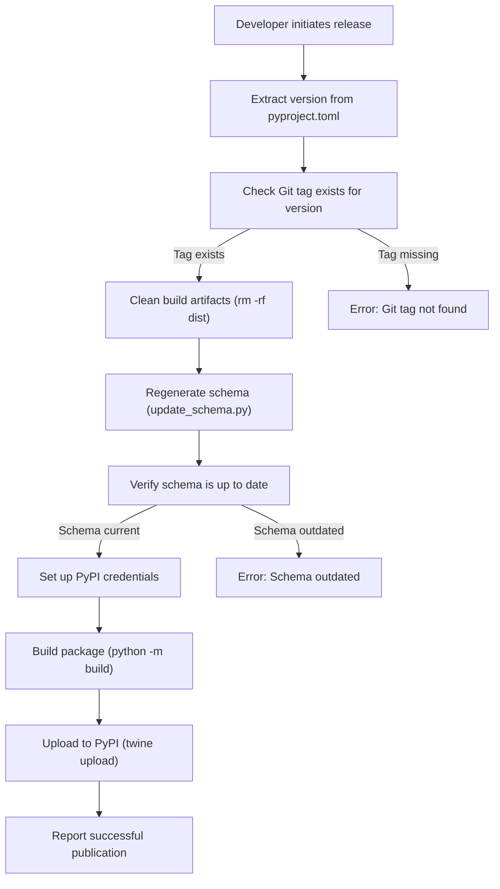
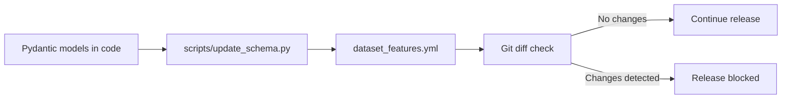

<!-- source: DeepWiki mcp.deepwiki.com · repo allenai/agent-eval · page 5.3 Release Process · fetched 2026-10-26 -->

# Release Process

<details>
<summary>Relevant source files</summary>

The following files were used as context for generating this wiki page:

- [Development.md](Development.md)
- [scripts/publish.sh](scripts/publish.sh)

</details>


This document describes the process for releasing new versions of the `agent-eval` package to PyPI. It covers version management, schema validation, and the automated publication workflow.

For information about development setup and testing, see [Development Setup](#5.1) and [Testing and CI](#5.2).

## Overview

The release process for `agent-eval` is automated through the `scripts/publish.sh` script, which handles version validation, schema updates, and PyPI publication. The process ensures that all releases are properly tagged, have up-to-date schemas, and are reproducibly built.

## Prerequisites

Before initiating a release, ensure you have:

- Write access to the `agent-eval` repository
- A valid PyPI API token with upload permissions
- The development environment set up as described in [Development Setup](#5.1)

## Release Workflow

The release process follows a structured workflow that validates the codebase state before publishing:



Sources: [scripts/publish.sh:1-38]()

## Version Management

The release system uses `pyproject.toml` as the single source of truth for version information:

### Version Extraction

The version is extracted from the `pyproject.toml` file using a simple grep-based approach:

```bash
version=$(grep version pyproject.toml | cut -d '"' -f2)
```

### Git Tag Validation

Before publishing, the system verifies that a Git tag exists for the current version. This ensures proper version control and traceability:

```bash
if ! git rev-parse "$version" >/dev/null 2>&1; then
  echo "Git tag '$version' not found. Please run './tag.sh' to create it before publishing."
  exit 1
fi
```

The system expects developers to create Git tags before publishing, likely through a separate `tag.sh` script (referenced but not provided).

Sources: [scripts/publish.sh:4-11]()

## Schema Validation Process

The release process includes automatic schema validation to ensure HuggingFace dataset compatibility:



The schema validation ensures that the `dataset_features.yml` file is current with the Pydantic models:

```bash
python scripts/update_schema.py
if ! git diff --quiet src/agenteval/dataset_features.yml; then
  echo "dataset_features.yml schema file is outdated. Please commit the updated file before publishing."
  exit 1
fi
```

This prevents publishing releases with inconsistent schemas that could break HuggingFace dataset integration.

Sources: [scripts/publish.sh:17-23](), [Development.md:16-24]()

## PyPI Publication

The publication process uses `twine` for secure upload to PyPI:

### Credential Configuration

The system uses token-based authentication for PyPI:

```bash
export TWINE_NON_INTERACTIVE=1
export TWINE_USERNAME='__token__'
export TWINE_PASSWORD="${PYPI_TOKEN:?PYPI_TOKEN must be set}"
```

The `PYPI_TOKEN` environment variable must be set before running the publish script.

### Build and Upload Process

The package is built using the standard Python build tools and uploaded via `twine`:

```bash
pip install --upgrade pip setuptools wheel build twine
python -m build
twine upload dist/*
```

Sources: [scripts/publish.sh:25-37](), [Development.md:9-14]()

## Release Command Execution

To execute a release, developers run the publish script with the required environment variable:

```bash
export PYPI_TOKEN=your_token_here
bash scripts/publish.sh
```

The script handles all validation, building, and uploading automatically.

## Error Handling

The release process includes several validation checkpoints that can halt publication:

| Error Condition | Error Message | Resolution |
|----------------|---------------|------------|
| Missing Git tag | `Git tag '$version' not found` | Run `./tag.sh` to create the tag |
| Outdated schema | `dataset_features.yml schema file is outdated` | Commit the updated schema file |
| Missing PyPI token | `PYPI_TOKEN must be set` | Set the `PYPI_TOKEN` environment variable |

The script uses `set -euo pipefail` to ensure it exits immediately on any error, preventing partial or inconsistent releases.

Sources: [scripts/publish.sh:2](), [scripts/publish.sh:8-11](), [scripts/publish.sh:20-23](), [scripts/publish.sh:28]()

## Post-Release Verification

After successful publication, the script reports the published version:

```bash
version=$(grep version pyproject.toml | cut -d '"' -f2)
echo "Successfully published version $version"
```

This provides confirmation that the correct version was published to PyPI.

Sources: [scripts/publish.sh:36-37]()

---

