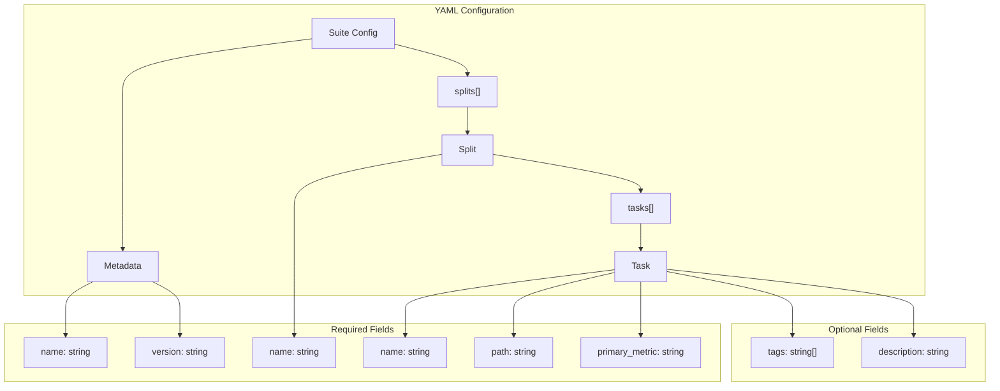
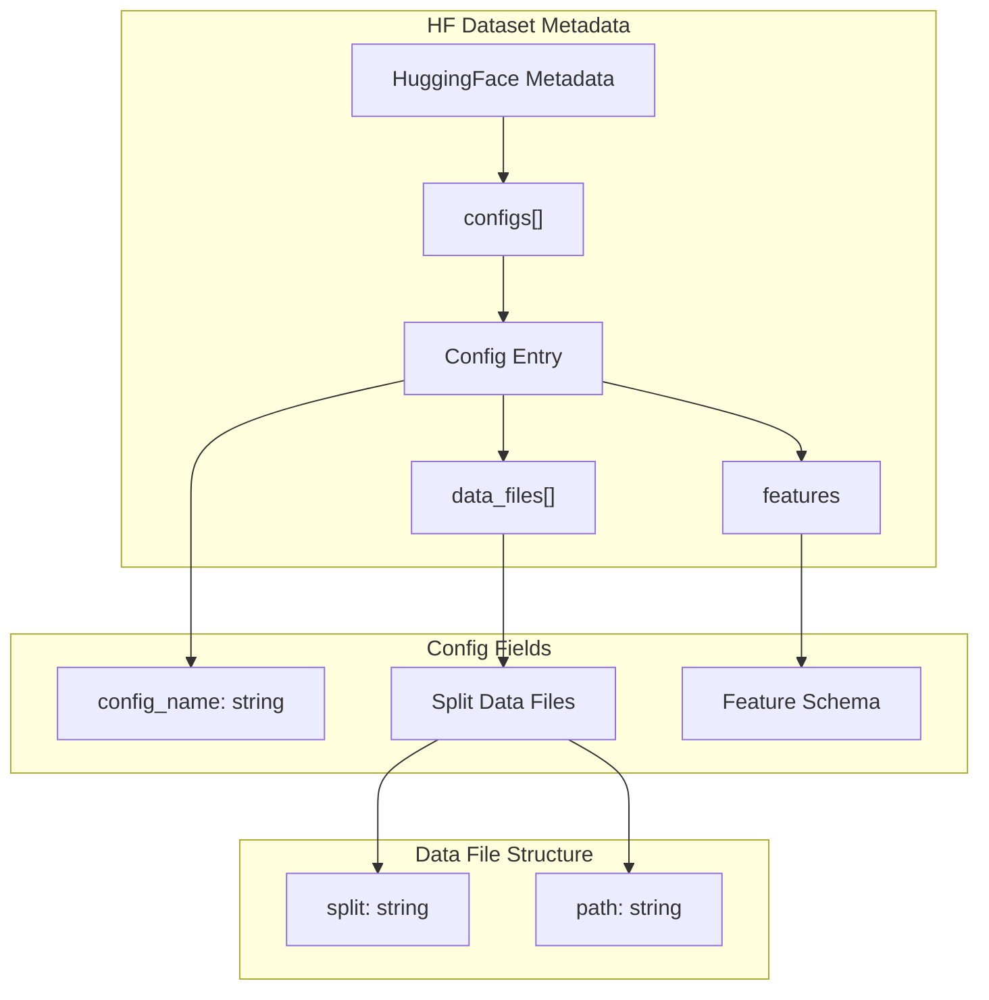
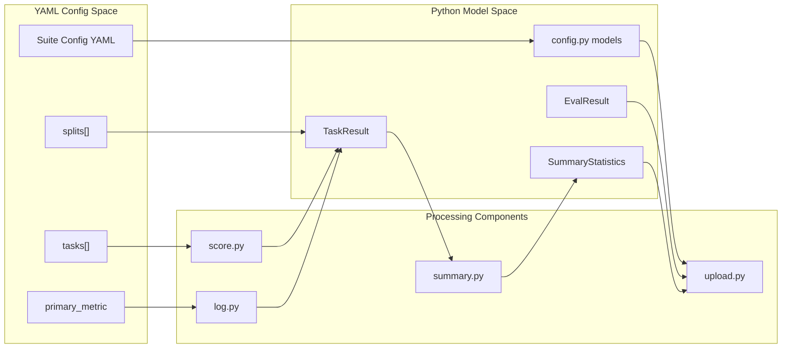
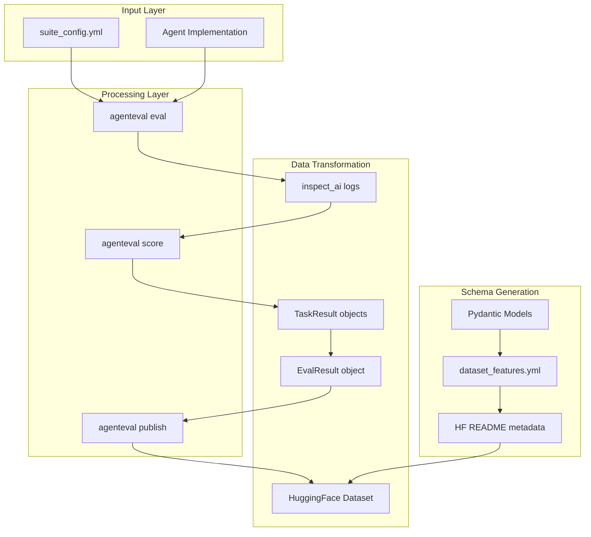

<!-- source: DeepWiki mcp.deepwiki.com · repo allenai/agent-eval · page 6 Reference · fetched 2026-10-26 -->

# Reference

<details>
<summary>Relevant source files</summary>

The following files were used as context for generating this wiki page:

- [sample-config-hf-readme-metadata.yml](sample-config-hf-readme-metadata.yml)
- [sample-config.yml](sample-config.yml)

</details>


This page provides reference documentation for the agent-eval toolkit's configuration files, data schemas, and core structures. It serves as a technical reference for users who need to understand the precise format and structure of configuration files, dataset schemas, and integration points.

For step-by-step examples of creating configurations, see [Configuration Examples](#6.1). For detailed information about dataset schema generation and HuggingFace integration, see [Dataset Schema Reference](#6.2). For understanding the Python package organization, see [Package Structure](#6.3).

## Configuration File Schema

The agent-eval toolkit uses YAML configuration files to define evaluation suites. The configuration schema defines how tasks are organized, executed, and published.

### Suite Configuration Structure



**Sources:** [sample-config.yml:1-21]()

### Configuration Field Definitions

| Field | Type | Required | Description | Example |
|-------|------|----------|-------------|---------|
| `name` | string | Yes | Unique identifier for the evaluation suite | `"agent-eval-sample"` |
| `version` | string | Yes | Version identifier for the suite | `"0.1-dev"` |
| `splits` | array | Yes | List of evaluation splits (validation, test, etc.) | See splits schema below |

#### Splits Schema

| Field | Type | Required | Description | Example |
|-------|------|----------|-------------|---------|
| `name` | string | Yes | Split identifier | `"validation"`, `"test"` |
| `tasks` | array | Yes | List of tasks in this split | See tasks schema below |

#### Tasks Schema

| Field | Type | Required | Description | Example |
|-------|------|----------|-------------|---------|
| `name` | string | Yes | Task identifier | `"first_task"` |
| `path` | string | Yes | Relative path to task implementation | `"tasks/first_task"` |
| `primary_metric` | string | Yes | Primary metric for scoring | `"my_scorer/my_metric"` |
| `tags` | array | No | Categorical tags for the task | `["task1", "nlp"]` |
| `description` | string | No | Human-readable task description | `"Evaluates reasoning"` |

**Sources:** [sample-config.yml:1-21]()

## HuggingFace Integration Schema

Agent-eval publishes evaluation results to HuggingFace Hub using a specific metadata format that defines dataset structure and features.

### HuggingFace README Metadata Structure



**Sources:** [sample-config-hf-readme-metadata.yml:1-12]()

### HuggingFace Metadata Fields

| Field | Type | Description | Example |
|-------|------|-------------|---------|
| `config_name` | string | Version identifier matching suite config | `"0.1-dev"` |
| `data_files` | array | File path patterns for each split | See data files schema |
| `features` | object | Dataset schema (generated from `dataset_features.yml`) | Auto-generated |

#### Data Files Schema

| Field | Type | Description | Example |
|-------|------|-------------|---------|
| `split` | string | Split name matching configuration | `"validation"`, `"test"` |
| `path` | string | Glob pattern for data files | `"0.1-dev/validation/*.json"` |

**Sources:** [sample-config-hf-readme-metadata.yml:3-8]()

## Configuration to Code Entity Mapping

This diagram shows how YAML configuration elements map to internal Python data structures and processing components.



**Sources:** [sample-config.yml:1-21](), system architecture diagrams

## Data Flow Schema

This diagram illustrates how configuration data flows through the system from YAML files to published HuggingFace datasets.



**Sources:** [sample-config.yml:1-21](), [sample-config-hf-readme-metadata.yml:1-12](), system architecture diagrams

## File Organization Patterns

The agent-eval toolkit follows consistent patterns for organizing configuration files, task implementations, and output data.

### Standard Directory Structure

```
evaluation-suite/
├── suite_config.yml           # Main configuration file
├── tasks/                     # Task implementation directory
│   ├── task_name/            # Individual task directory
│   │   ├── task.py           # Task implementation
│   │   └── data/             # Task-specific data
├── outputs/                   # Generated outputs
│   ├── logs/                 # Raw evaluation logs
│   ├── results/              # Processed results
│   └── summaries/            # Summary statistics
└── hf_metadata/              # HuggingFace publication files
    ├── README.md             # Dataset README with metadata
    └── dataset_features.yml  # Feature schema
```

### Configuration File Naming

| File Type | Naming Pattern | Example |
|-----------|---------------|---------|
| Suite Config | `{suite-name}-config.yml` | `agent-eval-sample-config.yml` |
| HF Metadata | `{suite-name}-hf-readme-metadata.yml` | `sample-config-hf-readme-metadata.yml` |
| Task Directory | `{task_name}/` | `tasks/first_task/` |
| Output Files | `{version}/{split}/` | `0.1-dev/validation/` |

**Sources:** [sample-config.yml:8,17](), [sample-config-hf-readme-metadata.yml:6,8]()

---

