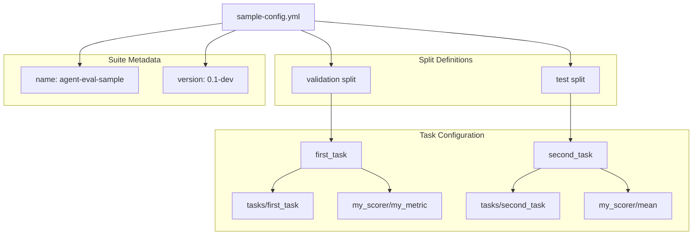
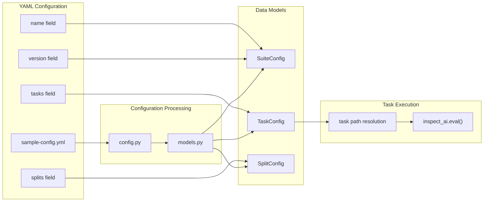
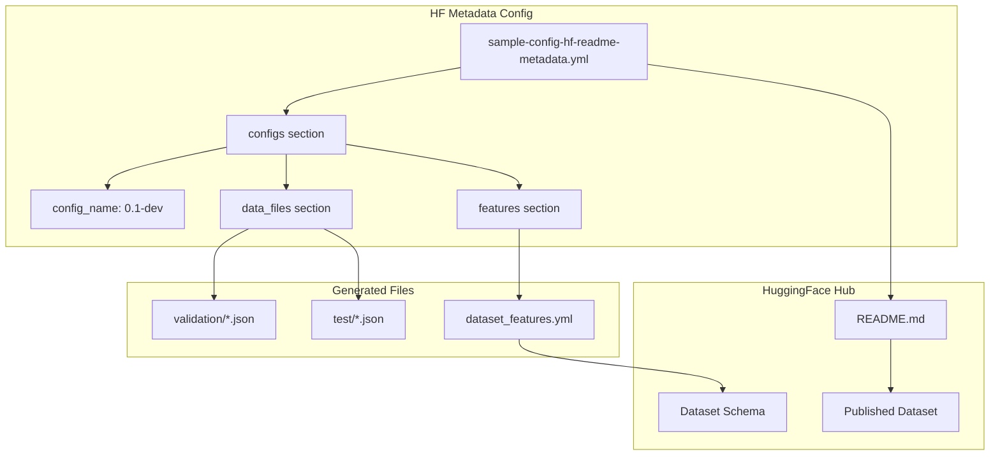

<!-- source: DeepWiki mcp.deepwiki.com · repo allenai/agent-eval · page 6.1 Configuration Examples · fetched 2026-10-26 -->

# Configuration Examples

<details>
<summary>Relevant source files</summary>

The following files were used as context for generating this wiki page:

- [sample-config-hf-readme-metadata.yml](sample-config-hf-readme-metadata.yml)
- [sample-config.yml](sample-config.yml)

</details>


This page provides concrete examples of configuration files used in agent-eval, with detailed explanations of each component. These examples demonstrate how to structure evaluation suites and configure HuggingFace dataset publishing.

For information about the configuration schema and validation, see [Configuration](#3.1). For details about data processing and schema management, see [Schema Management](#4.3).

## Configuration File Structure

Agent-eval uses YAML configuration files to define evaluation suites. The main configuration file defines the evaluation suite metadata, data splits, and task specifications.

### Basic Suite Configuration

The primary configuration format is demonstrated in the sample configuration:

**Suite Metadata Configuration**


Sources: [sample-config.yml:1-21]()

The configuration structure maps to internal data models processed by the system. Here's how configuration elements are processed:

**Configuration Processing Flow**


Sources: [sample-config.yml:1-21]()

## Suite Configuration Components

### Suite Metadata

The top-level configuration defines the evaluation suite identity:

| Field | Description | Example |
|-------|-------------|---------|
| `name` | Unique identifier for the suite | `agent-eval-sample` |
| `version` | Version string for the suite | `"0.1-dev"` |

Sources: [sample-config.yml:1-2]()

### Split Configuration

Each suite defines one or more data splits containing related tasks:

| Field | Description | Example |
|-------|-------------|---------|
| `name` | Split identifier | `validation`, `test` |
| `tasks` | List of tasks in this split | Array of task configurations |

The sample configuration demonstrates two splits:
- **Validation split**: Contains `first_task` for development/validation
- **Test split**: Contains `second_task` for final evaluation

Sources: [sample-config.yml:4-20]()

### Task Configuration

Each task specifies the evaluation details:

| Field | Description | Example |
|-------|-------------|---------|
| `name` | Task identifier | `first_task` |
| `path` | Relative path to task definition | `tasks/first_task` |
| `primary_metric` | Main metric for scoring | `my_scorer/my_metric` |
| `tags` | Categorical labels for task | `[task1]` |

**Task Path Resolution**: The `path` field points to task definitions that are loaded by Inspect AI during evaluation execution.

**Primary Metric Format**: Uses the pattern `scorer_name/metric_name` to specify which scoring function and metric to use for ranking results.

Sources: [sample-config.yml:6-11](), [sample-config.yml:16-20]()

## HuggingFace Dataset Configuration  

The HuggingFace integration requires additional metadata configuration for dataset publishing:

### Dataset Metadata Structure

**HuggingFace Configuration Mapping**


Sources: [sample-config-hf-readme-metadata.yml:1-12]()

### Configuration Mapping

The HuggingFace metadata configuration maps evaluation splits to dataset files:

| Configuration Element | Purpose | Example |
|----------------------|---------|---------|
| `config_name` | Dataset configuration version | `0.1-dev` |
| `data_files` | File paths for each split | `0.1-dev/validation/*.json` |
| `features` | Dataset schema reference | Links to `dataset_features.yml` |

**File Path Pattern**: Uses version-based directory structure (`{version}/{split}/*.json`) to organize evaluation results.

**Schema Integration**: The `features` section references the generated dataset schema that defines the structure of evaluation results.

Sources: [sample-config-hf-readme-metadata.yml:3-10]()

## Configuration Usage Patterns

### Multi-Split Evaluation

The sample configuration demonstrates organizing tasks across validation and test splits:

```yaml
splits:
  - name: validation      # Development/tuning tasks
    tasks:
      - name: first_task
        primary_metric: 'my_scorer/my_metric'
        
  - name: test           # Final evaluation tasks  
    tasks:
      - name: second_task
        primary_metric: 'my_scorer/mean'
```

This pattern allows different evaluation phases with distinct metrics and task sets.

### Task Organization

Tasks are organized with clear separation between definition and configuration:
- **Task Definition**: Located at `tasks/{task_name}` path
- **Task Configuration**: Specified in suite YAML with metadata
- **Metric Selection**: Primary metric determines scoring and ranking

Sources: [sample-config.yml:4-20]()

## Configuration Processing Pipeline

The configuration files are processed through the agent-eval pipeline as follows:

1. **Loading**: Configuration parsed by `config.py` module
2. **Validation**: Schema validation against Pydantic models in `models.py`
3. **Task Resolution**: Task paths resolved for Inspect AI execution
4. **Metric Configuration**: Primary metrics configured for scoring
5. **HuggingFace Integration**: Metadata used for dataset publishing

This processing ensures configuration consistency and enables the eval → score → publish workflow described in [Running Evaluations](#3.2).

Sources: [sample-config.yml:1-21](), [sample-config-hf-readme-metadata.yml:1-12]()

---

