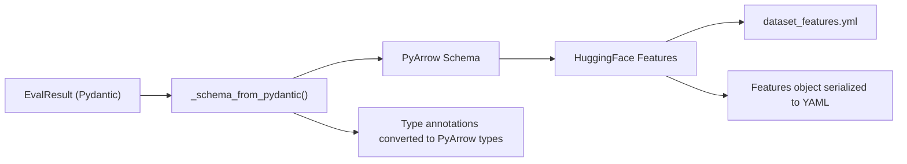
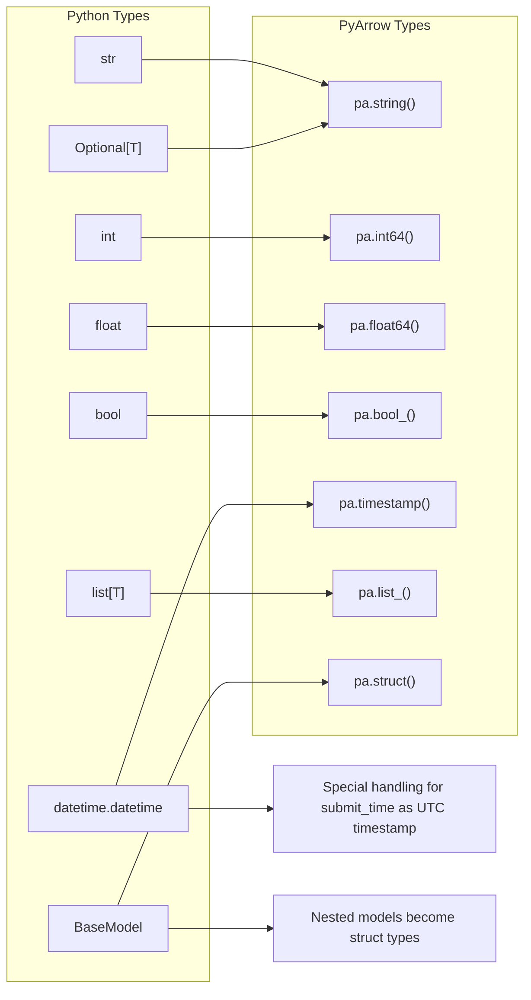

<!-- source: DeepWiki mcp.deepwiki.com · repo allenai/agent-eval · page 6.2 Dataset Schema Reference · fetched 2026-10-26 -->

# Dataset Schema Reference

<details>
<summary>Relevant source files</summary>

The following files were used as context for generating this wiki page:

- [src/agenteval/dataset_features.yml](src/agenteval/dataset_features.yml)
- [src/agenteval/schema_generator.py](src/agenteval/schema_generator.py)

</details>


This page provides comprehensive documentation for the dataset schema used by agent-eval when publishing evaluation results to HuggingFace Hub. The schema defines the structure and data types for all fields in published datasets, ensuring consistency and compatibility across evaluations.

For information about configuring evaluation suites, see [Configuration](#3.1). For details on the publication process, see [External Integrations](#4.2).

## Overview

The dataset schema in agent-eval serves as the contract between the internal data models and the HuggingFace dataset format. It defines how evaluation results, model usage statistics, and submission metadata are structured when published to HuggingFace Hub for leaderboards and analysis.

The schema is automatically generated from Pydantic models and maintained in [src/agenteval/dataset_features.yml](). This ensures that the published dataset structure remains consistent with the internal data representations used throughout the evaluation pipeline.

Sources: [src/agenteval/dataset_features.yml:1-72](), [src/agenteval/schema_generator.py:1-96]()

## Schema Generation Pipeline

The dataset schema follows a generation pipeline that transforms Pydantic model definitions into HuggingFace-compatible schema specifications:



**Schema Generation Process**

The `schema_generator.py` module provides the core functionality for converting Pydantic models to HuggingFace dataset schemas. The process involves:

1. **Type Annotation Analysis**: The `_pa_type_for_annotation()` function converts Python type annotations to PyArrow data types
2. **Model Field Extraction**: The `_schema_from_pydantic()` function processes Pydantic model fields and builds PyArrow field definitions
3. **Features Generation**: The `features_from_pydantic()` function creates a HuggingFace Features object from the PyArrow schema
4. **YAML Serialization**: The `write_dataset_features()` function outputs the schema as a YAML file for version control and distribution

Sources: [src/agenteval/schema_generator.py:18-96]()

## Dataset Schema Structure

The dataset schema defines four main top-level fields that capture all aspects of an evaluation result:

```mermaid
graph TD
    Dataset["agent-eval Dataset"]
    
    SuiteConfig["suite_config"]
    Split["split"]
    Results["results"]
    Submission["submission"]
    
    Dataset --> SuiteConfig
    Dataset --> Split
    Dataset --> Results
    Dataset --> Submission
    
    subgraph "suite_config Structure"
        SC_Name["name: string"]
        SC_Version["version: string"]
        SC_Splits["splits: list"]
        SuiteConfig --> SC_Name
        SuiteConfig --> SC_Version
        SuiteConfig --> SC_Splits
        
        SC_Splits --> TaskList["tasks: list"]
        TaskList --> TaskName["name: string"]
        TaskList --> TaskPath["path: string"]
        TaskList --> TaskMetric["primary_metric: string"]
        TaskList --> TaskTags["tags: sequence"]
    end
    
    subgraph "results Structure"
        R_TaskName["task_name: string"]
        R_Metrics["metrics: list"]
        R_ModelUsages["model_usages: list"]
        R_ModelCosts["model_costs: sequence"]
        Results --> R_TaskName
        Results --> R_Metrics
        Results --> R_ModelUsages  
        Results --> R_ModelCosts
    end
    
    subgraph "submission Structure"
        S_Time["submit_time: timestamp"]
        S_User["username: string"]
        S_Agent["agent_name: string"]
        S_Desc["agent_description: string"]
        S_URL["agent_url: string"]
        S_Logs["logs_url: string"]
        Submission --> S_Time
        Submission --> S_User
        Submission --> S_Agent
        Submission --> S_Desc
        Submission --> S_URL
        Submission --> S_Logs
    end
```



Sources: [src/agenteval/dataset_features.yml:1-72]()

## Field Specifications

### Suite Configuration

The `suite_config` field contains metadata about the evaluation suite configuration:

| Field | Type | Description |
|-------|------|-------------|
| `name` | string | Name of the evaluation suite |
| `version` | string | Version identifier for the suite |
| `splits` | list | List of evaluation splits with their tasks |

Each split within `splits` contains:

| Field | Type | Description |
|-------|------|-------------|
| `name` | string | Split identifier (e.g., "train", "test") |
| `tasks` | list | List of tasks in this split |

Each task within `tasks` contains:

| Field | Type | Description |
|-------|------|-------------|
| `name` | string | Task identifier |
| `path` | string | Path to task definition |
| `primary_metric` | string | Main evaluation metric for this task |
| `tags` | sequence | List of task category tags |

Sources: [src/agenteval/dataset_features.yml:1-21]()

### Results Data

The `results` field contains the core evaluation outcomes:

| Field | Type | Description |
|-------|------|-------------|
| `task_name` | string | Name of the evaluated task |
| `metrics` | list | Performance metrics for the task |
| `model_usages` | list | Detailed token usage statistics |
| `model_costs` | sequence | Cost information per model |

**Metrics Structure**

Each metric entry contains:
- `name` (string): Metric identifier
- `value` (float64): Computed metric value

**Model Usage Structure**

Each model usage entry contains:
- `model` (string): Model identifier
- `usage` (struct): Token usage statistics with fields:
  - `input_tokens` (int64)
  - `output_tokens` (int64) 
  - `total_tokens` (int64)
  - `input_tokens_cache_write` (int64)
  - `input_tokens_cache_read` (int64)
  - `reasoning_tokens` (int64)

Sources: [src/agenteval/dataset_features.yml:23-53]()

### Submission Metadata

The `submission` field captures information about who submitted the evaluation and when:

| Field | Type | Description |
|-------|------|-------------|
| `submit_time` | timestamp[us, tz=UTC] | Submission timestamp in UTC |
| `username` | string | Submitter's username |
| `agent_name` | string | Name of the evaluated agent |
| `agent_description` | string | Description of the agent |
| `agent_url` | string | URL to agent source code |
| `logs_url` | string | URL to evaluation logs |
| `logs_url_public` | string | Public URL for logs |
| `summary_url` | string | URL to evaluation summary |

Sources: [src/agenteval/dataset_features.yml:54-72]()

## Type System Mapping

The schema generator handles the conversion between Python types and PyArrow/HuggingFace types:



**Type Conversion Rules**

The `_pa_type_for_annotation()` function implements these conversion rules:

- Basic Python types map directly to PyArrow equivalents
- `Optional[T]` and `Union` types are handled by extracting non-None types
- `list[T]` becomes `pa.list_()` with recursive inner type conversion
- Pydantic `BaseModel` subclasses become `pa.struct()` with recursive field processing
- Special case: `submit_time` fields are converted to UTC timestamps

Sources: [src/agenteval/schema_generator.py:18-47]()

## Schema Management Functions

The schema generator module provides several utility functions for working with dataset schemas:

### Core Functions

| Function | Purpose | Parameters |
|----------|---------|------------|
| `features_from_pydantic()` | Convert Pydantic model to HuggingFace Features | `model: type[BaseModel]` |
| `write_dataset_features()` | Write schema to YAML file | `output_path: str` |
| `load_dataset_features()` | Load schema from YAML file | `input_path: str \| None` |

### Usage Patterns

**Generating Schema from Models**
```python
# Generate Features object from EvalResult model
features = features_from_pydantic(EvalResult)
```

**Writing Schema to File**
```python
# Write current schema to YAML
write_dataset_features("dataset_features.yml")
```

**Loading Schema for Dataset Creation**
```python
# Load schema from package or custom path
features = load_dataset_features()  # Uses packaged schema
features = load_dataset_features("custom_schema.yml")  # Custom schema
```

Sources: [src/agenteval/schema_generator.py:63-96]()

## Schema Validation and Maintenance

The dataset schema is maintained through automated processes that ensure consistency between the Pydantic models and the published schema:

1. **Generation**: The schema is generated from the `EvalResult` Pydantic model using `write_dataset_features()`
2. **Version Control**: The generated `dataset_features.yml` is committed to the repository
3. **CI Validation**: Continuous integration checks ensure the schema file matches the current model definitions
4. **Package Distribution**: The schema file is included in the Python package for runtime use

This approach ensures that any changes to the data models are automatically reflected in the dataset schema, maintaining consistency across the entire evaluation pipeline.

Sources: [src/agenteval/schema_generator.py:72-80](), [src/agenteval/dataset_features.yml:1-72]()

---

