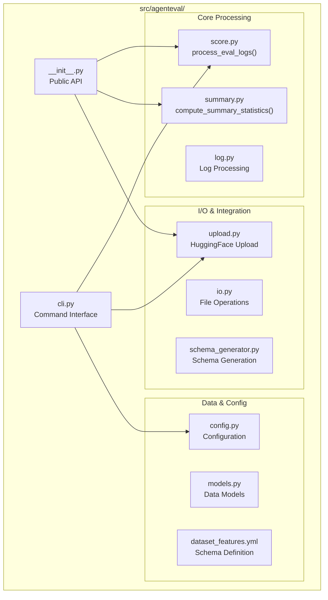
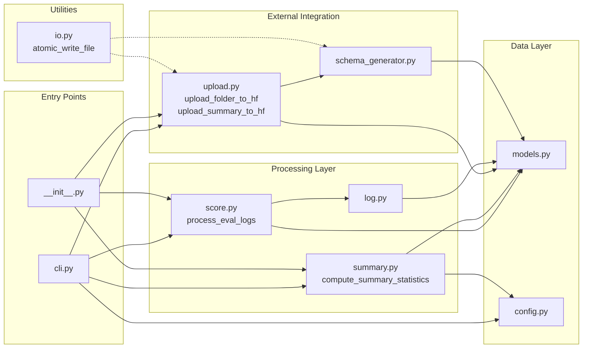
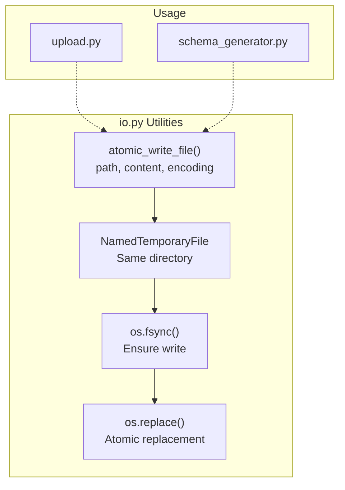
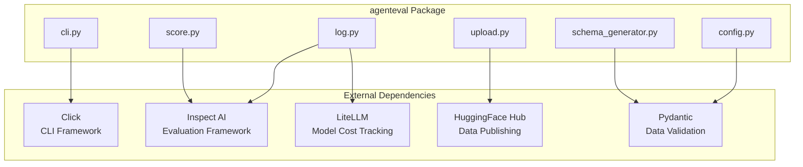

<!-- source: DeepWiki mcp.deepwiki.com · repo allenai/agent-eval · page 6.3 Package Structure · fetched 2026-10-26 -->

# Package Structure

Relevant source files

The following files were used as context for generating this wiki page:

- [MANIFEST.in](MANIFEST.in)
- [src/agenteval/__init__.py](src/agenteval/__init__.py)
- [src/agenteval/io.py](src/agenteval/io.py)

This page provides an overview of the `agent-eval` Python package structure, covering the organization of modules, their responsibilities, and key dependencies. This documentation focuses on the physical organization of code and how modules relate to each other within the package.

For information about the conceptual architecture and data flow, see [Architecture](#4). For development setup and contributing guidelines, see [Development](#5).

## Package Overview

The `agent-eval` toolkit is structured as a Python package located in `src/agenteval/` with a clear separation of concerns across functional modules. The package exports four main functions through its public API and organizes internal functionality into specialized modules.

### Main Package Exports

The package's public interface is defined in [src/agenteval/__init__.py:5-14]() and exposes four primary functions:

| Function | Module | Purpose |
|----------|---------|---------|
| `process_eval_logs` | `score.py` | Process evaluation logs into structured results |
| `compute_summary_statistics` | `summary.py` | Generate summary statistics from task results |
| `upload_folder_to_hf` | `upload.py` | Upload evaluation results to HuggingFace Hub |
| `upload_summary_to_hf` | `upload.py` | Upload summary data to HuggingFace Hub |

**Package Structure Overview**

Sources: [src/agenteval/__init__.py:1-14]()

## Core Module Architecture

The package follows a layered architecture with distinct responsibilities for each module. The CLI layer orchestrates operations, core processing modules handle data transformation, and integration modules manage external services.

**Module Dependencies and Data Flow**

Sources: [src/agenteval/__init__.py:5-14]()

## Module Responsibilities

### CLI and Entry Points

- **`cli.py`**: Provides the `agenteval` command-line interface with subcommands for `eval`, `score`, and `publish` operations
- **`__init__.py`**: Defines the public API and package version using `importlib.metadata`

### Core Processing Modules

- **`score.py`**: Contains `process_eval_logs()` function that transforms raw evaluation logs into structured `TaskResult` objects
- **`summary.py`**: Implements `compute_summary_statistics()` to aggregate task results into summary statistics and `EvalResult` objects  
- **`log.py`**: Handles parsing of evaluation logs, model usage extraction, and cost computation

### Data and Configuration

- **`models.py`**: Defines Pydantic data models for `TaskResult`, `EvalResult`, and other core data structures
- **`config.py`**: Manages evaluation suite configuration loading and validation
- **`dataset_features.yml`**: Schema definition file for HuggingFace dataset features, included via [MANIFEST.in:1]()

### Integration and I/O

- **`upload.py`**: Implements HuggingFace Hub integration with `upload_folder_to_hf()` and `upload_summary_to_hf()` functions
- **`schema_generator.py`**: Generates HuggingFace dataset schemas from Pydantic models
- **`io.py`**: Provides utility functions like `atomic_write_file()` for safe file operations

**File Operations Module Detail**

Sources: [src/agenteval/io.py:6-39]()

## Key Configuration Files

The package includes several important configuration and data files that are distributed with the package:

| File | Purpose | Location |
|------|---------|----------|
| `dataset_features.yml` | HuggingFace dataset schema definition | `src/agenteval/` |
| `MANIFEST.in` | Package inclusion rules | Root directory |
| `__init__.py` | Package initialization and public API | `src/agenteval/` |

The `dataset_features.yml` file is explicitly included in the package distribution through [MANIFEST.in:1](), ensuring that schema definitions are available at runtime for HuggingFace dataset generation.

## External Dependencies

The package integrates with several external libraries and services through its modules:

**External Integration Points**

Sources: [src/agenteval/__init__.py:1-14](), [MANIFEST.in:1](), [src/agenteval/io.py:1-39]()

The package structure reflects a clear separation between user-facing interfaces (CLI and public API), core data processing logic, and external service integrations, enabling maintainable and testable code organization.