# Page: Overview

# Overview

<details>
<summary>Relevant source files</summary>

The following files were used as context for generating this wiki page:

- [README.md](README.md)
- [pyproject.toml](pyproject.toml)

</details>


This document introduces the `agent-eval` toolkit, explaining its purpose as a comprehensive agent evaluation system and its high-level architecture. For detailed usage instructions, see [User Guide](#3). For development information, see [Development](#5).

## Purpose and Scope

The `agent-eval` toolkit is a Python package that provides a complete workflow for evaluating AI agents on standardized task suites. It serves as an orchestration layer that coordinates various AI/ML tools to deliver a three-stage evaluation pipeline: execution, scoring, and publication.

The system addresses three primary evaluation challenges:
1. **Standardized Task Suite Management**: Configuration-driven evaluation suites using YAML specifications
2. **Cost Tracking and Analysis**: Automatic extraction of token usage from evaluation logs with cost computation via LiteLLM
3. **Result Publication and Leaderboards**: Automated submission of results to HuggingFace datasets for leaderboard distribution

**Sources**: [README.md:1-7](), [pyproject.toml:5-8]()

## System Architecture

The `agent-eval` system follows a modular architecture with clear separation between CLI orchestration, data processing, and external integrations.

### Core System Components

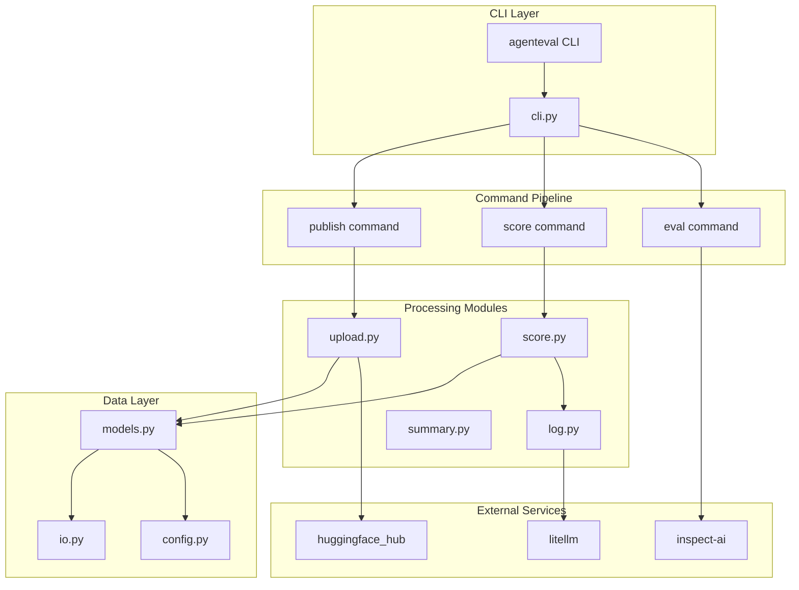

**Sources**: [pyproject.toml:37-38](), [README.md:14-36]()

### Data Flow Pipeline

The system processes evaluation data through a three-stage transformation pipeline, where each stage produces structured outputs for the next stage.

```mermaid
graph LR
    subgraph "Input Stage"
        YAML_CONFIG["YAML Config"]
        AGENT_CODE["Agent Implementation"]
    end
    
    subgraph "Evaluation Stage"
        AGENTEVAL_EVAL["agenteval eval"]
        INSPECT_RUNNER["Inspect AI Runner"]
        RAW_LOGS["Raw Evaluation Logs"]
        AGENTEVAL_JSON["agenteval.json"]
    end
    
    subgraph "Scoring Stage"
        AGENTEVAL_SCORE["agenteval score"]
        LOG_PARSER["Log Processing"]
        LITELLM_COSTS["LiteLLM Cost Computation"]
        TASK_RESULTS["TaskResult Objects"]
    end
    
    subgraph "Publication Stage"
        AGENTEVAL_PUBLISH["agenteval publish"]
        SUMMARY_STATS["Summary Statistics"]
        HF_UPLOAD["HuggingFace Upload"]
        LEADERBOARD_DATA["Leaderboard Dataset"]
    end
    
    YAML_CONFIG --> AGENTEVAL_EVAL
    AGENT_CODE --> AGENTEVAL_EVAL
    AGENTEVAL_EVAL --> INSPECT_RUNNER
    INSPECT_RUNNER --> RAW_LOGS
    RAW_LOGS --> AGENTEVAL_JSON
    
    AGENTEVAL_JSON --> AGENTEVAL_SCORE
    AGENTEVAL_SCORE --> LOG_PARSER
    LOG_PARSER --> LITELLM_COSTS
    LITELLM_COSTS --> TASK_RESULTS
    
    TASK_RESULTS --> AGENTEVAL_PUBLISH
    AGENTEVAL_PUBLISH --> SUMMARY_STATS
    SUMMARY_STATS --> HF_UPLOAD
    HF_UPLOAD --> LEADERBOARD_DATA
```

**Sources**: [README.md:14-36]()

## Core Components

### CLI Interface

The primary user interface is the `agenteval` command-line tool, implemented through the Click framework. The CLI provides three main commands that form the evaluation pipeline.

| Command | Purpose | Primary Output |
|---------|---------|----------------|
| `eval` | Execute evaluations using Inspect AI | `agenteval.json` with raw results |
| `score` | Process logs and compute metrics | Updated `agenteval.json` with scores |
| `publish` | Upload results to HuggingFace | Dataset on HuggingFace Hub |

**Sources**: [pyproject.toml:11-14](), [pyproject.toml:37-38](), [README.md:14-36]()

### Configuration System

Evaluations are defined through YAML configuration files that specify task suites, metrics, and submission metadata. The configuration system uses Pydantic models for validation and schema management.

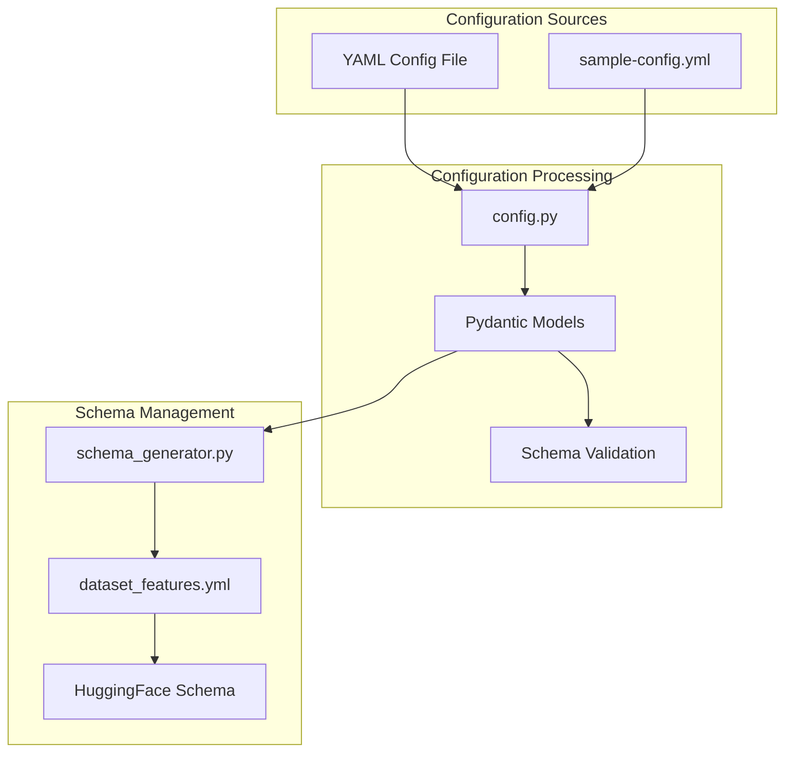

**Sources**: [README.md:20-24](), [pyproject.toml:50-51]()

### Data Models

The system uses strongly-typed Pydantic models to represent evaluation data throughout the pipeline. These models serve as the source of truth for data schemas and enable automatic generation of HuggingFace dataset schemas.

**Sources**: [pyproject.toml:15]()

## External Integrations

The `agent-eval` toolkit integrates with three primary external systems, each serving a specific role in the evaluation pipeline.

### Integration Architecture

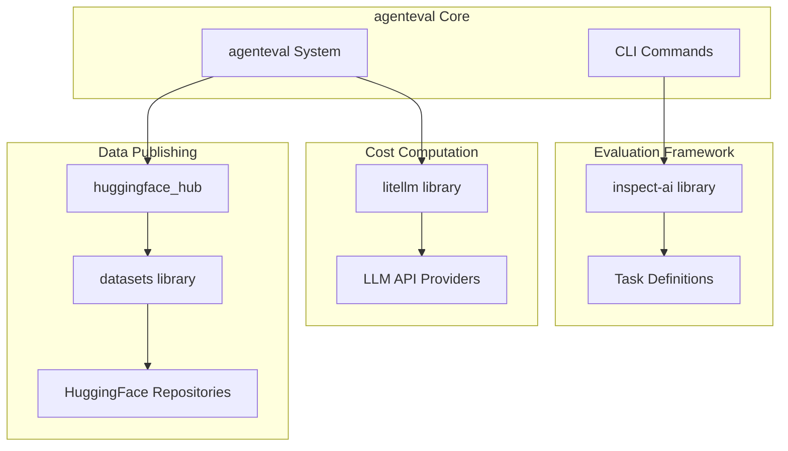

**Sources**: [pyproject.toml:11-20](), [README.md:3](), [README.md:38-46]()

### Key Integration Points

1. **Inspect AI**: Provides the evaluation execution framework for running agent tasks
2. **LiteLLM**: Enables cost computation by extracting token usage from evaluation logs
3. **HuggingFace Hub**: Serves as the publication platform for results and leaderboard data

For detailed information about these integrations, see [External Integrations](#4.2).

**Sources**: [README.md:3-6](), [pyproject.toml:11-20]()

## Package Structure

The `agent-eval` package is distributed as a Python package with a clear entry point and dependency management through setuptools.

| Component | Implementation | Purpose |
|-----------|----------------|---------|
| Package Name | `agent-eval` | PyPI package identifier |
| CLI Entry Point | `agenteval.cli:cli` | Main command interface |
| Python Requirement | `>=3.10` | Minimum Python version |
| Core Dependencies | Click, Inspect AI, LiteLLM, Pydantic | Essential functionality |
| Data Dependencies | HuggingFace Hub, PyArrow, Datasets | Publication and data handling |

**Sources**: [pyproject.toml:5-20](), [pyproject.toml:37-38]()

---

# Page: Installation and Setup

# Installation and Setup

<details>
<summary>Relevant source files</summary>

The following files were used as context for generating this wiki page:

- [README.md](README.md)
- [pyproject.toml](pyproject.toml)

</details>


This document covers the installation of the agent-eval toolkit and initial setup steps required to run your first evaluation. It includes system requirements, installation methods, dependency management, and verification procedures.

For detailed configuration of evaluation suites, see [Configuration](#3.1). For comprehensive usage instructions, see [User Guide](#3). For development setup, see [Development Setup](#5.1).

## System Requirements

Agent-eval requires Python 3.10 or higher and integrates with several external systems for evaluation execution and result publication.

### Python Version Requirements

The package requires Python 3.10 as specified in [pyproject.toml:10]():

| Requirement | Version |
|-------------|---------|
| Python | ≥ 3.10 |

### Core Dependencies

Agent-eval relies on several key external libraries for its functionality:

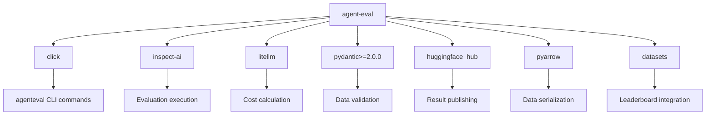
**Dependency Integration Overview**

The dependencies serve specific architectural roles as defined in [pyproject.toml:11-20]():

| Dependency | Purpose | Usage in Agent-eval |
|------------|---------|-------------------|
| `click` | CLI framework | Command-line interface implementation |
| `inspect-ai` | Evaluation framework | Task execution and evaluation logic |
| `litellm` | LLM cost tracking | Token usage extraction and cost computation |
| `pydantic` | Data validation | Schema definitions and data models |
| `huggingface_hub` | Dataset publishing | Leaderboard result uploads |
| `pyarrow` | Data serialization | Efficient data format handling |
| `datasets` | Dataset management | HuggingFace dataset integration |

Sources: [pyproject.toml:10-20]()

## Installation Methods

### PyPI Installation (Recommended)

Install agent-eval from the Python Package Index using pip:

```bash
pip install agent-eval
```

This installs the stable release version as specified in [pyproject.toml:7]() and automatically handles all required dependencies listed in [pyproject.toml:11-20]().

### Development Installation

For development or contributing to agent-eval, install with development dependencies:

```bash
pip install agent-eval[dev]
```

The development dependencies include testing and code formatting tools as defined in [pyproject.toml:26-35]():

| Tool | Purpose |
|------|---------|
| `black==24.2.0` | Code formatting |
| `isort` | Import sorting |
| `autoflake` | Unused import removal |
| `pytest` | Testing framework |
| `pytest-asyncio` | Async testing support |
| `mypy==1.15` | Type checking |
| `types-PyYAML` | Type stubs for YAML |
| `types-setuptools` | Type stubs for setuptools |

Sources: [README.md:10](), [pyproject.toml:26-35]()

## Installation Verification

### Command Line Interface Verification

After installation, verify that the `agenteval` CLI is available and properly configured:

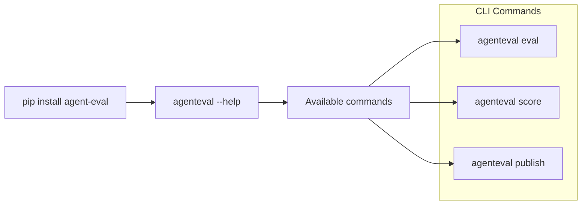
**CLI Verification Workflow**

The CLI entry point is configured in [pyproject.toml:38]() as `agenteval = "agenteval.cli:cli"`. Test the installation by running:

```bash
agenteval --help
```

This should display the main CLI help with available commands: `eval`, `score`, and `publish`.

### Dependency Verification

Verify that key dependencies are properly installed and accessible:

```bash
python -c "import inspect_ai, litellm, huggingface_hub; print('All dependencies available')"
```

Sources: [pyproject.toml:37-38](), [README.md:15-36]()

## Initial Configuration

### HuggingFace Authentication (Optional)

If you plan to publish results to HuggingFace datasets, configure authentication:

```bash
huggingface-cli login
```

This is required for the `agenteval publish` command functionality described in [README.md:33-36]().

### Environment Setup

Agent-eval integrates with external evaluation frameworks and APIs. Ensure relevant environment variables are configured for:

- **LiteLLM API keys**: For cost calculation functionality
- **Inspect AI settings**: For evaluation execution
- **HuggingFace tokens**: For dataset publishing

### Directory Structure

Agent-eval expects specific file organization for evaluations:

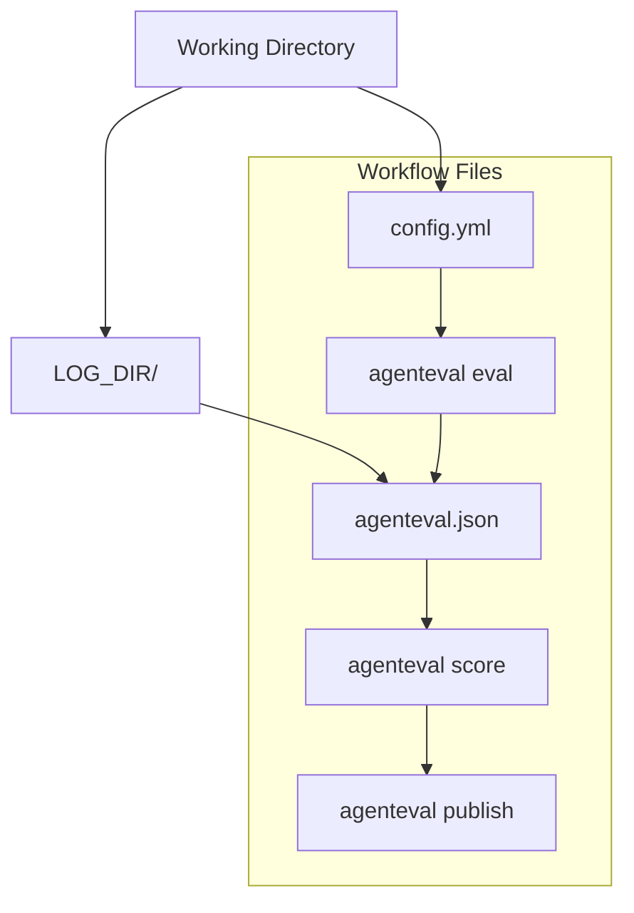
**Expected Directory Structure**

The evaluation workflow creates and expects specific files as described in [README.md:16-36]():

- Configuration file (e.g., `sample-config.yml`)
- Log directory for storing evaluation results
- `agenteval.json` file generated during evaluation

Sources: [README.md:38-46]()

## Quick Start Validation

### Sample Configuration

Agent-eval includes a sample configuration file for testing basic functionality. The configuration format is referenced in [README.md:20]() as `sample-config.yml`.

### First Evaluation Test

Once installed and configured, test the complete workflow:

1. **Prepare configuration**: Create or use a sample configuration file
2. **Run evaluation**: Execute `agenteval eval --config-path CONFIG_PATH --split SPLIT LOG_DIR`
3. **Score results**: Run `agenteval score LOG_DIR`
4. **Verify output**: Check that `agenteval.json` is generated in the log directory

This validates the complete installation and basic functionality of the three-stage pipeline (eval → score → publish).

Sources: [README.md:15-30]()

## Next Steps

After successful installation and verification:

- **Configuration**: Learn about evaluation suite configuration in [Configuration](#3.1)
- **Usage**: Follow the complete user guide in [User Guide](#3)
- **CLI Reference**: Review all available commands in [CLI Reference](#3.3)
- **Development**: Set up development environment following [Development Setup](#5.1)

The installation provides access to the complete agent-eval toolkit for running evaluations, computing scores, and publishing results to leaderboards.

---

# Page: User Guide

# User Guide

<details>
<summary>Relevant source files</summary>

The following files were used as context for generating this wiki page:

- [README.md](README.md)
- [src/agenteval/cli.py](src/agenteval/cli.py)

</details>


This guide provides comprehensive instructions for using agent-eval to run evaluations on agent systems using the Inspect AI framework. It covers the complete workflow from configuration through evaluation execution to results publication.

The guide focuses on practical usage of the three-stage evaluation pipeline: `eval` → `score` → `publish`. For detailed configuration syntax, see [Configuration](#3.1). For step-by-step execution instructions, see [Running Evaluations](#3.2). For complete CLI command reference, see [CLI Reference](#3.3).

## Overview of the Evaluation Workflow

Agent-eval implements a three-stage pipeline that transforms agent evaluation configurations into published leaderboard results. Each stage produces specific outputs that feed into the next stage.

**Agent-Eval Three-Stage Pipeline**
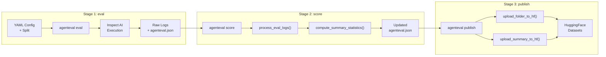

Sources: [src/agenteval/cli.py:333-429](), [src/agenteval/cli.py:100-196](), [src/agenteval/cli.py:199-330]()

## Core Concepts and Code Entities

The agent-eval system operates on several key data structures and files that flow through the evaluation pipeline.

**Core Data Flow and Code Entities**
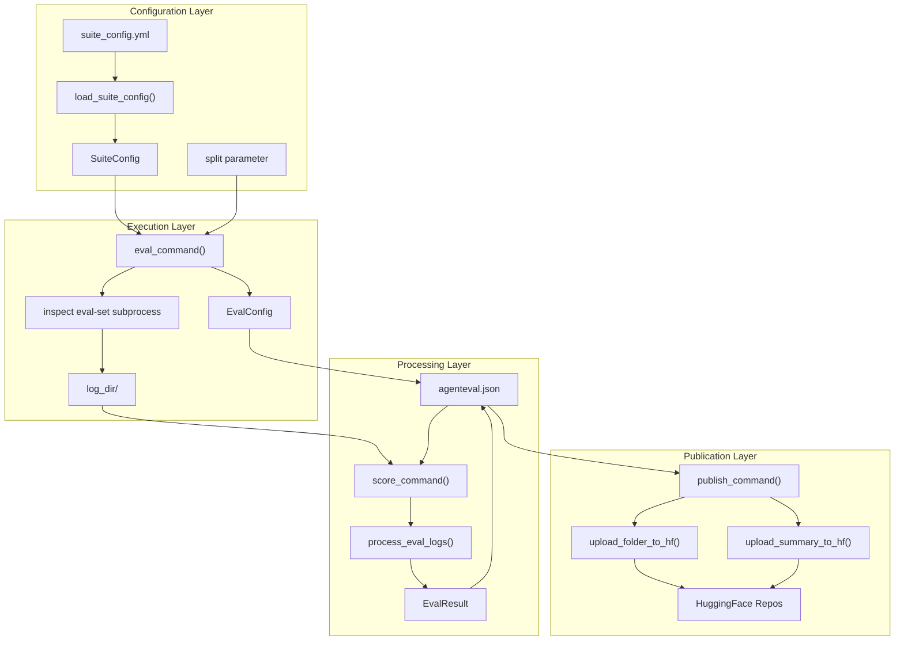

Sources: [src/agenteval/cli.py:11-15](), [src/agenteval/config.py](), [src/agenteval/models.py](), [src/agenteval/score.py](), [src/agenteval/upload.py]()

## Quick Start Example

Here's a complete example of running an evaluation from start to finish:

### 1. Run Evaluation
```bash
agenteval eval --config-path suite_config.yml --split test_split --log-dir ./logs/my_run
```

This command:
- Loads configuration via `load_suite_config()` from [src/agenteval/config.py]()
- Creates an `EvalConfig` object and writes initial `agenteval.json`
- Executes `inspect eval-set` subprocess with the configured tasks
- Verifies git reproducibility via `verify_git_reproducibility()`

### 2. Score Results
```bash  
agenteval score ./logs/my_run
```

This command:
- Loads `EvalResult` from existing `agenteval.json`
- Calls `process_eval_logs()` to extract metrics and costs
- Runs `compute_summary_statistics()` to aggregate results
- Updates `agenteval.json` with scored results

### 3. Publish to Leaderboard
```bash
agenteval publish --agent-name "MyAgent" --submissions-repo-id "org/submissions" --results-repo-id "org/results" ./logs/my_run
```

This command:
- Validates the `EvalResult` is fully scored
- Uploads log directory via `upload_folder_to_hf()`
- Uploads summary data via `upload_summary_to_hf()`
- Updates `agenteval.json` with publication metadata

Sources: [src/agenteval/cli.py:371-427](), [src/agenteval/cli.py:118-194](), [src/agenteval/cli.py:240-327]()

## Key Files and Data Structures

| File/Object | Purpose | Created By | Used By |
|-------------|---------|------------|---------|
| `suite_config.yml` | Evaluation suite configuration | User | `eval` command |
| `agenteval.json` | Evaluation metadata and results | `eval`, updated by `score` | All commands |
| `log_dir/` | Inspect AI evaluation logs | `inspect eval-set` | `score` command |
| `EvalConfig` | Initial evaluation configuration | `eval` command | Serialized to JSON |
| `EvalResult` | Complete evaluation results | `score` command | `publish` command |
| `SuiteConfig` | Parsed YAML configuration | `load_suite_config()` | `eval` command |

### The agenteval.json File

The `agenteval.json` file is the central data store that evolves through the pipeline:

1. **After eval**: Contains `EvalConfig` with `suite_config` and `split`
2. **After score**: Upgraded to `EvalResult` with `results`, `eval_specs`, and summary statistics  
3. **After publish**: Enhanced with `submission` metadata including URLs and timestamps

The file uses Pydantic models for validation and serialization via `EvalResult.model_validate_json()` and `EvalResult.save_json()`.

Sources: [src/agenteval/cli.py:17](), [src/agenteval/cli.py:401-403](), [src/agenteval/cli.py:124-132](), [src/agenteval/cli.py:187](), [src/agenteval/cli.py:325-326]()

## Advanced Usage Considerations

### Git Reproducibility

The `eval` command enforces git reproducibility by default via `verify_git_reproducibility()`:
- Checks for uncommitted changes in working directory
- Ensures current commit exists on remote repository  
- Warns about untracked files
- Can be bypassed with `--ignore-git` flag (not recommended)

### Error Handling

The `score` command implements comprehensive error handling:
- Warns about multiple evaluation specs in logs from mixed runs
- Identifies missing tasks via `eval_result.find_missing_tasks()`
- Exits with error code if metric computation fails
- Validates configuration version consistency

### HuggingFace Integration

The `publish` command requires proper HuggingFace setup:
- Uses `HfApi.whoami()` to determine username if not provided
- Sanitizes usernames and agent names via `sanitize_path_component()`
- Uploads to separate repositories for submissions and results
- Automatically adds dataset metadata if missing

Sources: [src/agenteval/cli.py:20-93](), [src/agenteval/cli.py:161-172](), [src/agenteval/cli.py:276-294]()

---

# Page: Configuration

# Configuration

<details>
<summary>Relevant source files</summary>

The following files were used as context for generating this wiki page:

- [sample-config.yml](sample-config.yml)
- [src/agenteval/config.py](src/agenteval/config.py)

</details>


This document explains how to configure evaluation suites using YAML configuration files. Configuration files define the tasks, splits, and metadata for evaluation runs in agent-eval. For information about running evaluations with these configurations, see [Running Evaluations](#3.2). For detailed CLI command reference, see [CLI Reference](#3.3).

## Configuration File Structure

Agent-eval uses YAML configuration files to define evaluation suites. A configuration file specifies the suite metadata, splits (e.g., validation, test), and the tasks within each split.

### Configuration Schema Mapping

The following diagram shows how YAML configuration elements map to the corresponding Pydantic data models:

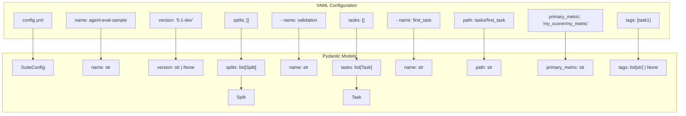

Sources: [src/agenteval/config.py:9-40](), [sample-config.yml:1-21]()

### Basic Configuration Example

Here is the structure of a basic configuration file:

```yaml
name: agent-eval-sample
version: "0.1-dev"

splits:
  - name: validation
    tasks:
      - name: first_task
        path: tasks/first_task
        primary_metric: 'my_scorer/my_metric'
        tags:
          - task1

  - name: test
    tasks:
      - name: second_task
        path: tasks/second_task
        primary_metric: 'my_scorer/mean'
        tags:
          - task2
```

Sources: [sample-config.yml:1-21]()

## Data Models and Validation

Agent-eval uses Pydantic models to validate and structure configuration data. The configuration system consists of three main models:

### Configuration Data Model Hierarchy

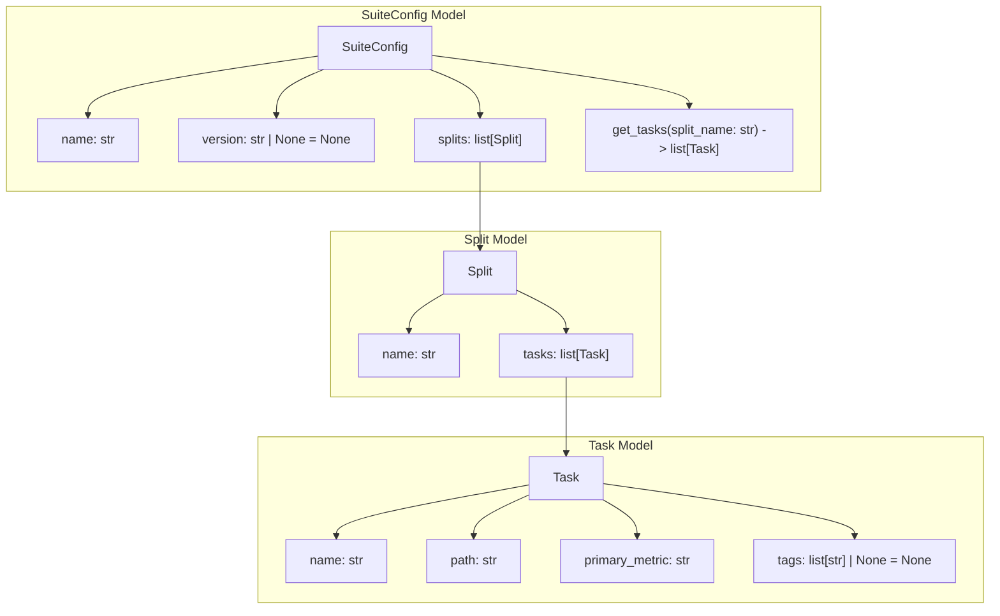

Sources: [src/agenteval/config.py:9-62]()

### Field Descriptions

| Model | Field | Type | Description |
|-------|-------|------|-------------|
| `SuiteConfig` | `name` | `str` | Name of the evaluation suite |
| `SuiteConfig` | `version` | `str \| None` | Version of the suite (e.g., '1.0.0.dev1') |
| `SuiteConfig` | `splits` | `list[Split]` | List of splits in the suite |
| `Split` | `name` | `str` | Name of the split (e.g., 'validation', 'test') |
| `Split` | `tasks` | `list[Task]` | List of tasks associated with the split |
| `Task` | `name` | `str` | Canonical task name used by the leaderboard |
| `Task` | `path` | `str` | Path to the task definition used by Inspect AI |
| `Task` | `primary_metric` | `str` | Primary metric for the task, used for summary scores |
| `Task` | `tags` | `list[str] \| None` | List of tags for computing summary scores for task groups |

Sources: [src/agenteval/config.py:9-40]()

## Configuration Loading Process

The configuration loading process involves file parsing, YAML validation, and Pydantic model validation:

### Configuration Loading Flow

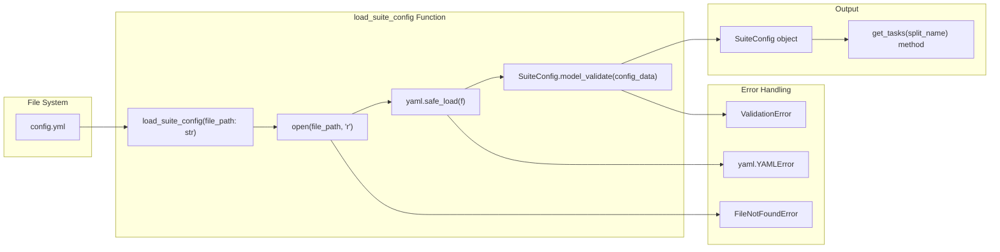

Sources: [src/agenteval/config.py:64-87]()

### Loading Configuration Files

The `load_suite_config` function handles configuration file loading with comprehensive error handling:

```python
# Example usage (do not copy this code)
config = load_suite_config("path/to/config.yml")
validation_tasks = config.get_tasks("validation")
```

The function performs the following validation steps:

1. **File Existence**: Checks if the configuration file exists
2. **YAML Parsing**: Validates YAML syntax using `yaml.safe_load`
3. **Schema Validation**: Uses Pydantic `model_validate` to ensure data structure compliance
4. **Split Access**: Provides `get_tasks()` method for retrieving tasks by split name

Sources: [src/agenteval/config.py:64-87]()

## Configuration Best Practices

### Task Naming and Organization

- Use descriptive task names that clearly identify the evaluation scenario
- Organize tasks into logical splits (e.g., `validation`, `test`, `dev`)
- Use consistent naming conventions across your evaluation suite

### Primary Metrics

The `primary_metric` field should reference a scorer and metric combination that will be computed during evaluation:

- Format: `'scorer_name/metric_name'`
- Examples: `'my_scorer/accuracy'`, `'my_scorer/mean'`, `'standard_scorer/f1'`
- This metric is used for generating summary statistics and leaderboard rankings

### Tags for Task Grouping

Tags enable grouping related tasks for aggregate scoring:

- Use tags to group tasks by domain, difficulty, or evaluation type
- Tags are used when computing summary scores across task groups
- Multiple tags can be assigned to a single task

### Version Management

- Use semantic versioning for suite versions (e.g., `"1.0.0"`, `"2.1.0-dev"`)
- Include version information to track evaluation suite evolution
- Version field is optional but recommended for reproducibility

Sources: [src/agenteval/config.py:16-20](), [sample-config.yml:1-21]()

---

# Page: Running Evaluations

# Running Evaluations

<details>
<summary>Relevant source files</summary>

The following files were used as context for generating this wiki page:

- [README.md](README.md)
- [src/agenteval/cli.py](src/agenteval/cli.py)
- [src/agenteval/summary.py](src/agenteval/summary.py)
- [tests/test_summary_utils.py](tests/test_summary_utils.py)

</details>


This page provides a step-by-step guide through the core evaluation workflow in agent-eval. The evaluation process consists of three sequential stages: `eval`, `score`, and `publish`. Each stage transforms evaluation data and produces outputs that feed into the next stage.

For information about configuring evaluation suites, see [Configuration](#3.1). For detailed CLI command reference, see [CLI Reference](#3.3).

## Workflow Overview

The agent-eval system implements a three-stage pipeline that transforms evaluation configurations into published leaderboard results:

**Evaluation Workflow**
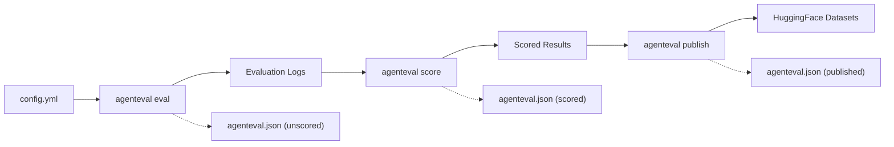

Each stage operates on the `agenteval.json` file in the log directory, progressively enriching it with evaluation data, computed metrics, and publication metadata.

Sources: [src/agenteval/cli.py:95-433]()

## Stage 1: Running Evaluations

The `eval` command executes evaluation tasks using Inspect AI and creates the initial log directory structure.

**Evaluation Execution Flow**
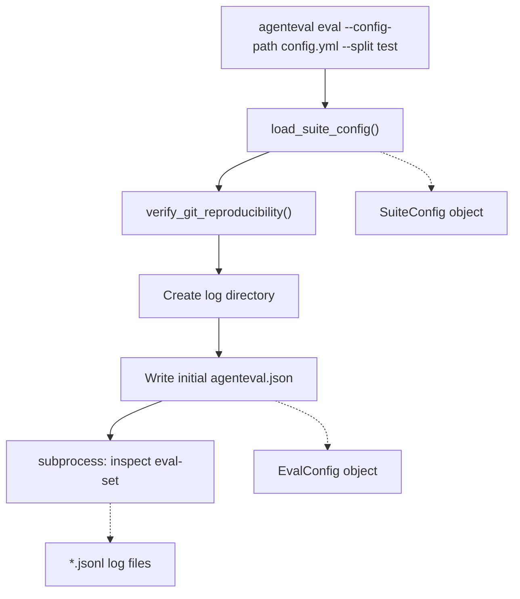

### Key Operations

The `eval_command` function performs these operations:

1. **Configuration Loading**: Uses `load_suite_config()` to parse the YAML configuration file [src/agenteval/cli.py:380]()
2. **Git Reproducibility Check**: Calls `verify_git_reproducibility()` to ensure the codebase state can be reproduced [src/agenteval/cli.py:384]()
3. **Log Directory Creation**: Creates a timestamped log directory if none is specified [src/agenteval/cli.py:389-395]()
4. **Initial JSON Creation**: Writes an `EvalConfig` object to `agenteval.json` [src/agenteval/cli.py:401-403]()
5. **Inspect AI Execution**: Runs `inspect eval-set` as a subprocess with the configured tasks [src/agenteval/cli.py:408-416]()

### File Outputs

After successful evaluation:
- Log directory contains `.jsonl` files with detailed evaluation logs
- `agenteval.json` contains basic configuration (`EvalConfig` object)
- Directory structure: `logs/{suite}_{version}_{split}_{timestamp}/`

Sources: [src/agenteval/cli.py:371-428](), [src/agenteval/cli.py:20-92]()

## Stage 2: Scoring Results

The `score` command processes evaluation logs, extracts metrics, and computes summary statistics.

**Scoring Data Flow**
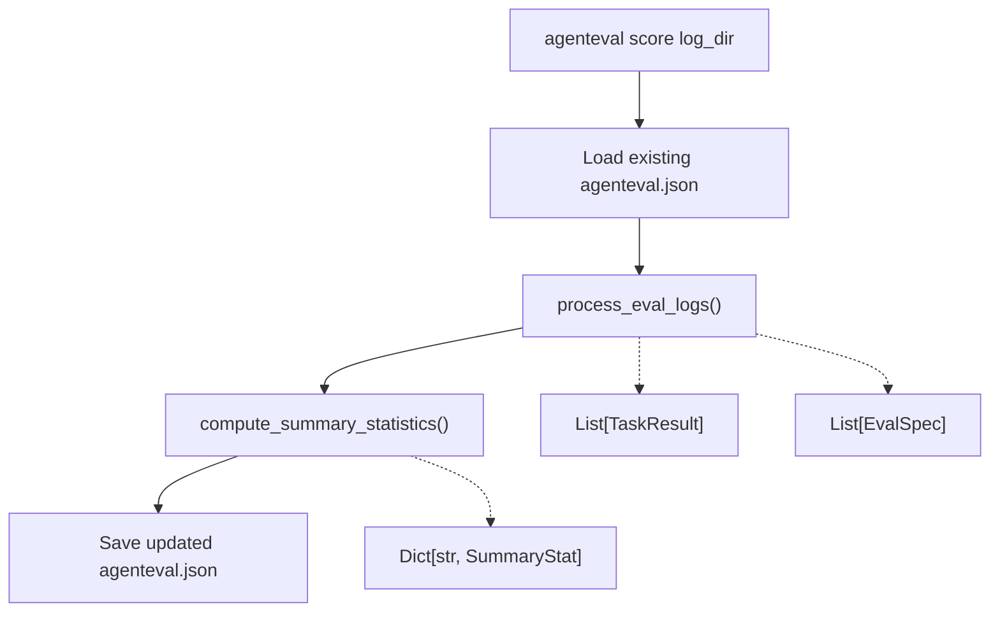

### Processing Operations

The `score_command` function orchestrates several data processing steps:

1. **Load Existing Results**: Loads `EvalResult` from `agenteval.json` or creates new one [src/agenteval/cli.py:124-155]()
2. **Log Processing**: Calls `process_eval_logs()` to extract `TaskResult` objects from log files [src/agenteval/cli.py:157]()
3. **Statistics Computation**: Uses `compute_summary_statistics()` to aggregate metrics [src/agenteval/cli.py:174-178]()
4. **Validation**: Checks for missing tasks and processing errors [src/agenteval/cli.py:169-171](), [src/agenteval/cli.py:182-184]()
5. **Persistence**: Saves the enriched `EvalResult` back to `agenteval.json` [src/agenteval/cli.py:187]()

### Data Transformations

The scoring stage transforms raw log data into structured metrics:

| Input | Processing Function | Output |
|-------|-------------------|---------|
| `.jsonl` log files | `process_eval_logs()` | `List[TaskResult]` with metrics and costs |
| `TaskResult` objects | `compute_summary_statistics()` | `Dict[str, SummaryStat]` for tasks, tags, and overall |
| Raw cost data | Cost extraction via LiteLLM | `model_costs` field in `TaskResult` |

Sources: [src/agenteval/cli.py:118-194](), [src/agenteval/summary.py:38-118]()

## Stage 3: Publishing Results

The `publish` command uploads scored results to HuggingFace datasets for leaderboard integration.

**Publication Upload Flow**
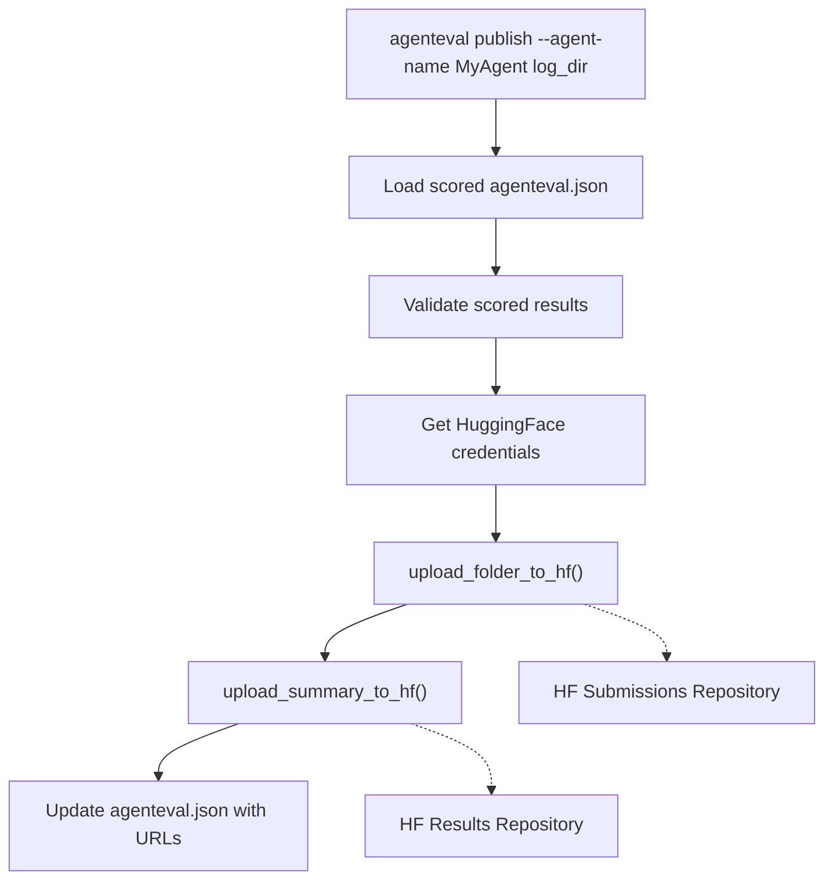

### Publication Operations

The `publish_command` function handles the upload workflow:

1. **Result Validation**: Ensures `agenteval.json` contains scored results via `is_scored()` [src/agenteval/cli.py:268-270]()
2. **HuggingFace Authentication**: Gets user credentials via `HfApi.whoami()` [src/agenteval/cli.py:277-286]()
3. **Metadata Population**: Fills `submission` fields with agent information and timestamp [src/agenteval/cli.py:297-301]()
4. **Log Upload**: Uses `upload_folder_to_hf()` to upload entire log directory [src/agenteval/cli.py:313-316]()
5. **Summary Upload**: Uses `upload_summary_to_hf()` to upload processed results [src/agenteval/cli.py:319-323]()
6. **Final Update**: Saves publication URLs back to `agenteval.json` [src/agenteval/cli.py:326-327]()

### Repository Structure

Published data is organized in HuggingFace repositories:

```
submissions-repo/
└── {config_name}/
    └── {split}/
        └── {username}_{agent_name}_{timestamp}/
            ├── agenteval.json
            ├── task1.jsonl
            └── task2.jsonl

results-repo/
└── {config_name}/
    └── {split}/
        └── {username}_{agent_name}_{timestamp}.json
```

Sources: [src/agenteval/cli.py:240-328](), [src/agenteval/upload.py]()

## File State Transitions

The `agenteval.json` file evolves through distinct states during the workflow:

**agenteval.json Evolution**
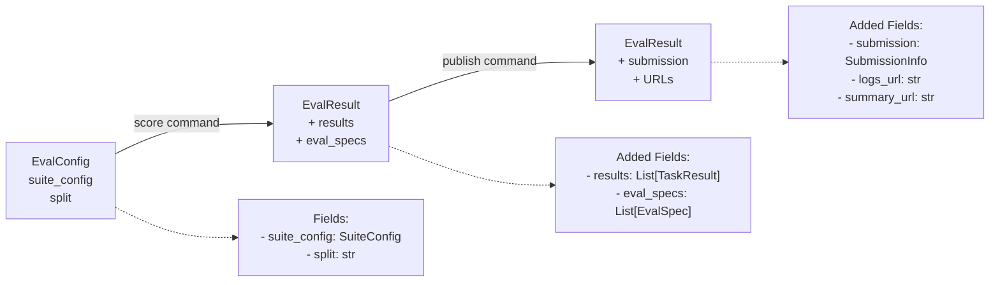

Each stage validates the expected file state and adds new data:

| Stage | Input State | Validation | Output State |
|-------|-------------|------------|--------------|
| `eval` | None | Config file exists | `EvalConfig` object created |
| `score` | `EvalConfig` or `EvalResult` | Log files present | `EvalResult` with metrics |
| `publish` | `EvalResult` | `is_scored()` returns true | `EvalResult` with publication metadata |

Sources: [src/agenteval/models.py](), [src/agenteval/cli.py:124-128](), [src/agenteval/cli.py:268-270]()

## Error Handling and Troubleshooting

The workflow includes several validation and error handling mechanisms:

### Git Reproducibility Checks

The `verify_git_reproducibility()` function enforces reproducible evaluations:
- Checks for uncommitted changes [src/agenteval/cli.py:65-70]()
- Warns about untracked files [src/agenteval/cli.py:58-62]()
- Verifies commit exists on remote [src/agenteval/cli.py:74-85]()

### Scoring Validation

The scoring stage performs comprehensive validation:
- Checks for missing tasks via `find_missing_tasks()` [src/agenteval/cli.py:169-171]()
- Warns about multiple evaluation specs [src/agenteval/cli.py:162-166]()
- Aborts on metric computation errors [src/agenteval/cli.py:182-184]()

### Publication Requirements

The publish command validates upload readiness:
- Ensures results are scored [src/agenteval/cli.py:268-270]()
- Validates suite config version [src/agenteval/cli.py:304-306]()
- Requires HuggingFace authentication [src/agenteval/cli.py:284-286]()

Common error scenarios and their resolutions:

| Error | Cause | Resolution |
|-------|-------|------------|
| "Git working directory contains uncommitted changes" | Dirty git state | Commit changes or use `--ignore-git` |
| "No scored results found" | Running publish before score | Run `agenteval score` first |
| "Missing tasks in result set" | Incomplete evaluation logs | Re-run evaluation or check task configuration |

Sources: [src/agenteval/cli.py:20-92](), [src/agenteval/cli.py:169-171](), [src/agenteval/cli.py:268-270]()

---

# Page: CLI Reference

# CLI Reference

<details>
<summary>Relevant source files</summary>

The following files were used as context for generating this wiki page:

- [src/agenteval/cli.py](src/agenteval/cli.py)

</details>


This document provides comprehensive reference documentation for all `agenteval` command-line interface commands and their options. The CLI provides a three-stage pipeline for agent evaluation: `eval` → `score` → `publish`.

For configuration file format and schema details, see [Configuration](#3.1). For step-by-step usage guidance, see [Running Evaluations](#3.2).

## Command Overview

The `agenteval` CLI provides three main commands that form a sequential workflow:

### CLI Command Flow

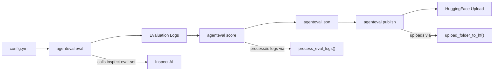

**Sources:** [src/agenteval/cli.py:95-433]()

## eval Command

Executes agent evaluations using Inspect AI's `eval-set` command with specified configuration and tasks.

### Syntax
```bash
agenteval eval --config-path CONFIG --split SPLIT [OPTIONS] [INSPECT_ARGS...]
```

### Required Arguments

| Option | Type | Description |
|--------|------|-------------|
| `--config-path` | string | Path to YAML configuration file |
| `--split` | string | Configuration data split to evaluate |

### Optional Arguments

| Option | Type | Default | Description |
|--------|------|---------|-------------|
| `--log-dir` | string | Auto-generated | Directory for evaluation logs |
| `--ignore-git` | flag | false | Skip git reproducibility checks |
| `--display` | string | "plain" | Display format for inspect output |
| `[INSPECT_ARGS...]` | various | - | Additional arguments passed to `inspect eval-set` |

### Behavior

1. **Git Reproducibility Check**: Validates working directory is clean and committed (unless `--ignore-git` specified)
2. **Task Resolution**: Loads tasks from configuration file based on split
3. **Log Directory Creation**: Auto-generates timestamped directory if not specified
4. **Evaluation Execution**: Calls `inspect eval-set` with resolved tasks and arguments
5. **Result Initialization**: Creates initial `agenteval.json` with configuration metadata

### Implementation Details

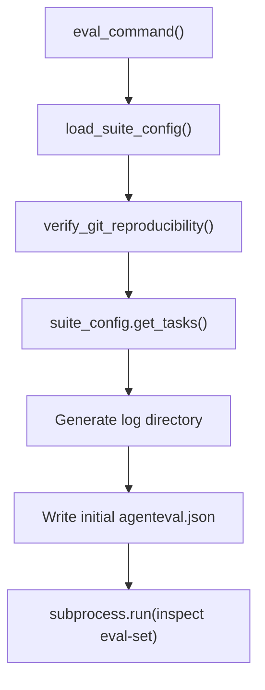

**Sources:** [src/agenteval/cli.py:333-428](), [src/agenteval/cli.py:20-92]()

## score Command

Processes evaluation logs and computes summary statistics, storing results in `agenteval.json`.

### Syntax
```bash
agenteval score LOG_DIR [OPTIONS]
```

### Required Arguments

| Argument | Type | Description |
|----------|------|-------------|
| `LOG_DIR` | path | Directory containing evaluation logs |

### Optional Arguments

| Option | Type | Description |
|--------|------|-------------|
| `--config-path` | string | Path to YAML config (ignored if `agenteval.json` exists) |
| `--split` | string | Config data split (ignored if `agenteval.json` exists) |

### Behavior

1. **Result Loading**: Loads existing `agenteval.json` if present, otherwise creates new `EvalResult`
2. **Log Processing**: Calls `process_eval_logs()` to extract task results and evaluation specs
3. **Statistics Computation**: Generates summary statistics via `compute_summary_statistics()`
4. **Validation**: Checks for missing tasks and multiple evaluation specs
5. **Persistence**: Saves updated results to `agenteval.json`

### Data Processing Pipeline

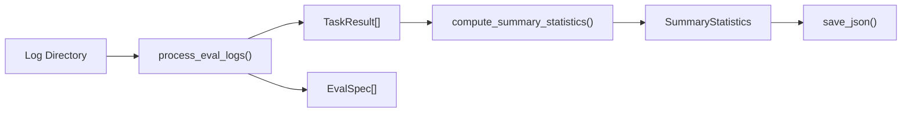

**Sources:** [src/agenteval/cli.py:100-196]()

## publish Command

Uploads scored evaluation results to HuggingFace Hub for leaderboard integration.

### Syntax
```bash
agenteval publish LOG_DIR --agent-name NAME [OPTIONS]
```

### Required Arguments

| Argument/Option | Type | Description |
|-----------------|------|-------------|
| `LOG_DIR` | path | Directory containing scored results |
| `--agent-name` | string | Descriptive name for the agent submission |

### Optional Arguments

| Option | Type | Default | Description |
|--------|------|---------|-------------|
| `--submissions-repo-id` | string | `$SUBMISSIONS_REPO_ID` | HF repository for submission logs |
| `--results-repo-id` | string | `$RESULTS_REPO_ID` | HF repository for result summaries |
| `--username` | string | HF account name | HF username/organization |
| `--agent-description` | string | - | Description of the agent |
| `--agent-url` | string | - | URL to agent repository/docs |

### Upload Process

```mermaid
graph TB
    LOAD["Load agenteval.json"]
    VALIDATE["Validate scored results"]
    HFAUTH["HfApi authentication"]
    SANITIZE["sanitize_path_component()"]
    METADATA["Fill submission metadata"]
    UPLOAD_LOGS["upload_folder_to_hf()"]
    UPLOAD_SUMMARY["upload_summary_to_hf()"]
    UPDATE_JSON["Update agenteval.json"]
    
    LOAD --> VALIDATE
    VALIDATE --> HFAUTH
    HFAUTH --> SANITIZE
    SANITIZE --> METADATA
    METADATA --> UPLOAD_LOGS
    UPLOAD_LOGS --> UPLOAD_SUMMARY
    UPLOAD_SUMMARY --> UPDATE_JSON
```

### File Organization

Submissions are organized in HuggingFace repositories as:
```
{config_name}/{split}/{username}_{agent_name}_{timestamp}/
├── logs/           # Evaluation logs
└── summary.json    # Summary statistics
```

**Sources:** [src/agenteval/cli.py:199-330]()

## Git Reproducibility

The `eval` command enforces git reproducibility by default to ensure evaluation results can be reproduced.

### Verification Process

```mermaid
graph TD
    CHECK_DIRTY["Check git diff --quiet"]
    CHECK_UNTRACKED["Check untracked files"]
    GET_SHA["Get commit SHA"]
    CHECK_REMOTE["Verify SHA on remote"]
    
    CHECK_DIRTY --> |"dirty"| ERROR["ClickException: Uncommitted changes"]
    CHECK_DIRTY --> |"clean"| CHECK_UNTRACKED
    CHECK_UNTRACKED --> |"present"| WARN["Warning: Untracked files"]
    CHECK_UNTRACKED --> GET_SHA
    WARN --> GET_SHA
    GET_SHA --> CHECK_REMOTE
    CHECK_REMOTE --> |"not found"| ERROR2["ClickException: SHA not on remote"]
    CHECK_REMOTE --> |"found"| SUCCESS["Validation passed"]
```

### Requirements

- Working directory must be clean (no uncommitted changes)
- Current commit must exist on remote repository
- Warns about untracked files (but doesn't fail)

Use `--ignore-git` to bypass these checks (not recommended for production evaluations).

**Sources:** [src/agenteval/cli.py:20-92]()

## Error Handling

### Common Error Scenarios

| Command | Error Condition | Solution |
|---------|----------------|----------|
| `eval` | Git working directory dirty | Commit changes or use `--ignore-git` |
| `eval` | Commit not on remote | Push changes or use `--ignore-git` |
| `score` | Missing `agenteval.json` and no config | Provide `--config-path` and `--split` |
| `score` | Split mismatch | Ensure CLI split matches JSON split |
| `publish` | No scored results | Run `score` command first |
| `publish` | Missing HF authentication | Configure HuggingFace Hub authentication |

### Exit Codes

- `0`: Success
- `1`: Error during execution (via `click.ClickException` or `sys.exit(1)`)

**Sources:** [src/agenteval/cli.py:65-92](), [src/agenteval/cli.py:130-153](), [src/agenteval/cli.py:262-286]()

## File Outputs

### agenteval.json Structure

The CLI commands work with a central `agenteval.json` file that evolves through the workflow:

1. **After `eval`**: Contains `EvalConfig` with suite configuration and split
2. **After `score`**: Enhanced with `TaskResult[]`, `EvalSpec[]`, and scoring metadata  
3. **After `publish`**: Includes submission metadata and HuggingFace URLs

### Constants

- `EVAL_FILENAME = "agenteval.json"` - Standard filename for results

**Sources:** [src/agenteval/cli.py:17](), [src/agenteval/cli.py:400-403](), [src/agenteval/cli.py:186-187](), [src/agenteval/cli.py:325-327]()

---

# Page: Architecture

# Architecture

<details>
<summary>Relevant source files</summary>

The following files were used as context for generating this wiki page:

- [src/agenteval/cli.py](src/agenteval/cli.py)
- [src/agenteval/models.py](src/agenteval/models.py)

</details>


This document provides a deep dive into agent-eval's internal architecture, covering the core components, data flow, and design patterns that enable the system's three-stage evaluation pipeline. 

For information about using the CLI commands, see [CLI Reference](#3.3). For details about individual data processing steps, see [Data Processing Pipeline](#4.1). For external system integrations, see [External Integrations](#4.2).

## System Overview

Agent-eval implements a three-stage pipeline architecture that transforms agent evaluation configurations into published leaderboard results. The system is designed as an orchestration layer that coordinates between existing tools like Inspect AI, LiteLLM, and HuggingFace Hub.

### Core Pipeline Architecture

```mermaid
graph TB
    subgraph "CLI Layer"
        CLI["cli.py"]
        eval_command["eval_command()"]
        score_command["score_command()"] 
        publish_command["publish_command()"]
    end
    
    subgraph "Data Models"
        EvalConfig["EvalConfig"]
        EvalResult["EvalResult"]
        SubmissionMetadata["SubmissionMetadata"]
    end
    
    subgraph "Processing Modules"
        config_module["config.py"]
        score_module["score.py"]
        summary_module["summary.py"]
        upload_module["upload.py"]
    end
    
    subgraph "External Systems"
        InspectAI["Inspect AI"]
        HuggingFace["HuggingFace Hub"]
        LiteLLM["LiteLLM"]
    end
    
    CLI --> eval_command
    CLI --> score_command
    CLI --> publish_command
    
    eval_command --> config_module
    eval_command --> InspectAI
    eval_command --> EvalConfig
    
    score_command --> score_module
    score_command --> summary_module
    score_command --> EvalResult
    
    publish_command --> upload_module
    publish_command --> HuggingFace
    publish_command --> SubmissionMetadata
    
    score_module --> LiteLLM
    config_module --> EvalConfig
    EvalResult --> SubmissionMetadata
```

*Sources: [src/agenteval/cli.py:95-433](), [src/agenteval/models.py:1-90]()*

The architecture follows a clear separation of concerns where the CLI layer orchestrates the pipeline, data models provide structure, and processing modules handle the core logic.

## Data Flow Through Pipeline Stages

The system processes evaluation data through three distinct stages, each with specific inputs, outputs, and responsibilities.

### Three-Stage Data Transformation

```mermaid
graph LR
    subgraph "Stage 1: eval"
        YAMLConfig["YAML Config"]
        eval_command_func["eval_command()"]
        InspectEval["inspect eval-set"]
        RawLogs["Raw Logs"]
        agenteval_json["agenteval.json"]
    end
    
    subgraph "Stage 2: score"
        score_command_func["score_command()"]
        process_eval_logs["process_eval_logs()"]
        TaskResult["TaskResult[]"]
        compute_summary["compute_summary_statistics()"]
        ScoredResult["Scored EvalResult"]
    end
    
    subgraph "Stage 3: publish"
        publish_command_func["publish_command()"]
        upload_folder["upload_folder_to_hf()"]
        upload_summary["upload_summary_to_hf()"]
        HFLeaderboard["HF Leaderboard"]
    end
    
    YAMLConfig --> eval_command_func
    eval_command_func --> InspectEval
    InspectEval --> RawLogs
    eval_command_func --> agenteval_json
    
    RawLogs --> score_command_func
    agenteval_json --> score_command_func
    score_command_func --> process_eval_logs
    process_eval_logs --> TaskResult
    TaskResult --> compute_summary
    compute_summary --> ScoredResult
    
    ScoredResult --> publish_command_func
    publish_command_func --> upload_folder
    publish_command_func --> upload_summary
    upload_folder --> HFLeaderboard
    upload_summary --> HFLeaderboard
```

*Sources: [src/agenteval/cli.py:333-428](), [src/agenteval/cli.py:100-195](), [src/agenteval/cli.py:199-329]()*

Each stage produces artifacts that serve as inputs to the next stage, with `agenteval.json` serving as the central state file that accumulates data throughout the pipeline.

## Core Components and Responsibilities

### CLI Command Layer

The CLI layer in [src/agenteval/cli.py]() provides the primary interface and orchestrates all system operations. Each command has distinct responsibilities:

| Command | Function | Primary Responsibility |
|---------|----------|----------------------|
| `eval` | `eval_command()` | Execute evaluations via Inspect AI and initialize result tracking |
| `score` | `score_command()` | Process evaluation logs into structured results and compute metrics |
| `publish` | `publish_command()` | Upload results to HuggingFace and update leaderboards |

*Sources: [src/agenteval/cli.py:333-428](), [src/agenteval/cli.py:100-195](), [src/agenteval/cli.py:199-329]()*

### Data Model Layer

The data models in [src/agenteval/models.py]() provide the core data structures that flow through the system:

```mermaid
classDiagram
    class EvalConfig {
        +SuiteConfig suite_config
        +str split
    }
    
    class EvalResult {
        +list[EvalSpec] eval_specs
        +list[TaskResult] results
        +SubmissionMetadata submission
        +find_missing_tasks() list[str]
        +is_scored() bool
        +save_json() None
    }
    
    class SubmissionMetadata {
        +datetime submit_time
        +str username
        +str agent_name
        +str agent_description
        +str agent_url
        +str logs_url
        +str summary_url
    }
    
    EvalConfig <|-- EvalResult
    EvalResult *-- SubmissionMetadata
```

*Sources: [src/agenteval/models.py:12-18](), [src/agenteval/models.py:33-89](), [src/agenteval/models.py:20-31]()*

`EvalResult` serves as the central data structure that accumulates information throughout the pipeline, starting as a simple `EvalConfig` and growing to include results and submission metadata.

## State Management and Persistence

The system uses a file-based state management approach centered around the `agenteval.json` file, which serves as the persistent state store throughout the evaluation pipeline.

### State File Evolution

```mermaid
graph TB
    subgraph "eval Stage"
        InitialState["EvalConfig(suite_config, split)"]
        SaveInitial["save to agenteval.json"]
    end
    
    subgraph "score Stage"
        LoadState["load from agenteval.json"]
        AddResults["+ eval_specs, results"]
        SaveScored["save scored EvalResult"]
    end
    
    subgraph "publish Stage"
        LoadScored["load scored EvalResult"]
        AddSubmission["+ submission metadata"]
        SaveFinal["save final EvalResult"]
    end
    
    InitialState --> SaveInitial
    SaveInitial --> LoadState
    LoadState --> AddResults
    AddResults --> SaveScored
    SaveScored --> LoadScored
    LoadScored --> AddSubmission
    AddSubmission --> SaveFinal
```

*Sources: [src/agenteval/cli.py:400-403](), [src/agenteval/cli.py:124-155](), [src/agenteval/cli.py:260-327](), [src/agenteval/models.py:57-89]()*

The constant `EVAL_FILENAME = "agenteval.json"` [src/agenteval/cli.py:17]() defines the standard filename used across all commands for state persistence.

## Reproducibility and Validation

Agent-eval implements several mechanisms to ensure evaluation reproducibility and result validation.

### Git Reproducibility Verification

```mermaid
graph TB
    eval_start["eval command starts"]
    ignore_git{"--ignore-git flag?"}
    git_check["verify_git_reproducibility()"]
    
    subgraph "Git Validation"
        check_sha["get commit SHA"]
        check_origin["get remote origin"]
        check_dirty["check working directory"]
        check_untracked["check untracked files"]
        check_remote["verify commit on remote"]
    end
    
    validation_pass["validation passes"]
    abort_dirty["abort: uncommitted changes"]
    abort_unpushed["abort: commit not on remote"]
    proceed["proceed with evaluation"]
    
    eval_start --> ignore_git
    ignore_git -->|false| git_check
    ignore_git -->|true| proceed
    
    git_check --> check_sha
    check_sha --> check_origin
    check_origin --> check_dirty
    check_dirty --> check_untracked
    check_untracked --> check_remote
    
    check_remote --> validation_pass
    check_dirty -->|dirty| abort_dirty
    check_remote -->|not on remote| abort_unpushed
    validation_pass --> proceed
```

*Sources: [src/agenteval/cli.py:20-92](), [src/agenteval/cli.py:383-384]()*

The `verify_git_reproducibility()` function ensures that evaluations can be reproduced by requiring a clean working directory and verifying that the current commit exists on the remote repository.

## External System Integration Points

Agent-eval integrates with external systems through well-defined interfaces that abstract away implementation details.

### Integration Architecture

```mermaid
graph TB
    subgraph "agent-eval Core"
        eval_cmd["eval_command()"]
        score_cmd["score_command()"]  
        publish_cmd["publish_command()"]
    end
    
    subgraph "Inspect AI Integration"
        subprocess_call["subprocess.run()"]
        inspect_eval_set["inspect eval-set"]
        log_output["evaluation logs"]
    end
    
    subgraph "HuggingFace Integration"
        HfApi["HfApi()"]
        upload_folder_to_hf["upload_folder_to_hf()"]
        upload_summary_to_hf["upload_summary_to_hf()"]
    end
    
    subgraph "LiteLLM Integration"
        process_eval_logs_func["process_eval_logs()"]
        cost_extraction["cost computation"]
    end
    
    eval_cmd --> subprocess_call
    subprocess_call --> inspect_eval_set
    inspect_eval_set --> log_output
    
    score_cmd --> process_eval_logs_func
    process_eval_logs_func --> cost_extraction
    
    publish_cmd --> HfApi
    HfApi --> upload_folder_to_hf
    HfApi --> upload_summary_to_hf
```

*Sources: [src/agenteval/cli.py:408-421](), [src/agenteval/cli.py:249-250](), [src/agenteval/cli.py:277-278](), [src/agenteval/cli.py:313-323]()*

The system uses subprocess calls to Inspect AI rather than direct imports, maintaining loose coupling and allowing for independent evolution of the evaluation framework.

## Key Architectural Patterns

Agent-eval employs several key architectural patterns that enable its functionality:

1. **Pipeline Architecture**: Clear three-stage processing with distinct responsibilities
2. **State Accumulation**: Central state file that grows through pipeline stages  
3. **External Tool Orchestration**: Coordinates existing tools rather than reimplementing functionality
4. **Reproducibility-First Design**: Git-based validation ensures evaluations can be reproduced
5. **Schema-Driven Development**: Pydantic models serve as the contract between components

For detailed information about data processing within each stage, see [Data Processing Pipeline](#4.1). For specifics about external integrations, see [External Integrations](#4.2). For data model details, see [Data Models](#4.4).

*Sources: [src/agenteval/cli.py:1-433](), [src/agenteval/models.py:1-90]()*

---

# Page: Data Processing Pipeline

# Data Processing Pipeline

<details>
<summary>Relevant source files</summary>

The following files were used as context for generating this wiki page:

- [src/agenteval/log.py](src/agenteval/log.py)
- [src/agenteval/score.py](src/agenteval/score.py)
- [src/agenteval/summary.py](src/agenteval/summary.py)
- [tests/test_summary_utils.py](tests/test_summary_utils.py)

</details>


This document describes how agent-eval transforms raw evaluation logs into structured results and summary statistics. The data processing pipeline consists of three main stages: log processing, model usage computation, and summary statistics generation. For information about external integrations with Inspect AI and LiteLLM, see [External Integrations](#4.2). For details about the data models used throughout the pipeline, see [Data Models](#4.4).

## Pipeline Overview

The data processing pipeline takes raw evaluation logs generated by Inspect AI and transforms them through multiple stages to produce structured results suitable for analysis and publication.

### Core Data Flow

```mermaid
graph TD
    A["Raw Eval Logs"] --> B["process_eval_logs()"]
    B --> C["TaskResult Objects"]
    C --> D["compute_summary_statistics()"]
    D --> E["SummaryStat Objects"]
    
    subgraph "score.py"
        B
        F["get_metrics()"]
        G["get_model_usages()"]
        H["EvalSpec.from_eval_log()"]
    end
    
    subgraph "log.py"
        I["collect_model_usage()"]
        J["compute_model_cost()"]
    end
    
    subgraph "summary.py"
        D
        K["_safe_mean()"]
        L["_safe_stderr()"]
    end
    
    B --> F
    B --> G
    B --> H
    G --> I
    I --> J
    D --> K
    D --> L
```

*Sources: [src/agenteval/score.py:101-160](), [src/agenteval/log.py:21-92](), [src/agenteval/summary.py:38-118]()*

## Log Processing Stage

The log processing stage is implemented in [src/agenteval/score.py]() and serves as the entry point for transforming raw Inspect AI evaluation logs into structured `TaskResult` objects.

### Process Evaluation Logs Function

The `process_eval_logs()` function is the main orchestrator that reads evaluation logs from a directory and processes them into structured results:

```mermaid
graph TD
    A["log_dir"] --> B["list_eval_logs()"]
    B --> C["read_eval_log()"]
    C --> D["get_normalized_task_name()"]
    D --> E["EvalSpec.from_eval_log()"]
    C --> F["get_metrics()"]
    C --> G["get_model_usages()"]
    G --> H["compute_model_cost()"]
    
    F --> I["TaskResult"]
    G --> I
    H --> I
    E --> J["List[EvalSpec]"]
    I --> K["List[TaskResult]"]
    
    subgraph "Return Values"
        K
        J
        L["had_errors: bool"]
    end
```

*Sources: [src/agenteval/score.py:101-160]()*

### Key Processing Steps

| Step | Function | Purpose |
|------|----------|---------|
| Log Discovery | `list_eval_logs()` | Find all evaluation log files in directory |
| Log Reading | `read_eval_log()` | Parse individual log files |
| Task Normalization | `get_normalized_task_name()` | Remove namespace prefixes from task names |
| Metrics Extraction | `get_metrics()` | Extract performance metrics from log results |
| Usage Collection | `get_model_usages()` | Collect model usage data for cost computation |
| Spec Generation | `EvalSpec.from_eval_log()` | Create evaluation specification objects |

### TaskResult Structure

The `TaskResult` class encapsulates all processed data for a single evaluation task:

- `task_name`: Normalized task identifier
- `metrics`: List of `Metric` objects with names and values
- `model_usages`: Optional list of model usage data per sample
- `model_costs`: Optional list of computed costs per sample

*Sources: [src/agenteval/score.py:47-61](), [src/agenteval/score.py:63-79](), [src/agenteval/score.py:82-88](), [src/agenteval/score.py:91-98]()*

## Model Usage and Cost Computation

The model usage and cost computation logic is implemented in [src/agenteval/log.py]() and handles the complex task of extracting usage statistics and computing costs from evaluation logs.

### Model Usage Collection

The `collect_model_usage()` function extracts model usage data from individual evaluation samples:

```mermaid
graph TD
    A["EvalSample"] --> B["Iterate Events"]
    B --> C{"Event Type?"}
    C -->|"StepEvent (scorer)"| D["Break - Exclude Scorer"]
    C -->|"ModelEvent"| E{"Has Usage?"}
    E -->|"Yes"| F["ModelUsageWithName"]
    E -->|"No"| B
    F --> G["Usage List"]
    
    subgraph "ModelUsageWithName"
        H["model: str"]
        I["usage: ModelUsage"]
    end
    
    F --> H
    F --> I
```

*Sources: [src/agenteval/log.py:21-35]()*

### Cost Computation Algorithm

The `compute_model_cost()` function implements sophisticated cost calculation that handles cached tokens:

```mermaid
graph TD
    A["List[ModelUsageWithName]"] --> B["For Each Usage"]
    B --> C["Extract Token Counts"]
    C --> D["Determine Token Pattern"]
    D --> E{"Pattern Type?"}
    E -->|"Inclusive Cache"| F["text_tokens = input - cache_read"]
    E -->|"Exclusive Cache"| G["text_tokens = input_tokens"]
    F --> H["Create PromptTokensDetailsWrapper"]
    G --> H
    H --> I["Build litellm Usage Object"]
    I --> J["cost_per_token()"]
    J --> K["Add to Total Cost"]
    K --> L{"More Usages?"}
    L -->|"Yes"| B
    L -->|"No"| M["Return Total Cost"]
```

The cost computation handles two token counting patterns:
- **Inclusive Pattern**: Input tokens include cached tokens (requires subtraction)
- **Exclusive Pattern**: Input tokens exclude cached tokens (Anthropic style)

*Sources: [src/agenteval/log.py:38-92]()*

## Summary Statistics Generation

The summary statistics stage, implemented in [src/agenteval/summary.py](), aggregates individual task results into meaningful summary statistics across different dimensions.

### Summary Computation Architecture

```mermaid
graph TD
    A["SuiteConfig"] --> B["compute_summary_statistics()"]
    C["TaskResult List"] --> B
    D["split"] --> B
    
    B --> E["Per-Task Statistics"]
    B --> F["Per-Tag Statistics"] 
    B --> G["Overall Statistics"]
    
    E --> H["SummaryStat Objects"]
    F --> H
    G --> H
    
    subgraph "Helper Functions"
        I["_safe_mean()"]
        J["_safe_stderr()"]
    end
    
    B --> I
    B --> J
    
    subgraph "SummaryStat Fields"
        K["score: float | None"]
        L["score_stderr: float | None"]
        M["cost: float | None"]
        N["cost_stderr: float | None"]
    end
    
    H --> K
    H --> L
    H --> M
    H --> N
```

*Sources: [src/agenteval/summary.py:38-118](), [src/agenteval/summary.py:11-16]()*

### Statistical Aggregation Logic

The summary system computes three types of aggregated statistics:

| Aggregation Type | Key Pattern | Purpose |
|------------------|-------------|---------|
| Per-Task | `task/{task_name}` | Individual task performance |
| Per-Tag | `tag/{tag_name}` | Performance grouped by task tags |
| Overall | `overall` | Aggregate performance across all tasks |

### Safe Statistical Functions

The pipeline implements robust statistical functions that handle missing data:

- `_safe_mean()`: Computes mean with different handling for scores (treats `None` as 0) vs costs (requires all values)
- `_safe_stderr()`: Computes standard error, returning `None` if any values are missing or insufficient data

*Sources: [src/agenteval/summary.py:18-36](), [tests/test_summary_utils.py:8-41]()*

## Error Handling and Data Quality

The pipeline implements comprehensive error handling to ensure data quality:

### Validation Checks

```mermaid
graph TD
    A["Input Validation"] --> B{"Duplicate Tasks?"}
    B -->|"Yes"| C["Raise ValueError"]
    B -->|"No"| D{"Duplicate Metrics?"}
    D -->|"Yes"| E["Raise ValueError"]
    D -->|"No"| F{"Missing Scores?"}
    F -->|"Yes"| G["Raise ValueError"]
    F -->|"No"| H["Continue Processing"]
    
    H --> I{"Cost Calculation Errors?"}
    I -->|"Yes"| J["Log Warning + Set None"]
    I -->|"No"| K["Return Valid Results"]
    
    J --> L["had_errors = True"]
    L --> K
```

*Sources: [src/agenteval/score.py:117-119](), [src/agenteval/score.py:73-78](), [src/agenteval/score.py:67-68](), [src/agenteval/log.py:86-91]()*

The pipeline maintains data integrity through:
- **Duplicate Detection**: Prevents duplicate tasks and metrics from corrupting results
- **Missing Data Handling**: Gracefully handles missing scores or usage data
- **Cost Calculation Fallback**: Logs warnings but continues processing when cost calculation fails
- **Error Reporting**: Returns a boolean flag indicating if any errors occurred during processing

---

# Page: External Integrations

# External Integrations

<details>
<summary>Relevant source files</summary>

The following files were used as context for generating this wiki page:

- [src/agenteval/cli.py](src/agenteval/cli.py)
- [src/agenteval/log.py](src/agenteval/log.py)
- [src/agenteval/upload.py](src/agenteval/upload.py)

</details>


This document describes how agent-eval integrates with external systems to provide its evaluation pipeline functionality. Agent-eval acts as an orchestration layer that coordinates three primary external integrations: Inspect AI for evaluation execution, LiteLLM for cost calculation, and HuggingFace Hub for data publication and leaderboards.

For information about the internal data processing pipeline that consumes data from these integrations, see [Data Processing Pipeline](#4.1). For details about the data schemas used in HuggingFace uploads, see [Schema Management](#4.3).

## Inspect AI Integration

Agent-eval uses Inspect AI as its core evaluation execution engine. The integration is implemented through subprocess calls to the `inspect eval-set` command rather than direct API usage, providing flexibility in argument passing and maintaining separation between the orchestration and execution layers.

### Evaluation Execution Flow

```mermaid
flowchart TB
    subgraph "agenteval CLI"
        eval_command["eval_command()"]
        suite_config["suite_config"]
        tasks["tasks"]
    end
    
    subgraph "Inspect AI Subprocess"
        inspect_eval["inspect eval-set"]
        log_files["Log Files"]
    end
    
    subgraph "Log Processing"
        EvalSample["EvalSample"]
        ModelEvent["ModelEvent"] 
        StepEvent["StepEvent"]
    end
    
    eval_command --> suite_config
    suite_config --> tasks
    eval_command --> inspect_eval
    tasks --> inspect_eval
    inspect_eval --> log_files
    log_files --> EvalSample
    EvalSample --> ModelEvent
    EvalSample --> StepEvent
```

The `eval_command` function constructs and executes the Inspect AI command with the following key components:

- **Task Resolution**: Uses `suite_config.get_tasks(split)` to determine which tasks to run
- **Command Construction**: Builds the full subprocess command including user arguments, log directory, and task paths
- **Log Directory Management**: Creates timestamped log directories when none is specified
- **Git Reproducibility**: Enforces git cleanliness checks before execution via `verify_git_reproducibility()`

Sources: [src/agenteval/cli.py:333-429]()

### Log Data Consumption

Agent-eval processes Inspect AI logs through the `inspect_ai.log` module, specifically working with `EvalSample`, `ModelEvent`, and `StepEvent` objects to extract evaluation results and model usage data.

```mermaid
flowchart LR
    subgraph "Inspect AI Log Objects"
        EvalSample["EvalSample"]
        ModelEvent["ModelEvent"]
        StepEvent["StepEvent"]
        ModelUsage["ModelUsage"]
    end
    
    subgraph "agenteval Processing"
        collect_model_usage["collect_model_usage()"]
        ModelUsageWithName["ModelUsageWithName"]
        process_eval_logs["process_eval_logs()"]
    end
    
    EvalSample --> collect_model_usage
    ModelEvent --> collect_model_usage
    ModelUsage --> ModelUsageWithName
    collect_model_usage --> ModelUsageWithName
    ModelUsageWithName --> process_eval_logs
    StepEvent --> process_eval_logs
```

The `collect_model_usage` function filters out scorer model calls by breaking when encountering `StepEvent` objects with `type == "scorer"`, ensuring only agent model usage is tracked.

Sources: [src/agenteval/log.py:21-36](), [src/agenteval/score.py]()

## LiteLLM Integration

Agent-eval uses LiteLLM for computing model usage costs across different AI providers. The integration handles complex token accounting including cached tokens for providers like Anthropic.

### Cost Calculation Pipeline

```mermaid
flowchart TB
    subgraph "Model Usage Data"
        ModelUsageWithName["ModelUsageWithName"]
        input_tokens["input_tokens"]
        output_tokens["output_tokens"] 
        cache_read["cache_read_input_tokens"]
        cache_write["cache_write_input_tokens"]
    end
    
    subgraph "LiteLLM Integration"
        Usage["litellm.Usage"]
        PromptTokensDetailsWrapper["PromptTokensDetailsWrapper"]
        cost_per_token["cost_per_token()"]
    end
    
    subgraph "Cost Output"
        prompt_cost["prompt_cost"]
        completion_cost["completion_cost"]
        total_cost["total_cost"]
    end
    
    ModelUsageWithName --> input_tokens
    ModelUsageWithName --> output_tokens
    ModelUsageWithName --> cache_read
    ModelUsageWithName --> cache_write
    
    input_tokens --> Usage
    output_tokens --> Usage
    cache_read --> PromptTokensDetailsWrapper
    PromptTokensDetailsWrapper --> Usage
    
    Usage --> cost_per_token
    cost_per_token --> prompt_cost
    cost_per_token --> completion_cost
    prompt_cost --> total_cost
    completion_cost --> total_cost
```

The `compute_model_cost` function handles two different token accounting patterns:

1. **Standard Pattern**: `input_tokens` includes cached tokens
2. **Anthropic Pattern**: `input_tokens` excludes cached tokens, requiring separate accounting

The function constructs a `litellm.Usage` object with proper token distribution and calls `cost_per_token()` to get provider-specific pricing.

Sources: [src/agenteval/log.py:38-93]()

### Token Accounting Logic

The cost calculation includes sophisticated logic for handling cached tokens:

| Token Type | Standard Pattern | Anthropic Pattern |
|------------|------------------|-------------------|
| `input_tokens` | Includes cached | Excludes cached |
| `cache_read_input_tokens` | Subtracted from input | Added to prompt total |
| `cache_write_input_tokens` | Subtracted from input | Added to prompt total |
| `text_tokens` | input - cache_read | input (no adjustment) |

Sources: [src/agenteval/log.py:54-66]()

## HuggingFace Hub Integration

Agent-eval integrates deeply with HuggingFace Hub for publishing evaluation results, managing datasets, and maintaining leaderboards. The integration spans file uploads, dataset schema management, and README configuration.

### Publication Architecture

```mermaid
flowchart TB
    subgraph "agenteval Data"
        EvalResult["EvalResult"]
        log_dir["log_dir"]
        submission_metadata["submission metadata"]
    end
    
    subgraph "HuggingFace Hub API"
        HfApi["HfApi"]
        upload_folder["upload_folder()"]
        upload_file["upload_file()"]
        hf_hub_download["hf_hub_download()"]
    end
    
    subgraph "Repository Structure"
        submissions_repo["submissions_repo_id"]
        results_repo["results_repo_id"]
        config_paths["config_name/split/submission_name"]
        readme_md["README.md"]
    end
    
    subgraph "Schema Management"
        load_dataset_features["load_dataset_features()"]
        ensure_readme_configs["ensure_readme_configs()"]
        yaml_parsing["YAML parsing"]
    end
    
    EvalResult --> upload_file
    log_dir --> upload_folder
    submission_metadata --> config_paths
    
    HfApi --> upload_folder
    HfApi --> upload_file
    HfApi --> hf_hub_download
    
    upload_folder --> submissions_repo
    upload_file --> results_repo
    config_paths --> submissions_repo
    config_paths --> results_repo
    
    load_dataset_features --> ensure_readme_configs
    ensure_readme_configs --> yaml_parsing
    yaml_parsing --> readme_md
    hf_hub_download --> readme_md
```

The publication process involves two separate repositories:

- **Submissions Repository**: Stores complete evaluation logs organized by `config_name/split/submission_name/`
- **Results Repository**: Stores JSON summaries organized by `config_name/split/submission_name.json`

Sources: [src/agenteval/cli.py:240-328](), [src/agenteval/upload.py:129-175]()

### Dataset Schema Management

HuggingFace dataset integration requires sophisticated README.md management to define dataset configurations and splits:

```mermaid
flowchart LR
    subgraph "Schema Sources"
        dataset_features_yml["dataset_features.yml"]
        pydantic_models["Pydantic Models"]
    end
    
    subgraph "README Processing"
        existing_readme["Existing README.md"]
        yaml_block["YAML Block Parsing"]
        config_merge["Config Merging"]
        updated_readme["Updated README.md"]
    end
    
    subgraph "HF Dataset Structure"
        configs["configs"]
        data_files["data_files"]
        features_schema["features schema"]
        split_paths["split paths"]
    end
    
    dataset_features_yml --> features_schema
    pydantic_models --> dataset_features_yml
    
    existing_readme --> yaml_block
    yaml_block --> config_merge
    features_schema --> config_merge
    split_paths --> config_merge
    config_merge --> updated_readme
    
    configs --> data_files
    data_files --> split_paths
    features_schema --> configs
```

The `ensure_readme_configs` function:

1. Downloads existing README.md or creates new one
2. Parses YAML frontmatter block
3. Merges new config/split information
4. Updates features schema from `load_dataset_features()`
5. Uploads updated README.md

Sources: [src/agenteval/upload.py:15-117](), [src/agenteval/schema_generator.py]()

### Path Sanitization and Validation

HuggingFace uploads require careful path component validation and sanitization:

```mermaid
flowchart TB
    subgraph "Input Components"
        username["username"]
        agent_name["agent_name"]
        config_name["config_name"]
        split["split"]
        submission_name["submission_name"]
    end
    
    subgraph "Sanitization Process"
        sanitize_path_component["sanitize_path_component()"]
        validate_path_component["_validate_path_component()"]
        regex_pattern["[A-Za-z0-9._-]+"]
    end
    
    subgraph "Safe Components"
        safe_username["safe_username"]
        safe_agent_name["safe_agent_name"]
        validated_paths["validated paths"]
    end
    
    username --> sanitize_path_component
    agent_name --> sanitize_path_component
    sanitize_path_component --> safe_username
    sanitize_path_component --> safe_agent_name
    
    config_name --> validate_path_component
    split --> validate_path_component
    submission_name --> validate_path_component
    validate_path_component --> regex_pattern
    regex_pattern --> validated_paths
```

- `sanitize_path_component()`: Replaces invalid characters with underscores for user-provided names
- `_validate_path_component()`: Strictly validates system-generated components, raising errors for invalid characters

Sources: [src/agenteval/upload.py:118-127]()

## Integration Architecture Overview

The external integrations work together in a coordinated pipeline that transforms agent code into published leaderboard results:

```mermaid
flowchart TB
    subgraph "Input Stage"
        yaml_config["YAML Config"]
        agent_code["Agent Code"]
        cli_args["CLI Arguments"]
    end
    
    subgraph "Inspect AI Integration"
        subprocess_call["subprocess.run(['inspect', 'eval-set'])"]
        inspect_logs["Inspect Log Files"]
        EvalSample_objects["EvalSample Objects"]
    end
    
    subgraph "LiteLLM Integration"
        collect_model_usage_func["collect_model_usage()"]
        litellm_Usage["litellm.Usage"]
        cost_per_token_func["cost_per_token()"]
        cost_data["Cost Data"]
    end
    
    subgraph "HuggingFace Integration"
        HfApi_instance["HfApi()"]
        upload_folder_to_hf["upload_folder_to_hf()"]
        upload_summary_to_hf["upload_summary_to_hf()"]
        ensure_readme_configs_func["ensure_readme_configs()"]
    end
    
    subgraph "Output Stage"
        submissions_repo["Submissions Dataset"]
        results_repo["Results Dataset"]
        leaderboard_data["Leaderboard Data"]
    end
    
    yaml_config --> subprocess_call
    agent_code --> subprocess_call
    cli_args --> subprocess_call
    
    subprocess_call --> inspect_logs
    inspect_logs --> EvalSample_objects
    EvalSample_objects --> collect_model_usage_func
    
    collect_model_usage_func --> litellm_Usage
    litellm_Usage --> cost_per_token_func
    cost_per_token_func --> cost_data
    
    cost_data --> HfApi_instance
    inspect_logs --> upload_folder_to_hf
    HfApi_instance --> upload_folder_to_hf
    HfApi_instance --> upload_summary_to_hf
    upload_summary_to_hf --> ensure_readme_configs_func
    
    upload_folder_to_hf --> submissions_repo
    upload_summary_to_hf --> results_repo
    ensure_readme_configs_func --> leaderboard_data
```

This architecture ensures:

- **Separation of Concerns**: Each external system handles its specialized functionality
- **Data Flow Integrity**: Results flow through structured transformations from logs to published datasets
- **Schema Consistency**: HuggingFace datasets maintain consistent structure through automated README management
- **Cost Transparency**: Model usage costs are calculated across all providers using standardized interfaces

Sources: [src/agenteval/cli.py:333-429](), [src/agenteval/log.py:21-93](), [src/agenteval/upload.py:15-175]()

---

# Page: Schema Management

# Schema Management

<details>
<summary>Relevant source files</summary>

The following files were used as context for generating this wiki page:

- [scripts/update_schema.py](scripts/update_schema.py)
- [src/agenteval/dataset_features.yml](src/agenteval/dataset_features.yml)
- [src/agenteval/schema_generator.py](src/agenteval/schema_generator.py)

</details>


This document covers how agent-eval defines, generates, and maintains data schemas for HuggingFace datasets. The schema management system ensures consistent data structures across evaluation results and enables seamless integration with HuggingFace Hub for dataset publishing.

For information about the core data models that schemas are generated from, see [Data Models](#4.4). For details on HuggingFace integration, see [External Integrations](#4.2).

## Schema Generation Pipeline

Agent-eval uses a schema-first design where Pydantic models serve as the source of truth for data structures. The system automatically generates HuggingFace Dataset schemas from these Pydantic models to ensure consistency between internal data processing and published datasets.

### Schema Generation Flow

```mermaid
graph TD
    PydanticModel["EvalResult (Pydantic)"]
    SchemaGenerator["schema_generator.py"]
    ArrowSchema["PyArrow Schema"]
    HFFeatures["HuggingFace Features"]
    YAMLFile["dataset_features.yml"]
    UpdateScript["update_schema.py"]
    
    PydanticModel --> SchemaGenerator
    SchemaGenerator --> ArrowSchema
    ArrowSchema --> HFFeatures
    HFFeatures --> YAMLFile
    UpdateScript --> SchemaGenerator
    
    SchemaGenerator -.-> |"features_from_pydantic()"| HFFeatures
    SchemaGenerator -.-> |"write_dataset_features()"| YAMLFile
    SchemaGenerator -.-> |"load_dataset_features()"| HFFeatures
```

**Schema Generation Pipeline**

The pipeline transforms Pydantic model definitions into HuggingFace-compatible schemas through PyArrow intermediate representation. The `EvalResult` model drives the entire schema definition process.

Sources: [src/agenteval/schema_generator.py:1-96](), [src/agenteval/models.py]()

### Type Mapping System

The schema generator maps Python type annotations to PyArrow data types, which then convert to HuggingFace Features:

| Python Type | PyArrow Type | HuggingFace Feature |
|-------------|--------------|-------------------|
| `str` | `pa.string()` | `string` |
| `int` | `pa.int64()` | `int64` |
| `float` | `pa.float64()` | `float64` |
| `bool` | `pa.bool_()` | `bool` |
| `datetime.datetime` | `pa.timestamp("us")` | `timestamp[us, tz=UTC]` |
| `list[T]` | `pa.list_(T)` | `list` or `sequence` |
| `BaseModel` | `pa.struct(fields)` | `struct` |

Sources: [src/agenteval/schema_generator.py:18-47]()

## Core Components

### SchemaGenerator Module

The `schema_generator.py` module provides the core functionality for converting between Pydantic models and HuggingFace schemas:

```mermaid
graph LR
    subgraph "schema_generator.py Functions"
        TypeAnnotation["_pa_type_for_annotation()"]
        PydanticSchema["_schema_from_pydantic()"]
        FeaturesConvert["features_from_pydantic()"]
        WriteFeatures["write_dataset_features()"]
        LoadFeatures["load_dataset_features()"]
    end
    
    subgraph "External Dependencies"
        PyArrow["pyarrow"]
        HFDatasets["datasets.Features"]
        PydanticBase["pydantic.BaseModel"]
    end
    
    TypeAnnotation --> PyArrow
    PydanticSchema --> TypeAnnotation
    FeaturesConvert --> PydanticSchema
    WriteFeatures --> FeaturesConvert
    LoadFeatures --> HFDatasets
    
    PydanticBase --> PydanticSchema
    HFDatasets --> FeaturesConvert
```

**Core Schema Generator Functions**

Key functions handle the conversion process:
- `_pa_type_for_annotation()` maps Python types to PyArrow types
- `_schema_from_pydantic()` extracts field definitions from Pydantic models  
- `features_from_pydantic()` creates HuggingFace Features from Pydantic models
- `write_dataset_features()` serializes schema to YAML
- `load_dataset_features()` deserializes schema from YAML

Sources: [src/agenteval/schema_generator.py:18-96]()

### Update Script

The `update_schema.py` script provides a convenient way to regenerate the schema file:

```mermaid
graph TD
    UpdateScript["scripts/update_schema.py"]
    MainFunction["main()"]
    UpdateFunction["update_schema()"]
    WriteFunction["write_dataset_features()"]
    OutputFile["src/agenteval/dataset_features.yml"]
    
    UpdateScript --> MainFunction
    MainFunction --> UpdateFunction
    UpdateFunction --> WriteFunction
    WriteFunction --> OutputFile
    
    UpdateFunction -.-> |"repo_root / 'src' / 'agenteval' / 'dataset_features.yml'"| OutputFile
```

**Schema Update Workflow**

The script locates the repository root, determines the output path, and regenerates the schema file from the current Pydantic model definitions.

Sources: [scripts/update_schema.py:1-24]()

## Schema File Structure

The generated `dataset_features.yml` file defines the structure of evaluation result datasets published to HuggingFace Hub:

### Top-Level Schema Elements

| Field | Type | Description |
|-------|------|-------------|
| `suite_config` | `struct` | Configuration metadata for the evaluation suite |
| `split` | `string` | Dataset split identifier |
| `results` | `list` | Individual task evaluation results |
| `submission` | `struct` | Submission metadata and timestamps |

Sources: [src/agenteval/dataset_features.yml:1-72]()

### Suite Configuration Schema

The suite configuration captures evaluation setup information:

```yaml
suite_config:
  struct:
  - name: name
    dtype: string
  - name: version  
    dtype: string
  - name: splits
    list:
    - name: name
      dtype: string
    - name: tasks
      list:
      - name: name
        dtype: string
      - name: path
        dtype: string
      - name: primary_metric
        dtype: string
      - name: tags
        sequence: string
```

Sources: [src/agenteval/dataset_features.yml:1-20]()

### Results Schema Structure

The results section defines how task evaluation outcomes are structured:

```yaml
results:
  list:
  - name: task_name
    dtype: string
  - name: metrics
    list:
    - name: name
      dtype: string
    - name: value
      dtype: float64
  - name: model_usages
    list:
      list:
      - name: model
        dtype: string
      - name: usage
        struct:
        - name: input_tokens
          dtype: int64
        - name: output_tokens
          dtype: int64
        - name: total_tokens
          dtype: int64
```

This nested structure accommodates multiple tasks, each with multiple metrics and detailed token usage tracking per model.

Sources: [src/agenteval/dataset_features.yml:23-53]()

## Maintenance Workflow

### Schema Regeneration Process

When Pydantic models change, the schema must be regenerated to maintain consistency:

```mermaid
graph TD
    ModelChange["Pydantic Model Changes"]
    RunScript["python scripts/update_schema.py"]
    ValidateSchema["Schema Validation"]
    CommitChanges["Commit Updated Files"]
    CIValidation["CI Schema Check"]
    
    ModelChange --> RunScript
    RunScript --> ValidateSchema
    ValidateSchema --> CommitChanges
    CommitChanges --> CIValidation
    
    RunScript -.-> |"Regenerates"| DatasetYAML["dataset_features.yml"]
    CIValidation -.-> |"Validates consistency"| DatasetYAML
```

**Schema Maintenance Process**

The maintenance workflow ensures schema consistency through automated regeneration and validation checks.

Sources: [scripts/update_schema.py:1-24](), [src/agenteval/schema_generator.py:72-79]()

### Special Field Handling

The schema generator includes special handling for certain fields:

- `submit_time` fields receive explicit UTC timezone specification: `pa.timestamp("us", tz="UTC")`
- Fields marked with `exclude=True` in Pydantic models are omitted from the schema
- Union types are simplified to their non-None alternatives for Optional fields

Sources: [src/agenteval/schema_generator.py:55-59](), [src/agenteval/schema_generator.py:21-26]()

### Schema Loading

The system supports loading schemas both from the packaged YAML file and external files:

```python
# Load packaged schema
features = load_dataset_features()

# Load custom schema  
features = load_dataset_features("/path/to/custom/schema.yml")
```

This flexibility enables testing with modified schemas while maintaining a stable default configuration.

Sources: [src/agenteval/schema_generator.py:82-95]()

---

# Page: Data Models

# Data Models

<details>
<summary>Relevant source files</summary>

The following files were used as context for generating this wiki page:

- [src/agenteval/config.py](src/agenteval/config.py)
- [src/agenteval/models.py](src/agenteval/models.py)

</details>


This page documents the core data structures and models used throughout the agent-eval system. These Pydantic-based models define the schema for configuration files, evaluation results, and data exchange formats used in the eval → score → publish pipeline.

For information about how these models are used in schema generation for HuggingFace datasets, see [Schema Management](#4.3). For details about the data processing pipeline that transforms raw logs into these structured models, see [Data Processing Pipeline](#4.1).

## Configuration Models

The configuration models define the structure for evaluation suite definitions loaded from YAML files. These models provide the foundation for organizing tasks, splits, and evaluation parameters.

### SuiteConfig Model Hierarchy

```mermaid
classDiagram
    class SuiteConfig {
        +str name
        +str version
        +list[Split] splits
        +get_tasks(split_name: str) list[Task]
    }
    
    class Split {
        +str name
        +list[Task] tasks
    }
    
    class Task {
        +str name
        +str path
        +str primary_metric
        +list[str] tags
    }
    
    SuiteConfig "1" *-- "many" Split : contains
    Split "1" *-- "many" Task : contains
```

**Task Model Structure**

The `Task` class [src/agenteval/config.py:9-21]() represents individual evaluation tasks with the following key fields:

| Field | Type | Purpose |
|-------|------|---------|
| `name` | `str` | Canonical task name used by leaderboards |
| `path` | `str` | Task definition path used by Inspect AI |
| `primary_metric` | `str` | Primary metric for summary score computation |
| `tags` | `list[str] \| None` | Optional tags for task grouping |

**Split and Suite Organization**

The `Split` class [src/agenteval/config.py:23-28]() groups related tasks together, while `SuiteConfig` [src/agenteval/config.py:31-61]() serves as the top-level container. The `SuiteConfig.get_tasks()` method provides task retrieval with error handling for invalid split names.

Sources: [src/agenteval/config.py:9-61]()

## Evaluation Result Models

The evaluation result models capture the outputs of the evaluation pipeline, including metadata, task results, and submission information for publication.

### EvalResult Model Architecture

```mermaid
classDiagram
    class EvalResult {
        +SuiteConfig suite_config
        +str split
        +list[EvalSpec] eval_specs
        +list[TaskResult] results
        +SubmissionMetadata submission
        +find_missing_tasks() list[str]
        +is_scored() bool
        +save_json(path, indent) None
        +dump_json_bytes(indent) bytes
    }
    
    class EvalConfig {
        +SuiteConfig suite_config
        +str split
    }
    
    class SubmissionMetadata {
        +datetime submit_time
        +str username
        +str agent_name
        +str agent_description
        +str agent_url
        +str logs_url
        +str logs_url_public
        +str summary_url
    }
    
    EvalResult --|> EvalConfig : inherits
    EvalResult "1" *-- "1" SubmissionMetadata : contains
    EvalResult "1" *-- "many" TaskResult : contains
    EvalConfig "1" *-- "1" SuiteConfig : references
```

**EvalConfig Base Class**

The `EvalConfig` class [src/agenteval/models.py:12-18]() provides the foundational fields that link evaluation results to their configuration:

- `suite_config`: Reference to the complete suite configuration
- `split`: Identifier for the specific split being evaluated

**SubmissionMetadata Structure**

The `SubmissionMetadata` class [src/agenteval/models.py:20-31]() captures publication-related information:

| Field | Type | Purpose |
|-------|------|---------|
| `submit_time` | `datetime \| None` | Timestamp of submission |
| `username` | `str \| None` | Submitter identification |
| `agent_name` | `str \| None` | Display name for the agent |
| `agent_description` | `str \| None` | Agent description text |
| `agent_url` | `str \| None` | Link to agent implementation |
| `logs_url` | `str \| None` | Private logs location |
| `logs_url_public` | `str \| None` | Public logs location |
| `summary_url` | `str \| None` | Summary results location |

Sources: [src/agenteval/models.py:12-31]()

## Model Integration and Data Flow

The data models integrate with the broader system architecture through a well-defined flow from configuration loading through result publication.

### Data Model Pipeline Integration

```mermaid
flowchart TD
    YAML["suite.yaml"] --> load_suite_config["load_suite_config()"]
    load_suite_config --> SuiteConfig["SuiteConfig"]
    
    SuiteConfig --> EvalConfig["EvalConfig"]
    EvalSpec["EvalSpec"] --> EvalResult["EvalResult"]
    TaskResult["TaskResult"] --> EvalResult
    
    EvalResult --> save_json["save_json()"]
    EvalResult --> dump_json_bytes["dump_json_bytes()"]
    
    save_json --> JSON_FILE["results.json"]
    dump_json_bytes --> HF_UPLOAD["HuggingFace Upload"]
    
    subgraph "Configuration Loading"
        YAML
        load_suite_config
        SuiteConfig
    end
    
    subgraph "Evaluation Execution"
        EvalConfig
        EvalSpec
        TaskResult
    end
    
    subgraph "Result Management"
        EvalResult
        save_json
        dump_json_bytes
    end
    
    subgraph "Output Persistence"
        JSON_FILE
        HF_UPLOAD
    end
```

**Configuration Loading Process**

The `load_suite_config()` function [src/agenteval/config.py:64-87]() handles YAML parsing and validation, converting raw configuration files into structured `SuiteConfig` objects with comprehensive error handling for file not found, YAML parsing errors, and validation failures.

**Result Serialization Methods**

The `EvalResult` class provides two serialization methods:

- `save_json()` [src/agenteval/models.py:57-73](): Atomic file writing using `atomic_write_file()` for safe persistence
- `dump_json_bytes()` [src/agenteval/models.py:75-89](): In-memory serialization for HuggingFace uploads

Sources: [src/agenteval/config.py:64-87](), [src/agenteval/models.py:57-89]()

## Model Validation and State Management

The data models implement validation logic and state management methods to ensure data integrity throughout the evaluation pipeline.

### EvalResult State Management

```mermaid
stateDiagram-v2
    [*] --> Unscored : EvalResult created
    Unscored --> Scored : results populated
    Scored --> Published : submission metadata added
    
    state Unscored {
        is_scored() : returns False
        find_missing_tasks() : returns task list
    }
    
    state Scored {
        is_scored() : returns True
        find_missing_tasks() : returns empty or partial list
    }
    
    state Published {
        submission : contains metadata
        save_json() : persists to file
        dump_json_bytes() : serializes for upload
    }
```

**Missing Task Detection**

The `find_missing_tasks()` method [src/agenteval/models.py:38-46]() compares the configured tasks from `suite_config.get_tasks(split)` against the actual `results` to identify incomplete evaluations. This enables validation of evaluation completeness before publication.

**Scoring State Validation**

The `is_scored()` method [src/agenteval/models.py:48-55]() provides a simple boolean check for whether the evaluation contains actual results (`results is not None and len(results) > 0`), enabling conditional logic in the processing pipeline.

**Field Exclusion Strategy**

The `EvalResult` model uses Pydantic's `Field(exclude=True)` for `eval_specs` [src/agenteval/models.py:34](), preventing internal evaluation specifications from being serialized in output files while maintaining them for processing.

Sources: [src/agenteval/models.py:34-55]()

## External Dependencies and Integration Points

The data models integrate with external libraries and systems through well-defined interfaces and serialization formats.

### Model Dependency Graph

```mermaid
flowchart LR
    subgraph "External Libraries"
        PYDANTIC["pydantic.BaseModel"]
        YAML["yaml.safe_load"]
        DATETIME["datetime.datetime"]
    end
    
    subgraph "Internal Modules"
        IO["io.atomic_write_file"]
        SCORE["score.EvalSpec"]
        SCORE_TR["score.TaskResult"]
    end
    
    subgraph "Configuration Models"
        Task --> PYDANTIC
        Split --> PYDANTIC
        SuiteConfig --> PYDANTIC
        SuiteConfig --> YAML
    end
    
    subgraph "Result Models"
        EvalConfig --> PYDANTIC
        EvalConfig --> SuiteConfig
        SubmissionMetadata --> PYDANTIC
        SubmissionMetadata --> DATETIME
        EvalResult --> EvalConfig
        EvalResult --> IO
        EvalResult --> SCORE
        EvalResult --> SCORE_TR
    end
```

**Pydantic Integration**

All models inherit from `pydantic.BaseModel`, providing automatic validation, serialization, and type checking. The models use Pydantic's `Field()` for advanced configuration like exclusion rules and default factories.

**Atomic Write Integration**

The `EvalResult.save_json()` method uses `atomic_write_file()` from the `io` module [src/agenteval/models.py:73](), ensuring safe file operations that prevent data corruption during write failures.

**Score Module Integration**

The models reference `EvalSpec` and `TaskResult` from the `score` module [src/agenteval/models.py:9](), creating a clear separation between data structures and processing logic while maintaining type safety.

Sources: [src/agenteval/models.py:1-10](), [src/agenteval/config.py:5-6]()

---

# Page: Development

# Development

<details>
<summary>Relevant source files</summary>

The following files were used as context for generating this wiki page:

- [Development.md](Development.md)
- [Makefile](Makefile)

</details>


This document provides a comprehensive guide for developers contributing to the agent-eval toolkit. It covers development environment setup, coding practices, testing procedures, schema management, and the release process. For information about using agent-eval as an end user, see [User Guide](#3). For information about the internal architecture, see [Architecture](#4).

## Development Environment

Setting up a development environment for agent-eval involves cloning the repository and installing development dependencies.

### Environment Setup

The development setup follows standard Python packaging practices with additional dependencies for code quality tools:

```bash
git clone https://github.com/allenai/agent-eval
cd agent-eval
pip install -e ".[dev]"
```

This installs the package in editable mode with development dependencies including testing frameworks, code formatters, and schema generation tools.

**Development Environment Components**
```mermaid
graph TB
    subgraph "Local Development"
        REPO["Git Repository"]
        VENV["Python Virtual Environment"]
        EDITABLE["Editable Install"]
    end
    
    subgraph "Development Dependencies"
        PYTEST["pytest"]
        BLACK["black formatter"]
        ISORT["isort import sorter"]
        PYDANTIC["pydantic"]
    end
    
    subgraph "Development Tools"
        MAKEFILE["Makefile"]
        SCRIPTS["scripts/ directory"]
        UPDATE_SCHEMA["update_schema.py"]
        PUBLISH["publish.sh"]
    end
    
    REPO --> VENV
    VENV --> EDITABLE
    EDITABLE --> PYTEST
    EDITABLE --> BLACK
    EDITABLE --> ISORT
    EDITABLE --> PYDANTIC
    
    MAKEFILE --> BLACK
    MAKEFILE --> ISORT
    MAKEFILE --> PYTEST
    SCRIPTS --> UPDATE_SCHEMA
    SCRIPTS --> PUBLISH
```

Sources: [Development.md:1-25](), [Makefile:1-25]()

## Code Quality and Formatting

The codebase maintains consistent code quality through automated formatting and linting tools integrated into the development workflow.

### Formatting Workflow

The project uses `black` for code formatting and `isort` for import organization:

| Tool | Purpose | Configuration |
|------|---------|---------------|
| `black` | Code formatting | Standard configuration |
| `isort` | Import sorting | Compatible with black |
| `pytest` | Unit testing | Test discovery and execution |

The formatting process is automated through the Makefile:

**Code Quality Pipeline**
```mermaid
graph LR
    subgraph "Development Process"
        CODE["Code Changes"]
        FORMAT["make format"]
        TEST["make test"]
        COMMIT["Git Commit"]
    end
    
    subgraph "Formatting Tools"
        ISORT_CMD["isort ."]
        BLACK_CMD["black ."]
    end
    
    subgraph "Testing"
        PYTEST_CMD["pytest"]
    end
    
    CODE --> FORMAT
    FORMAT --> ISORT_CMD
    FORMAT --> BLACK_CMD
    FORMAT --> TEST
    TEST --> PYTEST_CMD
    TEST --> COMMIT
```

Sources: [Makefile:3-7](), [Makefile:22-24]()

## Schema Management

The agent-eval system maintains strict schema compatibility with HuggingFace datasets through automated schema generation and validation.

### Schema Update Process

The schema management system ensures that Pydantic models remain synchronized with HuggingFace dataset schemas:

**Schema Generation Workflow**
```mermaid
graph TB
    subgraph "Source Models"
        PYDANTIC_MODELS["Pydantic Models"]
        TASK_RESULT["TaskResult"]
        EVAL_RESULT["EvalResult"]
    end
    
    subgraph "Schema Generation"
        UPDATE_SCRIPT["scripts/update_schema.py"]
        SCHEMA_GENERATOR["schema_generator.py"]
        DATASET_FEATURES["dataset_features.yml"]
    end
    
    subgraph "Validation"
        CI_CHECK["CI Schema Check"]
        HF_SCHEMA["HuggingFace Schema"]
    end
    
    PYDANTIC_MODELS --> UPDATE_SCRIPT
    TASK_RESULT --> SCHEMA_GENERATOR
    EVAL_RESULT --> SCHEMA_GENERATOR
    UPDATE_SCRIPT --> SCHEMA_GENERATOR
    SCHEMA_GENERATOR --> DATASET_FEATURES
    DATASET_FEATURES --> CI_CHECK
    CI_CHECK --> HF_SCHEMA
```

The schema update process is triggered when Pydantic models change:

1. Models are modified in the codebase
2. CI detects schema inconsistency
3. Developer runs schema update command
4. New schema is generated and committed

Sources: [Development.md:16-24](), [Makefile:17-20]()

## Testing Framework

The testing infrastructure ensures code quality and prevents regressions through comprehensive test coverage.

### Test Execution

Testing is managed through `pytest` with simple execution commands:

**Testing Architecture**
```mermaid
graph TB
    subgraph "Test Categories"
        UNIT_TESTS["Unit Tests"]
        INTEGRATION_TESTS["Integration Tests"]
        SCHEMA_TESTS["Schema Validation Tests"]
    end
    
    subgraph "Test Infrastructure"
        PYTEST_FRAMEWORK["pytest Framework"]
        TEST_FIXTURES["Test Fixtures"]
        MOCK_DATA["Mock Data"]
    end
    
    subgraph "CI Integration"
        GITHUB_ACTIONS["GitHub Actions"]
        AUTOMATED_TESTING["Automated Testing"]
        SCHEMA_VALIDATION["Schema Validation"]
    end
    
    UNIT_TESTS --> PYTEST_FRAMEWORK
    INTEGRATION_TESTS --> PYTEST_FRAMEWORK
    SCHEMA_TESTS --> PYTEST_FRAMEWORK
    
    PYTEST_FRAMEWORK --> TEST_FIXTURES
    PYTEST_FRAMEWORK --> MOCK_DATA
    
    PYTEST_FRAMEWORK --> GITHUB_ACTIONS
    GITHUB_ACTIONS --> AUTOMATED_TESTING
    GITHUB_ACTIONS --> SCHEMA_VALIDATION
```

Sources: [Makefile:22-24]()

## Publication and Release Process

The publication workflow handles versioning, packaging, and distribution to PyPI through automated scripts.

### Release Workflow

The release process involves version tagging and automated publishing:

**Publication Pipeline**
```mermaid
graph LR
    subgraph "Release Preparation"
        VERSION_TAG["Version Tagging"]
        TAG_SCRIPT["tag.sh"]
        BUILD_PACKAGE["Package Building"]
    end
    
    subgraph "Publication"
        PUBLISH_SCRIPT["scripts/publish.sh"]
        PYPI_TOKEN["PYPI_TOKEN"]
        PYPI_UPLOAD["PyPI Upload"]
    end
    
    subgraph "Automation"
        MAKE_TAG["make tag"]
        MAKE_PUBLISH["make publish"]
    end
    
    VERSION_TAG --> TAG_SCRIPT
    TAG_SCRIPT --> BUILD_PACKAGE
    BUILD_PACKAGE --> PUBLISH_SCRIPT
    PUBLISH_SCRIPT --> PYPI_TOKEN
    PYPI_TOKEN --> PYPI_UPLOAD
    
    MAKE_TAG --> TAG_SCRIPT
    MAKE_PUBLISH --> PUBLISH_SCRIPT
```

The publication process requires authentication through environment variables and follows these steps:

1. Set PYPI_TOKEN environment variable
2. Execute publication script
3. Package is built and uploaded to PyPI

Sources: [Development.md:8-14](), [Makefile:8-15]()

## Development Tasks

The Makefile provides convenient commands for common development tasks:

| Command | Purpose | Implementation |
|---------|---------|----------------|
| `make format` | Format code with black and isort | Runs formatting tools |
| `make test` | Execute test suite | Runs pytest |
| `make tag` | Create version tag | Executes tagging script |
| `make publish` | Publish to PyPI | Runs publication script |
| `make update-schema` | Update HF schema | Regenerates dataset schema |

This structured approach ensures consistent development practices and maintains code quality across contributions to the agent-eval toolkit.

Sources: [Makefile:1-25](), [Development.md:1-25]()

---

# Page: Development Setup

# Development Setup

<details>
<summary>Relevant source files</summary>

The following files were used as context for generating this wiki page:

- [Development.md](Development.md)
- [Makefile](Makefile)
- [pyproject.toml](pyproject.toml)

</details>


This document covers setting up a development environment for contributing to the agent-eval codebase. It includes environment setup, development dependencies, development workflow, and key development commands.

For information about running tests and continuous integration, see [Testing and CI](#5.2). For information about the release process, see [Release Process](#5.3).

## Prerequisites and Environment Setup

The agent-eval project requires Python 3.10 or higher and uses a standard Python package development setup with setuptools.

### Initial Setup

1. Clone the repository from `https://github.com/allenai/agent-eval`
2. Install the package in development mode with development dependencies:

```bash
pip install -e ".[dev]"
```

This installs the package in editable mode with all development dependencies defined in the `dev` optional dependency group.

**Sources:** [Development.md:1-5](), [pyproject.toml:10](), [pyproject.toml:25-35]()

## Development Dependencies and Tools

The development environment includes several code quality and testing tools configured in the `pyproject.toml` file.

| Tool | Version | Purpose |
|------|---------|---------|
| `black` | 24.2.0 | Code formatting |
| `isort` | latest | Import sorting |
| `autoflake` | latest | Remove unused imports |
| `pytest` | latest | Test framework |
| `pytest-asyncio` | latest | Async testing support |
| `mypy` | 1.15 | Type checking |
| `types-PyYAML` | latest | Type stubs for PyYAML |
| `types-setuptools` | latest | Type stubs for setuptools |

The project uses strict versioning for `black` and `mypy` to ensure consistent formatting and type checking across development environments.

**Sources:** [pyproject.toml:25-35]()

## Development Workflow

The development workflow follows a standard Python package development pattern with integrated code quality tools and automated schema management.

### Development Workflow Diagram

```mermaid
graph TB
    subgraph "Initial Setup"
        CLONE["git clone"]
        INSTALL["pip install -e .[dev]"]
    end
    
    subgraph "Development Cycle"
        CODE["Code Changes"]
        FORMAT["make format"]
        TEST["make test"]
        SCHEMA["make update-schema"]
    end
    
    subgraph "Quality Tools"
        ISORT["isort ."]
        BLACK["black ."]
        PYTEST["pytest"]
        MYPY["mypy"]
    end
    
    subgraph "Schema Management"
        UPDATE_SCRIPT["scripts/update_schema.py"]
        DATASET_FEATURES["dataset_features.yml"]
        PYDANTIC_MODELS["Pydantic Models"]
    end
    
    subgraph "Publishing"
        TAG["make tag"]
        PUBLISH["make publish"]
        PYPI["PyPI Registry"]
    end
    
    CLONE --> INSTALL
    INSTALL --> CODE
    CODE --> FORMAT
    FORMAT --> TEST
    TEST --> SCHEMA
    
    FORMAT --> ISORT
    FORMAT --> BLACK
    TEST --> PYTEST
    TEST --> MYPY
    
    SCHEMA --> UPDATE_SCRIPT
    UPDATE_SCRIPT --> DATASET_FEATURES
    PYDANTIC_MODELS --> UPDATE_SCRIPT
    
    SCHEMA --> TAG
    TAG --> PUBLISH
    PUBLISH --> PYPI
```

**Sources:** [Makefile:1-25](), [Development.md:1-25]()

## Package Build System

The project uses a modern Python packaging setup with `setuptools` and follows PEP 621 standards for project metadata.

### Build System Configuration

The build system is configured through several key sections in `pyproject.toml`:

| Section | Purpose | Key Configuration |
|---------|---------|-------------------|
| `[build-system]` | Build backend | `setuptools>=61`, `wheel` |
| `[project]` | Package metadata | name, version, dependencies |
| `[project.scripts]` | CLI entry points | `agenteval = "agenteval.cli:cli"` |
| `[tool.setuptools]` | Package discovery | source in `src/` directory |
| `[tool.pytest.ini_options]` | Test configuration | test paths and patterns |

The package structure follows the `src` layout pattern, with the main package located in `src/agenteval/`.

### Package Dependencies Structure

```mermaid
graph TB
    subgraph "Core Dependencies"
        CLICK["click"]
        INSPECT["inspect-ai"]
        LITELLM["litellm"]
        PYDANTIC["pydantic>=2.0.0"]
    end
    
    subgraph "Leaderboard Dependencies"
        HF_HUB["huggingface_hub"]
        PYARROW["pyarrow"]
        DATASETS["datasets"]
    end
    
    subgraph "Development Dependencies"
        BLACK["black==24.2.0"]
        ISORT["isort"]
        AUTOFLAKE["autoflake"]
        PYTEST["pytest"]
        PYTEST_ASYNCIO["pytest-asyncio"]
        MYPY["mypy==1.15"]
        TYPES_YAML["types-PyYAML"]
        TYPES_SETUPTOOLS["types-setuptools"]
    end
    
    subgraph "Package Data"
        DATASET_FEATURES["dataset_features.yml"]
    end
    
    subgraph "Entry Points"
        CLI_ENTRY["agenteval CLI"]
        CLI_MODULE["agenteval.cli:cli"]
    end
    
    CLI_ENTRY --> CLI_MODULE
    CLI_MODULE --> CLICK
    CLI_MODULE --> INSPECT
    
    INSPECT --> LITELLM
    CLI_MODULE --> PYDANTIC
    
    CLI_MODULE --> HF_HUB
    HF_HUB --> PYARROW
    HF_HUB --> DATASETS
    
    DATASET_FEATURES --> CLI_MODULE
```

**Sources:** [pyproject.toml:1-52]()

## Development Commands

The project provides several Makefile targets and scripts for common development tasks.

### Available Make Targets

| Command | Purpose | Implementation |
|---------|---------|----------------|
| `make format` | Code formatting | Runs `isort` and `black` |
| `make test` | Run test suite | Executes `pytest` |
| `make update-schema` | Update HF dataset schema | Runs `scripts/update_schema.py` |
| `make tag` | Version tagging | Executes `tag.sh` script |
| `make publish` | Publish to PyPI | Runs `scripts/publish.sh` |

### Schema Management Workflow

The project includes automated schema management for HuggingFace dataset compatibility:

1. Pydantic models define the data structure
2. `scripts/update_schema.py` generates the schema from models
3. The schema is saved to `dataset_features.yml`
4. CI checks ensure schema consistency

This prevents schema inference problems on HuggingFace and maintains compatibility as the data models evolve.

**Sources:** [Makefile:1-25](), [Development.md:16-24]()

## Development Environment Variables

For publishing packages to PyPI, the development environment requires:

- `PYPI_TOKEN`: Authentication token for PyPI package uploads

This token is used by the `scripts/publish.sh` script during the publishing workflow.

**Sources:** [Development.md:9-14]()

## Package Data Management

The package includes static data files that are distributed with the package:

- `dataset_features.yml`: HuggingFace dataset schema definition
- Located in the `agenteval` package directory
- Automatically included via `tool.setuptools.package-data` configuration

This ensures that schema definitions are available at runtime for dataset operations.

**Sources:** [pyproject.toml:50-51]()

---

# Page: Testing and CI

# Testing and CI

<details>
<summary>Relevant source files</summary>

The following files were used as context for generating this wiki page:

- [.github/workflows/ci-tests.yml](.github/workflows/ci-tests.yml)
- [.github/workflows/ci-validate-schema.yml](.github/workflows/ci-validate-schema.yml)

</details>


This document covers the testing framework and continuous integration (CI) setup for agent-eval. It explains how automated tests are executed, how schema validation ensures data consistency, and how developers can run tests locally during development.

For information about setting up a development environment, see [Development Setup](#5.1). For details about the release process that follows successful CI validation, see [Release Process](#5.3).

## CI Pipeline Overview

The agent-eval project uses GitHub Actions for continuous integration with two main workflows that run on every push and pull request to the main branch:

1. **CI Tests** - Executes the full test suite using pytest
2. **Schema Validation** - Ensures the dataset schema remains synchronized with the codebase

### CI Pipeline Architecture

```mermaid
graph TB
    subgraph "GitHub Events"
        PUSH["Push to main"]
        PR["Pull Request"]
    end
    
    subgraph "CI Workflows"
        CI_TESTS["ci-tests.yml"]
        CI_SCHEMA["ci-validate-schema.yml"]
    end
    
    subgraph "Test Execution"
        SETUP["Python 3.10 Setup"]
        INSTALL["pip install .[dev]"]
        PYTEST["pytest execution"]
    end
    
    subgraph "Schema Validation"
        CHECK_EXISTS["Check dataset_features.yml exists"]
        REGEN_SCHEMA["python scripts/update_schema.py"]
        VERIFY_SYNC["git diff verification"]
    end
    
    PUSH --> CI_TESTS
    PUSH --> CI_SCHEMA
    PR --> CI_TESTS
    PR --> CI_SCHEMA
    
    CI_TESTS --> SETUP
    SETUP --> INSTALL
    INSTALL --> PYTEST
    
    CI_SCHEMA --> CHECK_EXISTS
    CHECK_EXISTS --> REGEN_SCHEMA
    REGEN_SCHEMA --> VERIFY_SYNC
```

**Sources:** [.github/workflows/ci-tests.yml:1-29](), [.github/workflows/ci-validate-schema.yml:1-41]()

## Test Execution Workflow

The main testing workflow is defined in the `ci-tests.yml` file and follows a standard Python testing pattern optimized for rapid feedback.

### Test Configuration

| Step | Command | Purpose |
|------|---------|---------|
| Python Setup | `python-version: '3.10'` | Ensures consistent Python environment |
| Dependency Installation | `pip install .[dev]` | Installs package with development dependencies |
| Test Execution | `pytest --maxfail=1 --disable-warnings -q` | Runs tests with fail-fast and quiet output |

The pytest configuration uses specific flags for CI optimization:
- `--maxfail=1`: Stops execution after first failure for faster feedback
- `--disable-warnings`: Reduces noise in CI output  
- `-q`: Quiet mode for cleaner logs

### Test Execution Flow

```mermaid
graph LR
    subgraph "CI Environment"
        UBUNTU["ubuntu-latest"]
        PYTHON["Python 3.10"]
    end
    
    subgraph "Setup Phase"
        CHECKOUT["actions/checkout@v3"]
        SETUP_PY["actions/setup-python@v4"]
        PIP_UPGRADE["pip --upgrade"]
    end
    
    subgraph "Installation Phase"
        INSTALL_DEV["pip install .[dev]"]
        DEV_DEPS["Development Dependencies"]
    end
    
    subgraph "Test Phase"
        PYTEST_RUN["pytest --maxfail=1 --disable-warnings -q"]
        TEST_RESULTS["Test Results"]
    end
    
    UBUNTU --> CHECKOUT
    PYTHON --> SETUP_PY
    CHECKOUT --> SETUP_PY
    SETUP_PY --> PIP_UPGRADE
    PIP_UPGRADE --> INSTALL_DEV
    INSTALL_DEV --> DEV_DEPS
    DEV_DEPS --> PYTEST_RUN
    PYTEST_RUN --> TEST_RESULTS
```

**Sources:** [.github/workflows/ci-tests.yml:14-28]()

## Schema Validation Workflow

The schema validation workflow ensures that the `dataset_features.yml` file remains synchronized with the Pydantic models defined in the codebase. This is critical for maintaining consistency between the Python data models and the HuggingFace dataset schema.

### Validation Process Steps

The validation follows a three-step verification process:

1. **Existence Check**: Verifies `dataset_features.yml` exists in the expected location
2. **Regeneration**: Runs the schema generation script to create an updated version
3. **Synchronization Verification**: Uses git diff to ensure the existing file matches the generated version

### Schema Validation Flow

```mermaid
graph TB
    subgraph "File System Check"
        CHECK_FILE["Check src/agenteval/dataset_features.yml exists"]
        FILE_EXISTS{"File exists?"}
        FAIL_MISSING["Exit 1: File missing"]
    end
    
    subgraph "Schema Generation"
        RUN_SCRIPT["python scripts/update_schema.py"]
        GENERATE_SCHEMA["Generate new dataset_features.yml"]
    end
    
    subgraph "Synchronization Check"
        GIT_DIFF["git diff --quiet dataset_features.yml"]
        DIFF_CHECK{"Files match?"}
        FAIL_OUTDATED["Exit 1: Schema outdated"]
        SUCCESS["Validation passed"]
    end
    
    CHECK_FILE --> FILE_EXISTS
    FILE_EXISTS -->|No| FAIL_MISSING
    FILE_EXISTS -->|Yes| RUN_SCRIPT
    RUN_SCRIPT --> GENERATE_SCHEMA
    GENERATE_SCHEMA --> GIT_DIFF
    GIT_DIFF --> DIFF_CHECK
    DIFF_CHECK -->|No| FAIL_OUTDATED
    DIFF_CHECK -->|Yes| SUCCESS
```

**Sources:** [.github/workflows/ci-validate-schema.yml:25-40]()

## Local Testing Setup

For developers working on agent-eval, the CI setup can be replicated locally using the same commands executed in the GitHub Actions workflows.

### Running Tests Locally

To execute tests in the same environment as CI:

```bash
# Install development dependencies
pip install .[dev]

# Run the full test suite with CI flags
pytest --maxfail=1 --disable-warnings -q
```

### Schema Validation Locally

To validate schema synchronization before committing:

```bash
# Check if schema file exists
ls src/agenteval/dataset_features.yml

# Regenerate schema
python scripts/update_schema.py

# Check for differences
git diff src/agenteval/dataset_features.yml
```

If the `git diff` command shows differences, the schema file needs to be committed with the updated version.

### Development Dependencies

The `[dev]` extra in the pip installation includes testing frameworks and development tools required for the full CI pipeline. This ensures local development environments match the CI environment configuration.

**Sources:** [.github/workflows/ci-tests.yml:24-28](), [.github/workflows/ci-validate-schema.yml:32-40]()

## CI Integration Points

The CI system integrates with several key components of the agent-eval architecture:

- **Schema Generator**: The `scripts/update_schema.py` script that generates HuggingFace dataset schemas
- **Development Dependencies**: Testing frameworks and tools installed via `pip install .[dev]`
- **Git Reproducibility**: Schema validation ensures reproducible dataset schemas across environments
- **Package Structure**: CI validates the complete package installation and import paths

This testing and CI setup ensures that all changes to agent-eval maintain compatibility with external integrations while preserving the reproducibility guarantees that are central to the evaluation framework's design.

**Sources:** [.github/workflows/ci-tests.yml:1-29](), [.github/workflows/ci-validate-schema.yml:1-41]()

---

# Page: Release Process

# Release Process

<details>
<summary>Relevant source files</summary>

The following files were used as context for generating this wiki page:

- [Development.md](Development.md)
- [scripts/publish.sh](scripts/publish.sh)

</details>


This document describes the process for releasing new versions of the `agent-eval` package to PyPI. It covers version management, schema validation, and the automated publication workflow.

For information about development setup and testing, see [Development Setup](#5.1) and [Testing and CI](#5.2).

## Overview

The release process for `agent-eval` is automated through the `scripts/publish.sh` script, which handles version validation, schema updates, and PyPI publication. The process ensures that all releases are properly tagged, have up-to-date schemas, and are reproducibly built.

## Prerequisites

Before initiating a release, ensure you have:

- Write access to the `agent-eval` repository
- A valid PyPI API token with upload permissions
- The development environment set up as described in [Development Setup](#5.1)

## Release Workflow

The release process follows a structured workflow that validates the codebase state before publishing:

```mermaid
flowchart TD
    START["Developer initiates release"]
    VERSION_CHECK["Extract version from pyproject.toml"]
    GIT_TAG_CHECK["Check Git tag exists for version"]
    CLEAN_BUILD["Clean build artifacts (rm -rf dist)"]
    SCHEMA_REGEN["Regenerate schema (update_schema.py)"]
    SCHEMA_CHECK["Verify schema is up to date"]
    PYPI_CREDS["Set up PyPI credentials"]
    BUILD["Build package (python -m build)"]
    UPLOAD["Upload to PyPI (twine upload)"]
    SUCCESS["Report successful publication"]
    
    ERROR_NO_TAG["Error: Git tag not found"]
    ERROR_SCHEMA["Error: Schema outdated"]
    
    START --> VERSION_CHECK
    VERSION_CHECK --> GIT_TAG_CHECK
    GIT_TAG_CHECK -->|"Tag exists"| CLEAN_BUILD
    GIT_TAG_CHECK -->|"Tag missing"| ERROR_NO_TAG
    CLEAN_BUILD --> SCHEMA_REGEN
    SCHEMA_REGEN --> SCHEMA_CHECK
    SCHEMA_CHECK -->|"Schema current"| PYPI_CREDS
    SCHEMA_CHECK -->|"Schema outdated"| ERROR_SCHEMA
    PYPI_CREDS --> BUILD
    BUILD --> UPLOAD
    UPLOAD --> SUCCESS
```

Sources: [scripts/publish.sh:1-38]()

## Version Management

The release system uses `pyproject.toml` as the single source of truth for version information:

### Version Extraction

The version is extracted from the `pyproject.toml` file using a simple grep-based approach:

```bash
version=$(grep version pyproject.toml | cut -d '"' -f2)
```

### Git Tag Validation

Before publishing, the system verifies that a Git tag exists for the current version. This ensures proper version control and traceability:

```bash
if ! git rev-parse "$version" >/dev/null 2>&1; then
  echo "Git tag '$version' not found. Please run './tag.sh' to create it before publishing."
  exit 1
fi
```

The system expects developers to create Git tags before publishing, likely through a separate `tag.sh` script (referenced but not provided).

Sources: [scripts/publish.sh:4-11]()

## Schema Validation Process

The release process includes automatic schema validation to ensure HuggingFace dataset compatibility:

```mermaid
flowchart LR
    PYDANTIC["Pydantic models in code"]
    UPDATE_SCRIPT["scripts/update_schema.py"]
    SCHEMA_FILE["dataset_features.yml"]
    GIT_CHECK["Git diff check"]
    
    PYDANTIC --> UPDATE_SCRIPT
    UPDATE_SCRIPT --> SCHEMA_FILE
    SCHEMA_FILE --> GIT_CHECK
    
    GIT_CHECK -->|"No changes"| PROCEED["Continue release"]
    GIT_CHECK -->|"Changes detected"| FAIL["Release blocked"]
```

The schema validation ensures that the `dataset_features.yml` file is current with the Pydantic models:

```bash
python scripts/update_schema.py
if ! git diff --quiet src/agenteval/dataset_features.yml; then
  echo "dataset_features.yml schema file is outdated. Please commit the updated file before publishing."
  exit 1
fi
```

This prevents publishing releases with inconsistent schemas that could break HuggingFace dataset integration.

Sources: [scripts/publish.sh:17-23](), [Development.md:16-24]()

## PyPI Publication

The publication process uses `twine` for secure upload to PyPI:

### Credential Configuration

The system uses token-based authentication for PyPI:

```bash
export TWINE_NON_INTERACTIVE=1
export TWINE_USERNAME='__token__'
export TWINE_PASSWORD="${PYPI_TOKEN:?PYPI_TOKEN must be set}"
```

The `PYPI_TOKEN` environment variable must be set before running the publish script.

### Build and Upload Process

The package is built using the standard Python build tools and uploaded via `twine`:

```bash
pip install --upgrade pip setuptools wheel build twine
python -m build
twine upload dist/*
```

Sources: [scripts/publish.sh:25-37](), [Development.md:9-14]()

## Release Command Execution

To execute a release, developers run the publish script with the required environment variable:

```bash
export PYPI_TOKEN=your_token_here
bash scripts/publish.sh
```

The script handles all validation, building, and uploading automatically.

## Error Handling

The release process includes several validation checkpoints that can halt publication:

| Error Condition | Error Message | Resolution |
|----------------|---------------|------------|
| Missing Git tag | `Git tag '$version' not found` | Run `./tag.sh` to create the tag |
| Outdated schema | `dataset_features.yml schema file is outdated` | Commit the updated schema file |
| Missing PyPI token | `PYPI_TOKEN must be set` | Set the `PYPI_TOKEN` environment variable |

The script uses `set -euo pipefail` to ensure it exits immediately on any error, preventing partial or inconsistent releases.

Sources: [scripts/publish.sh:2](), [scripts/publish.sh:8-11](), [scripts/publish.sh:20-23](), [scripts/publish.sh:28]()

## Post-Release Verification

After successful publication, the script reports the published version:

```bash
version=$(grep version pyproject.toml | cut -d '"' -f2)
echo "Successfully published version $version"
```

This provides confirmation that the correct version was published to PyPI.

Sources: [scripts/publish.sh:36-37]()

---

# Page: Reference

# Reference

<details>
<summary>Relevant source files</summary>

The following files were used as context for generating this wiki page:

- [sample-config-hf-readme-metadata.yml](sample-config-hf-readme-metadata.yml)
- [sample-config.yml](sample-config.yml)

</details>


This page provides reference documentation for the agent-eval toolkit's configuration files, data schemas, and core structures. It serves as a technical reference for users who need to understand the precise format and structure of configuration files, dataset schemas, and integration points.

For step-by-step examples of creating configurations, see [Configuration Examples](#6.1). For detailed information about dataset schema generation and HuggingFace integration, see [Dataset Schema Reference](#6.2). For understanding the Python package organization, see [Package Structure](#6.3).

## Configuration File Schema

The agent-eval toolkit uses YAML configuration files to define evaluation suites. The configuration schema defines how tasks are organized, executed, and published.

### Suite Configuration Structure

```mermaid
graph TB
    subgraph "YAML Configuration"
        ROOT["Suite Config"]
        META["Metadata"]
        SPLITS["splits[]"]
        SPLIT["Split"]
        TASKS["tasks[]"]
        TASK["Task"]
    end
    
    subgraph "Required Fields"
        NAME["name: string"]
        VERSION["version: string"]
        SPLIT_NAME["name: string"]
        TASK_NAME["name: string"]
        TASK_PATH["path: string"]
        PRIMARY_METRIC["primary_metric: string"]
    end
    
    subgraph "Optional Fields"
        TAGS["tags: string[]"]
        DESCRIPTION["description: string"]
    end
    
    ROOT --> META
    ROOT --> SPLITS
    META --> NAME
    META --> VERSION
    SPLITS --> SPLIT
    SPLIT --> SPLIT_NAME
    SPLIT --> TASKS
    TASKS --> TASK
    TASK --> TASK_NAME
    TASK --> TASK_PATH
    TASK --> PRIMARY_METRIC
    TASK --> TAGS
    TASK --> DESCRIPTION
```

**Sources:** [sample-config.yml:1-21]()

### Configuration Field Definitions

| Field | Type | Required | Description | Example |
|-------|------|----------|-------------|---------|
| `name` | string | Yes | Unique identifier for the evaluation suite | `"agent-eval-sample"` |
| `version` | string | Yes | Version identifier for the suite | `"0.1-dev"` |
| `splits` | array | Yes | List of evaluation splits (validation, test, etc.) | See splits schema below |

#### Splits Schema

| Field | Type | Required | Description | Example |
|-------|------|----------|-------------|---------|
| `name` | string | Yes | Split identifier | `"validation"`, `"test"` |
| `tasks` | array | Yes | List of tasks in this split | See tasks schema below |

#### Tasks Schema

| Field | Type | Required | Description | Example |
|-------|------|----------|-------------|---------|
| `name` | string | Yes | Task identifier | `"first_task"` |
| `path` | string | Yes | Relative path to task implementation | `"tasks/first_task"` |
| `primary_metric` | string | Yes | Primary metric for scoring | `"my_scorer/my_metric"` |
| `tags` | array | No | Categorical tags for the task | `["task1", "nlp"]` |
| `description` | string | No | Human-readable task description | `"Evaluates reasoning"` |

**Sources:** [sample-config.yml:1-21]()

## HuggingFace Integration Schema

Agent-eval publishes evaluation results to HuggingFace Hub using a specific metadata format that defines dataset structure and features.

### HuggingFace README Metadata Structure

```mermaid
graph TB
    subgraph "HF Dataset Metadata"
        HF_ROOT["HuggingFace Metadata"]
        CONFIGS["configs[]"]
        CONFIG["Config Entry"]
        DATA_FILES["data_files[]"]
        FEATURES["features"]
    end
    
    subgraph "Config Fields"
        CONFIG_NAME["config_name: string"]
        SPLIT_DATA["Split Data Files"]
        FEATURE_SCHEMA["Feature Schema"]
    end
    
    subgraph "Data File Structure"
        SPLIT_NAME["split: string"]
        PATH_PATTERN["path: string"]
    end
    
    HF_ROOT --> CONFIGS
    CONFIGS --> CONFIG
    CONFIG --> CONFIG_NAME
    CONFIG --> DATA_FILES
    CONFIG --> FEATURES
    DATA_FILES --> SPLIT_DATA
    SPLIT_DATA --> SPLIT_NAME
    SPLIT_DATA --> PATH_PATTERN
    FEATURES --> FEATURE_SCHEMA
```

**Sources:** [sample-config-hf-readme-metadata.yml:1-12]()

### HuggingFace Metadata Fields

| Field | Type | Description | Example |
|-------|------|-------------|---------|
| `config_name` | string | Version identifier matching suite config | `"0.1-dev"` |
| `data_files` | array | File path patterns for each split | See data files schema |
| `features` | object | Dataset schema (generated from `dataset_features.yml`) | Auto-generated |

#### Data Files Schema

| Field | Type | Description | Example |
|-------|------|-------------|---------|
| `split` | string | Split name matching configuration | `"validation"`, `"test"` |
| `path` | string | Glob pattern for data files | `"0.1-dev/validation/*.json"` |

**Sources:** [sample-config-hf-readme-metadata.yml:3-8]()

## Configuration to Code Entity Mapping

This diagram shows how YAML configuration elements map to internal Python data structures and processing components.

```mermaid
graph LR
    subgraph "YAML Config Space"
        YAML_SUITE["Suite Config YAML"]
        YAML_SPLIT["splits[]"]
        YAML_TASK["tasks[]"]
        YAML_METRIC["primary_metric"]
    end
    
    subgraph "Python Model Space"
        CONFIG_MODEL["config.py models"]
        TASK_RESULT["TaskResult"]
        EVAL_RESULT["EvalResult"]
        SUMMARY_STATS["SummaryStatistics"]
    end
    
    subgraph "Processing Components"
        SCORE_MODULE["score.py"]
        LOG_PARSER["log.py"]
        SUMMARY_MODULE["summary.py"]
        UPLOAD_MODULE["upload.py"]
    end
    
    YAML_SUITE --> CONFIG_MODEL
    YAML_SPLIT --> TASK_RESULT
    YAML_TASK --> SCORE_MODULE
    YAML_METRIC --> LOG_PARSER
    
    CONFIG_MODEL --> UPLOAD_MODULE
    TASK_RESULT --> SUMMARY_MODULE
    EVAL_RESULT --> UPLOAD_MODULE
    SUMMARY_STATS --> UPLOAD_MODULE
    
    SCORE_MODULE --> TASK_RESULT
    LOG_PARSER --> TASK_RESULT
    SUMMARY_MODULE --> SUMMARY_STATS
```

**Sources:** [sample-config.yml:1-21](), system architecture diagrams

## Data Flow Schema

This diagram illustrates how configuration data flows through the system from YAML files to published HuggingFace datasets.

```mermaid
graph TD
    subgraph "Input Layer"
        SUITE_YAML["suite_config.yml"]
        AGENT_CODE["Agent Implementation"]
    end
    
    subgraph "Processing Layer"
        EVAL_CMD["agenteval eval"]
        SCORE_CMD["agenteval score"] 
        PUBLISH_CMD["agenteval publish"]
    end
    
    subgraph "Data Transformation"
        RAW_LOGS["inspect_ai logs"]
        TASK_RESULTS["TaskResult objects"]
        EVAL_RESULTS["EvalResult object"]
        HF_DATASET["HuggingFace Dataset"]
    end
    
    subgraph "Schema Generation"
        PYDANTIC_MODELS["Pydantic Models"]
        DATASET_FEATURES["dataset_features.yml"]
        HF_METADATA["HF README metadata"]
    end
    
    SUITE_YAML --> EVAL_CMD
    AGENT_CODE --> EVAL_CMD
    EVAL_CMD --> RAW_LOGS
    
    RAW_LOGS --> SCORE_CMD
    SCORE_CMD --> TASK_RESULTS
    TASK_RESULTS --> EVAL_RESULTS
    
    EVAL_RESULTS --> PUBLISH_CMD
    PUBLISH_CMD --> HF_DATASET
    
    PYDANTIC_MODELS --> DATASET_FEATURES
    DATASET_FEATURES --> HF_METADATA
    HF_METADATA --> HF_DATASET
```

**Sources:** [sample-config.yml:1-21](), [sample-config-hf-readme-metadata.yml:1-12](), system architecture diagrams

## File Organization Patterns

The agent-eval toolkit follows consistent patterns for organizing configuration files, task implementations, and output data.

### Standard Directory Structure

```
evaluation-suite/
├── suite_config.yml           # Main configuration file
├── tasks/                     # Task implementation directory
│   ├── task_name/            # Individual task directory
│   │   ├── task.py           # Task implementation
│   │   └── data/             # Task-specific data
├── outputs/                   # Generated outputs
│   ├── logs/                 # Raw evaluation logs
│   ├── results/              # Processed results
│   └── summaries/            # Summary statistics
└── hf_metadata/              # HuggingFace publication files
    ├── README.md             # Dataset README with metadata
    └── dataset_features.yml  # Feature schema
```

### Configuration File Naming

| File Type | Naming Pattern | Example |
|-----------|---------------|---------|
| Suite Config | `{suite-name}-config.yml` | `agent-eval-sample-config.yml` |
| HF Metadata | `{suite-name}-hf-readme-metadata.yml` | `sample-config-hf-readme-metadata.yml` |
| Task Directory | `{task_name}/` | `tasks/first_task/` |
| Output Files | `{version}/{split}/` | `0.1-dev/validation/` |

**Sources:** [sample-config.yml:8,17](), [sample-config-hf-readme-metadata.yml:6,8]()

---

# Page: Configuration Examples

# Configuration Examples

<details>
<summary>Relevant source files</summary>

The following files were used as context for generating this wiki page:

- [sample-config-hf-readme-metadata.yml](sample-config-hf-readme-metadata.yml)
- [sample-config.yml](sample-config.yml)

</details>


This page provides concrete examples of configuration files used in agent-eval, with detailed explanations of each component. These examples demonstrate how to structure evaluation suites and configure HuggingFace dataset publishing.

For information about the configuration schema and validation, see [Configuration](#3.1). For details about data processing and schema management, see [Schema Management](#4.3).

## Configuration File Structure

Agent-eval uses YAML configuration files to define evaluation suites. The main configuration file defines the evaluation suite metadata, data splits, and task specifications.

### Basic Suite Configuration

The primary configuration format is demonstrated in the sample configuration:

**Suite Metadata Configuration**
```mermaid
graph TB
    CONFIG["sample-config.yml"]
    
    subgraph "Suite Metadata"
        NAME["name: agent-eval-sample"]
        VERSION["version: 0.1-dev"]
    end
    
    subgraph "Split Definitions"
        VALIDATION["validation split"]
        TEST["test split"]
    end
    
    subgraph "Task Configuration"
        TASK1["first_task"]
        TASK2["second_task"]
        PATH1["tasks/first_task"]
        PATH2["tasks/second_task"]
        METRIC1["my_scorer/my_metric"]
        METRIC2["my_scorer/mean"]
    end
    
    CONFIG --> NAME
    CONFIG --> VERSION
    CONFIG --> VALIDATION
    CONFIG --> TEST
    
    VALIDATION --> TASK1
    TEST --> TASK2
    
    TASK1 --> PATH1
    TASK1 --> METRIC1
    TASK2 --> PATH2
    TASK2 --> METRIC2
```

Sources: [sample-config.yml:1-21]()

The configuration structure maps to internal data models processed by the system. Here's how configuration elements are processed:

**Configuration Processing Flow**
```mermaid
graph LR
    subgraph "YAML Configuration"
        YML["sample-config.yml"]
        NAME_FIELD["name field"]
        VERSION_FIELD["version field"]
        SPLITS_FIELD["splits field"]
        TASKS_FIELD["tasks field"]
    end
    
    subgraph "Configuration Processing"
        CONFIG_MODULE["config.py"]
        MODELS_MODULE["models.py"]
    end
    
    subgraph "Data Models"
        SUITE_CONFIG["SuiteConfig"]
        TASK_CONFIG["TaskConfig"]
        SPLIT_CONFIG["SplitConfig"]
    end
    
    subgraph "Task Execution"
        INSPECT_RUNNER["inspect_ai.eval()"]
        TASK_PATH["task path resolution"]
    end
    
    YML --> CONFIG_MODULE
    NAME_FIELD --> SUITE_CONFIG
    VERSION_FIELD --> SUITE_CONFIG
    SPLITS_FIELD --> SPLIT_CONFIG
    TASKS_FIELD --> TASK_CONFIG
    
    CONFIG_MODULE --> MODELS_MODULE
    MODELS_MODULE --> SUITE_CONFIG
    MODELS_MODULE --> TASK_CONFIG
    MODELS_MODULE --> SPLIT_CONFIG
    
    TASK_CONFIG --> TASK_PATH
    TASK_PATH --> INSPECT_RUNNER
```

Sources: [sample-config.yml:1-21]()

## Suite Configuration Components

### Suite Metadata

The top-level configuration defines the evaluation suite identity:

| Field | Description | Example |
|-------|-------------|---------|
| `name` | Unique identifier for the suite | `agent-eval-sample` |
| `version` | Version string for the suite | `"0.1-dev"` |

Sources: [sample-config.yml:1-2]()

### Split Configuration

Each suite defines one or more data splits containing related tasks:

| Field | Description | Example |
|-------|-------------|---------|
| `name` | Split identifier | `validation`, `test` |
| `tasks` | List of tasks in this split | Array of task configurations |

The sample configuration demonstrates two splits:
- **Validation split**: Contains `first_task` for development/validation
- **Test split**: Contains `second_task` for final evaluation

Sources: [sample-config.yml:4-20]()

### Task Configuration

Each task specifies the evaluation details:

| Field | Description | Example |
|-------|-------------|---------|
| `name` | Task identifier | `first_task` |
| `path` | Relative path to task definition | `tasks/first_task` |
| `primary_metric` | Main metric for scoring | `my_scorer/my_metric` |
| `tags` | Categorical labels for task | `[task1]` |

**Task Path Resolution**: The `path` field points to task definitions that are loaded by Inspect AI during evaluation execution.

**Primary Metric Format**: Uses the pattern `scorer_name/metric_name` to specify which scoring function and metric to use for ranking results.

Sources: [sample-config.yml:6-11](), [sample-config.yml:16-20]()

## HuggingFace Dataset Configuration  

The HuggingFace integration requires additional metadata configuration for dataset publishing:

### Dataset Metadata Structure

**HuggingFace Configuration Mapping**
```mermaid
graph TB
    subgraph "HF Metadata Config"
        HF_CONFIG["sample-config-hf-readme-metadata.yml"]
        CONFIGS["configs section"]
        CONFIG_NAME["config_name: 0.1-dev"]
        DATA_FILES["data_files section"]
        FEATURES["features section"]
    end
    
    subgraph "Generated Files"
        VALIDATION_FILES["validation/*.json"]
        TEST_FILES["test/*.json"]
        DATASET_FEATURES["dataset_features.yml"]
    end
    
    subgraph "HuggingFace Hub"
        HF_DATASET["Published Dataset"]
        README_MD["README.md"]
        DATASET_SCHEMA["Dataset Schema"]
    end
    
    HF_CONFIG --> CONFIGS
    CONFIGS --> CONFIG_NAME
    CONFIGS --> DATA_FILES
    CONFIGS --> FEATURES
    
    DATA_FILES --> VALIDATION_FILES
    DATA_FILES --> TEST_FILES
    FEATURES --> DATASET_FEATURES
    
    HF_CONFIG --> README_MD
    DATASET_FEATURES --> DATASET_SCHEMA
    README_MD --> HF_DATASET
```

Sources: [sample-config-hf-readme-metadata.yml:1-12]()

### Configuration Mapping

The HuggingFace metadata configuration maps evaluation splits to dataset files:

| Configuration Element | Purpose | Example |
|----------------------|---------|---------|
| `config_name` | Dataset configuration version | `0.1-dev` |
| `data_files` | File paths for each split | `0.1-dev/validation/*.json` |
| `features` | Dataset schema reference | Links to `dataset_features.yml` |

**File Path Pattern**: Uses version-based directory structure (`{version}/{split}/*.json`) to organize evaluation results.

**Schema Integration**: The `features` section references the generated dataset schema that defines the structure of evaluation results.

Sources: [sample-config-hf-readme-metadata.yml:3-10]()

## Configuration Usage Patterns

### Multi-Split Evaluation

The sample configuration demonstrates organizing tasks across validation and test splits:

```yaml
splits:
  - name: validation      # Development/tuning tasks
    tasks:
      - name: first_task
        primary_metric: 'my_scorer/my_metric'
        
  - name: test           # Final evaluation tasks  
    tasks:
      - name: second_task
        primary_metric: 'my_scorer/mean'
```

This pattern allows different evaluation phases with distinct metrics and task sets.

### Task Organization

Tasks are organized with clear separation between definition and configuration:
- **Task Definition**: Located at `tasks/{task_name}` path
- **Task Configuration**: Specified in suite YAML with metadata
- **Metric Selection**: Primary metric determines scoring and ranking

Sources: [sample-config.yml:4-20]()

## Configuration Processing Pipeline

The configuration files are processed through the agent-eval pipeline as follows:

1. **Loading**: Configuration parsed by `config.py` module
2. **Validation**: Schema validation against Pydantic models in `models.py`
3. **Task Resolution**: Task paths resolved for Inspect AI execution
4. **Metric Configuration**: Primary metrics configured for scoring
5. **HuggingFace Integration**: Metadata used for dataset publishing

This processing ensures configuration consistency and enables the eval → score → publish workflow described in [Running Evaluations](#3.2).

Sources: [sample-config.yml:1-21](), [sample-config-hf-readme-metadata.yml:1-12]()

---

# Page: Dataset Schema Reference

# Dataset Schema Reference

<details>
<summary>Relevant source files</summary>

The following files were used as context for generating this wiki page:

- [src/agenteval/dataset_features.yml](src/agenteval/dataset_features.yml)
- [src/agenteval/schema_generator.py](src/agenteval/schema_generator.py)

</details>


This page provides comprehensive documentation for the dataset schema used by agent-eval when publishing evaluation results to HuggingFace Hub. The schema defines the structure and data types for all fields in published datasets, ensuring consistency and compatibility across evaluations.

For information about configuring evaluation suites, see [Configuration](#3.1). For details on the publication process, see [External Integrations](#4.2).

## Overview

The dataset schema in agent-eval serves as the contract between the internal data models and the HuggingFace dataset format. It defines how evaluation results, model usage statistics, and submission metadata are structured when published to HuggingFace Hub for leaderboards and analysis.

The schema is automatically generated from Pydantic models and maintained in [src/agenteval/dataset_features.yml](). This ensures that the published dataset structure remains consistent with the internal data representations used throughout the evaluation pipeline.

Sources: [src/agenteval/dataset_features.yml:1-72](), [src/agenteval/schema_generator.py:1-96]()

## Schema Generation Pipeline

The dataset schema follows a generation pipeline that transforms Pydantic model definitions into HuggingFace-compatible schema specifications:

```mermaid
graph LR
    PydanticModel["EvalResult (Pydantic)"]
    SchemaGen["_schema_from_pydantic()"]
    PyArrowSchema["PyArrow Schema"]
    HFFeatures["HuggingFace Features"]
    YAMLOutput["dataset_features.yml"]
    
    PydanticModel --> SchemaGen
    SchemaGen --> PyArrowSchema
    PyArrowSchema --> HFFeatures
    HFFeatures --> YAMLOutput
    
    note1["Type annotations converted to PyArrow types"]
    note2["Features object serialized to YAML"]
    
    SchemaGen --> note1
    HFFeatures --> note2
```

**Schema Generation Process**

The `schema_generator.py` module provides the core functionality for converting Pydantic models to HuggingFace dataset schemas. The process involves:

1. **Type Annotation Analysis**: The `_pa_type_for_annotation()` function converts Python type annotations to PyArrow data types
2. **Model Field Extraction**: The `_schema_from_pydantic()` function processes Pydantic model fields and builds PyArrow field definitions
3. **Features Generation**: The `features_from_pydantic()` function creates a HuggingFace Features object from the PyArrow schema
4. **YAML Serialization**: The `write_dataset_features()` function outputs the schema as a YAML file for version control and distribution

Sources: [src/agenteval/schema_generator.py:18-96]()

## Dataset Schema Structure

The dataset schema defines four main top-level fields that capture all aspects of an evaluation result:

```mermaid
graph TD
    Dataset["agent-eval Dataset"]
    
    SuiteConfig["suite_config"]
    Split["split"]
    Results["results"]
    Submission["submission"]
    
    Dataset --> SuiteConfig
    Dataset --> Split
    Dataset --> Results
    Dataset --> Submission
    
    subgraph "suite_config Structure"
        SC_Name["name: string"]
        SC_Version["version: string"]
        SC_Splits["splits: list"]
        SuiteConfig --> SC_Name
        SuiteConfig --> SC_Version
        SuiteConfig --> SC_Splits
        
        SC_Splits --> TaskList["tasks: list"]
        TaskList --> TaskName["name: string"]
        TaskList --> TaskPath["path: string"]
        TaskList --> TaskMetric["primary_metric: string"]
        TaskList --> TaskTags["tags: sequence"]
    end
    
    subgraph "results Structure"
        R_TaskName["task_name: string"]
        R_Metrics["metrics: list"]
        R_ModelUsages["model_usages: list"]
        R_ModelCosts["model_costs: sequence"]
        Results --> R_TaskName
        Results --> R_Metrics
        Results --> R_ModelUsages  
        Results --> R_ModelCosts
    end
    
    subgraph "submission Structure"
        S_Time["submit_time: timestamp"]
        S_User["username: string"]
        S_Agent["agent_name: string"]
        S_Desc["agent_description: string"]
        S_URL["agent_url: string"]
        S_Logs["logs_url: string"]
        Submission --> S_Time
        Submission --> S_User
        Submission --> S_Agent
        Submission --> S_Desc
        Submission --> S_URL
        Submission --> S_Logs
    end
```

Sources: [src/agenteval/dataset_features.yml:1-72]()

## Field Specifications

### Suite Configuration

The `suite_config` field contains metadata about the evaluation suite configuration:

| Field | Type | Description |
|-------|------|-------------|
| `name` | string | Name of the evaluation suite |
| `version` | string | Version identifier for the suite |
| `splits` | list | List of evaluation splits with their tasks |

Each split within `splits` contains:

| Field | Type | Description |
|-------|------|-------------|
| `name` | string | Split identifier (e.g., "train", "test") |
| `tasks` | list | List of tasks in this split |

Each task within `tasks` contains:

| Field | Type | Description |
|-------|------|-------------|
| `name` | string | Task identifier |
| `path` | string | Path to task definition |
| `primary_metric` | string | Main evaluation metric for this task |
| `tags` | sequence | List of task category tags |

Sources: [src/agenteval/dataset_features.yml:1-21]()

### Results Data

The `results` field contains the core evaluation outcomes:

| Field | Type | Description |
|-------|------|-------------|
| `task_name` | string | Name of the evaluated task |
| `metrics` | list | Performance metrics for the task |
| `model_usages` | list | Detailed token usage statistics |
| `model_costs` | sequence | Cost information per model |

**Metrics Structure**

Each metric entry contains:
- `name` (string): Metric identifier
- `value` (float64): Computed metric value

**Model Usage Structure**

Each model usage entry contains:
- `model` (string): Model identifier
- `usage` (struct): Token usage statistics with fields:
  - `input_tokens` (int64)
  - `output_tokens` (int64) 
  - `total_tokens` (int64)
  - `input_tokens_cache_write` (int64)
  - `input_tokens_cache_read` (int64)
  - `reasoning_tokens` (int64)

Sources: [src/agenteval/dataset_features.yml:23-53]()

### Submission Metadata

The `submission` field captures information about who submitted the evaluation and when:

| Field | Type | Description |
|-------|------|-------------|
| `submit_time` | timestamp[us, tz=UTC] | Submission timestamp in UTC |
| `username` | string | Submitter's username |
| `agent_name` | string | Name of the evaluated agent |
| `agent_description` | string | Description of the agent |
| `agent_url` | string | URL to agent source code |
| `logs_url` | string | URL to evaluation logs |
| `logs_url_public` | string | Public URL for logs |
| `summary_url` | string | URL to evaluation summary |

Sources: [src/agenteval/dataset_features.yml:54-72]()

## Type System Mapping

The schema generator handles the conversion between Python types and PyArrow/HuggingFace types:

```mermaid
graph LR
    subgraph "Python Types"
        PyStr["str"]
        PyInt["int"]
        PyFloat["float"]
        PyBool["bool"]
        PyDateTime["datetime.datetime"]
        PyList["list[T]"]
        PyUnion["Optional[T]"]
        PyModel["BaseModel"]
    end
    
    subgraph "PyArrow Types"
        PaString["pa.string()"]
        PaInt64["pa.int64()"]
        PaFloat64["pa.float64()"]
        PaBool["pa.bool_()"]
        PaTimestamp["pa.timestamp()"]
        PaList["pa.list_()"]
        PaStruct["pa.struct()"]
    end
    
    PyStr --> PaString
    PyInt --> PaInt64
    PyFloat --> PaFloat64
    PyBool --> PaBool
    PyDateTime --> PaTimestamp
    PyList --> PaList
    PyUnion --> PaString
    PyModel --> PaStruct
    
    note1["Special handling for submit_time as UTC timestamp"]
    note2["Nested models become struct types"]
    
    PyDateTime --> note1
    PyModel --> note2
```

**Type Conversion Rules**

The `_pa_type_for_annotation()` function implements these conversion rules:

- Basic Python types map directly to PyArrow equivalents
- `Optional[T]` and `Union` types are handled by extracting non-None types
- `list[T]` becomes `pa.list_()` with recursive inner type conversion
- Pydantic `BaseModel` subclasses become `pa.struct()` with recursive field processing
- Special case: `submit_time` fields are converted to UTC timestamps

Sources: [src/agenteval/schema_generator.py:18-47]()

## Schema Management Functions

The schema generator module provides several utility functions for working with dataset schemas:

### Core Functions

| Function | Purpose | Parameters |
|----------|---------|------------|
| `features_from_pydantic()` | Convert Pydantic model to HuggingFace Features | `model: type[BaseModel]` |
| `write_dataset_features()` | Write schema to YAML file | `output_path: str` |
| `load_dataset_features()` | Load schema from YAML file | `input_path: str \| None` |

### Usage Patterns

**Generating Schema from Models**
```python
# Generate Features object from EvalResult model
features = features_from_pydantic(EvalResult)
```

**Writing Schema to File**
```python
# Write current schema to YAML
write_dataset_features("dataset_features.yml")
```

**Loading Schema for Dataset Creation**
```python
# Load schema from package or custom path
features = load_dataset_features()  # Uses packaged schema
features = load_dataset_features("custom_schema.yml")  # Custom schema
```

Sources: [src/agenteval/schema_generator.py:63-96]()

## Schema Validation and Maintenance

The dataset schema is maintained through automated processes that ensure consistency between the Pydantic models and the published schema:

1. **Generation**: The schema is generated from the `EvalResult` Pydantic model using `write_dataset_features()`
2. **Version Control**: The generated `dataset_features.yml` is committed to the repository
3. **CI Validation**: Continuous integration checks ensure the schema file matches the current model definitions
4. **Package Distribution**: The schema file is included in the Python package for runtime use

This approach ensures that any changes to the data models are automatically reflected in the dataset schema, maintaining consistency across the entire evaluation pipeline.

Sources: [src/agenteval/schema_generator.py:72-80](), [src/agenteval/dataset_features.yml:1-72]()

---

# Page: Package Structure

# Package Structure

<details>
<summary>Relevant source files</summary>

The following files were used as context for generating this wiki page:

- [MANIFEST.in](MANIFEST.in)
- [src/agenteval/__init__.py](src/agenteval/__init__.py)
- [src/agenteval/io.py](src/agenteval/io.py)

</details>


This page provides an overview of the `agent-eval` Python package structure, covering the organization of modules, their responsibilities, and key dependencies. This documentation focuses on the physical organization of code and how modules relate to each other within the package.

For information about the conceptual architecture and data flow, see [Architecture](#4). For development setup and contributing guidelines, see [Development](#5).

## Package Overview

The `agent-eval` toolkit is structured as a Python package located in `src/agenteval/` with a clear separation of concerns across functional modules. The package exports four main functions through its public API and organizes internal functionality into specialized modules.

### Main Package Exports

The package's public interface is defined in [src/agenteval/__init__.py:5-14]() and exposes four primary functions:

| Function | Module | Purpose |
|----------|---------|---------|
| `process_eval_logs` | `score.py` | Process evaluation logs into structured results |
| `compute_summary_statistics` | `summary.py` | Generate summary statistics from task results |
| `upload_folder_to_hf` | `upload.py` | Upload evaluation results to HuggingFace Hub |
| `upload_summary_to_hf` | `upload.py` | Upload summary data to HuggingFace Hub |

**Package Structure Overview**
```mermaid
graph TB
    subgraph "src/agenteval/"
        INIT["__init__.py<br/>Public API"]
        CLI["cli.py<br/>Command Interface"]
        
        subgraph "Core Processing"
            SCORE["score.py<br/>process_eval_logs()"]
            SUMMARY["summary.py<br/>compute_summary_statistics()"]
            LOG["log.py<br/>Log Processing"]
        end
        
        subgraph "Data & Config"
            MODELS["models.py<br/>Data Models"]
            CONFIG["config.py<br/>Configuration"]
            FEATURES["dataset_features.yml<br/>Schema Definition"]
        end
        
        subgraph "I/O & Integration"
            UPLOAD["upload.py<br/>HuggingFace Upload"]
            IO["io.py<br/>File Operations"]
            SCHEMA["schema_generator.py<br/>Schema Generation"]
        end
    end
    
    INIT --> SCORE
    INIT --> SUMMARY
    INIT --> UPLOAD
    CLI --> SCORE
    CLI --> UPLOAD
    CLI --> CONFIG
```

Sources: [src/agenteval/__init__.py:1-14]()

## Core Module Architecture

The package follows a layered architecture with distinct responsibilities for each module. The CLI layer orchestrates operations, core processing modules handle data transformation, and integration modules manage external services.

**Module Dependencies and Data Flow**
```mermaid
graph LR
    subgraph "Entry Points"
        CLI["cli.py"]
        API["__init__.py"]
    end
    
    subgraph "Processing Layer"
        SCORE["score.py<br/>process_eval_logs"]
        SUMMARY["summary.py<br/>compute_summary_statistics"]
        LOG["log.py"]
    end
    
    subgraph "Data Layer"
        MODELS["models.py"]
        CONFIG["config.py"]
    end
    
    subgraph "External Integration"
        UPLOAD["upload.py<br/>upload_folder_to_hf<br/>upload_summary_to_hf"]
        SCHEMA["schema_generator.py"]
    end
    
    subgraph "Utilities"
        IO["io.py<br/>atomic_write_file"]
    end
    
    CLI --> SCORE
    CLI --> SUMMARY
    CLI --> UPLOAD
    CLI --> CONFIG
    
    API --> SCORE
    API --> SUMMARY
    API --> UPLOAD
    
    SCORE --> LOG
    SCORE --> MODELS
    SUMMARY --> MODELS
    SUMMARY --> CONFIG
    
    UPLOAD --> MODELS
    UPLOAD --> SCHEMA
    
    LOG --> MODELS
    SCHEMA --> MODELS
    
    IO -.-> UPLOAD
    IO -.-> SCHEMA
```

Sources: [src/agenteval/__init__.py:5-14]()

## Module Responsibilities

### CLI and Entry Points

- **`cli.py`**: Provides the `agenteval` command-line interface with subcommands for `eval`, `score`, and `publish` operations
- **`__init__.py`**: Defines the public API and package version using `importlib.metadata`

### Core Processing Modules

- **`score.py`**: Contains `process_eval_logs()` function that transforms raw evaluation logs into structured `TaskResult` objects
- **`summary.py`**: Implements `compute_summary_statistics()` to aggregate task results into summary statistics and `EvalResult` objects  
- **`log.py`**: Handles parsing of evaluation logs, model usage extraction, and cost computation

### Data and Configuration

- **`models.py`**: Defines Pydantic data models for `TaskResult`, `EvalResult`, and other core data structures
- **`config.py`**: Manages evaluation suite configuration loading and validation
- **`dataset_features.yml`**: Schema definition file for HuggingFace dataset features, included via [MANIFEST.in:1]()

### Integration and I/O

- **`upload.py`**: Implements HuggingFace Hub integration with `upload_folder_to_hf()` and `upload_summary_to_hf()` functions
- **`schema_generator.py`**: Generates HuggingFace dataset schemas from Pydantic models
- **`io.py`**: Provides utility functions like `atomic_write_file()` for safe file operations

**File Operations Module Detail**
```mermaid
graph TB
    subgraph "io.py Utilities"
        ATOMIC["atomic_write_file()<br/>path, content, encoding"]
        TEMP["NamedTemporaryFile<br/>Same directory"]
        FSYNC["os.fsync()<br/>Ensure write"]
        REPLACE["os.replace()<br/>Atomic replacement"]
    end
    
    ATOMIC --> TEMP
    TEMP --> FSYNC
    FSYNC --> REPLACE
    
    subgraph "Usage"
        UPLOAD_MOD["upload.py"]
        SCHEMA_MOD["schema_generator.py"]
    end
    
    UPLOAD_MOD -.-> ATOMIC
    SCHEMA_MOD -.-> ATOMIC
```

Sources: [src/agenteval/io.py:6-39]()

## Key Configuration Files

The package includes several important configuration and data files that are distributed with the package:

| File | Purpose | Location |
|------|---------|----------|
| `dataset_features.yml` | HuggingFace dataset schema definition | `src/agenteval/` |
| `MANIFEST.in` | Package inclusion rules | Root directory |
| `__init__.py` | Package initialization and public API | `src/agenteval/` |

The `dataset_features.yml` file is explicitly included in the package distribution through [MANIFEST.in:1](), ensuring that schema definitions are available at runtime for HuggingFace dataset generation.

## External Dependencies

The package integrates with several external libraries and services through its modules:

**External Integration Points**
```mermaid
graph TB
    subgraph "agenteval Package"
        CLI_MOD["cli.py"]
        SCORE_MOD["score.py"] 
        LOG_MOD["log.py"]
        UPLOAD_MOD["upload.py"]
        SCHEMA_MOD["schema_generator.py"]
        CONFIG_MOD["config.py"]
    end
    
    subgraph "External Dependencies"
        CLICK["Click<br/>CLI Framework"]
        INSPECT["Inspect AI<br/>Evaluation Framework"]
        LITELLM["LiteLLM<br/>Model Cost Tracking"]
        HF_HUB["HuggingFace Hub<br/>Data Publishing"]
        PYDANTIC["Pydantic<br/>Data Validation"]
    end
    
    CLI_MOD --> CLICK
    SCORE_MOD --> INSPECT
    LOG_MOD --> LITELLM
    LOG_MOD --> INSPECT
    UPLOAD_MOD --> HF_HUB
    SCHEMA_MOD --> PYDANTIC
    CONFIG_MOD --> PYDANTIC
```

Sources: [src/agenteval/__init__.py:1-14](), [MANIFEST.in:1](), [src/agenteval/io.py:1-39]()

The package structure reflects a clear separation between user-facing interfaces (CLI and public API), core data processing logic, and external service integrations, enabling maintainable and testable code organization.