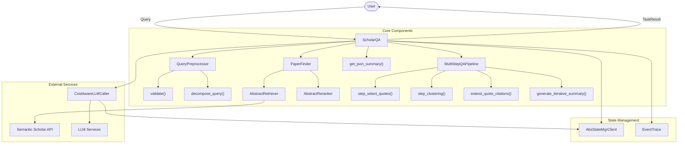
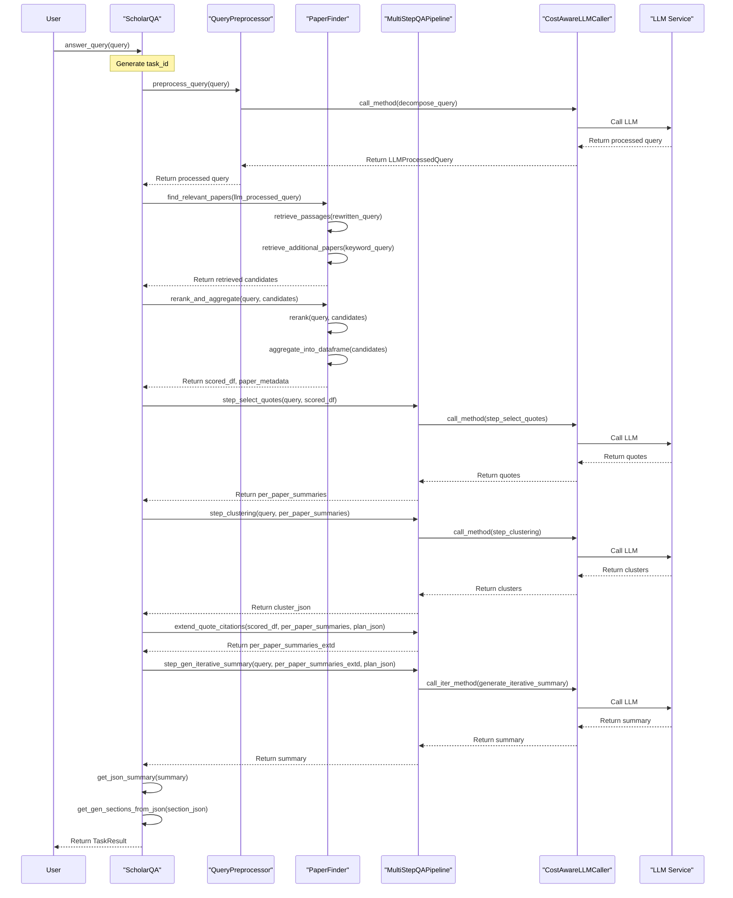
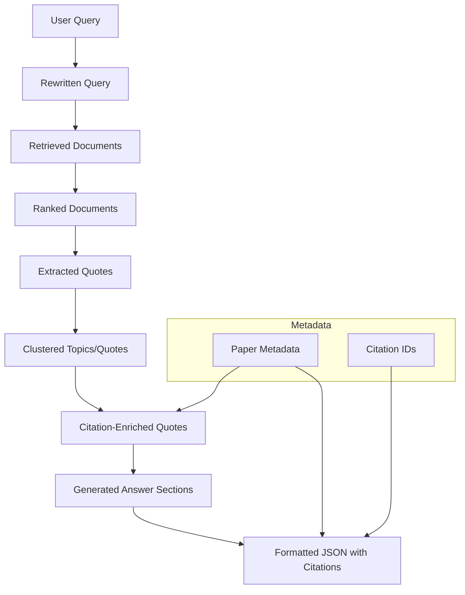
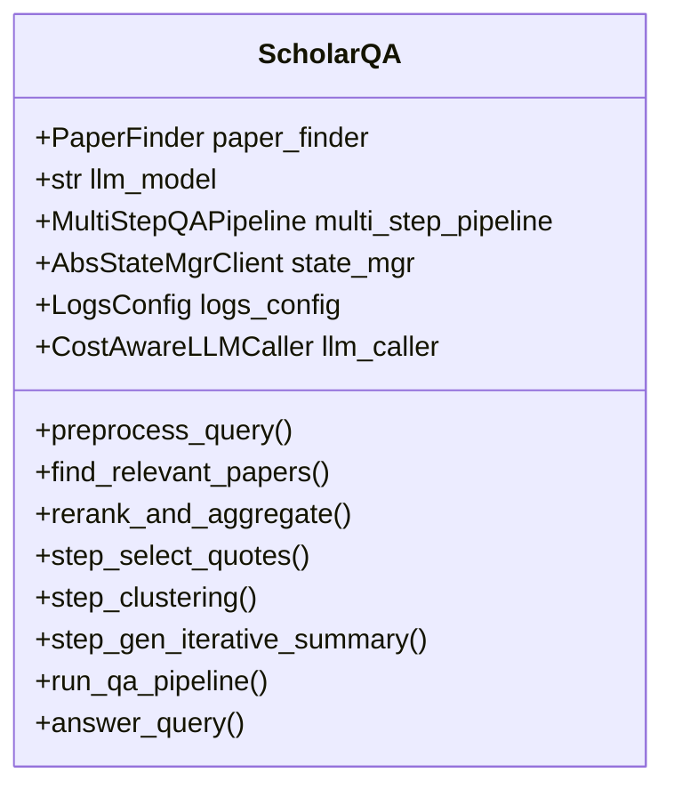
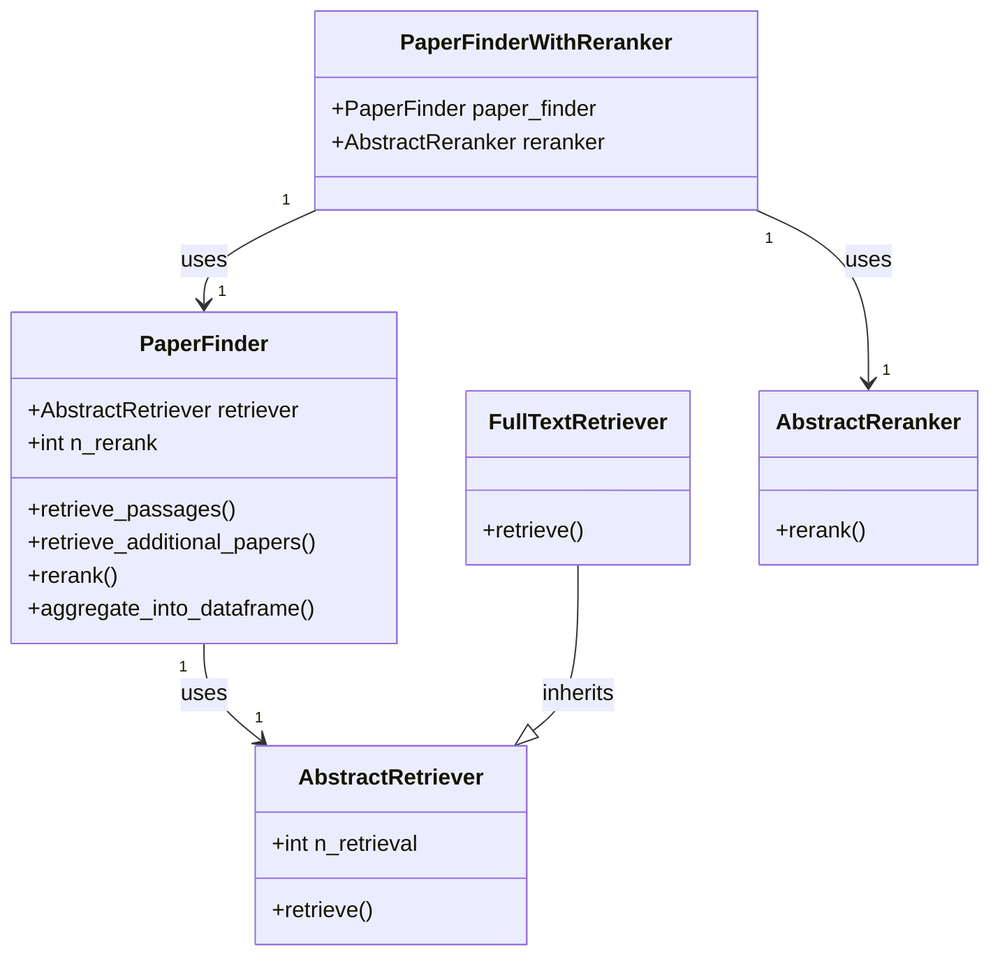
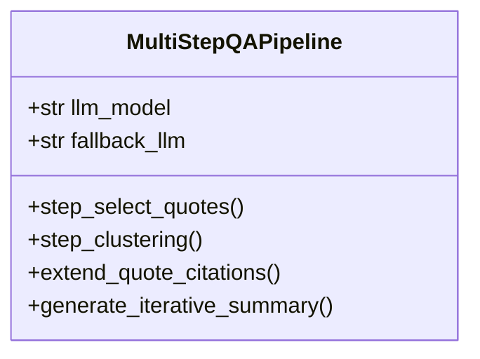
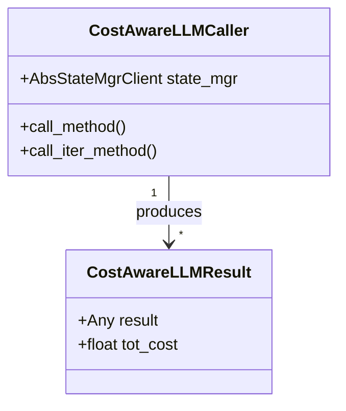

<!-- source: DeepWiki mcp.deepwiki.com · repo allenai/ai2-scholarqa-lib · page 1 Overview · fetched 2026-10-26 -->

# Overview

Relevant source files

The following files were used as context for generating this wiki page:

- [api/pyproject.toml](api/pyproject.toml)
- [api/scholarqa/__init__.py](api/scholarqa/__init__.py)
- [api/scholarqa/scholar_qa.py](api/scholarqa/scholar_qa.py)

ScholarQA is a Retrieval-Augmented Generation (RAG) system designed for answering complex scientific questions by retrieving relevant scientific papers, extracting important information, and generating comprehensive answers with proper citations. This page provides a high-level overview of the system architecture, components, and how they work together.

## Purpose and Scope

ScholarQA is designed to:
- Answer complex scientific questions with comprehensive, factually accurate responses
- Retrieve relevant information from a corpus of 8M+ scientific papers
- Generate structured answers with proper citations to original sources
- Provide both synchronous and asynchronous processing capabilities

This overview covers the high-level architecture of ScholarQA, its main components, and how they interact. For detailed information on installation and configuration, see [Installation & Setup](#2). For in-depth information about specific components, see [Core Components](#3).

## System Architecture

ScholarQA implements a sophisticated multi-step RAG pipeline that goes beyond simple "retrieve-then-generate" approaches, incorporating specialized components for query processing, document retrieval and reranking, quote extraction and clustering, and summary generation.

### High-Level Architecture Diagram

Sources: [api/scholarqa/scholar_qa.py:28-88](), [api/scholarqa/__init__.py:1-8]()

## Processing Pipeline

When a user submits a query, ScholarQA processes it through the following steps:

1. **Query Preprocessing**: Validates the query and decomposes it to extract search filters and create an optimized version for retrieval
2. **Document Retrieval**: Retrieves relevant paper passages from the Semantic Scholar index and API
3. **Document Reranking**: Reranks and aggregates the retrieved documents to focus on the most relevant papers
4. **Quote Extraction**: Extracts salient quotes from the papers that address the query
5. **Quote Clustering**: Clusters the extracted quotes to form a coherent outline for the answer
6. **Citation Addition**: Extends quotes with proper citations to their sources
7. **Summary Generation**: Generates a comprehensive, structured answer based on the clustered quotes
8. **Output Formatting**: Formats the answer with proper citations and returns it as a structured JSON object

### Request Flow Sequence

Sources: [api/scholarqa/scholar_qa.py:225-387]()

### Data Flow Through System

The following diagram illustrates how data is transformed as it flows through the ScholarQA system:

Sources: [api/scholarqa/scholar_qa.py:242-387]()

## Core Components

### ScholarQA Core

The main `ScholarQA` class (defined in [api/scholarqa/scholar_qa.py:28-387]()) orchestrates the entire question-answering process:

The `ScholarQA` class provides both synchronous and asynchronous interfaces for processing queries. The main method `run_qa_pipeline()` coordinates all the steps of the question-answering process, while `answer_query()` provides a simpler interface for library users.

Sources: [api/scholarqa/scholar_qa.py:28-88](), [api/scholarqa/scholar_qa.py:225-241]()

### Document Retrieval and Reranking

The document retrieval and reranking components are implemented by the `PaperFinder` class and related classes:

These classes handle the retrieval of relevant documents from various sources, including the Semantic Scholar API, and reranking them to improve relevance.

Sources: [api/scholarqa/__init__.py:2-4]()

### Multi-Step QA Pipeline

The `MultiStepQAPipeline` class implements the core quote extraction, clustering, and summary generation steps:

This component is responsible for extracting relevant quotes from retrieved documents, clustering them into coherent topics, enriching them with citations, and generating a comprehensive answer.

Sources: [api/scholarqa/scholar_qa.py:56-61](), [api/scholarqa/scholar_qa.py:148-207]()

### LLM Integration

The LLM integration is handled by the `CostAwareLLMCaller` class:

This component provides a consistent interface for calling LLMs, with built-in cost tracking and reporting.

Sources: [api/scholarqa/scholar_qa.py:56](), [api/scholarqa/llms/litellm_helper.py]() (referenced in imports)

## Key Features

ScholarQA offers several distinguishing features:

1. **Multi-Step Processing**: Rather than a simple retrieve-then-generate approach, ScholarQA implements a sophisticated pipeline that extracts relevant quotes, clusters them thematically, enriches them with citations, and then generates a structured answer.

2. **Cost-Aware LLM Integration**: The system carefully tracks costs of LLM calls and implements fallback strategies, providing transparency and control over resource usage.

3. **Flexible Retrieval System**: The `PaperFinder` classes provide abstraction over different retrieval methods, allowing the system to use various sources and retrieval strategies.

4. **Comprehensive Citation Handling**: The system maintains proper academic citation practices throughout, ensuring generated content is properly attributed.

5. **Asynchronous Processing**: The system supports both synchronous and asynchronous processing, making it suitable for handling potentially long-running scholarly queries.

6. **State Management and Tracing**: The system includes robust state management and event tracing capabilities, providing visibility into the processing pipeline and enabling detailed analysis of system behavior.

Sources: [api/scholarqa/scholar_qa.py:28-387](), [api/pyproject.toml:10-66]()

---

