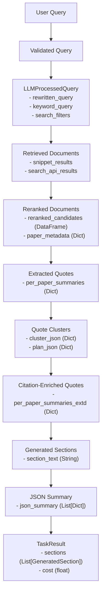
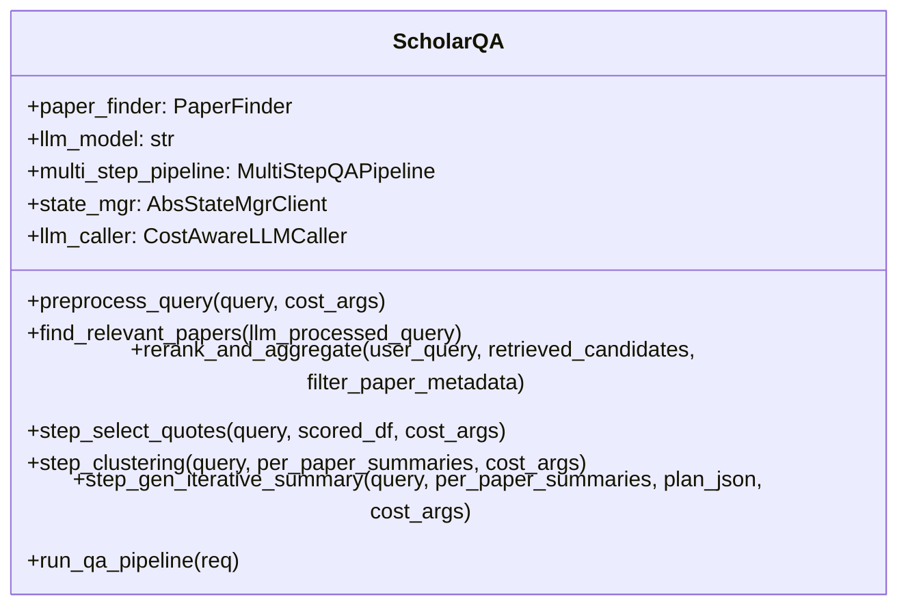
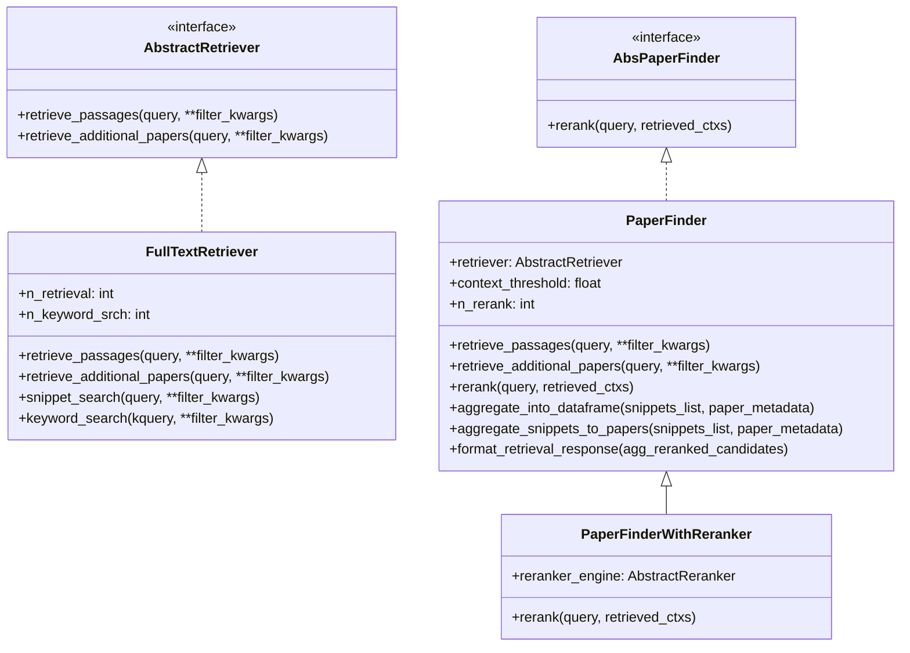
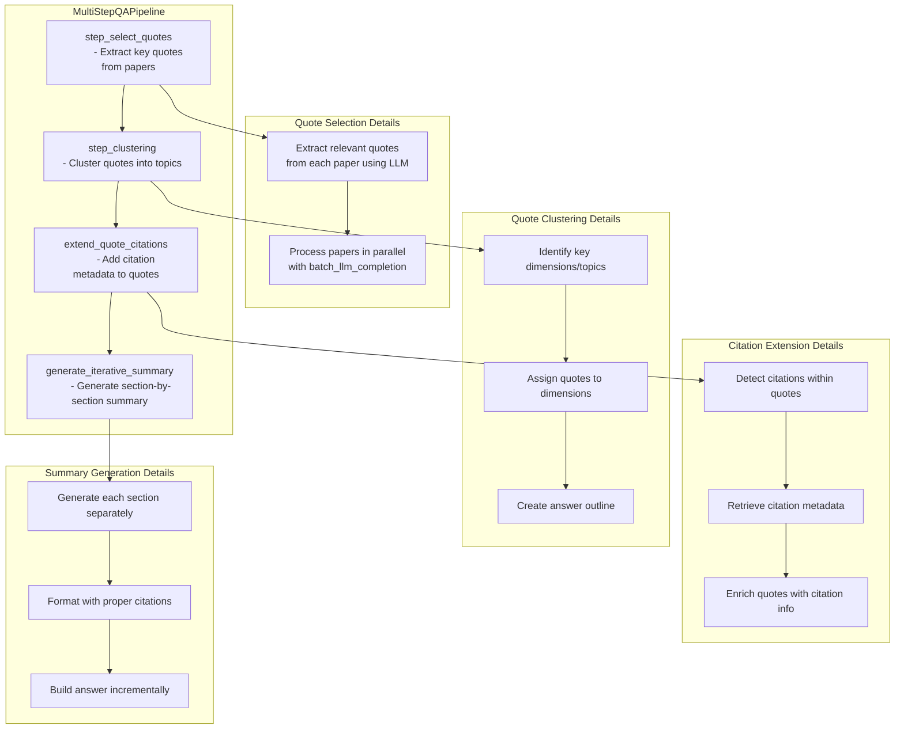
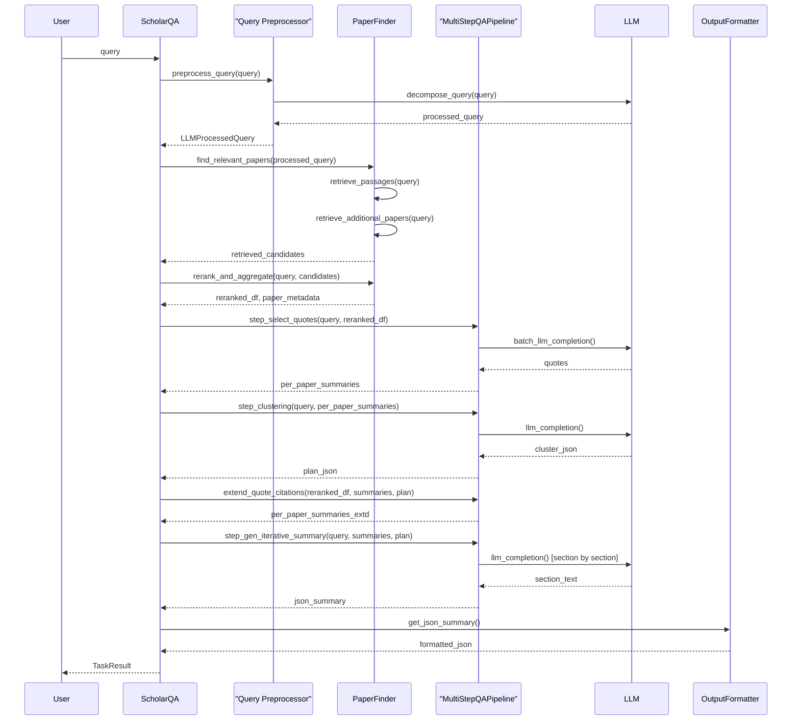

<!-- source: DeepWiki mcp.deepwiki.com · repo allenai/ai2-scholarqa-lib · page 1.1 System Architecture · fetched 2026-10-26 -->

# System Architecture

Relevant source files

The following files were used as context for generating this wiki page:

- [api/scholarqa/rag/multi_step_qa_pipeline.py](api/scholarqa/rag/multi_step_qa_pipeline.py)
- [api/scholarqa/rag/retrieval.py](api/scholarqa/rag/retrieval.py)
- [api/scholarqa/rag/retriever_base.py](api/scholarqa/rag/retriever_base.py)
- [api/scholarqa/scholar_qa.py](api/scholarqa/scholar_qa.py)

This document details the technical architecture of the ScholarQA system - a Retrieval-Augmented Generation (RAG) system designed for answering questions about scientific literature. It covers the core components, their interactions, and the data flow through the system.

For a high-level overview of ScholarQA's purpose and capabilities, see [Overview](#1).

## Core Components

ScholarQA employs a multi-stage RAG architecture with specialized components handling different aspects of the question-answering process.

```mermaid
graph TD
    subgraph "ScholarQA Core Orchestrator"
        ScholarQA["ScholarQA class"]
        StateMgr["AbsStateMgrClient"]
        LLMCaller["CostAwareLLMCaller"]
    end
    
    subgraph "Query Processing"
        QueryPreprocessor["validate/decompose_query"]
    end
    
    subgraph "Document Retrieval"
        PaperFinder["PaperFinder class"]
        PaperFinderReranker["PaperFinderWithReranker class"]
        AbstractRetriever["AbstractRetriever interface"]
        FullTextRetriever["FullTextRetriever class"]
        Reranker["AbstractReranker interface"]
    end
    
    subgraph "Multi-Step QA Pipeline"
        MultiStepQA["MultiStepQAPipeline class"]
        QuoteExtractor["step_select_quotes method"]
        QuoteClustering["step_clustering method"]
        CitationExtension["extend_quote_citations method"]
        SummaryGen["generate_iterative_summary method"]
    end
    
    subgraph "Output Processing"
        JSONFormatter["get_json_summary function"]
    end
    
    ScholarQA --> QueryPreprocessor
    ScholarQA --> PaperFinder
    ScholarQA --> MultiStepQA
    ScholarQA --> JSONFormatter
    ScholarQA --> StateMgr
    ScholarQA --> LLMCaller
    
    PaperFinder --> AbstractRetriever
    PaperFinderReranker --> PaperFinder
    PaperFinderReranker --> Reranker
    FullTextRetriever --> AbstractRetriever
    
    MultiStepQA --> QuoteExtractor
    MultiStepQA --> QuoteClustering
    MultiStepQA --> CitationExtension
    MultiStepQA --> SummaryGen
    
    LLMCaller --> QueryPreprocessor
    LLMCaller --> QuoteExtractor
    LLMCaller --> QuoteClustering
    LLMCaller --> SummaryGen
```

Sources:
- [scholarqa/scholar_qa.py:28-388]()
- [scholarqa/rag/retrieval.py:15-176]()
- [scholarqa/rag/multi_step_qa_pipeline.py:51-272]()
- [scholarqa/rag/retriever_base.py:10-111]()

## Data Flow

The following diagram shows the end-to-end data flow through the ScholarQA system:

Sources:
- [scholarqa/scholar_qa.py:83-387]()

## ScholarQA Class

The `ScholarQA` class acts as the central orchestrator, coordinating all components and managing the entire pipeline execution.

Key responsibilities:
- Initializing and coordinating all system components
- Managing task state for tracking progress of asynchronous processing
- Orchestrating the entire RAG pipeline through a series of discrete steps
- Handling errors and applying fallback strategies

Sources:
- [scholarqa/scholar_qa.py:28-62]()
- [scholarqa/scholar_qa.py:241-387]()

## Document Retrieval System

The document retrieval system finds relevant scientific papers and passages based on the user's query. It provides a layered architecture that allows different retrieval strategies.

Key components:
- `AbstractRetriever`: Interface defining the retrieval API
- `FullTextRetriever`: Implementation that queries Semantic Scholar API
- `PaperFinder`: Manages retrieval process and basic reranking
- `PaperFinderWithReranker`: Extends PaperFinder with advanced reranking capabilities

Primary operations:
1. `retrieve_passages`: Gets relevant paper passages from Semantic Scholar
2. `retrieve_additional_papers`: Finds additional papers using keyword search
3. `rerank`: Reorders retrieved passages by relevance
4. `aggregate_into_dataframe`: Transforms individual passages into paper-level records

Sources:
- [scholarqa/rag/retriever_base.py:10-111]()
- [scholarqa/rag/retrieval.py:15-176]()

## Multi-Step QA Pipeline

The Multi-Step QA Pipeline processes retrieved documents through several stages to generate a comprehensive answer with proper citations.

Key methods:
- `step_select_quotes`: Extracts relevant quotes from each paper using an LLM
- `step_clustering`: Organizes quotes into meaningful dimensions/topics
- `extend_quote_citations`: Enhances quotes with proper citation information
- `generate_iterative_summary`: Creates a structured, section-by-section answer

The pipeline handles:
1. Quote extraction from multiple papers in parallel
2. Semantic clustering of quotes to create a coherent structure
3. Citation resolution and linking
4. Incremental answer generation following the created outline

Sources:
- [scholarqa/rag/multi_step_qa_pipeline.py:51-272]()

## End-to-End Processing Sequence

The following sequence diagram shows the complete processing flow through ScholarQA:

Sources:
- [scholarqa/scholar_qa.py:241-387]()

## Configurability

ScholarQA is designed for flexibility through dependency injection. The system can be customized by configuring these key components:

| Component | Description | Default | Configuration |
|-----------|-------------|---------|--------------|
| `paper_finder` | Document retrieval component | Required parameter | Constructor parameter |
| `llm_model` | LLM model to use | CLAUDE_37_SONNET | Constructor parameter |
| `multi_step_pipeline` | QA pipeline implementation | New instance created | Constructor parameter |
| `state_mgr` | State management client | LocalStateMgrClient | Constructor parameter |
| `fallback_llm` | Fallback LLM model | GPT_4o | Constructor parameter |
| `validate` | Whether to validate queries | True if OPENAI_API_KEY in env | Constructor parameter |

Sources:
- [scholarqa/scholar_qa.py:28-61]()

## External Integrations

ScholarQA integrates with several external systems:

1. **Semantic Scholar API**: For paper metadata and full text retrieval
   - Used by `FullTextRetriever` through `snippet_search` and `keyword_search` methods
   - Provides paper content, metadata, and citation information

2. **LLM Services**: For various natural language processing tasks
   - Query decomposition and validation
   - Quote extraction and selection
   - Topic clustering and organization
   - Answer generation with proper citations
   - Integrated via `CostAwareLLMCaller` which handles model selection, fallbacks, and cost tracking

3. **State Management**: For task tracking and asynchronous processing
   - Default implementation is `LocalStateMgrClient`
   - Updates task state during processing for client progress monitoring
   - Maintains cost information across LLM calls

Sources:
- [scholarqa/rag/retriever_base.py:35-111]()
- [scholarqa/scholar_qa.py:56-57]()
- [scholarqa/scholar_qa.py:65-81]()

## Summary

The ScholarQA architecture implements a sophisticated RAG system specifically designed for answering scientific questions. Its multi-step pipeline approach provides several advantages over simpler retrieve-and-generate systems:

1. Focused retrieval with query decomposition and reranking
2. Explicit extraction of key quotes from papers
3. Structured answer organization based on content clustering
4. Proper academic citation handling
5. Cost-aware LLM integration with fallback mechanisms

This architecture enables ScholarQA to generate comprehensive, well-organized answers to scholarly questions with appropriate citations to scientific literature.

Sources:
- [scholarqa/scholar_qa.py:28-388]()
- [scholarqa/rag/multi_step_qa_pipeline.py:51-272]()

---

