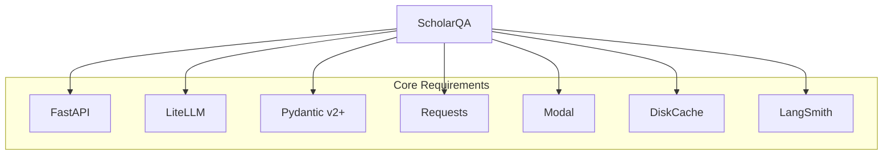
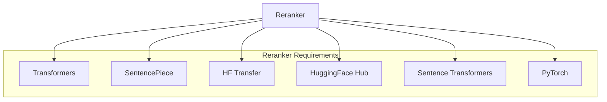
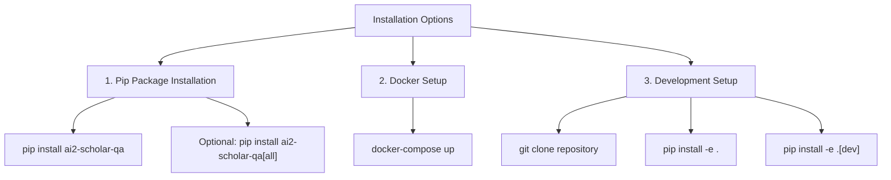
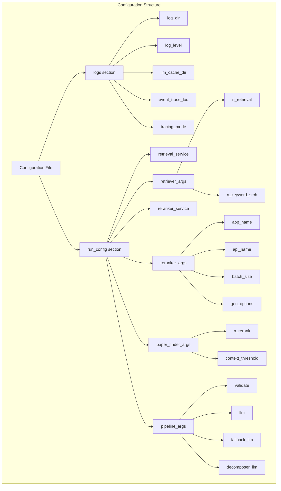
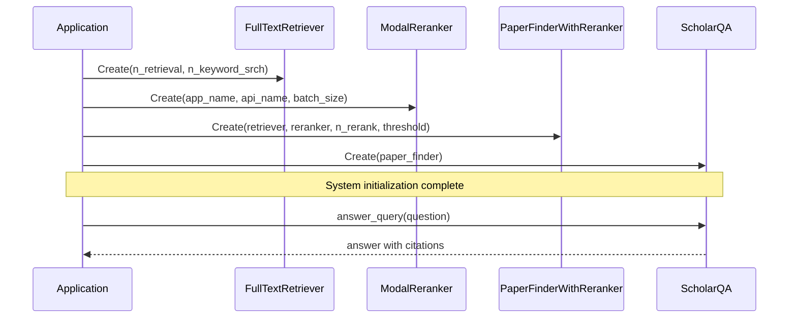

<!-- source: DeepWiki mcp.deepwiki.com · repo allenai/ai2-scholarqa-lib · page 2 Installation & Setup · fetched 2026-10-26 -->

# Installation & Setup

<details>
<summary>Relevant source files</summary>

The following files were used as context for generating this wiki page:

- [api/lib_example.py](api/lib_example.py)
- [api/pyproject.toml](api/pyproject.toml)
- [api/requirements.txt](api/requirements.txt)
- [api/reranker_requirements.txt](api/reranker_requirements.txt)
- [api/run_configs/default.json](api/run_configs/default.json)
- [docker-compose.yaml](docker-compose.yaml)

</details>


This document provides detailed instructions for installing and configuring the AI2 ScholarQA system. It covers installation methods, required dependencies, configuration options, and basic setup. For information about the overall system architecture, see [System Architecture](#1.1). For API usage and integration details, see [API & Integration](#4).

## Requirements

ScholarQA requires Python 3.11.3 or higher. The system has two tiers of dependencies:
- Core dependencies (required for basic functionality)
- Extended dependencies (required for full functionality including reranking)

### Core Dependencies

The core system relies on the following key dependencies:



Sources: [api/pyproject.toml:19-45](), [api/requirements.txt:1-29]()

### Reranker Dependencies

If you plan to use the local reranker functionality, additional dependencies are required:



Sources: [api/reranker_requirements.txt:1-5](), [api/pyproject.toml:53-64]()

## Installation Methods

ScholarQA can be installed and run using three different methods:



### Python Package Installation

Install the package using pip:

```
pip install ai2-scholar-qa
```

For full functionality including the reranker:

```
pip install ai2-scholar-qa[all]
```

Sources: [api/pyproject.toml:10-69]()

### Docker Setup

The repository includes a Docker Compose configuration that sets up:
1. The ScholarQA API service
2. A web UI for interacting with the API
3. A reverse proxy for handling communication between components
4. A logging component (Sonar)

To use the Docker setup:

1. Clone the repository
2. Create a `.env` file with required environment variables (see Configuration section)
3. Run Docker Compose:

```
docker-compose up
```

This will start all services, with the API accessible on port 8000 and the UI on port 4000.

Sources: [docker-compose.yaml:1-45]()

### Development Setup

For development work on ScholarQA:

1. Clone the repository
2. Install the package in development mode:
   ```
   pip install -e .
   ```
3. Install development dependencies:
   ```
   pip install -e .[dev]
   ```
4. Install reranker dependencies if needed:
   ```
   pip install -r api/reranker_requirements.txt
   ```

Sources: [api/pyproject.toml:47-64]()

## Configuration

ScholarQA uses JSON configuration files to control its behavior. The default configuration is located at `run_configs/default.json`.

### Configuration File Structure



Sources: [api/run_configs/default.json:1-33]()

### Setting Up Configuration

You can specify the configuration file using the `CONFIG_PATH` environment variable:

```
export CONFIG_PATH=path/to/your/config.json
```

When using Docker, this is set in the `docker-compose.yaml` file:

Sources: [docker-compose.yaml:17-19]()

### Critical Configuration Parameters

#### LLM Configuration
- `pipeline_args.llm`: Primary LLM to use (default: "anthropic/claude-3-7-sonnet-20250219")
- `pipeline_args.fallback_llm`: Fallback LLM if primary fails (default: "openai/gpt-4o")
- `pipeline_args.decomposer_llm`: LLM for query decomposition (default: same as primary)

#### Retrieval Configuration
- `retrieval_service`: Which retrieval service to use (default: "public_api")
- `retriever_args.n_retrieval`: Number of documents to retrieve (default: 256)
- `retriever_args.n_keyword_srch`: Number of keyword search results (default: 20)

#### Reranker Configuration
- `reranker_service`: Reranker service to use (default: "modal")
- `reranker_args.app_name`: Modal app name (requires Modal setup)
- `reranker_args.api_name`: Modal API name
- `paper_finder_args.n_rerank`: Number of documents to rerank (default: 50)
- `paper_finder_args.context_threshold`: Similarity threshold for context relevance (default: 0.5)

Sources: [api/run_configs/default.json:9-32]()

## Environment Variables

ScholarQA requires several environment variables to be set:

1. **API Keys for LLMs**: Depending on your configuration, you need API keys for OpenAI, Anthropic, or other LLM providers
2. **Semantic Scholar API Key**: For accessing the paper retrieval service
3. **Configuration Path**: `CONFIG_PATH` to specify your configuration file location

When using Docker, these should be placed in a `.env` file in the root directory.

Sources: [docker-compose.yaml:22-23]()

## Basic Usage

Here's a simple example of using ScholarQA as a library:

```python
from scholarqa.rag.reranker.modal_engine import ModalReranker
from scholarqa.rag.retrieval import PaperFinderWithReranker
from scholarqa.rag.retriever_base import FullTextRetriever
from scholarqa import ScholarQA

# Initialize components
retriever = FullTextRetriever(n_retrieval=256, n_keyword_srch=20)
reranker = ModalReranker(app_name="modal_app_name", api_name="modal_api_name", batch_size=256, gen_options=dict())
paper_finder = PaperFinderWithReranker(retriever, reranker, n_rerank=50, context_threshold=0.5)

# Create ScholarQA instance
scholar_qa = ScholarQA(paper_finder=paper_finder)

# Query the system
result = scholar_qa.answer_query("Which is the 9th planet in our solar system?")
print(result)
```

Sources: [api/lib_example.py:1-11]()

## Component Initialization Flow

The following diagram shows how components are initialized and connected:



Sources: [api/lib_example.py:1-11]()

## Running the API Service

To run the ScholarQA API service directly:

1. Install the package and dependencies
2. Set required environment variables
3. Run using uvicorn:

```
uvicorn scholarqa.api:app --host 0.0.0.0 --port 8000
```

When using Docker, the API service is automatically started based on the configuration in `docker-compose.yaml`.

Sources: [docker-compose.yaml:9-23]()

## Troubleshooting

### Common Installation Issues

1. **Missing Dependencies**: If you encounter import errors, ensure you've installed the package with the correct optional dependencies using `pip install ai2-scholar-qa[all]`

2. **Modal Setup Issues**: For reranking with Modal, ensure you've configured Modal correctly and set the appropriate app and API names in your configuration

3. **API Keys**: Most failures are due to missing or invalid API keys. Check your environment variables and ensure all required API keys are properly set

4. **Configuration Path**: If the system can't find your configuration, check that `CONFIG_PATH` is correctly set and points to a valid JSON file

Sources: [api/run_configs/default.json:1-33](), [docker-compose.yaml:17-19]()

## Next Steps

After installation, refer to [API & Integration](#4) for information on using the ScholarQA API, and [Configuration Options](#4.1) for a complete reference of all configuration parameters.

---

