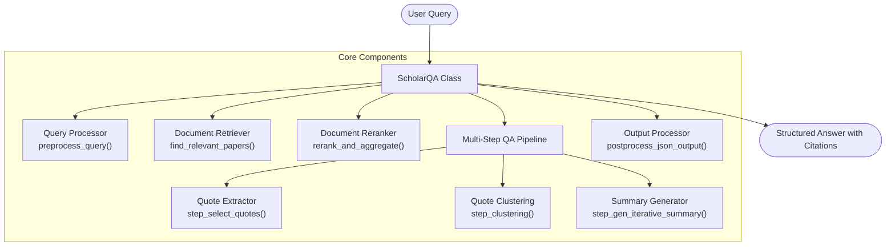
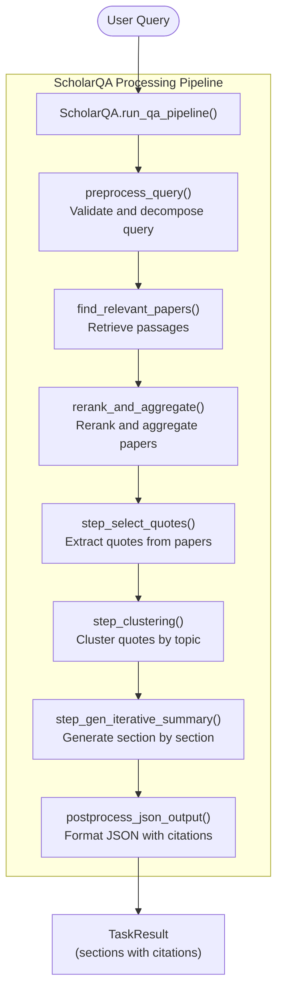
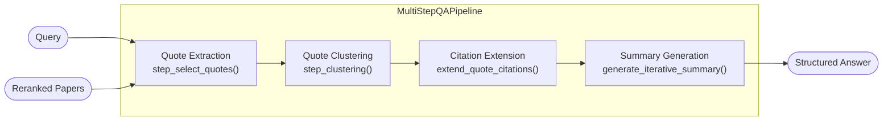
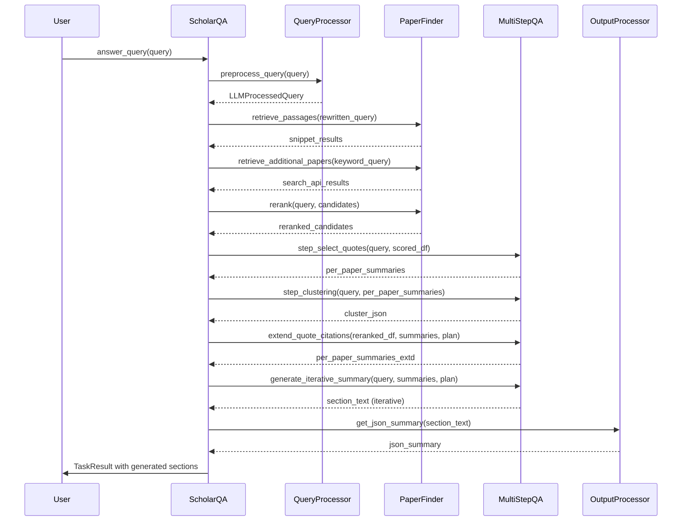

<!-- source: DeepWiki mcp.deepwiki.com · repo allenai/ai2-scholarqa-lib · page 3 Core Components · fetched 2026-10-26 -->

# Core Components

Relevant source files

The following files were used as context for generating this wiki page:

- [api/scholarqa/__init__.py](api/scholarqa/__init__.py)
- [api/scholarqa/config/config_setup.py](api/scholarqa/config/config_setup.py)
- [api/scholarqa/scholar_qa.py](api/scholarqa/scholar_qa.py)

This document provides an overview of the main components that make up the ScholarQA system, describing their functions and interactions. For information about installation and setup, see [Installation & Setup](#2). For API integration details, see [API & Integration](#4).

## Overview

ScholarQA's core components work together to process scientific questions, retrieve relevant papers, extract and organize information, and generate comprehensive answers with proper citations. The system is built around a multi-stage Retrieval-Augmented Generation (RAG) pipeline designed specifically for scientific literature.

Sources: [scholarqa/scholar_qa.py:28-388]()

## ScholarQA Core Class

The `ScholarQA` class serves as the central orchestrator that initializes and coordinates all components in the pipeline. It maintains the state of the question-answering process and handles the overall task execution.

### Key Attributes

| Attribute | Type | Description |
|-----------|------|-------------|
| `paper_finder` | `PaperFinder` | Handles document retrieval and reranking |
| `multi_step_pipeline` | `MultiStepQAPipeline` | Implements the multi-step generation process |
| `llm_caller` | `CostAwareLLMCaller` | Manages LLM integration with cost tracking |
| `state_mgr` | `AbsStateMgrClient` | Manages task state for asynchronous operations |

Sources: [scholarqa/scholar_qa.py:28-62]()

### Processing Flow

Sources: [scholarqa/scholar_qa.py:241-387]()

## Query Processor

The Query Processor handles the initial processing of user questions through two main functions:

1. **Validation**: Checks if the query is valid and answerable
2. **Decomposition**: Breaks down the query to extract search filters and reformulates it for optimal retrieval

### Implementation Details

- Implemented in the `preprocess_query()` method in `ScholarQA`
- Returns a `LLMProcessedQuery` object containing:
  - `rewritten_query`: A reformulated version of the query optimized for retrieval
  - `keyword_query`: A query suitable for keyword search
  - `search_filters`: Extracted filters like year, venue, field of study, etc.

Sources: [scholarqa/scholar_qa.py:83-93]()

## Document Retrieval System

The Document Retriever finds relevant scientific papers based on the processed query. It uses the `PaperFinder` class to retrieve content from two sources:

1. **Passage Retrieval**: Retrieves passages matching the rewritten query from the Semantic Scholar index
2. **Paper Retrieval**: Uses keyword search to find additional papers via the Semantic Scholar API

### Implementation Details

- Implemented in the `find_relevant_papers()` method in `ScholarQA`
- Uses the `PaperFinder` class to perform retrieval operations
- Returns a tuple of snippet results and search API results

Sources: [scholarqa/scholar_qa.py:96-125](), [scholarqa/__init__.py:2-3]()

## Document Reranker

The Document Reranker takes the retrieved papers and reranks them based on their relevance to the query. It also aggregates passages at the paper level to prepare them for the QA pipeline.

### Implementation Details

- Implemented in the `rerank_and_aggregate()` method in `ScholarQA`
- Uses the `rerank()` method of the `PaperFinder` instance
- Returns a pandas DataFrame of reranked papers and a dictionary of paper metadata

Sources: [scholarqa/scholar_qa.py:128-146](), [scholarqa/__init__.py:4]()

## Multi-Step QA Pipeline

The Multi-Step QA Pipeline is the core of the answer generation process. It consists of three main steps:

### 1. Quote Extraction

- Implemented in the `step_select_quotes()` method
- Extracts relevant quotes from each paper that address the query
- Uses an LLM to intelligently select the most relevant parts of papers

Sources: [scholarqa/scholar_qa.py:149-170]()

### 2. Quote Clustering

- Implemented in the `step_clustering()` method
- Groups the extracted quotes into coherent topics to form an outline
- Creates a structured plan for the answer with dimensions and formats

Sources: [scholarqa/scholar_qa.py:172-184]()

### 3. Summary Generation

- Implemented in the `step_gen_iterative_summary()` method
- Generates a comprehensive answer by summarizing the quotes section by section
- Includes inline citations to source papers

Sources: [scholarqa/scholar_qa.py:186-207]()

## Output Processing

The Output Processor formats the generated answer into a structured JSON format with proper citations. It ensures that each statement in the answer is properly attributed to the source papers.

### Implementation Details

- Uses the `get_json_summary()` function from `scholarqa.postprocess.json_output_utils`
- Translates the generated sections into `GeneratedSection` objects
- Creates a final `TaskResult` with sections, citations, and cost information

Sources: [scholarqa/scholar_qa.py:209-224](), [scholarqa/scholar_qa.py:358-387]()

## Configuration System

ScholarQA uses a configuration system to manage various settings across components. The main configuration classes are:

1. **LogsConfig**: Manages logging settings, event traces, and LLM caching
2. **RunConfig**: Configures retrieval, reranking, and pipeline services
3. **AppConfig**: Top-level configuration that includes logs and run configurations

Sources: [scholarqa/config/config_setup.py:13-70]()

## Component Interactions

The following diagram illustrates how the ScholarQA components interact during the question-answering process:

Sources: [scholarqa/scholar_qa.py:241-387]()

## Summary

The ScholarQA core components form a sophisticated RAG pipeline specifically designed for scientific literature. The system leverages multiple stages of processing to ensure high-quality answers with proper citations:

1. The **Query Processor** prepares the user query for retrieval
2. The **Document Retrieval System** finds relevant papers and passages
3. The **Document Reranker** improves relevance by reranking results
4. The **Multi-Step QA Pipeline** extracts quotes, clusters them, and generates a comprehensive answer
5. The **Output Processor** formats the answer with proper citations

These components work together seamlessly to provide accurate, comprehensive answers to scientific questions with proper attribution to the source literature.

---

